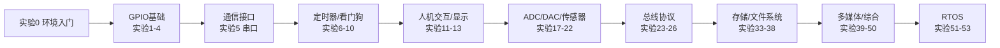

# 正点原子 STM32F103 标准实验教程

> 基于 **正点原子 STM32F103** 开发板（战舰 / 精英 / mini）· **HAL 库** · **Keil MDK** 的全套实验教程。
> 每个实验目录都配有一份标准化 `readme.md`，含 **生活类比、硬件连接图、寄存器说明、软件架构图、核心代码讲解、实验效果**，帮助初学者快速上手、高效学习。

---

## 📖 关于本仓库

本仓库收录了正点原子 STM32F103 系列 **实验0 ~ 实验53**，共 54 个实验，覆盖从 GPIO 点灯到 UCOS-II 实时操作系统的完整学习路径。所有实验统一采用 HAL 库和 `Drivers/BSP` 分层驱动结构，代码规范一致，非常适合系统性入门与进阶。

每个实验的 `readme.md` 都遵循同一套九段式模板：

| 章节 | 内容 |
|------|------|
| 一、实验简介 | 一句话概述 + 🏠 生活类比，用日常例子讲清原理 |
| 二、实验目的 | 本实验要掌握的知识点 |
| 三、硬件资源与连接图 | 引脚分配表 + Mermaid 硬件连接图 |
| 四、核心寄存器 | 涉及的外设寄存器 / 内核对象说明 |
| 五、软件架构 / 流程 | Mermaid 程序执行流程图 |
| 六、主要示例代码及讲解 | 从真实源码摘录的核心代码 + 逐段讲解 |
| 七、实验效果 | 烧录后的实际现象 |
| 八、注意事项 | 常见坑与调试提示 |
| 九、文件结构 | 目录树 + 各文件作用 |

---

## 🚀 快速开始

1. 安装 **Keil MDK-ARM**（建议 v5 及以上）并安装 STM32F1 器件包。
2. 进入任意实验目录的 `Projects/MDK-ARM/`，双击 `.uvprojx` 打开工程。
3. 编译（F7）后，用 ST-Link / J-Link 下载（F8）到开发板。
4. 若烧录或编译报"文件被占用"，先运行仓库根目录的 [`keilkill.bat`](<keilkill.bat>) 结束残留的 Keil 进程。

> 📌 **新手请先做实验0**（环境安装与烧录入门），再按编号顺序学习。

---

## 🗺️ 推荐学习路径

---

## 📚 分类实验索引

### 🟢 入门与 GPIO 基础
| 编号 | 实验 | 核心知识 |
|------|------|----------|
| 0 | [基础入门实验](<实验0 基础入门实验/readme.md>) | Keil 安装、工程打开与烧录流程 |
| 1 | [跑马灯实验](<实验1 跑马灯实验/readme.md>) | GPIO 推挽输出 |
| 2 | [蜂鸣器实验](<实验2 蜂鸣器实验/readme.md>) | GPIO 输出驱动 |
| 3 | [按键输入实验](<实验3 按键输入实验/readme.md>) | GPIO 输入读取与消抖 |
| 4 | [外部中断实验](<实验4 外部中断实验/readme.md>) | EXTI / NVIC 中断 |

### ⏱️ 定时器与看门狗
| 编号 | 实验 | 核心知识 |
|------|------|----------|
| 6 | [独立看门狗实验](<实验6 独立看门狗实验/readme.md>) | IWDG |
| 7 | [窗口看门狗实验](<实验7 窗口看门狗实验/readme.md>) | WWDG |
| 8 | [基本定时器实验](<实验8 基本定时器实验/readme.md>) | TIM 定时中断 |
| 9 | [通用定时器实验](<实验9 通用定时器实验/readme.md>) | 输入捕获 / 输出比较 |
| 10 | [高级定时器实验](<实验10 高级定时器实验/readme.md>) | PWM / 死区 / 互补输出 |

### 📡 通信接口与总线
| 编号 | 实验 | 核心知识 |
|------|------|----------|
| 5 | [串口实验](<实验5 串口实验/readme.md>) | USART 收发 / 中断 / printf |
| 23 | [IIC 实验](<实验23 IIC实验/readme.md>) | I2C（软件模拟）读写 |
| 24 | [SPI 实验](<实验24 SPI实验/readme.md>) | SPI 读写 |
| 25 | [485 实验](<实验25 485实验/readme.md>) | RS485 半双工通信 |
| 26 | [CAN 通信实验](<实验26 CAN通信实验/readme.md>) | bxCAN 收发 |
| 32 | [无线通信实验](<实验32 无线通信实验/readme.md>) | NRF24L01 无线收发 |
| 47 | [串口 IAP 实验](<实验47 串口IAP实验/readme.md>) | 串口在线升级 / Flash 编程 |
| 48 | [USB 读卡器实验](<实验48 USB读卡器实验/readme.md>) | USB MSC 设备 |
| 49 | [USB 虚拟串口实验](<实验49 USB虚拟串口实验/readme.md>) | USB CDC 设备 |
| 50 | [网络通信实验](<实验50 网络通信实验/readme.md>) | 以太网 TCP/UDP（本目录无源码，见文末说明） |

### 🖥️ 人机交互与显示
| 编号 | 实验 | 核心知识 |
|------|------|----------|
| 11 | [电容触摸按键实验](<实验11 电容触摸按键实验/readme.md>) | TSC 电容触摸 |
| 12 | [OLED 实验](<实验12 OLED实验/readme.md>) | SSD1306 显示 |
| 13 | [TFTLCD（MCU屏）实验](<实验13 TFTLCD（MCU屏）实验/readme.md>) | FSMC / LCD 驱动 |
| 27 | [触摸屏实验](<实验27 触摸屏实验/readme.md>) | 电阻/电容触摸 + 校准 |
| 28 | [红外遥控实验](<实验28 红外遥控实验/readme.md>) | NEC 协议解码 |
| 29 | [游戏手柄实验](<实验29 游戏手柄实验/readme.md>) | FC 手柄（GPIO 移位读取） |
| 39 | [汉字显示实验](<实验39 汉字显示实验/readme.md>) | 字库与汉字显示 |
| 40 | [图片显示实验](<实验40 图片显示实验/readme.md>) | 图片数组显示 |
| 45 | [手写识别实验](<实验45 手写识别实验/readme.md>) | 手写轨迹识别 |
| 46 | [T9 拼音输入法实验](<实验46 T9拼音输入法实验/readme.md>) | 拼音输入法 |

### 🔌 ADC / DAC 与传感器
| 编号 | 实验 | 核心知识 |
|------|------|----------|
| 17 | [DMA 实验](<实验17 DMA实验/readme.md>) | DMA 数据搬运 |
| 18 | [ADC 实验](<实验18 ADC实验/readme.md>) | ADC 采样 |
| 19 | [内部温度传感器实验](<实验19 内部温度传感器实验/readme.md>) | 片内温度采集 |
| 20 | [光敏传感器实验](<实验20 光敏传感器实验/readme.md>) | 光照采集 |
| 21 | [DAC 实验](<实验21 DAC实验/readme.md>) | DAC 数模转换 |
| 22 | [PWM DAC 实验](<实验22 PWM DAC实验/readme.md>) | PWM + RC 滤波 |
| 30 | [DS18B20 数字温度传感器实验](<实验30 DS18B20数字温度传感器实验/readme.md>) | 单总线温度采集 |
| 31 | [DHT11 数字温湿度传感器实验](<实验31 DHT11数字温湿度传感器实验/readme.md>) | 单总线温湿度 |

### 🕐 时钟与功耗
| 编号 | 实验 | 核心知识 |
|------|------|----------|
| 15 | [RTC 实验](<实验15 RTC实验/readme.md>) | 实时时钟 |
| 16 | [低功耗实验](<实验16 低功耗实验/readme.md>) | Sleep / Stop / Standby |

### 💾 存储与文件系统
| 编号 | 实验 | 核心知识 |
|------|------|----------|
| 33 | [FLASH 模拟 EEPROM 实验](<实验33 FLASH模拟EEPROM实验/readme.md>) | 片内 Flash 读写 |
| 35 | [外部 SRAM 实验](<实验35 外部SRAM实验/readme.md>) | FSMC 外扩内存 |
| 36 | [内存管理实验](<实验36 内存管理实验/readme.md>) | 堆管理算法 |
| 37 | [SD 卡实验](<实验37 SD卡实验/readme.md>) | SDIO 读写 |
| 38 | [FATFS 实验](<实验38 FATFS实验/readme.md>) | FatFs 文件系统 |

### 🎬 多媒体与综合应用
| 编号 | 实验 | 核心知识 |
|------|------|----------|
| 34 | [摄像头实验](<实验34 摄像头实验/readme.md>) | OV7725 图像采集（SCCB+AL422B FIFO） |
| 41 | [照相机实验](<实验41 照相机实验/readme.md>) | OV7725 拍照存图 |
| 42 | [音乐播放器实验](<实验42 音乐播放器实验/readme.md>) | VS1053 音频解码播放 |
| 43 | [录音机实验](<实验43 录音机实验/readme.md>) | 音频采集录制 |

### 🛠️ 调试与算法
| 编号 | 实验 | 核心知识 |
|------|------|----------|
| 14 | [USMART 调试实验](<实验14 USMART调试实验/readme.md>) | 串口在线调参组件 |
| 44 | [DSP 测试实验](<实验44 DSP测试实验/readme.md>) | CMSIS-DSP 运算 |

### 🧩 UCOS-II 实时操作系统
| 编号 | 实验 | 核心知识 |
|------|------|----------|
| 51 | [UCOSII 实验1-任务调度](<实验51 UCOSII实验1-任务调度/readme.md>) | 任务创建与调度 |
| 52 | [UCOSII 实验2-信号量和邮箱](<实验52 UCOSII实验2-信号量和邮箱/readme.md>) | 信号量 / 邮箱通信 |
| 53 | [UCOSII 实验3-消息队列、信号量集和软件定时器](<实验53 UCOSII实验3-消息队列、信号量集和软件定时器/readme.md>) | 消息队列 / 信号量集 / 软件定时器 |

---

## 📁 完整实验列表（按编号）

| # | 实验 | # | 实验 |
|---|------|---|------|
| 0 | [基础入门实验](<实验0 基础入门实验/readme.md>) | 27 | [触摸屏实验](<实验27 触摸屏实验/readme.md>) |
| 1 | [跑马灯实验](<实验1 跑马灯实验/readme.md>) | 28 | [红外遥控实验](<实验28 红外遥控实验/readme.md>) |
| 2 | [蜂鸣器实验](<实验2 蜂鸣器实验/readme.md>) | 29 | [游戏手柄实验](<实验29 游戏手柄实验/readme.md>) |
| 3 | [按键输入实验](<实验3 按键输入实验/readme.md>) | 30 | [DS18B20数字温度传感器实验](<实验30 DS18B20数字温度传感器实验/readme.md>) |
| 4 | [外部中断实验](<实验4 外部中断实验/readme.md>) | 31 | [DHT11数字温湿度传感器实验](<实验31 DHT11数字温湿度传感器实验/readme.md>) |
| 5 | [串口实验](<实验5 串口实验/readme.md>) | 32 | [无线通信实验](<实验32 无线通信实验/readme.md>) |
| 6 | [独立看门狗实验](<实验6 独立看门狗实验/readme.md>) | 33 | [FLASH模拟EEPROM实验](<实验33 FLASH模拟EEPROM实验/readme.md>) |
| 7 | [窗口看门狗实验](<实验7 窗口看门狗实验/readme.md>) | 34 | [摄像头实验](<实验34 摄像头实验/readme.md>) |
| 8 | [基本定时器实验](<实验8 基本定时器实验/readme.md>) | 35 | [外部SRAM实验](<实验35 外部SRAM实验/readme.md>) |
| 9 | [通用定时器实验](<实验9 通用定时器实验/readme.md>) | 36 | [内存管理实验](<实验36 内存管理实验/readme.md>) |
| 10 | [高级定时器实验](<实验10 高级定时器实验/readme.md>) | 37 | [SD卡实验](<实验37 SD卡实验/readme.md>) |
| 11 | [电容触摸按键实验](<实验11 电容触摸按键实验/readme.md>) | 38 | [FATFS实验](<实验38 FATFS实验/readme.md>) |
| 12 | [OLED实验](<实验12 OLED实验/readme.md>) | 39 | [汉字显示实验](<实验39 汉字显示实验/readme.md>) |
| 13 | [TFTLCD（MCU屏）实验](<实验13 TFTLCD（MCU屏）实验/readme.md>) | 40 | [图片显示实验](<实验40 图片显示实验/readme.md>) |
| 14 | [USMART调试实验](<实验14 USMART调试实验/readme.md>) | 41 | [照相机实验](<实验41 照相机实验/readme.md>) |
| 15 | [RTC实验](<实验15 RTC实验/readme.md>) | 42 | [音乐播放器实验](<实验42 音乐播放器实验/readme.md>) |
| 16 | [低功耗实验](<实验16 低功耗实验/readme.md>) | 43 | [录音机实验](<实验43 录音机实验/readme.md>) |
| 17 | [DMA实验](<实验17 DMA实验/readme.md>) | 44 | [DSP测试实验](<实验44 DSP测试实验/readme.md>) |
| 18 | [ADC实验](<实验18 ADC实验/readme.md>) | 45 | [手写识别实验](<实验45 手写识别实验/readme.md>) |
| 19 | [内部温度传感器实验](<实验19 内部温度传感器实验/readme.md>) | 46 | [T9拼音输入法实验](<实验46 T9拼音输入法实验/readme.md>) |
| 20 | [光敏传感器实验](<实验20 光敏传感器实验/readme.md>) | 47 | [串口IAP实验](<实验47 串口IAP实验/readme.md>) |
| 21 | [DAC实验](<实验21 DAC实验/readme.md>) | 48 | [USB读卡器实验](<实验48 USB读卡器实验/readme.md>) |
| 22 | [PWM DAC实验](<实验22 PWM DAC实验/readme.md>) | 49 | [USB虚拟串口实验](<实验49 USB虚拟串口实验/readme.md>) |
| 23 | [IIC实验](<实验23 IIC实验/readme.md>) | 50 | [网络通信实验](<实验50 网络通信实验/readme.md>) |
| 24 | [SPI实验](<实验24 SPI实验/readme.md>) | 51 | [UCOSII实验1-任务调度](<实验51 UCOSII实验1-任务调度/readme.md>) |
| 25 | [485实验](<实验25 485实验/readme.md>) | 52 | [UCOSII实验2-信号量和邮箱](<实验52 UCOSII实验2-信号量和邮箱/readme.md>) |
| 26 | [CAN通信实验](<实验26 CAN通信实验/readme.md>) | 53 | [UCOSII实验3-消息队列、信号量集和软件定时器](<实验53 UCOSII实验3-消息队列、信号量集和软件定时器/readme.md>) |

---

## 📝 说明

- 本仓库教程基于正点原子官方例程整理，配套视频与资料见 [www.yuanzige.com](https://www.yuanzige.com) / [www.openedv.com](https://www.openedv.com)。
- 版权信息：广州市星翼电子科技有限公司（正点原子）。文档仅用于学习交流。
- 目标平台以 **战舰 STM32F103（高密度 F103xE）** 为准；所有 `readme.md` 的引脚、寄存器与代码均从各实验目录的 GBK 源码（`readme.txt` / `main.c` / BSP 驱动）提取核对，未编造。
- **实验50 网络通信**：该目录仅含说明文件、无实际源码，且 F103xE 片内无以太网 MAC，其 `readme.md` 中的相关内容已明确标注为"通用参考"，请以官方扩展例程为准。
- 个别实验的实际硬件与常见叫法不同，`readme.md` 已按真实源码修正：如实验29 为 **FC 手柄**（GPIO 移位）、实验34/41 摄像头为 **OV7725 + AL422B FIFO + SCCB**、实验42 音乐播放为 **VS1053 解码芯片**。
