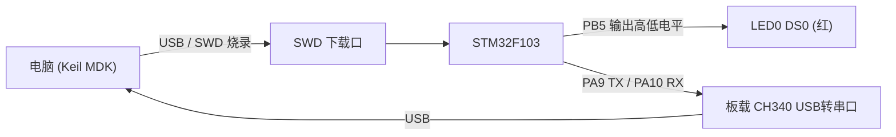
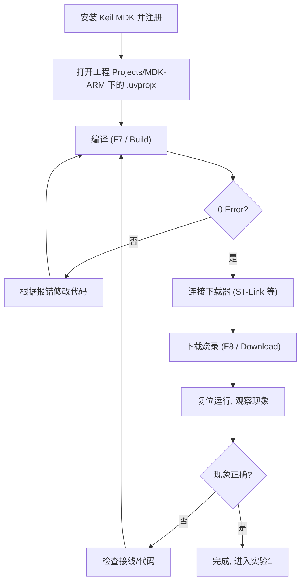

# 实验0 基础入门实验

> 平台：正点原子 STM32F103（战舰/精英/mini）开发板 · Keil MDK

## 一、实验简介

本实验不点亮任何复杂外设，而是带你走通嵌入式开发的"全流程"：**安装 Keil MDK → 新建/打开工程 → 编译 → 烧录 → 看现象**。目录下包含 4 个递进的子实验：

| 子实验 | 内容 |
|--------|------|
| 实验0-1 新建最简单工程实验 | 不用任何库，仅一个 main.c + 启动文件，直接操作寄存器让 PB5 上的 LED0 闪烁 |
| 实验0-2 新建工程实验-寄存器版本 | 学习搭建寄存器版本 MDK 工程，串口每 500ms 打印一个递增值 |
| 实验0-3 新建工程实验-HAL库版本 | 学习搭建 HAL 库版本 MDK 工程，编译通过即达标 |
| 实验0-4 新建工程实验-CubeMX版本 | 学习用 STM32CubeMX 图形化配置并生成 MDK 工程 |

🏠 **生活类比**：学做菜之前，先得熟悉厨房——灶台怎么开火（安装 Keil）、菜谱放在哪（打开工程）、菜熟没熟（编译是否 0 Error）、怎么端上桌（烧录到开发板）。本实验就是"熟悉厨房"，后面所有实验都建立在这套流程之上。

## 二、实验目的

- 掌握 Keil MDK 的安装、注册与基本使用
- 学会新建 / 打开一个 STM32F103 的 MDK 工程，认识工程的目录组织
- 掌握"编译 → 下载（烧录）→ 观察现象"的完整开发流程
- 通过实验0-1 建立"寄存器 = 内存中一个可读写地址"的最底层认识
- 了解寄存器版、HAL 库版、CubeMX 三种建工程方式的区别

## 三、硬件资源与连接图

| 资源 | 引脚 | 说明 |
|------|------|------|
| LED0 (DS0, 红) | **PB5** | 实验0-1 用其闪烁验证流程（低电平点亮） |
| 串口1 | **PA9 / PA10** | 实验0-2 用其打印数据，板载 CH340 USB 转串口 |
| 烧录口 | SWD (SWDIO/SWCLK) | Keil 通过 ST-Link 等下载器烧录程序 |



## 四、核心寄存器

> **本实验为环境入门，不涉及具体外设寄存器**的学习要求。但实验0-1 为了演示"最精简工程"，直接用 C 语言映射并操作了以下寄存器（见 `实验0-1，新建最简单工程实验/main.c`），可作为预览：

| 寄存器 | 名称 | 在实验0-1 中的作用 |
|--------|------|------|
| `RCC_APB2ENR` | APB2 时钟使能寄存器 | `|= 1<<3` 使能 GPIOB 时钟（bit3 = IOPBEN） |
| `GPIOB_CRL` | 端口配置低寄存器 | 配置 PB5 为 50MHz 推挽输出（bit20~23） |
| `GPIOB_ODR` | 输出数据寄存器 | 置 1/清 0 bit5，控制 PB5 输出高低电平 |

真正的寄存器系统学习从实验1（跑马灯）开始。

## 五、软件架构 / 流程



## 六、主要示例代码及讲解

### 1. 最精简工程的寄存器映射（`实验0-1，新建最简单工程实验/main.c`）

```c
/* 总线基地址定义 */
#define PERIPH_BASE         0x40000000                          /* 外设基地址 */
#define APB2PERIPH_BASE     (PERIPH_BASE + 0x00010000)          /* APB2总线基地址 */
#define AHBPERIPH_BASE      (PERIPH_BASE + 0x00020000)          /* AHB总线基地址 */

/* 外设基地址定义 */
#define RCC_BASE            (AHBPERIPH_BASE + 0x00001000)       /* RCC基地址 */
#define GPIOB_BASE          (APB2PERIPH_BASE + 0x00000C00)      /* GPIOB基地址 */

/* 外设相关寄存器映射(定义) */
#define RCC_APB2ENR         *(volatile unsigned int *)(RCC_BASE + 0x18)
#define GPIOB_CRL           *(volatile unsigned int *)(GPIOB_BASE + 0x00)
#define GPIOB_ODR           *(volatile unsigned int *)(GPIOB_BASE + 0x0C)
```

**讲解**：
- 芯片手册里每个寄存器都有一个固定地址；用 `*(volatile unsigned int *)地址` 就能像读写变量一样读写寄存器。
- `volatile` 告诉编译器"这个值会被硬件改变，不要优化掉读取动作"。
- 这就是所有库（标准库/HAL）最底层的本质——库只是把这些宏和位操作封装得更好用。

### 2. 不用库的 LED 闪烁主函数（`实验0-1，新建最简单工程实验/main.c`）

```c
int main(void)
{
    /* 未执行任何PLL时钟配置, 默认使用HSI(8M)工作, 相当于工作在主频8Mhz频率下 */

    RCC_APB2ENR |= 1 << 3;          /* GPIOB 时钟使能 */

    GPIOB_CRL &= ~(0X0FUL << 20);   /* MODE5[1:0], CNF5[1:0], 清零 */
    GPIOB_CRL |= 0x03 << 20;        /* MODE5[1:0]=3, PB5输出模式, 速度50Mhz */
    GPIOB_CRL |= 0x00 << 22;        /* CNF5[1:0] =0, PB5推挽输出模式 */

    while(1)
    {
        GPIOB_ODR |= 1 << 5;        /* PB5 = 1, LED0灭 */
        delay_x(500000);            /* 延时一定时间 */
        GPIOB_ODR &= ~(1UL << 5);   /* PB5 = 0, LED0亮 */
        delay_x(500000);            /* 延时一定时间 */
    }
}
```

**讲解**：
- 第一步永远是**开外设时钟**（`RCC_APB2ENR |= 1<<3`），否则写 GPIO 寄存器无效。
- `GPIOB_CRL` 每 4 位管一个引脚，PB5 对应 bit20~23：MODE=11（50MHz 输出）、CNF=00（推挽）。
- 该工程只有 `main.c` + 启动文件 `startup_stm32f103xe.s`，是理解"Keil 工程最少需要什么"的最佳样本。

### 3. 工程目录组织（以 `实验0-2，新建工程实验-寄存器版本` 为例）

```
实验0-2，新建工程实验-寄存器版本/
├── User/          用户代码 (main.c 等)
├── Drivers/       驱动 (SYSTEM: delay/sys/usart, CMSIS, BSP)
├── Middlewares/   中间件
├── Projects/      Keil 工程文件 (.uvprojx)
└── Output/        编译输出 (hex/axf 等)
```

**讲解**：正点原子所有例程都遵循这套目录规范。拿到任何一个实验，双击 `Projects/MDK-ARM/` 下的 `.uvprojx` 即可打开工程；后续实验的 BSP 驱动都放在 `Drivers/BSP/<外设名>/` 下。

## 七、实验效果

- **实验0-1**：烧录后，开发板 LED0（红，PB5）闪烁（默认 HSI 8MHz 主频下运行）。
- **实验0-2**：STM32 通过串口1 每 500ms 打印一次 t 的值，t 从 0 开始递增（需用 XCOM 串口调试助手，波特率 115200，连接板载 USB 转串口验证）。
- **实验0-3**：熟悉 HAL 库新建工程的过程，编译通过即成功。
- **实验0-4**：学会用 CubeMX 生成并打开工程。

## 八、注意事项

- 烧录前先退出可能占用下载器/工程的进程；若烧录失败可运行根目录 `keilkill.bat` 结束占用进程。
- Keil 打开工程认准 `.uvprojx` 文件（在 `Projects/MDK-ARM/` 下），不要直接打开 Output 里的中间文件。
- 实验0-2 需要打开 XCOM 串口调试助手连接开发板才能验证；波特率、串口号（设备管理器中查看 CH340 对应 COM 口）要选对。
- 实验0-1 未配置 PLL，主频为内部 HSI 8MHz，延时 `delay_x(500000)` 的实际时间与 72MHz 下不同，属正常现象。
- 用 USB 线连接开发板的 **USB_UART** 口（板载 CH340）才能看到串口打印，接 USB_SLAVE 口无效。

## 九、文件结构

```
实验0 基础入门实验/
├── 实验0-1，新建最简单工程实验/
│   ├── main.c                  寄存器直控LED闪烁的最精简代码
│   ├── startup_stm32f103xe.s   启动文件(向量表/堆栈初始化)
│   ├── test.uvprojx / .uvoptx  Keil工程与配置文件
│   └── keilkill.bat            结束Keil占用进程
├── 实验0-2，新建工程实验-寄存器版本/
│   ├── User/                   main.c 用户代码
│   ├── Drivers/                SYSTEM(delay/sys/usart) + CMSIS
│   ├── Middlewares/            中间件
│   ├── Projects/               Keil工程 (.uvprojx)
│   ├── Output/                 编译产物
│   └── readme.txt              实验说明
├── 实验0-3，新建工程实验-HAL库版本/
│   ├── Users/ · Drivers/(含STM32F1xx_HAL_Driver) · Middlewares/ · Projects/
│   └── readme.txt              实验说明
├── 实验0-4，新建工程实验-CubeMX版本/
│   ├── LED_TEST.ioc            CubeMX工程文件
│   ├── MDK-ARM/                Keil工程
│   ├── Inc/ · Src/             生成的头文件与源码
│   └── Drivers/                HAL库与CMSIS
└── keilkill.bat                结束Keil占用进程
```
