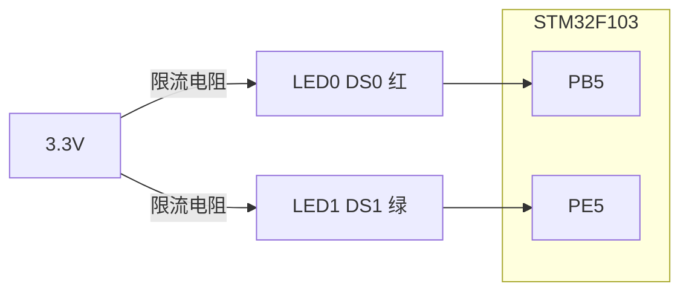
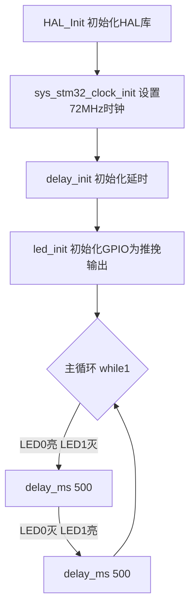

# 实验1 跑马灯实验

> 平台：正点原子 STM32F103（战舰/精英/mini）开发板 · HAL 库 · Keil MDK

## 一、实验简介

本实验点亮开发板上的两颗 LED，让它们交替闪烁，形成"跑马灯"效果。它是所有 STM32 学习的第一步——**用 GPIO 输出高低电平去控制一个外设**。

🏠 **生活类比**：GPIO 就像家里的电灯开关。你按下开关（输出高电平）灯亮，松开（输出低电平）灯灭。跑马灯就是两个开关轮流按，让两盏灯交替亮灭，看起来像在"流动"。

## 二、实验目的

- 掌握 STM32 GPIO 作为**推挽输出**的配置方法
- 理解 GPIO 的时钟使能、模式、上下拉、速度等参数
- 学会用 `HAL_GPIO_WritePin()` / `HAL_GPIO_TogglePin()` 控制引脚电平
- 熟悉 HAL 库工程的基本结构（`HAL_Init → 时钟 → delay → 外设 → 主循环`）

## 三、硬件资源与连接图

| 外设 | 引脚 | 说明 |
|------|------|------|
| LED0 (DS0, 红) | **PB5** | 低电平点亮（灌电流） |
| LED1 (DS1, 绿) | **PE5** | 低电平点亮（灌电流） |



> 接线说明：LED 正极经限流电阻接 3.3V，负极接 MCU 引脚。当引脚输出**低电平**时，电流从 3.3V 经 LED 流入引脚，LED 点亮；输出高电平时两端电压差为 0，LED 熄灭。这叫**灌电流（低电平驱动）**。

## 四、核心寄存器（GPIO）

GPIO 每组端口由一组寄存器控制，本实验用到的关键寄存器：

| 寄存器 | 名称 | 作用 |
|--------|------|------|
| `RCC_APB2ENR` | 时钟使能寄存器 | 置位 IOPBEN / IOPEEN 使能 PB、PE 口时钟（用前必开） |
| `GPIOx_CRL` | 端口配置低寄存器 | 配置 Pin0~Pin7 的模式 MODE 与 CNF |
| `GPIOx_CRH` | 端口配置高寄存器 | 配置 Pin8~Pin15 |
| `GPIOx_ODR` | 输出数据寄存器 | 写 1 输出高电平，写 0 输出低电平 |
| `GPIOx_IDR` | 输入数据寄存器 | 读取引脚实际电平 |
| `GPIOx_BSRR` | 位设置/复位寄存器 | 高 16 位复位、低 16 位置位，原子操作改电平 |

`GPIOx_CRL` 每 4 位控制一个引脚（MODE[1:0] + CNF[1:0]）：

```
MODE[1:0]: 00=输入  01=输出2MHz  10=输出10MHz  11=输出50MHz
CNF (输出): x0=推挽  x1=开漏     (输入): 00=模拟 01=浮空 10=上/下拉
```

本实验把 PB5、PE5 配为 **50MHz 推挽输出 + 上拉**（HAL 内部通过 `HAL_GPIO_Init` 完成上述寄存器配置）。

## 五、软件架构 / 流程



## 六、主要示例代码及讲解

### 1. LED 驱动初始化（`Drivers/BSP/LED/led.c`）

```c
void led_init(void)
{
    GPIO_InitTypeDef gpio_init_struct;
    LED0_GPIO_CLK_ENABLE();                       /* 使能PB口时钟 */
    LED1_GPIO_CLK_ENABLE();                       /* 使能PE口时钟 */

    gpio_init_struct.Pin   = LED0_GPIO_PIN;       /* 选择PB5 */
    gpio_init_struct.Mode  = GPIO_MODE_OUTPUT_PP; /* 推挽输出 */
    gpio_init_struct.Pull  = GPIO_PULLUP;         /* 上拉 */
    gpio_init_struct.Speed = GPIO_SPEED_FREQ_HIGH;/* 高速 */
    HAL_GPIO_Init(LED0_GPIO_PORT, &gpio_init_struct);

    gpio_init_struct.Pin = LED1_GPIO_PIN;         /* 换成PE5 */
    HAL_GPIO_Init(LED1_GPIO_PORT, &gpio_init_struct);

    LED0(1);                                      /* 初始关闭LED0 */
    LED1(1);                                      /* 初始关闭LED1 */
}
```

**讲解**：
- 使用任何外设前**必须先开时钟**，否则寄存器不工作——就像给电器通电才能用。
- `GPIO_InitTypeDef` 是一个"配置单"，填好引脚、模式、上下拉、速度后，交给 `HAL_GPIO_Init()` 一次性写入寄存器。
- `GPIO_MODE_OUTPUT_PP` = Push-Pull 推挽输出，能主动拉高也能拉低，驱动能力强（对比"开漏"只能拉低）。
- 末尾 `LED0(1)/LED1(1)` 把引脚置高，让灯初始为熄灭状态。

### 2. 引脚宏定义（`Drivers/BSP/LED/led.h`）

```c
#define LED0(x)   do{ x ? \
    HAL_GPIO_WritePin(LED0_GPIO_PORT, LED0_GPIO_PIN, GPIO_PIN_SET) : \
    HAL_GPIO_WritePin(LED0_GPIO_PORT, LED0_GPIO_PIN, GPIO_PIN_RESET); }while(0)
```

**讲解**：把"写电平"封装成 `LED0(0)`（亮）/ `LED0(1)`（灭），代码更直观。`do{...}while(0)` 是宏的标准写法，保证宏当一条语句用不出错。

### 3. 主函数（`User/main.c`）

```c
int main(void)
{
    HAL_Init();                            /* 初始化HAL库 */
    sys_stm32_clock_init(RCC_PLL_MUL9);    /* 设置时钟,72M */
    delay_init(72);                        /* 初始化延时函数 */
    led_init();                            /* 初始化LED */

    while(1)
    {
        LED0(0); LED1(1);                  /* LED0亮, LED1灭 */
        delay_ms(500);
        LED0(1); LED1(0);                  /* LED0灭, LED1亮 */
        delay_ms(500);
    }
}
```

**讲解**：主循环里两行电平设置 + 500ms 延时交替执行，形成 1 秒一轮的跑马灯。改变 `delay_ms()` 的数值即可调节闪烁快慢。

## 七、实验效果

烧录程序后，开发板上 **LED0（红）与 LED1（绿）交替闪烁**，每颗亮约 0.5 秒，形成跑马灯效果。

## 八、注意事项

- 修改代码后需重新编译并烧录；若烧录失败先运行根目录 `keilkill.bat` 结束占用进程。
- 板载 LED 为**低电平点亮**，`LED0(0)` 是亮、`LED0(1)` 是灭，别搞反。
- 延时时间太小（如 <50ms）人眼会感觉两灯同时亮，属于视觉暂留现象。

## 九、文件结构

```
实验1 跑马灯实验/
├── User/
│   ├── main.c              主程序
│   ├── stm32f1xx_it.c      中断服务函数
│   └── stm32f1xx_hal_conf.h HAL配置
├── Drivers/
│   ├── BSP/LED/            LED 驱动 (led.c / led.h)
│   ├── SYSTEM/             delay / sys / usart 系统支持
│   ├── CMSIS/              内核启动与设备定义
│   └── STM32F1xx_HAL_Driver/ ST HAL 库
└── Projects/MDK-ARM/       Keil 工程文件 (.uvprojx)
```
