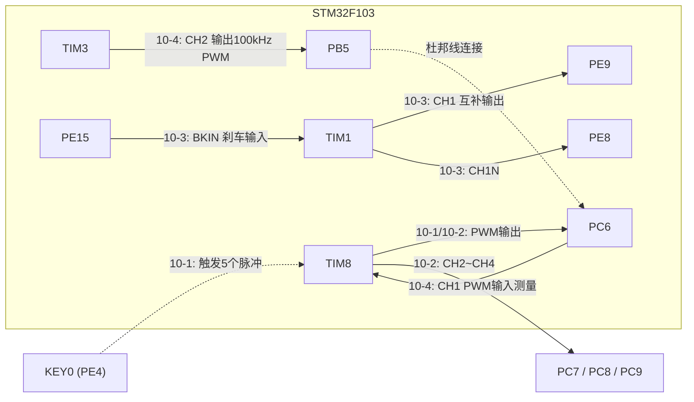
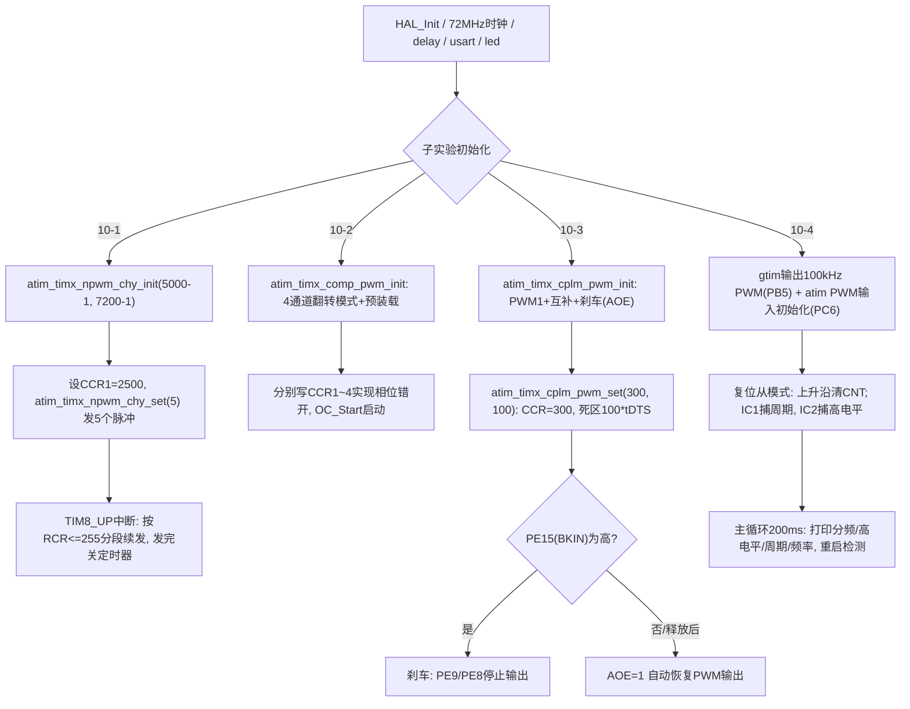

# 实验10 高级定时器实验

> 平台：正点原子 STM32F103（战舰）开发板 · HAL 库 · Keil MDK

本目录包含四个子实验，每个子实验是一个完整工程：

| 子实验 | 功能 | 使用的定时器 |
|--------|------|--------------|
| 实验10-1 输出指定个数PWM实验 | 按键控制 TIM8_CH1 精确输出 5 个 PWM 脉冲 | TIM8 CH1 → PC6（RCR 重复计数器） |
| 实验10-2 输出比较模式实验 | 4 路同频不同相位的 50% 占空比 PWM | TIM8 CH1~CH4 → PC6/PC7/PC8/PC9 |
| 实验10-3 互补输出带死区控制实验 | 7:3 互补 PWM + 死区 + 刹车保护 | TIM1 CH1/CH1N → PE9/PE8，BKIN → PE15（完全重映射） |
| 实验10-4 PWM输入模式实验 | 测量输入 PWM 的频率/高电平/周期并串口打印 | TIM3_CH2(PB5) 输出 → 杜邦线 → TIM8_CH1(PC6) 测量 |

## 一、实验简介

高级定时器（TIM1/TIM8）在通用定时器的基础上，增加了**重复计数器 RCR、互补输出（OCxN）、死区控制、刹车输入（BKIN）、主输出使能（MOE）**等电机/电源控制专用功能。本实验通过 4 个子实验逐一演示：用 RCR 精确控制"只发 N 个脉冲"；用输出比较翻转模式产生 4 路不同相位的 PWM；用互补输出+死区+刹车驱动"半桥"式波形；最后再用 TIM8 的 PWM 输入模式测量 PWM 信号的频率与占空比。

🏠 **生活类比**：高级定时器像专业赛车变速箱——普通定时器只会"转圈计时"，而它还带限滑（只发指定个数脉冲）、双离合器（互补输出）、换挡间隙（死区时间，防止上下桥臂同时导通短路）和紧急熄火按钮（刹车输入）。

## 二、实验目的

- 掌握高级定时器特有的 **RCR 重复计数器**，实现"输出指定个数 PWM"
- 理解**输出比较翻转模式（TIM_OCMODE_TOGGLE）**产生 PWM 的原理与相位控制
- 掌握**互补输出、死区时间（DTG）、刹车输入（BKIN）、MOE/AOE** 的配置方法
- 掌握 **PWM 输入模式**（复位从模式 + 双通道捕获）测频率、测占空比
- 学会 TIM1/TIM8 的重映射（如 TIM1 完全重映射到 PE 口）与 TIM8 部分重映射

## 三、硬件资源与连接图

| 子实验 | 外设 | 引脚 | 说明 |
|--------|------|------|------|
| 10-1 | TIM8_CH1 | **PC6** | PWM 输出（部分重映射），2Hz、50% 占空比 |
| 10-1 | KEY0 | **PE4** | 按下输出 5 个 PWM 脉冲 |
| 10-1 | LED1 | PE5 | 设为上拉输入，用杜邦线连 PC6 后随脉冲亮灭 |
| 10-2 | TIM8_CH1~CH4 | **PC6 / PC7 / PC8 / PC9** | 1kHz、50% 占空比，相位依次 25%/50%/75%/100% |
| 10-3 | TIM1_CH1 | **PE9** | 正常输出，70% 占空比（TIM1 完全重映射） |
| 10-3 | TIM1_CH1N | **PE8** | 互补输出，30% 占空比 |
| 10-3 | TIM1_BKIN | **PE15** | 刹车输入，高电平有效 |
| 10-4 | TIM3_CH2 | **PB5** | 输出 100kHz PWM（部分重映射） |
| 10-4 | TIM8_CH1 | **PC6** | PWM 输入测量（部分重映射），需杜邦线连 PB5→PC6 |



## 四、核心寄存器（高级定时器 TIM1/TIM8）

高级定时器包含通用定时器的全部寄存器（CR1/PSC/ARR/CNT/CCMR/CCER/CCR/SMCR/DIER/SR），另外**独有**以下寄存器：

| 寄存器 | 名称 | 作用 |
|--------|------|------|
| `TIMx_RCR` | 重复计数器 | RPR[7:0]：每发生 RPR+1 次更新事件才产生一次"重复计数更新"，配合更新中断实现输出指定个数脉冲（10-1 的核心） |
| `TIMx_BDTR` | 刹车和死区寄存器 | **DTG[7:0]** 死区时间；**MOE** 主输出使能；**AOE** 自动输出使能；**BKE/BKP** 刹车使能与极性；**OSSR/OSSI** 关闭状态选择；**LOCK** 寄存器锁 |
| `TIMx_CR2` | 控制寄存器2 | **CCPC** 捕获/比较预装载控制；**OIS1/OIS1N** MOE=0 时 OCx/OCxN 的空闲电平 |
| `TIMx_CCMR1` | 捕获/比较模式1 | OC1M=110/111＝PWM1/2 模式；OC1M=011＝**翻转模式**（10-2 用）；PWM 输入时配置 CC1S/CC2S 映射 |
| `TIMx_CCER` | 捕获/比较使能 | **CC1E/CC1NE** 主/互补输出使能；**CC1P/CC1NP** 主/互补输出极性 |
| `TIMx_SMCR` | 从模式控制 | PWM 输入模式（10-4）：SMS=100 复位模式，TS=TI1FP1，上升沿到来清零 CNT |

死区时间计算（10-3，CKD[1:0]=10 即 tDTS = 4×tCK_INT）：

```
tCK_INT = 1/72MHz, tDTS = 4 * tCK_INT ≈ 55.6ns (18MHz)
DTG=100 (DTG[7]=0, 属于0~127线性区): 死区时间 = DTG * tDTS = 100 * 55.6ns ≈ 5.56us
```

各子实验定时参数（定时器时钟 72MHz）：

```
10-1: arr=5000-1, psc=7200-1 → 10kHz计数, 2Hz PWM, CCR1=2500 (50%)
10-2: arr=1000-1, psc=72-1   → 1MHz计数, 翻转模式下每CCR次翻转一次 → 周期1kHz、占空比50%
      CCR1~4 = 250/500/750/1000 → 相位依次错开25%
10-3: arr=1000-1, psc=72-1   → 1kHz PWM, CCR1=300, OCy极性LOW → PE9约70%、PE8约30%
10-4: TIM3 arr=10-1, psc=72-1 → 100kHz PWM输出; TIM8 psc=0, arr=65535 → 72MHz直接计数测量
```

## 五、软件架构 / 流程



## 六、主要示例代码及讲解

### 1. 输出指定个数 PWM（`实验10-1 .../Drivers/BSP/TIMER/atim.c`）

```c
void atim_timx_npwm_chy_set(uint32_t npwm)
{
    if (npwm == 0) return;

    g_npwm_remain = npwm;                                                   /* 保存脉冲个数 */
    HAL_TIM_GenerateEvent(&g_timx_npwm_chy_handle, TIM_EVENTSOURCE_UPDATE); /* 产生一次更新事件,在中断里面处理脉冲输出 */
    __HAL_TIM_ENABLE(&g_timx_npwm_chy_handle);                              /* 使能定时器TIMX */
}

void ATIM_TIMX_NPWM_IRQHandler(void)   /* 即 TIM8_UP_IRQHandler */
{
    uint16_t npwm = 0;

    if(__HAL_TIM_GET_FLAG(&g_timx_npwm_chy_handle, TIM_FLAG_UPDATE) != RESET)
    {
        if (g_npwm_remain >= 256)           /* 还有大于256个脉冲需要发送 */
        {
            g_npwm_remain = g_npwm_remain - 256;
            npwm = 256;
        }
        else if (g_npwm_remain % 256)       /* 还有位数（不到256）个脉冲要发送 */
        {
            npwm = g_npwm_remain % 256;
            g_npwm_remain = 0;              /* 没有脉冲了 */
        }

        if (npwm) /* 有脉冲要发送 */
        {
            ATIM_TIMX_NPWM->RCR = npwm - 1;                                         /* 设置重复计数寄存器值为npwm-1, 即npwm个脉冲 */
            HAL_TIM_GenerateEvent(&g_timx_npwm_chy_handle, TIM_EVENTSOURCE_UPDATE); /* 产生一次更新事件,在中断里面处理脉冲输出 */
            __HAL_TIM_ENABLE(&g_timx_npwm_chy_handle);                              /* 使能定时器TIMX */
        }
        else
        {
            ATIM_TIMX_NPWM->CR1 &= ~(1 << 0); /* 关闭定时器TIMX，使用HAL Disable会清除PWM通道信息，此处不用 */
        }

        __HAL_TIM_CLEAR_IT(&g_timx_npwm_chy_handle, TIM_IT_UPDATE);  /* 清除定时器溢出中断标志位 */
    }
}
```

**讲解**：
- 高级定时器独有的 **RCR（重复计数器）**：设 RCR=N−1，则输出 N 个 PWM 周期后才产生一次更新中断——这就是"精确发 N 个脉冲"的硬件基础。
- RCR 只有 8 位（最大 256 个脉冲/次），所以驱动里做"分段续发"：剩余脉冲 ≥256 就先发 256 个，发完在中断里继续装下一段；`g_npwm_remain` 为 0 时直接清 CR1 的 CEN 关闭定时器（不用 HAL 的 Disable，以免清掉 PWM 通道状态）。
- 主循环中每按一次 KEY0 调 `atim_timx_npwm_chy_set(5)`，PC6 就输出 5 个脉冲；若用杜邦线把 PC6 接到已设为输入的 PE5（LED1），LED1 会亮灭 5 次。

### 2. 互补输出 + 死区 + 刹车（`实验10-3 .../Drivers/BSP/TIMER/atim.c`）

```c
    g_timx_cplm_pwm_handle.Init.ClockDivision = TIM_CLOCKDIVISION_DIV4;     /* CKD[1:0] = 10, tDTS = 4 * tCK_INT = Ft / 4 = 18Mhz */
    HAL_TIM_PWM_Init(&g_timx_cplm_pwm_handle);

    tim_oc_cplm_pwm.OCMode = TIM_OCMODE_PWM1;                               /* PWM模式1 */
    tim_oc_cplm_pwm.OCPolarity = TIM_OCPOLARITY_LOW;                        /* OCy 低电平有效 */
    tim_oc_cplm_pwm.OCNPolarity = TIM_OCNPOLARITY_LOW;                      /* OCyN 低电平有效 */
    tim_oc_cplm_pwm.OCIdleState = TIM_OCIDLESTATE_SET;                      /* 当MOE=0，OCx=1 */
    tim_oc_cplm_pwm.OCNIdleState = TIM_OCNIDLESTATE_SET;                    /* 当MOE=0，OCxN=1 */
    HAL_TIM_PWM_ConfigChannel(&g_timx_cplm_pwm_handle, &tim_oc_cplm_pwm, ATIM_TIMX_CPLM_CHY);

    /* 设置死区参数，开启死区中断 */
    g_sbreak_dead_time_config.OffStateRunMode = TIM_OSSR_DISABLE;           /* 运行模式的关闭输出状态 */
    g_sbreak_dead_time_config.OffStateIDLEMode = TIM_OSSI_DISABLE;          /* 空闲模式的关闭输出状态 */
    g_sbreak_dead_time_config.LockLevel = TIM_LOCKLEVEL_OFF;                /* 不用寄存器锁功能 */
    g_sbreak_dead_time_config.BreakState = TIM_BREAK_ENABLE;                /* 使能刹车输入 */
    g_sbreak_dead_time_config.BreakPolarity = TIM_BREAKPOLARITY_HIGH;       /* 刹车输入有效信号极性为高 */
    g_sbreak_dead_time_config.AutomaticOutput = TIM_AUTOMATICOUTPUT_ENABLE; /* 使能AOE位，允许刹车结束后自动恢复输出 */
    HAL_TIMEx_ConfigBreakDeadTime(&g_timx_cplm_pwm_handle, &g_sbreak_dead_time_config);

    HAL_TIM_PWM_Start(&g_timx_cplm_pwm_handle, ATIM_TIMX_CPLM_CHY);         /* 使能OCy输出 */
    HAL_TIMEx_PWMN_Start(&g_timx_cplm_pwm_handle, ATIM_TIMX_CPLM_CHY);      /* 使能OCyN输出 */
```

```c
void atim_timx_cplm_pwm_set(uint16_t ccr, uint8_t dtg)
{
    g_sbreak_dead_time_config.DeadTime = dtg;       /* 死区时间设置 */
    HAL_TIMEx_ConfigBreakDeadTime(&g_timx_cplm_pwm_handle, &g_sbreak_dead_time_config);  /*重设死区时间*/
    __HAL_TIM_MOE_ENABLE(&g_timx_cplm_pwm_handle);  /* MOE=1,使能主输出 */
    ATIM_TIMX_CPLM_CHY_CCRY = ccr;                  /* 设置比较寄存器 */
}
```

**讲解**：
- 以上配置全部落在高级定时器独有的 **BDTR 寄存器**：`HAL_TIMEx_ConfigBreakDeadTime()` 一次写好 DTG（死区）、BKE/BKP（刹车使能/高有效）、AOE（刹车释放后自动恢复输出）；`__HAL_TIM_MOE_ENABLE()` 置 MOE 位——高级定时器输出 PWM 必须 MOE=1，这是与通用定时器最大的使用差异。
- **互补输出**：OCxN 波形与 OCx 相反（PE8 与 PE9 互补），切换瞬间插入 DTG 设定的**死区时间**，防止驱动 H 桥时上下管同时导通短路。
- **刹车**：给 PE15（BKIN）输入高电平，硬件立刻封锁 PE9/PE8 输出；拉低后因 AOE=1，下一个更新事件自动恢复输出——这是电机驱动的硬件级保护。
- TIM1 默认引脚在 PA 口，要用 PE9/PE8/PE15 必须**完全重映射**：`__HAL_AFIO_REMAP_TIM1_ENABLE()`（由 `atim.h` 的 REMAP 宏完成）。

### 3. PWM 输入模式测量（`实验10-4 .../Drivers/BSP/TIMER/atim.c` 与 `User/main.c`）

```c
    /* 从模式配置，IT1触发更新 */
    slave_config.SlaveMode = TIM_SLAVEMODE_RESET;                   /* 从模式：复位模式 */
    slave_config.InputTrigger = TIM_TS_TI1FP1;                      /* 定时器输入触发源：TI1FP1 */
    slave_config.TriggerPolarity = TIM_INPUTCHANNELPOLARITY_RISING; /* 上升沿检测 */
    HAL_TIM_SlaveConfigSynchro(&g_timx_pwmin_chy_handle, &slave_config);

    /* IC1捕获：上升沿触发TI1FP1 */
    tim_ic_pwmin_chy.ICPolarity = TIM_INPUTCHANNELPOLARITY_RISING; /* 上升沿检测 */
    tim_ic_pwmin_chy.ICSelection = TIM_ICSELECTION_DIRECTTI;       /* 选择输入端IC1映射到TI1 */
    HAL_TIM_IC_ConfigChannel(&g_timx_pwmin_chy_handle, &tim_ic_pwmin_chy, TIM_CHANNEL_1);

    /* IC2捕获：上升沿触发TI1FP2 */
    tim_ic_pwmin_chy.ICPolarity = TIM_INPUTCHANNELPOLARITY_FALLING; /* 下降沿检测 */
    tim_ic_pwmin_chy.ICSelection = TIM_ICSELECTION_INDIRECTTI;      /* 选择输入端IC2映射到TI1 */
    HAL_TIM_IC_ConfigChannel(&g_timx_pwmin_chy_handle, &tim_ic_pwmin_chy, TIM_CHANNEL_2);
```

```c
    /* main.c 中的结果计算 */
    tpsc = ((double)g_timxchy_pwmin_psc + 1) / 72;      /* 得到PWM采样时钟周期时间 */
    ht = g_timxchy_pwmin_hval * tpsc;                   /* 计算高电平时间 */
    ct = g_timxchy_pwmin_cval * tpsc;                   /* 计算周期长度 */
    f = (1 / ct) * 1000000;                             /* 计算频率 */
```

**讲解**：
- PWM 输入是输入捕获的"打包版"：**一个引脚、两个通道同时捕获**。SMCR 配成复位从模式后，每个上升沿自动把 CNT 清零，于是 CCR2（IC2 下降沿捕获）= 高电平宽度，CCR1（IC1 下个上升沿捕获）= 完整周期，硬件一次搞定占空比和频率测量。
- TIM8 测量时钟不分频（PSC=0，72MHz），CNT 计满 65535 会溢出，驱动用 `g_timxchy_pwmin_psc` 记录溢出次数参与换算。
- 信号链路：TIM3_CH2 从 PB5 输出 100kHz PWM（CCR2=2），用**杜邦线把 PB5 接到 PC6**，TIM8_CH1 测量后每 200ms 通过串口（115200）打印分频数、高电平脉宽、周期与频率，LED1 闪烁提示运行。

## 七、实验效果

- **10-1**：上电默认输出 5 个 PWM 波；每按一次 KEY0，PC6 再输出 5 个脉冲。将 PE5（LED1）设为输入并用杜邦线连 PC6 后，可见 LED1 亮灭 5 次即一组脉冲。
- **10-2**：PC6/PC7/PC8/PC9 输出 4 路 1kHz、50% 占空比 PWM，相位依次相差 25%，示波器多通道同时观察最直观。
- **10-3**：PE9 输出约 70% 占空比、PE8 输出互补的约 30% 波形，切换沿之间有约 5.56us 死区；PE15 接高电平时两路立即停止输出，释放后自动恢复。
- **10-4**：串口每 200ms 打印一次测量结果，约 `PWM Cycle time:10.0us、PWM Frequency:100kHz、PWM Hight time:8us`（与 TIM3 输出一致），LED1 闪烁提示运行。
- 各子实验中 LED0（红）闪烁提示程序运行（10-1 为 LED0，10-4 为 LED1）。

## 八、注意事项

- 高级定时器（TIM1/TIM8）输出必须置 **MOE=1**（BDTR 寄存器），否则引脚无波形——这是初学者最常踩的坑。
- TIM8 引脚默认在 PC 口，但 PC6 为 TIM8_CH1 需要**部分重映射**（驱动中 `AFIO_REMAP_PARTIAL`）；TIM1 用 PE9/PE8/PE15 需要**完全重映射**。使用前务必开 AFIO 时钟。
- 10-1 关闭定时器时直接操作 `CR1 &= ~(1<<0)` 而不用 HAL 接口，因为 HAL 的 Disable 会清除 PWM 通道配置。
- 10-3 刹车为高电平有效；PE15 悬空时若波形异常，注意检查该脚电平。
- 10-4 必须用杜邦线把 PB5 与 PC6 连起来才有测量结果；串口助手波特率 115200，P4 的 PA9/PA10 需用跳线帽接 RXD/TXD。
- 修改代码后需重新编译烧录；若烧录失败可先运行根目录 `keilkill.bat`。

## 九、文件结构

```
实验10 高级定时器实验/
├── 实验10-1 高级定时器输出指定个数PWM实验/
│   ├── User/main.c             按键触发发5个脉冲, LED1设为输入
│   └── Drivers/BSP/
│       ├── KEY/                按键驱动 (KEY0-PE4 等)
│       ├── LED/                LED 驱动
│       └── TIMER/atim.c(.h)    TIM8_CH1 RCR定数脉冲驱动 (PC6)
├── 实验10-2 高级定时器输出比较模式实验/
│   ├── User/main.c             设置CCR1~4实现4路相位错开
│   └── Drivers/BSP/TIMER/      TIM8 4通道翻转模式驱动 (PC6~PC9)
├── 实验10-3 高级定时器互补输出带死区控制实验/
│   ├── User/main.c             设占空比300与死区100*tDTS
│   └── Drivers/BSP/TIMER/      TIM1 互补输出/死区/刹车驱动 (PE9/PE8/PE15)
├── 实验10-4 高级定时器PWM输入模式实验/
│   ├── User/main.c             频率/脉宽计算与串口打印
│   └── Drivers/BSP/TIMER/      atim(TIM8 PWM输入) + gtim(TIM3 PWM输出)
└── （各子实验均含 SYSTEM / CMSIS / STM32F1xx_HAL_Driver /
    Projects-MDK-ARM 工程文件 与 readme.txt）
```
