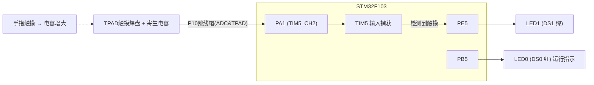
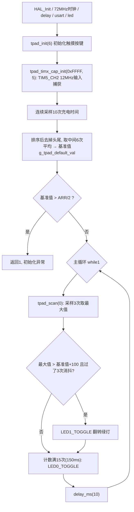

# 实验11 电容触摸按键实验

> 平台：正点原子 STM32F103（战舰）开发板 · HAL 库 · Keil MDK

## 一、实验简介

本实验使用开发板右下角的**电容触摸按键 TPAD**（白色 LOGO 触摸区，接在 PA1），配合**定时器 TIM5 的通道 2 输入捕获**功能实现触摸检测。原理是：先给触摸焊盘放电，再让引脚浮空，利用 TIM5_CH2 测量焊盘寄生电容"充电到翻转电平"所需的时间；手指触摸时电容变大、充电时间变长，捕获值超过门限即判定为一次触摸，从而翻转 LED1。LED0 常闪提示程序运行。这是定时器输入捕获功能的一个巧妙应用。

🏠 **生活类比**：电容触摸按键像给一个小水池"测注水时间"。空池（没触摸）放水到满只要一小会儿；你把手指按上去相当于把池子变大（电容增大），注满就要更久。系统只要比较"注满时间"是否明显超过空池时的基准值，就知道有没有人摸它。

## 二、实验目的

- 理解电容触摸按键的**充放电检测原理**
- 进一步掌握定时器**输入捕获**功能（TIM5_CH2 捕获上升沿，测充电时间）
- 学会标定空载基准值（多次采样、去极值取平均）与设置触摸门限
- 掌握用 GPIO 输出低电平"放电"、再切浮空输入"充电"的操作方法

## 三、硬件资源与连接图

| 外设 | 引脚 | 说明 |
|------|------|------|
| TPAD 触摸按键 | **PA1** | 板载触摸焊盘（右下角白色 LOGO），即 TIM5_CH2 |
| LED0 (DS0, 红) | **PB5** | 低电平点亮，主循环每 150ms 翻转，提示程序运行 |
| LED1 (DS1, 绿) | **PE5** | 低电平点亮，检测到触摸时翻转 |
| 定时器 TIM5 | 芯片内部资源 | 通道 2 输入捕获，时钟 72MHz |
| 跳线帽 P10 | — | **必须连接 ADC&TPAD** 一侧，把 PA1 接通到触摸焊盘 |



## 四、核心寄存器（TIM5 + GPIOA）

检测过程本质是对 `TIM5` 的 CNT/CCR2 和 `GPIOA` 模式寄存器的操作：

| 寄存器 | 名称 | 作用 |
|--------|------|------|
| `TIM5_CR1` | 控制寄存器1 | CEN 启动计数；ARPE 预装载 |
| `TIM5_PSC` | 预分频寄存器 | psc=6−1=5，计数时钟 = 72MHz/6 = **12MHz**（1 计数 ≈ 83.3ns） |
| `TIM5_ARR` | 自动重装载寄存器 | 设为 0xFFFF（TPAD_ARR_MAX_VAL），单次充电远不会计满 |
| `TIM5_CNT` | 计数器 | 放电后被软件清零，随后以 12MHz 递增计数 |
| `TIM5_CCMR1` | 捕获/比较模式1 | CC2S=01：通道 2 配为输入捕获，IC2 映射到 TI2；IC2PSC/IC2F 分频与滤波 |
| `TIM5_CCER` | 捕获/比较使能 | CC2E 使能捕获，CC2P=0 上升沿有效 |
| `TIM5_CCR2` | 捕获/比较寄存器 | 上升沿到来时硬件锁存的 CNT 值 = 充电时间（宏 `TPAD_TIMX_CAP_CHY_CCRX` 直接访问） |
| `GPIOA_CRL` | PA 端口配置低寄存器 | PA1 在"推挽输出（放电）"与"浮空输入（充电）"两种模式间切换 |

检测一次触摸的时序（对应 `tpad.c` 的 `tpad_reset()` + `tpad_get_val()`）：

```
1. PA1 配为推挽输出并写0 → 触摸焊盘电容快速放电 (持续5ms)
2. 清 TIM5 的 SR/CNT → 计时起点归零
3. PA1 切成浮空输入 → 寄生电容开始缓慢充电, PA1 电平逐渐上升
4. 电平越过施密特触发器阈值 → TIM5_CH2 捕获上升沿, CNT 锁存进 CCR2
5. 读 CCR2 即得充电时间; 触摸时电容大 → 充电慢 → 读数明显变大
判定条件: 捕获值 > 基准值 g_tpad_default_val + TPAD_GATE_VAL(100)
```

## 五、软件架构 / 流程



## 六、主要示例代码及讲解

### 1. 放电/充电切换（`Drivers/BSP/TPAD/tpad.c`）

```c
static void tpad_reset(void)
{
    GPIO_InitTypeDef gpio_init_struct;

    gpio_init_struct.Pin = TPAD_GPIO_PIN;               /* 输入捕获的GPIO口 */
    gpio_init_struct.Mode = GPIO_MODE_OUTPUT_PP;        /* 推挽输出 */
    gpio_init_struct.Pull = GPIO_PULLUP;                /* 上拉 */
    gpio_init_struct.Speed = GPIO_SPEED_FREQ_MEDIUM;    /* 中速 */
    HAL_GPIO_Init(TPAD_GPIO_PORT, &gpio_init_struct);   /* TPAD引脚推挽输出 */

    HAL_GPIO_WritePin(TPAD_GPIO_PORT, TPAD_GPIO_PIN, GPIO_PIN_RESET);   /* TPAD引脚输出0, 放电 */

    delay_ms(5);

    g_timx_cap_chy_handle.Instance->SR = 0;             /* 清除标记 */
    g_timx_cap_chy_handle.Instance->CNT = 0;            /* 归零 */

    gpio_init_struct.Pin = TPAD_GPIO_PIN;               /* 输入捕获的GPIO口 */
    gpio_init_struct.Mode = GPIO_MODE_INPUT;            /* 输入 */
    gpio_init_struct.Pull = GPIO_NOPULL;                /* 浮空 */
    gpio_init_struct.Speed = GPIO_SPEED_FREQ_MEDIUM;    /* 中速 */
    HAL_GPIO_Init(TPAD_GPIO_PORT, &gpio_init_struct);   /* TPAD引脚浮空输入 */
}
```

**讲解**：
- 前半段把 PA1 配成**推挽输出低电平**并保持 5ms，把触摸焊盘的寄生电容彻底放空——每次测量都从同一起点开始，这是数据可比的前提。
- 中间直接操作寄存器把 `TIM5_SR` 清零（去掉放电期间的杂散捕获标志）、`TIM5_CNT` 清零（计时归零）。
- 后半段把 PA1 切成**浮空输入**，电容开始充电，引脚电平缓慢爬升；爬到输入阈值时 TIM5_CH2 就捕获到一个"上升沿"。

### 2. 基准值标定（`Drivers/BSP/TPAD/tpad.c`）

```c
uint8_t tpad_init(uint16_t psc)
{
    uint16_t buf[10];
    /* ... */
    tpad_timx_cap_init(TPAD_ARR_MAX_VAL, psc - 1);  /* 以72 / (psc - 1) Mhz的频率计数 */

    for (i = 0; i < 10; i++)        /* 连续读取10次 */
    {
        buf[i] = tpad_get_val();
        delay_ms(10);
    }

    /* 冒泡排序后 */
    for (i = 2; i < 8; i++)         /* 取中间的6个数据进行平均 */
    {
        temp += buf[i];
    }
    g_tpad_default_val = temp / 6;

    if (g_tpad_default_val > TPAD_ARR_MAX_VAL / 2)
    {
        return 1;                   /* 初始化遇到超过TPAD_ARR_MAX_VAL/2的数值,不正常! */
    }
    return 0;
}
```

**讲解**：
- 初始化时**必须没人触摸按键**：驱动连续采样 10 次空载充电时间，排序后去掉最大 2 个和最小 2 个，取中间 6 个平均，得到空载基准值 `g_tpad_default_val`。这种"去极值平均"能有效滤除个别毛刺。
- `tpad_init(6)` 中 psc=6，写入预分频寄存器的是 5，TIM5 以 72/6=12MHz 计数，分辨力约 83ns。
- 若基准值超过量程一半，说明硬件异常（如跳线帽没接对），返回 1 报错。

### 3. 触摸扫描与主函数（`Drivers/BSP/TPAD/tpad.c`、`User/main.c`）

```c
uint8_t tpad_scan(uint8_t mode)
{
    static uint8_t keyen = 0;   /* 0, 可以开始检测;  >0, 还不能开始检测; */
    uint8_t res = 0;
    uint8_t sample = 3;         /* 默认采样次数为3次 */
    uint16_t rval;

    if (mode)
    {
        sample = 6;             /* 支持连按的时候，设置采样次数为6次 */
        keyen = 0;              /* 支持连按, 每次调用该函数都可以检测 */
    }

    rval = tpad_get_maxval(sample);

    if (rval > (g_tpad_default_val + TPAD_GATE_VAL))    /* 大于tpad_default_val+TPAD_GATE_VAL,有效 */
    {
        if (keyen == 0)
        {
            res = 1;            /* keyen==0, 有效 */
        }
        keyen = 3;              /* 至少要再过3次之后才能按键有效 */
    }

    if (keyen) keyen--;

    return res;
}
```

```c
    while (1)
    {
        if (tpad_scan(0))   /* 成功捕获到了一次上升沿(此函数执行时间至少15ms) */
        {
            LED1_TOGGLE();  /* LED1翻转 */
        }

        t++;
        if (t == 15)
        {
            t = 0;
            LED0_TOGGLE();  /* LED0翻转 */
        }

        delay_ms(10);
    }
```

**讲解**：
- `tpad_scan()` 每轮采样 3 次取**最大值**（`tpad_get_maxval`），只要最大值超过"基准+门限 100"就判为触摸。取最大值是因为触摸引起的充电时间只会变长不会变短。
- `keyen` 实现**消抖/防连按**：判定一次触摸后，需再经过 3 轮扫描才允许下一次触发；`mode=1` 时采样 6 次且取消间隔，支持连按。
- 主循环里 `tpad_scan(0)` 每轮耗时约 15ms（3 次放电各 5ms），配合 `delay_ms(10)`，t 计到 15 约 400ms 翻转一次 LED0。

## 七、实验效果

烧录程序后（**P10 跳线帽须接在 ADC&TPAD 一侧**）：**LED0（红）持续闪烁**提示程序运行；用手指按压开发板右下角的 **TPAD 白色触摸区**，每检测到一次有效触摸，**LED1（绿）翻转一次**——摸一下亮、再摸一下灭。初始化成功时串口（115200）会打印一行空载基准值 `g_tpad_default_val:xxx`。

## 八、注意事项

- **必须将 P10 端子用跳线帽连接到 ADC&TPAD**，否则 PA1 与触摸焊盘不通，检测无效。
- `tpad_init()` 标定基准值期间**不要触摸按键**，否则基准偏高、之后按键不灵敏（可复位重来）。
- 门限 `TPAD_GATE_VAL=100`（约 8.3us）可按实测灵敏度调整：太灵敏误触发就调大，不灵敏就调小。
- 单次放电固定 5ms，`tpad_scan(0)` 一轮至少约 15ms，不要指望它是"毫秒级快速轮询"的按键。
- 触摸检测易受电源纹波、湿度和 PCB 布线影响，基准值每次上电重新标定是正常设计。
- 修改代码后需重新编译烧录；若烧录失败可先运行根目录 `keilkill.bat`。

## 九、文件结构

```
实验11 电容触摸按键实验/
├── User/
│   ├── main.c              主程序（tpad_scan 检测触摸, 翻转LED1）
│   ├── stm32f1xx_it.c      中断服务函数
│   └── stm32f1xx_hal_conf.h HAL配置
├── Drivers/
│   ├── BSP/
│   │   ├── LED/            LED 驱动 (led.c / led.h)
│   │   └── TPAD/           电容触摸按键驱动 (tpad.c / tpad.h,
│   │                       含TIM5_CH2输入捕获、基准标定、扫描消抖)
│   ├── SYSTEM/             delay / sys / usart 系统支持
│   ├── CMSIS/              内核启动与设备定义
│   └── STM32F1xx_HAL_Driver/ ST HAL 库
├── Projects/MDK-ARM/       Keil 工程文件 (.uvprojx)
└── readme.txt              实验说明（GBK编码）
```
