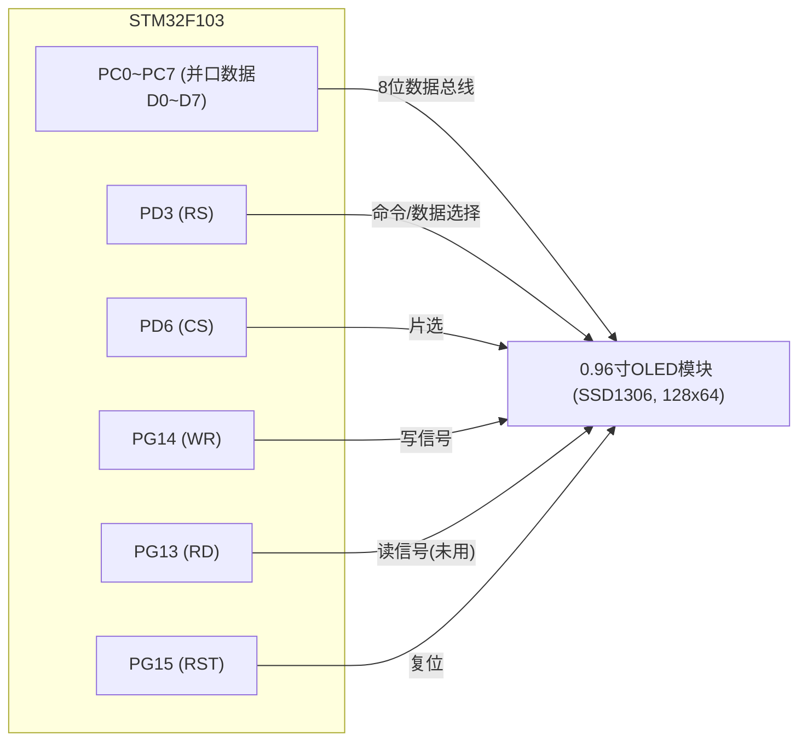
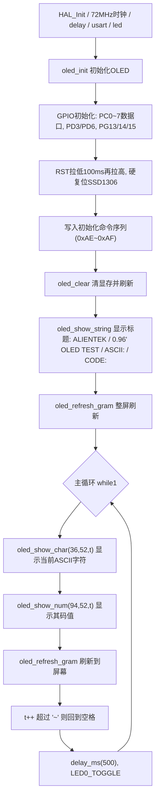

# 实验12 OLED实验

> 平台：正点原子 STM32F103（战舰）开发板 · HAL 库 · Keil MDK

## 一、实验简介

本实验驱动**正点原子 0.96 寸 OLED 模块**（128×64 分辨率，主控芯片 **SSD1306**），把它插在开发板左下角的 OLED/CAMERA 接口上即可使用。程序先在屏幕上显示标题字符串，然后循环显示从空格 `' '` 到 `'~'` 的全部 ASCII 字符及其码值，LED0 闪烁提示程序运行。驱动默认采用 **8080 并口模式**（IO 口模拟时序），也支持 4 线 SPI 模式（改一个宏即可切换）。OLED 是自发光器件，无需背光、对比度高、功耗低，是嵌入式项目最常用的显示器件之一。

🏠 **生活类比**：OLED 显存就像一块"画板缓冲区"。你所有的画点、写字操作都先在 MCU 内存里的画板（`g_oled_gram` 数组）上完成，最后喊一声"上墙！"（`oled_refresh_gram()`），整块画板内容一次性誊到屏幕上——这样既避免了频繁通信造成的闪烁，也让"画什么"和"怎么送"解耦。

## 二、实验目的

- 了解 SSD1306 OLED 的**显存（GDDRAM）组织方式**（8 页 × 128 列，每字节 8 个像素）
- 掌握 SSD1306 的**初始化命令序列**与"写命令/写数据"的区别
- 掌握 **8080 并口（IO 模拟）** 与 **4 线 SPI** 两种驱动方式的实现
- 学会使用显存缓冲区编程：画点 → 写字符 → 整屏刷新
- 掌握 `oled_show_char / oled_show_num / oled_show_string` 等显示 API 的用法

## 三、硬件资源与连接图

OLED 模块插在开发板左下角 **OLED/CAMERA 接口**（模块比接口少 2 针，**屏幕朝外、靠左插**）。8080 并口模式（默认，模块 BS0/BS1 均接 VCC）引脚如下：

| 信号 | MCU 引脚 | 说明 |
|------|----------|------|
| D0~D7（数据总线） | **PC0 ~ PC7** | 8 位并行数据（代码中直接写 `GPIOC->ODR` 低 8 位） |
| RS（数据/命令） | **PD3** | 0＝写命令，1＝写数据 |
| CS（片选） | **PD6** | 低电平有效 |
| WR（写信号） | **PG14** | 上升沿锁存数据（8080 时序） |
| RD（读信号） | **PG13** | 本实验只写不读，初始化为高 |
| RST（复位） | **PG15** | 低电平复位 |
| LED0 (DS0, 红) | PB5 | 低电平点亮，主循环 500ms 翻转提示运行 |

4 线 SPI 模式（`oled.h` 中改 `OLED_MODE` 为 0，模块 BS1/BS2 接 GND）时仅需 5 根线：**RST=PG15、CS=PD6、RS(DC)=PD3、SCLK=PC0、SDIN=PC1**。



> 接线说明：模块直接插在开发板左下角 OLED/CAMERA 接口上，屏幕朝外、靠左插，无需杜邦线。

## 四、核心寄存器与 SSD1306 命令

MCU 侧无专用外设寄存器（IO 模拟时序，直接操作 `GPIOC/GPIOD/GPIOG` 的 ODR）；核心是 **SSD1306 的命令字**（RS=0 时写入）：

| 命令 | 名称 | 作用 |
|------|------|------|
| `0xAE` / `0xAF` | Display OFF / ON | 关闭 / 开启显示 |
| `0xD5` + `0x50` | 时钟设置 | 设置振荡频率与分频因子 |
| `0xA8` + `0x3F` | 驱动路数 | 多路复用率 1/64（64 行） |
| `0xD3` + `0x00` | 显示偏移 | 无偏移 |
| `0x40` | 显示起始行 | 从第 0 行开始显示 |
| `0x8D` + `0x14` | 电荷泵 | bit2=1 开启电荷泵（升压，点亮 OLED 必需） |
| `0x20` + `0x02` | 内存地址模式 | 10＝**页寻址模式**（本驱动采用） |
| `0xA1` / `0xC8` | 段/COM 重映射 | 列地址 127 映射到 SEG0、COM 反向扫描（决定屏幕方向） |
| `0xDA` + `0x12` | COM 引脚配置 | 交替 COM 引脚、左右方向 |
| `0x81` + `0xEF` | 对比度 | 亮度 1~255，越大越亮 |
| `0xD9` + `0xF1` | 预充电周期 | PHASE1/PHASE2 充电时间 |
| `0xDB` + `0x30` | VCOMH 电压 | 0.83×VCC |
| `0xA4` / `0xA6` | 全局显示/显示方式 | 按显存显示、正常（非反相） |
| `0xB0+i` | 页地址 | 设置当前操作页（0~7，每页 8 行） |
| `0x00` / `0x10` | 列地址低/高 4 位 | 设置页内列起始地址（0~127） |

显存组织（`oled.c`）：`static uint8_t g_oled_gram[128][8]`——128 列 × 8 页，**每字节纵向表示 8 个像素**（低位在上）。例如 `g_oled_gram[1][0]` 的 bit1 即坐标 (1,1)。

## 五、软件架构 / 流程



## 六、主要示例代码及讲解

### 1. 8080 并口写一个字节（`Drivers/BSP/OLED/oled.c`）

```c
static uint8_t g_oled_gram[128][8];

#if OLED_MODE == 1    /* 使用8080并口驱动OLED */

static void oled_data_out(uint8_t data)
{
    GPIOC->ODR = (GPIOC->ODR & 0XFF00) | (data & 0X00FF);
}

static void oled_wr_byte(uint8_t data, uint8_t cmd)
{
    oled_data_out(data);
    OLED_RS(cmd);
    OLED_CS(0);
    OLED_WR(0);
    OLED_WR(1);
    OLED_CS(1);
    OLED_RS(1);
}
```

**讲解**：
- `oled_data_out()` 用一条语句把数据写到 `GPIOC->ODR` 低 8 位（PC0~PC7），保留高 8 位不变——8 根数据线一次并行送出，这就是"并口快"的原因。
- `OLED_RS(cmd)` 决定这字节是**命令**（RS=0）还是**显存数据**（RS=1）。
- `WR` 拉低再拉高产生一个**写脉冲**，SSD1306 在 WR 上升沿把总线数据锁存进去；CS 在传输期间保持低电平。
- `oled.h` 中 `OLED_MODE` 改为 0 则编译 SPI 版本：逐位输出 `data`，SCLK 上升沿移入，仅需 5 根线。

### 2. 整屏刷新（`Drivers/BSP/OLED/oled.c`）

```c
void oled_refresh_gram(void)
{
    uint8_t i, n;

    for (i = 0; i < 8; i++)
    {
        oled_wr_byte (0xb0 + i, OLED_CMD); /* 设置页地址（0~7） */
        oled_wr_byte (0x00, OLED_CMD);     /* 设置显示位置—列低地址 */
        oled_wr_byte (0x10, OLED_CMD);     /* 设置显示位置—列高地址 */

        for (n = 0; n < 128; n++)
        {
            oled_wr_byte(g_oled_gram[n][i], OLED_DATA);
        }
    }
}
```

**讲解**：
- SSD1306 在页寻址模式下，写显存前要先用 3 条命令"定位光标"：`0xB0+i` 选第 i 页，`0x00/0x10` 把列地址复位到 0（列地址分低 4 位、高 4 位两条命令）。
- 之后连续写 128 个数据字节，地址自动递增，正好填满一页；8 页写完即全屏刷新（1KB 显存）。
- 所有绘图函数（`oled_draw_point / oled_show_char / oled_fill` 等）都只改 `g_oled_gram` 数组，**改完必须调用本函数才会显示到屏幕上**。

### 3. 初始化命令序列与主函数（`Drivers/BSP/OLED/oled.c`、`User/main.c`）

```c
    OLED_RST(0);
    delay_ms(100);
    OLED_RST(1);

    oled_wr_byte(0xAE, OLED_CMD);   /* 关闭显示 */
    oled_wr_byte(0xD5, OLED_CMD);   /* 设置时钟分频因子,震荡频率 */
    oled_wr_byte(80, OLED_CMD);     /* [3:0],分频因子;[7:4],震荡频率 */
    oled_wr_byte(0xA8, OLED_CMD);   /* 设置驱动路数 */
    oled_wr_byte(0X3F, OLED_CMD);   /* 默认0X3F(1/64) */
    /* ... 显示偏移/起始行/电荷泵/内存模式/段重定义/COM扫描 ... */
    oled_wr_byte(0x8D, OLED_CMD);   /* 电荷泵设置 */
    oled_wr_byte(0x14, OLED_CMD);   /* bit2，开启/关闭 */
    /* ... 对比度/预充电/VCOMH/显示方式 ... */
    oled_wr_byte(0xAF, OLED_CMD);   /* 开启显示 */
    oled_clear();
```

```c
    oled_init();                            /* 初始化OLED */
    oled_show_string(0, 0, "ALIENTEK", 24);
    oled_show_string(0, 24, "0.96' OLED TEST", 16);
    oled_show_string(0, 52, "ASCII:", 12);
    oled_show_string(64, 52, "CODE:", 12);
    oled_refresh_gram();                    /* 更新显示到OLED */

    t = ' ';
    while (1)
    {
        oled_show_char(36, 52, t, 12, 1);   /* 显示ASCII字符 */
        oled_show_num(94, 52, t, 3, 12);    /* 显示ASCII字符的码值 */
        oled_refresh_gram();                /* 更新显示到OLED */
        t++;

        if (t > '~')
        {
            t = ' ';
        }

        delay_ms(500);
        LED0_TOGGLE();                      /* LED0闪烁 */
    }
```

**讲解**：
- 初始化前先用 RST 引脚做一次**硬复位**（拉低 100ms 再拉高），确保 SSD1306 处于确定状态。
- 命令序列中 `0x8D 0x14`（开电荷泵）必不可少——OLED 像素需要高于 VCC 的驱动电压，由片内电荷泵产生；不开电荷泵屏幕不会亮。
- 显示函数支持 12/16/24 三种字号（对应 `oledfont.h` 中的点阵字库）；坐标 (x,y) 中 x 为列 0~127、y 为行 0~63。
- 主循环让字符 `t` 从空格 `' '`（码值 32）到 `'~'`（码值 126）循环递增，每 500ms 换一个字符并显示其十进制码值。

## 七、实验效果

把 OLED 模块插入开发板左下角接口（屏幕朝外、靠左插）并烧录程序，复位后屏幕显示：

- 第一行 24 号字 **ALIENTEK**；第二行 16 号字 **0.96' OLED TEST**；
- 底部左侧 `ASCII:` 后每 500ms 依次显示空格到 `~` 的所有 ASCII 字符，右侧 `CODE:` 后同步显示对应码值（32→126 循环）；
- **LED0（红）每 500ms 闪烁一次**，提示程序运行。

## 八、注意事项

- 模块 **BS0/BS1 需接 VCC**（出厂默认），即 8080 并口方式；若要改 4 线 SPI，需改模块 BS 跳线并把 `oled.h` 中 `OLED_MODE` 改为 0。
- 开发板的 OLED/CAMERA 接口比 OLED 插针**多 2 个**，务必**屏幕朝外、靠左插**，插错位可能烧屏或烧板。
- 每次修改显存后必须调用 `oled_refresh_gram()` 才会更新屏幕；整屏刷新约 1KB 数据，不要在高速循环里频繁刷屏。
- 显示坐标范围 x:0~127、y:0~63，字号只能是 12/16/24，越界或字号不匹配会显示异常。
- OLED 为易碎器件，插拔时捏住模块边缘，不要直接按压玻璃屏。
- 修改代码后需重新编译烧录；若烧录失败可先运行根目录 `keilkill.bat`。

## 九、文件结构

```
实验12 OLED实验/
├── User/
│   ├── main.c              主程序（显示标题+ASCII字符/码值轮显）
│   ├── stm32f1xx_it.c      中断服务函数
│   └── stm32f1xx_hal_conf.h HAL配置
├── Drivers/
│   ├── BSP/
│   │   ├── LED/            LED 驱动 (led.c / led.h)
│   │   └── OLED/           OLED 驱动
│   │       ├── oled.c      8080并口/SPI写字节、显存刷新、初始化、绘图与文字显示
│   │       ├── oled.h      引脚宏定义(RST/CS/RS/WR/RD)、OLED_MODE模式开关、API声明
│   │       └── oledfont.h  12/16/24号ASCII点阵字库
│   ├── SYSTEM/             delay / sys / usart 系统支持
│   ├── CMSIS/              内核启动与设备定义
│   └── STM32F1xx_HAL_Driver/ ST HAL 库
├── Projects/MDK-ARM/       Keil 工程文件 (.uvprojx)
└── readme.txt              实验说明（GBK编码）
```
