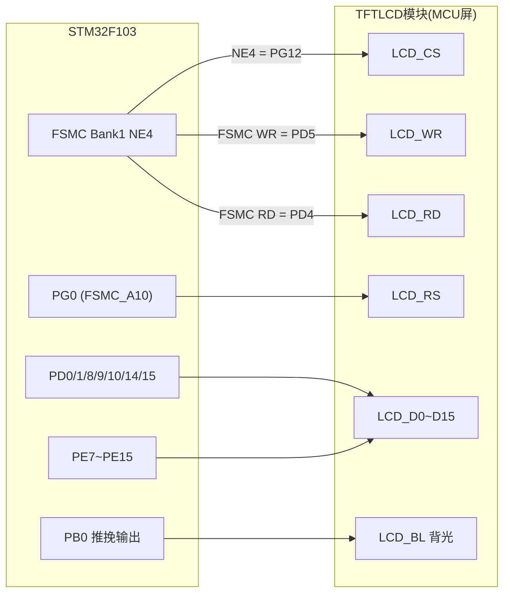
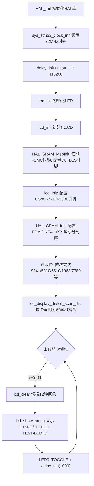

# 实验13 TFTLCD（MCU屏）实验

> 平台：正点原子 战舰 STM32F103 开发板 · HAL 库 · Keil MDK

## 一、实验简介

本实验使用战舰板丝印为 TFTLCD 的排座，驱动正点原子 2.8/3.5/4.3/7/10 寸彩色 TFTLCD 模块（仅限 MCU 屏，16 位 8080 并口）。驱动核心是 **FSMC 外设**——它把 LCD 当成一块"外部 SRAM"来访问，向特定地址写数据就等于向 LCD 写命令或像素，速度远快于软件模拟 GPIO 时序。程序循环切换 12 种底色、显示文字和 LCD 驱动 IC 的 ID。

🏠 **生活类比**：FSMC 驱动 LCD 就像用"快递流水线"寄包裹：你只要把包裹（数据）放到指定窗口地址，流水线（总线时序）自动帮你送达；而 LCD_RS 这根地址线就像窗口编号——寄到 A 窗口是"命令"，寄到 B 窗口是"数据"，一条地址线区分了两种业务。

## 二、实验目的

- 掌握用 **FSMC（灵活静态存储控制器）** 驱动 16 位 8080 并口 TFTLCD 的方法
- 理解 LCD_REG / LCD_RAM 两个地址如何通过 FSMC_A10（RS）区分命令与数据
- 学会配置 FSMC 读/写时序（AddressSetupTime、DataSetupTime、AccessMode）
- 学会读取 LCD 驱动 IC 的 ID（如 ILI9341、NT35310、NT35510、SSD1963 等）并自适应驱动
- 掌握 `lcd_clear`、`lcd_show_string`、`lcd_draw_point` 等常用绘图 API

## 三、硬件资源与连接图

| 外设/信号 | 引脚 | 说明 |
|------|------|------|
| LCD 数据线 D0~D15 | **PD14/PD15、PD0/PD1、PE7~PE15、PD8/PD9/PD10** | FSMC_D0~D15，16 位并口 |
| LCD_CS 片选 | **PG12** | FSMC_NE4（FSMC_Bank1 块4 片选） |
| LCD_RS 寄存器/数据选择 | **PG0** | FSMC_A10（地址线 A10） |
| LCD_WR 写信号 | **PD5** | FSMC 复用功能（NOR 写使能） |
| LCD_RD 读信号 | **PD4** | FSMC 复用功能（读使能） |
| LCD_BL 背光 | **PB0** | 普通推挽输出，高电平点亮背光 |
| LED0 (DS0, 红) | **PB5** | 低电平点亮，指示程序运行 |
| LED1 (DS1, 绿) | **PE5** | 低电平点亮 |
| 串口1 | **PA9/PA10** | 板载 CH340，115200，打印 LCD ID |



> 接线说明：LCD 模块直接插在战舰板 TFTLCD 排座上。FSMC_NE4 基地址为 `0x6C00 0000`，地址线 A10 对应偏移 `2^10 × 2 = 0x800`。驱动中定义：
> `LCD_BASE = (0x60000000 + 0x4000000*(NEX-1)) | (((1<<AX)*2) - 2)`，即 `0x6C00 07FE`。
> 结构体 `LCD->LCD_REG`（RS=0）写命令，`LCD->LCD_RAM`（RS=1）写数据。

## 四、核心寄存器（FSMC / GPIO）

| 寄存器 | 名称 | 作用 |
|--------|------|------|
| `RCC_AHBENR` | AHB 外设时钟使能 | 置位 FSMCEN，使能 FSMC 时钟 |
| `FSMC_BCR4`（BTCR[6]） | 块4 控制寄存器 | MBKEN 使能存储块；MWID[1:0]=01 选 16 位数据宽度；WREN=1 使能写操作；EXTMOD=1 使能读写分时序（BWTR 有效） |
| `FSMC_BTR4`（BTCR[7]） | 块4 读时序寄存器 | ADDSET[3:0] 地址建立时间；DATAST[7:0] 数据保持时间；ACCMOD 访问模式。本实验读时序：ADDSET=0、DATAST=15、模式A |
| `FSMC_BWTR4` | 块4 写时序寄存器 | 字段同 BTR，专用于写操作。本实验写时序：ADDSET=0、DATAST=1、模式A（写比读快得多） |
| `GPIOx_CRL/CRH` | 端口配置寄存器 | 把 PD/PE/PG 相关引脚配成 **50MHz 复用推挽输出**（CNF=10 复用推挽）；PB0 配成普通推挽输出控制背光 |
| `GPIOx_ODR/BSRR` | 输出数据/置位复位寄存器 | 控制 PB0 背光开关 |

FSMC 异步写（模式A）一次访问的时序：

```
|<- ADDSET+1 ->|<- DATAST+1 ->|  单位: HCLK(72MHz, 13.9ns)
NWE ──────────┐____________┌──   写脉冲宽度 = (DATAST+1)*13.9ns
写: DATAST=1 → 约27.8ns(实际>200ns)   读: DATAST=15 → 222.4ns(读必须慢)
```

## 五、软件架构 / 流程



## 六、主要示例代码及讲解

### 1. LCD 底层读写（`Drivers/BSP/LCD/lcd.c`）

```c
/* LCD地址结构体 (lcd.h) */
typedef struct
{
    volatile uint16_t LCD_REG;
    volatile uint16_t LCD_RAM;
} LCD_TypeDef;

#define LCD_BASE  (uint32_t)((0X60000000 + (0X4000000 * (LCD_FSMC_NEX - 1))) \
                  | (((1 << LCD_FSMC_AX) * 2) -2))
#define LCD       ((LCD_TypeDef *) LCD_BASE)

void lcd_wr_data(volatile uint16_t data)
{
    data = data;            /* 使用-O2优化的时候,必须插入的延时 */
    LCD->LCD_RAM = data;
}

void lcd_wr_regno(volatile uint16_t regno)
{
    regno = regno;          /* 使用-O2优化的时候,必须插入的延时 */
    LCD->LCD_REG = regno;   /* 写入要写的寄存器序号 */
}
```

**讲解**：
- 整个 LCD 驱动被映射成结构体的两个成员：`LCD_REG` 和 `LCD_RAM`，两者地址差 2（16 位宽度），恰好落在 FSMC_A10 的 0/1 电平上——A10=0 时 RS=0 发命令，A10=1 时 RS=1 发数据。
- 向 `LCD->LCD_RAM` 赋值一次，FSMC 就自动产生一个完整的 8080 写时序，**这就是"像访问内存一样访问外设"**。
- `regno = regno;` 这类"自赋值"是为了防止编译器 -O2 优化时把连续写操作合并、破坏 LCD 时序。

### 2. FSMC 初始化（`Drivers/BSP/LCD/lcd.c` 中 `lcd_init`）

```c
g_sram_handle.Init.NSBank = FSMC_NORSRAM_BANK4;                    /* 使用NE4 */
g_sram_handle.Init.MemoryDataWidth = FSMC_NORSRAM_MEM_BUS_WIDTH_16;/* 16位数据宽度 */
g_sram_handle.Init.WriteOperation = FSMC_WRITE_OPERATION_ENABLE;   /* 存储器写使能 */
g_sram_handle.Init.ExtendedMode = FSMC_EXTENDED_MODE_ENABLE;       /* 读写使用不同的时序 */

/* FSMC读时序 */
fsmc_read_handle.AddressSetupTime = 0;   /* 地址建立时间(ADDSET)为1个HCLK 13.9ns */
fsmc_read_handle.DataSetupTime = 15;     /* 数据保持时间(DATAST)为16个HCLK=222.4ns */
fsmc_read_handle.AccessMode = FSMC_ACCESS_MODE_A;   /* 模式A */
/* FSMC写时序 */
fsmc_write_handle.AddressSetupTime = 0;
fsmc_write_handle.DataSetupTime = 1;     /* 数据保持时间(DATAST)为2个HCLK=27.8ns */
fsmc_write_handle.AccessMode = FSMC_ACCESS_MODE_A;

HAL_SRAM_Init(&g_sram_handle, &fsmc_read_handle, &fsmc_write_handle);
delay_ms(50);        /* 初始化FSMC后,必须等待一定时间才能开始初始化 */
```

**讲解**：
- LCD 通过 `HAL_SRAM_Init` 按"异步 SRAM"方式初始化，写入 `FSMC_BCR4/BTR4/BWTR4` 寄存器。
- **读慢写快**：读数据 DATAST=15（222.4ns），因为液晶驱动 IC 读出 GRAM 需要较长时间；写数据 DATAST=1 即可，这样刷屏速度最快。
- `ExtendedMode=ENABLE` 才能让 BTR（读）和 BWTR（写）两套时序同时生效。
- 引脚部分：`HAL_SRAM_MspInit` 里把 PD0/1/8/9/10/14/15、PE7~PE15 配成复用推挽（它们即 FSMC_D0~D15），背光 PB0 配成普通推挽输出。

### 3. 主函数（`User/main.c`，节选）

```c
lcd_init();                                         /* 初始化LCD */
g_point_color = RED;
sprintf((char *)lcd_id, "LCD ID:%04X", lcddev.id);  /* 将LCD ID打印到lcd_id数组 */

while (1)
{
    switch (x)
    {
    case 0:  lcd_clear(WHITE);    break;
    case 1:  lcd_clear(BLACK);    break;
    case 2:  lcd_clear(BLUE);     break;
    /* ... case 3~10 ... */
    case 11: lcd_clear(BROWN);    break;
    }
    lcd_show_string(10, 40, 240, 32, 32, "STM32", RED);
    lcd_show_string(10, 80, 240, 24, 24, "TFTLCD TEST", RED);
    lcd_show_string(10, 110, 240, 16, 16, "ATOM@ALIENTEK", RED);
    lcd_show_string(10, 130, 240, 16, 16, (char *)lcd_id, RED); /* 显示LCD ID */
    x++;
    if (x == 12) x = 0;
    LED0_TOGGLE(); /*红灯闪烁*/
    delay_ms(1000);
}
```

**讲解**：
- `lcd_init()` 内部会读 ID 自动识别 ILI9341/NT35310/NT35510/SSD1963 等多种驱动 IC，并根据 ID 设置分辨率、写 GRAM 指令等参数存入全局结构体 `lcddev`。
- `lcd_show_string(x, y, width, height, size, str, color)` 支持 16/24/32 三种字号，`lcd_clear(color)` 全屏刷色。
- 主循环每 1 秒切换一种底色循环显示 12 种颜色，同时 LED0 闪烁指示程序在运行。

## 七、实验效果

程序下载后，LCD 每秒切换一种底色（白→黑→蓝→红→品红→绿→青→黄→亮红→灰→浅灰→棕循环），屏上显示 "STM32"、"TFTLCD TEST"、"ATOM@ALIENTEK" 和 `LCD ID:xxxx`；串口（115200）每次复位打印一次 LCD 驱动 IC 的 ID；板载红色 LED0 每秒闪烁。

## 八、注意事项

- 本例程**仅支持 MCU 屏（16 位 8080 并口），不支持 RGB 屏**。
- LCD 模块必须插到战舰板丝印 TFTLCD 的排座上；4.3 寸和 7 寸屏电流较大，USB 供电可能不足，建议外接 12V 1A 电源适配器。
- 串口调试助手波特率必须是 115200，推荐使用 XCOM/SSCOM；P4 的 PA9/PA10 必须用跳线帽连接在 RXD/TXD 上。
- FSMC 读时序不能设太快（DATAST 太小），个别驱动 IC 会读 ID 失败，表现为 ID 显示 0000 或 FFFF——此时检查排座是否插紧。
- 若移植到其他板子，除了改 CS/WR/RD/RS/BL 这 6 个 IO 定义，还要改 `lcd_init` 里 D0~D15 的引脚配置，并保证 `LCD_FSMC_NEX`/`LCD_FSMC_AX` 与 CS/RS 实际所接 FSMC 片选/地址线一致。
- 烧录失败时先运行根目录 `keilkill.bat` 结束占用进程。

## 九、文件结构

```
实验13 TFTLCD（MCU屏）实验/
├── User/
│   ├── main.c                  主程序：底色循环切换 + 文字显示
│   ├── stm32f1xx_it.c          中断服务函数
│   └── stm32f1xx_hal_conf.h    HAL 配置
├── Drivers/
│   ├── BSP/
│   │   ├── LCD/                LCD 驱动
│   │   │   ├── lcd.c           FSMC初始化、ID识别、画点/填色/显示字符
│   │   │   ├── lcd.h           引脚/FSMC/LCD_BASE 定义
│   │   │   ├── lcd_ex.c        各型号LCD初始化序列(寄存器表)
│   │   │   └── lcdfont.h       16/24/32 点阵字库
│   │   └── LED/                LED 驱动 (led.c / led.h)
│   ├── SYSTEM/                 delay / sys / usart 系统支持
│   ├── CMSIS/                  内核启动与设备定义
│   └── STM32F1xx_HAL_Driver/   ST HAL 库(含 FSMC/SRAM 驱动)
├── Projects/MDK-ARM/           Keil 工程文件 (.uvprojx)
└── readme.txt                  实验说明(厂商原始文档)
```
