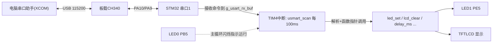
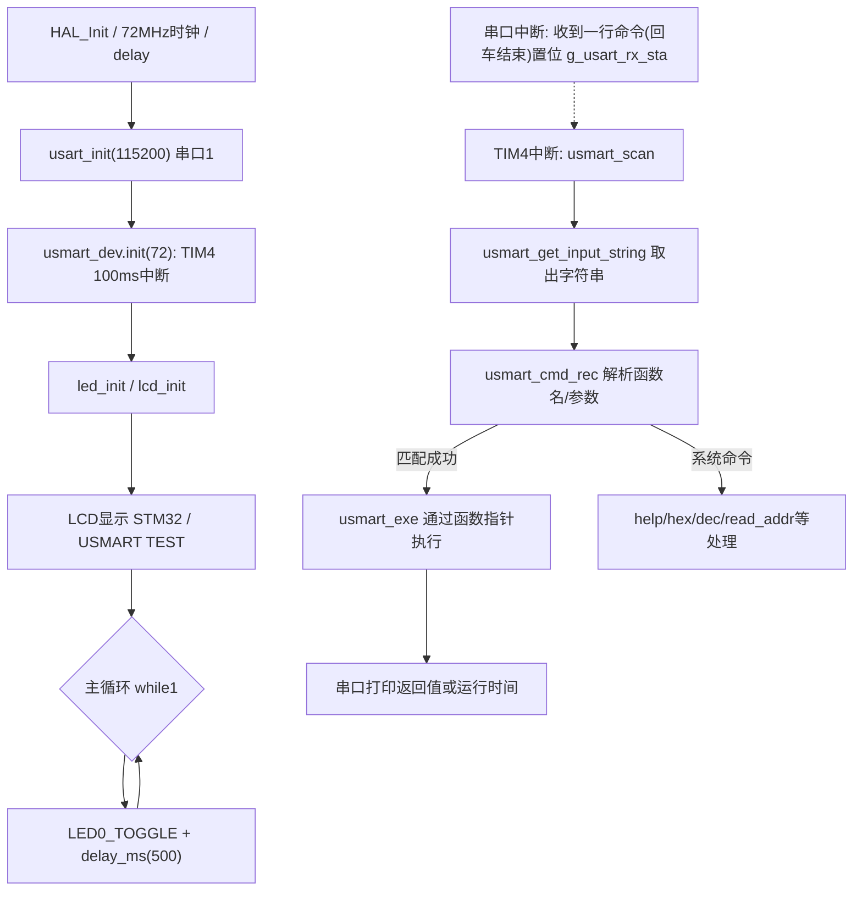

# 实验14 USMART调试实验

> 平台：正点原子 战舰 STM32F103 开发板 · HAL 库 · Keil MDK

## 一、实验简介

本实验学习正点原子自研的串口调试组件 **USMART**（位于 `Middlewares/USMART`）。把它移植进工程后，你可以在电脑串口助手里**直接输入函数名和参数，远程调用单片机内部的任意函数**（如 `lcd_clear(0XF800)`、`led_set(0)`），还能读取任意地址、修改变量、统计函数运行时间——相当于一个"命令行版调试器"，不用反复改代码、编译、烧录就能测试驱动。

🏠 **生活类比**：USMART 就像家里的"语音管家"。你不用亲自走到灯前按开关（改代码重新烧录），只要喊一句"开灯"（串口发送 `led_set(0)`），管家就替你执行。函数名列表 `usmart_nametab` 就是管家手里的"技能清单"，只有登记在清单上的技能才能被喊话触发。

## 二、实验目的

- 理解 USMART 组件的工作原理：串口收字符串 → 定时器扫描 → 解析函数名/参数 → 通过函数指针执行
- 学会在 `usmart_config.c` 的 `usmart_nametab[]` 中注册需要远程调用的函数
- 掌握 USMART 常用指令：`help`、`id`、`hex`、`dec`、`read_addr`、`write_addr`、`runtime`
- 复习串口1（PA9/PA10, 115200）与定时器 TIM4 中断的配合使用

## 三、硬件资源与连接图

本实验不新增外设，硬件复用前几个实验的资源：

| 外设 | 引脚/资源 | 说明 |
|------|------|------|
| 串口1 | **PA9(TX) / PA10(RX)** | 板载 CH340 USB 转串口，波特率 115200，USMART 命令通道 |
| TIM4 | 内部定时器 | USMART 扫描定时中断（计数频率 10kHz，ARR=1000 → 每 100ms 扫描一次） |
| LCD (MCU屏) | FSMC NE4 等 | 被 USMART 远程调用显示函数（引脚见实验13） |
| LED0 (DS0, 红) | **PB5** | 低电平点亮，主循环闪烁提示程序运行 |
| LED1 (DS1, 绿) | **PE5** | 低电平点亮，被 `led_set()` 远程控制 |



## 四、核心寄存器（USART / TIM）

USMART 是纯软件组件，靠串口收发 + 定时器扫描工作，涉及的关键寄存器：

| 寄存器 | 名称 | 作用 |
|--------|------|------|
| `USART1_SR` | 串口状态寄存器 | RXNE(bit5) 置位表示收到一字节；TC(bit6) 发送完成。中断里据此收发 |
| `USART1_DR` | 串口数据寄存器 | 读 DR 取走接收字节；写 DR 发送字节（printf 重定向到此处） |
| `USART1_BRR` | 波特率寄存器 | 72MHz/115200 的分频值，设置波特率 |
| `TIM4_CR1` | 定时器控制寄存器1 | CEN 使能计数器；向上计数模式 |
| `TIM4_PSC` | 预分频寄存器 | `usmart_init(72)` 时 PSC = 72×100−1 = 7199，72MHz/7200 = 10kHz 计数频率 |
| `TIM4_ARR` | 自动重装载寄存器 | 设为 1000 → 10kHz/1000 = 10Hz，即每 100ms 进一次更新中断扫描串口 |
| `TIM4_DIER` | 中断使能寄存器 | UIE 置位允许更新中断 |
| `TIM4_CNT` | 计数寄存器 | runtime 统计功能用它测量函数执行时间（单位 0.1ms） |

## 五、软件架构 / 流程



**关键点**：主循环完全不参与 USMART，命令的接收靠串口中断、执行靠 TIM4 定时中断，两条中断线并行工作，因此主循环还能继续闪烁 LED。

## 六、主要示例代码及讲解

### 1. 注册可调用函数（`Middlewares/USMART/usmart_config.c`）

```c
#include "./BSP/LCD/lcd.h"
extern void led_set(uint8_t sta);
extern void test_fun(void(*ledset)(uint8_t), uint8_t sta);

/* 函数名列表初始化(用户自己添加) */
struct _m_usmart_nametab usmart_nametab[] =
{
#if USMART_USE_WRFUNS == 1      /* 如果使能了读写操作 */
    (void *)read_addr,  "uint32_t read_addr(uint32_t addr)",
    (void *)write_addr, "void write_addr(uint32_t addr,uint32_t val)",
#endif
    (void *)delay_ms, "void delay_ms(uint16_t nms)",
    (void *)lcd_clear, "void lcd_clear(uint16_t color)",
    (void *)lcd_show_string, "void lcd_show_string(uint16_t x, uint16_t y, uint16_t width, uint16_t height, uint8_t size, char *p, uint16_t color)",
    (void *)led_set, "void led_set(uint8_t sta)",
    (void *)test_fun, "void test_fun(void(*ledset)(uint8_t), uint8_t sta)",
};
```

**讲解**：
- 每一项 = **函数指针 + 函数原型字符串**。原型字符串供 USMART 匹配串口命令、确定参数个数和类型（数字/字符串/函数地址）。
- 想让哪个函数能被串口调用，就把它加进这张表——这是使用 USMART 唯一需要改的地方。
- 单个函数最多支持 10 个参数（`MAX_PARM`），支持 10/16 进制、负数、字符串和函数入口地址作参数。

### 2. 供 USMART 调用的测试函数（`User/main.c`）

```c
/* LED状态设置函数 */
void led_set(uint8_t sta)
{
    LED1(sta);
}

/* 函数参数调用测试函数 */
void test_fun(void(*ledset)(uint8_t), uint8_t sta)
{
    ledset(sta);
}

int main(void)
{
    HAL_Init();                         /* 初始化HAL库 */
    sys_stm32_clock_init(RCC_PLL_MUL9); /* 设置时钟, 72Mhz */
    delay_init(72);                     /* 延时初始化 */
    usart_init(115200);                 /* 串口初始化为115200 */
    usmart_dev.init(72);                /* 初始化USMART */
    led_init();                         /* 初始化LED */
    lcd_init();                         /* 初始化LCD */
    /* ... LCD 显示提示信息 ... */
    while (1)
    {
        LED0_TOGGLE();                  /* LED0(RED) 闪烁 */
        delay_ms(500);
    }
}
```

**讲解**：
- `usmart_dev.init(72)` 传入定时器时钟 72MHz，内部配置 TIM4：PSC=7199（10kHz）、ARR=1000（100ms 中断扫描一次）。
- `test_fun` 演示了"函数指针作参数"：串口输入 `test_fun led_set,1` 即可把 `led_set` 的地址传给 `test_fun` 调用。
- 主循环只负责闪 LED0，USMART 在中断中后台运行。

### 3. 命令解析与执行（`Middlewares/USMART/usmart.c`，节选）

```c
void usmart_scan(void)
{
    uint8_t sta, len;
    char *pbuf = 0;

    pbuf = usmart_get_input_string();   /* 获取数据流 */
    if (pbuf == 0) return ;             /* 数据流空, 直接返回 */

    sta = usmart_dev.cmd_rec(pbuf);     /* 得到函数各个信息 */
    if (sta == 0)
    {
        usmart_dev.exe();               /* 执行函数 */
    }
    else
    {
        len = usmart_sys_cmd_exe(pbuf); /* 系统命令: help/hex/dec/id... */
        /* ... 错误提示: 函数错误/参数错误/未找到匹配的函数 ... */
    }
}
```

**讲解**：
- `usmart_scan()` 在 TIM4 更新中断里被调用；`usmart_get_input_string()`（usmart_port.c）检查串口接收标志 `g_usart_rx_sta`，收到完整一行（以回车结束）才返回字符串。
- `cmd_rec` 把命令串与 `usmart_nametab` 逐项比对，提取参数；`exe` 按解析出的参数类型压栈并通过函数指针调用目标函数，有返回值的（如 `read_addr`）会打印到串口。
- 移植到别的工程时，只需按 `usmart_port.c/h` 的注释实现串口取串和定时器扫描两组接口即可。

## 七、实验效果

程序下载后 LCD 显示 "STM32 / USMART TEST / ATOM@ALIENTEK"，LED0 每 0.5s 闪烁。打开 XCOM 串口助手（115200，勾选发送新行），按复位后 USMART 打印版本和帮助信息；此时可输入命令：

- `help`：列出全部指令；`id 3`：查看 3 号函数原型
- `led_set 0` / `led_set 1`：远程点亮/熄灭 LED1
- `lcd_clear 0XF800`：LCD 刷成红色；`lcd_show_num 30,120,888,3,16,RED`：屏上显示数字
- `read_addr 0X20000000`：读取 RAM 地址内容；`hex 100`：显示 `HEX 0X64`
- `test_fun led_set,1`：演示函数指针作为参数

## 八、注意事项

- 串口调试助手波特率必须是 115200，请使用 XCOM/SSCOM，其他助手可能控制 DTR/RTS 导致 MCU 复位或程序不运行。
- 串口输入字符串必须**以回车换行结束**，否则 USMART 认为命令未接收完整。
- P4 的 PA9/PA10 必须通过跳线帽连接在 RXD/TXD 上，并用 USB 线连接 USB_UART 口。
- 被注册函数的原型字符串必须与真实函数**参数个数、类型一致**，否则解析出错甚至跑飞。
- `runtime 1` 统计函数运行时间的功能，必须保证 `usmart_port.h` 中 `USMART_ENTIMX_SCAN = 1` 才可用；TIM4 被 USMART 占用，工程中勿重复使用 TIM4。
- USMART 默认占用约 4KB FLASH、最少 72 字节 SRAM，应保证堆栈不小于 100 字节。
- 烧录失败时先运行根目录 `keilkill.bat` 结束占用进程。

## 九、文件结构

```
实验14 USMART调试实验/
├── User/
│   ├── main.c                  主程序：led_set/test_fun 测试函数 + LED0闪烁
│   ├── stm32f1xx_it.c          中断服务函数
│   └── stm32f1xx_hal_conf.h    HAL 配置
├── Middlewares/
│   └── USMART/                 USMART 串口调试组件(V3.5)
│       ├── usmart.c/h          核心：命令解析 cmd_rec、执行 exe、扫描 scan
│       ├── usmart_str.c/h      字符串处理与参数解析
│       ├── usmart_config.c     用户函数注册表 usmart_nametab[]（移植主要改这里）
│       └── usmart_port.c/h     移植层：TIM4 扫描、串口取串接口
├── Drivers/
│   ├── BSP/
│   │   ├── LCD/                LCD 驱动（供 USMART 远程调用）
│   │   └── LED/                LED 驱动
│   ├── SYSTEM/                 delay / sys / usart（串口1 收发缓冲）
│   ├── CMSIS/                  内核启动与设备定义
│   └── STM32F1xx_HAL_Driver/   ST HAL 库
├── Projects/MDK-ARM/           Keil 工程文件 (.uvprojx)
└── readme.txt                  实验说明(厂商原始文档)
```
