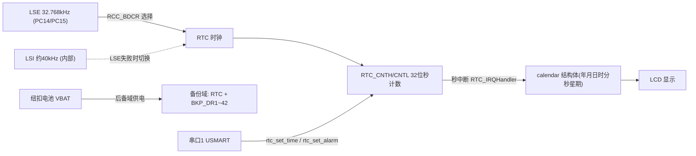
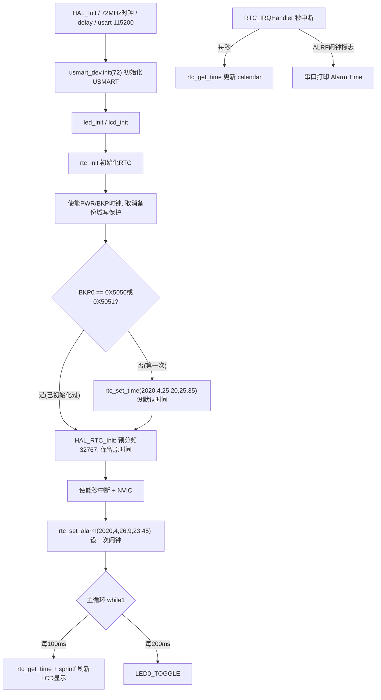

# 实验15 RTC实验

> 平台：正点原子 战舰 STM32F103 开发板 · HAL 库 · Keil MDK

## 一、实验简介

本实验学习 STM32F103 内部 **RTC（实时时钟）** 的使用：LCD 实时显示年月日、时分秒和星期，可通过 USMART 串口命令远程设置时间、闹钟以及读写 RTC 后备寄存器。STM32 的 RTC 本质是一个由低速时钟（LSE 32.768kHz 或 LSI 40kHz）驱动的 **32 位秒计数器**，软件再把"总秒数"换算成日历时间。RTC 位于备份域，靠纽扣电池供电，主电源断开后时间照常走。

🏠 **生活类比**：RTC 就像家里的挂钟——只要装上电池（后备域 VBAT 供电），哪怕全屋停电（主电源断开）它也一直走。你回家只需"对一次表"（设置时间），之后每次看钟都是准确时间，不用重新买钟（重新初始化）。

## 二、实验目的

- 理解 RTC 的"秒计数器"本质，掌握秒数与年月日时分秒的相互换算
- 掌握 RTC 时钟源配置：优先 LSE（32.768kHz），起振失败自动切换 LSI（约40kHz）
- 掌握备份域访问流程：使能 PWR/BKP 时钟 → 取消写保护 → 操作 RTC/BKP 寄存器
- 学会使用 RTC 秒中断、闹钟中断，以及后备寄存器 BKP_DRx 保存配置标志
- 结合 USMART 通过串口远程调用 `rtc_set_time` / `rtc_set_alarm` / `rtc_read_bkr` / `rtc_write_bkr`

## 三、硬件资源与连接图

| 外设 | 引脚/资源 | 说明 |
|------|------|------|
| RTC 时钟源 | **PC14/PC15（LSE 32.768kHz 晶振）** | 板载低速晶振；失败则用内部 LSI |
| 后备域供电 | **VBAT 引脚（纽扣电池）** | 主电源断开后维持 RTC 计数与 BKP 寄存器 |
| LCD (MCU屏) | FSMC 接口（见实验13） | 显示时间/日期/星期 |
| 串口1 | **PA9/PA10** | 115200，USMART 命令通道 + 闹钟打印 |
| LED0 (DS0, 红) | **PB5** | 每 200ms 翻转，提示程序运行 |
| LED1 (DS1, 绿) | **PE5** | 低电平点亮 |



> 接线说明：无需外接模块，LCD 插在 TFTLCD 排座、USB 线接 USB_UART 口即可。后备域内容（RTC 计数、BKP 寄存器）只在 VBAT 也断电时才会丢失。

## 四、核心寄存器（RTC / PWR / RCC / BKP）

F103 的 RTC 是"老式"结构（不同于 F4 的 BCD 日历式 RTC），关键寄存器：

| 寄存器 | 名称 | 作用 |
|--------|------|------|
| `RTC_CRH` | RTC 控制寄存器高 | 中断使能位：SECIE 秒中断、ALRIE 闹钟中断、OWIE 溢出中断 |
| `RTC_CRL` | RTC 控制寄存器低 | 标志位 SECF/ALRF/OWF；**CNF(bit4)=1 进入配置模式**才能写 CNT/ALR/PRL；RTOFF(bit5)=1 表示上次操作完成 |
| `RTC_PRLH / RTC_PRLL` | 预分频装载寄存器(高/低) | 20 位预分频值，本实验 AsynchPrediv=32767：32.768kHz/(32767+1) = **1Hz 秒脉冲** |
| `RTC_CNTH / RTC_CNTL` | 计数器寄存器(高/低) | 32 位秒计数值，从 1970-1-1 0:0:0 起累计 |
| `RTC_ALRH / RTC_ALRL` | 闹钟寄存器(高/低) | CNT 计数值等于 ALR 时触发闹钟中断 |
| `RCC_BDCR` | 备份域控制寄存器 | LSEON(bit0) 开外部低速晶振、LSERDY(bit1) 就绪标志；RTCSEL 选择 RTC 时钟源、RTCEN 使能 |
| `PWR_CR` | 电源控制寄存器 | **DBP(bit8)=1 取消备份域写保护**（HAL_PWR_EnableBkUpAccess 做的事） |
| `BKP_DR1~DR42` | 备份数据寄存器 | 掉电保持的小存储区。本驱动用 BKP0 存标志：0X5050=已用LSE初始化，0X5051=已用LSI初始化 |

写 RTC 寄存器的固定流程：`等待RTOFF=1 → CNF=1 → 写CNT/ALR/PRL → CNF=0 → 等待RTOFF=1`。

## 五、软件架构 / 流程



## 六、主要示例代码及讲解

### 1. RTC 初始化与时钟源选择（`Drivers/BSP/RTC/rtc.c`）

```c
uint8_t rtc_init(void)
{
    uint16_t bkpflag = 0;

    __HAL_RCC_PWR_CLK_ENABLE(); /* 使能电源时钟 */
    __HAL_RCC_BKP_CLK_ENABLE(); /* 使能备份时钟 */
    HAL_PWR_EnableBkUpAccess(); /* 取消备份区写保护 */

    bkpflag = rtc_read_bkr(0);  /* 读取BKP0的值 */

    g_rtc_handle.Instance = RTC;
    g_rtc_handle.Init.AsynchPrediv = 32767; /* 时钟周期设置,理论值：32767 */
    g_rtc_handle.Init.OutPut = RTC_OUTPUTSOURCE_NONE;
    if (HAL_RTC_Init(&g_rtc_handle) != HAL_OK) return 1;

    if ((bkpflag != 0X5050) && (bkpflag != 0x5051))  /* 之前未初始化过，重新配置 */
    {
        rtc_set_time(2020, 4, 25, 20, 25, 35);       /* 设置时间 */
    }

    __HAL_RTC_ALARM_ENABLE_IT(&g_rtc_handle, RTC_IT_SEC);   /* 允许秒中断 */
    HAL_NVIC_SetPriority(RTC_IRQn, 0x2, 0);
    HAL_NVIC_EnableIRQ(RTC_IRQn);                           /* 使能RTC中断通道 */
    rtc_get_time(); /* 更新时间 */
    return 0;
}
```

**讲解**：
- 操作备份域前必须先**使能 PWR 和 BKP 时钟并取消写保护**（改 `PWR_CR` 的 DBP 位），这三步缺一不可。
- `HAL_RTC_MspInit`（被 HAL_RTC_Init 回调）里用 `RCC->BDCR` 检测 LSE 是否起振：成功则 RTC 用 LSE 并向 BKP0 写 0X5050；失败自动改用 LSI 并写 0X5051。
- BKP0 标志让程序能区分"第一次上电"和"电池供电后重新上电"——后者**不重设时间**，实现断电续走。
- 预分频 32767：32768Hz/(32767+1)=1Hz，RTC 计数器每秒加 1。

### 2. 设置时间与闹钟（`Drivers/BSP/RTC/rtc.c`）

```c
uint8_t rtc_set_time(uint16_t syear, uint8_t smon, uint8_t sday,
                     uint8_t hour, uint8_t min, uint8_t sec)
{
    uint32_t seccount = 0;
    seccount = rtc_date2sec(syear, smon, sday, hour, min, sec); /* 年月日→总秒数 */

    __HAL_RCC_PWR_CLK_ENABLE();
    __HAL_RCC_BKP_CLK_ENABLE();
    HAL_PWR_EnableBkUpAccess();
    /* 上面三步是必须的! */

    RTC->CRL |= 1 << 4;         /* 允许配置(CNF=1) */
    RTC->CNTL = seccount & 0xffff;
    RTC->CNTH = seccount >> 16;
    RTC->CRL &= ~(1 << 4);      /* 配置更新(CNF=0) */
    while (!__HAL_RTC_ALARM_GET_FLAG(&g_rtc_handle, RTC_FLAG_RTOFF)); /* 等RTOFF=1 */
    return 0;
}
```

**讲解**：
- F103 的 RTC 没有"年月日寄存器"，`rtc_date2sec` 以 1970-1-1 为基准把日历换算成 32 位秒数写进 `RTC_CNTH/CNTL`（年份合法范围 1970~2105）。
- 写 CNT 前必须置 `CRL` 的 CNF 位进入配置模式，写完清零并等待 RTOFF=1 确认操作完成——这是 RTC 寄存器访问的硬件要求。
- `rtc_set_alarm` 写法完全相同，只是把秒数写入 `RTC_ALRH/ALRL`；当 CNT 追平 ALR 时产生闹钟中断。

### 3. 主循环显示与中断服务（`User/main.c`、`rtc.c`）

```c
rtc_set_alarm(2020, 4, 26, 9, 23, 45);  /* 设置一次闹钟 */
while (1)
{
    t++;
    if ((t % 10) == 0)                  /* 每100ms更新一次显示数据 */
    {
        rtc_get_time();
        sprintf((char *)tbuf, "Time:%02d:%02d:%02d",
                calendar.hour, calendar.min, calendar.sec);
        lcd_show_string(30, 120, 210, 16, 16, (char *)tbuf, RED);
        sprintf((char *)tbuf, "Date:%04d-%02d-%02d",
                calendar.year, calendar.month, calendar.date);
        lcd_show_string(30, 140, 210, 16, 16, (char *)tbuf, RED);
        /* Week 同理... */
    }
    if ((t % 20) == 0) LED0_TOGGLE();   /* 每200ms,翻转一次LED0 */
    delay_ms(10);
}
```

**讲解**：
- 秒中断 `RTC_IRQHandler` 里检查 `RTC_CRL` 的 SECF/ALRF 标志：秒中断每秒调用 `rtc_get_time()` 把 CNT 换算回日历存入全局 `calendar` 结构体；闹钟中断则通过串口打印 `Alarm Time`。
- 主循环只负责把 `calendar` 格式化后刷到 LCD，时间维护完全在中断中后台完成。
- 通过 USMART 输入 `rtc_set_time 2023,10,1,8,30,0` 即可远程改时间，`rtc_read_bkr 1` / `rtc_write_bkr 1,0X1234` 可读写后备寄存器。

## 七、实验效果

程序下载后，LCD 显示 "STM32 / RTC TEST / ATOM@ALIENTEK"，下方每 100ms 刷新一次 `Time:时:分:秒`、`Date:年-月-日`、`Week:星期`；LED0 每 200ms 翻转。首次运行时间从默认值 2020-4-25 20:25:35 开始走；到达设定的闹钟时刻（默认 2020-4-26 9:23:45）时串口打印一次 `Alarm Time:...`。通过 USMART 可随时修改时间/闹钟或读写后备寄存器。

## 八、注意事项

- 时间基准是 1970-1-1，合法年份范围 **1970~2105**（32 位秒计数溢出限制）。
- 修改 RTC/BKP 寄存器前必须：使能 PWR、BKP 时钟 + `HAL_PWR_EnableBkUpAccess()` 取消写保护，且遵守 CNF/RTOFF 握手流程。
- 切换 LSE/LSI 会导致时间丢失，需重新设置；可通过 BKP0 的值判断当前时钟源（0X5050=LSE，0X5051=LSI）。
- LSI 精度较低（约 40kHz ±数%），对时精度要求高请确保 LSE 晶振正常起振。
- 只有 VBAT 电池也断电（或执行备份域复位）后，时间才会恢复默认值；单纯重新烧录程序/按复位不会丢时间。
- 串口调试助手波特率 115200，推荐 XCOM/SSCOM；USMART 命令以回车换行结束。
- 烧录失败时先运行根目录 `keilkill.bat` 结束占用进程。

## 九、文件结构

```
实验15 RTC实验/
├── User/
│   ├── main.c                  主程序：LCD刷新时间 + USMART
│   ├── stm32f1xx_it.c          中断服务函数
│   └── stm32f1xx_hal_conf.h    HAL 配置
├── Middlewares/
│   └── USMART/                 USMART 组件（注册了 rtc_set_time 等函数）
├── Drivers/
│   ├── BSP/
│   │   ├── RTC/                RTC 驱动
│   │   │   ├── rtc.c           LSE/LSI切换、时间/闹钟设置、秒数换算、BKP读写
│   │   │   └── rtc.h           calendar 结构体与接口声明
│   │   ├── LCD/                LCD 驱动
│   │   └── LED/                LED 驱动
│   ├── SYSTEM/                 delay / sys / usart 系统支持
│   ├── CMSIS/                  内核启动与设备定义
│   └── STM32F1xx_HAL_Driver/   ST HAL 库
├── Projects/MDK-ARM/           Keil 工程文件 (.uvprojx)
└── readme.txt                  实验说明(厂商原始文档)
```
