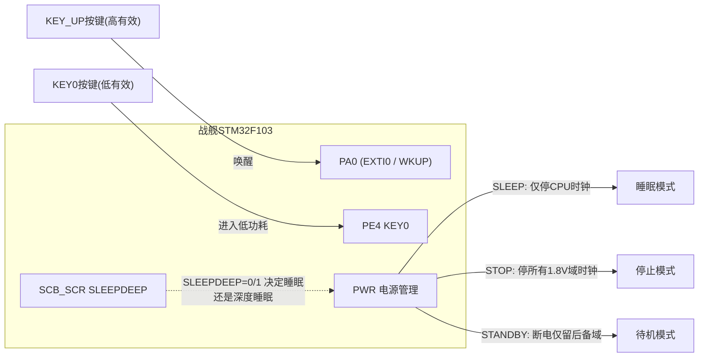
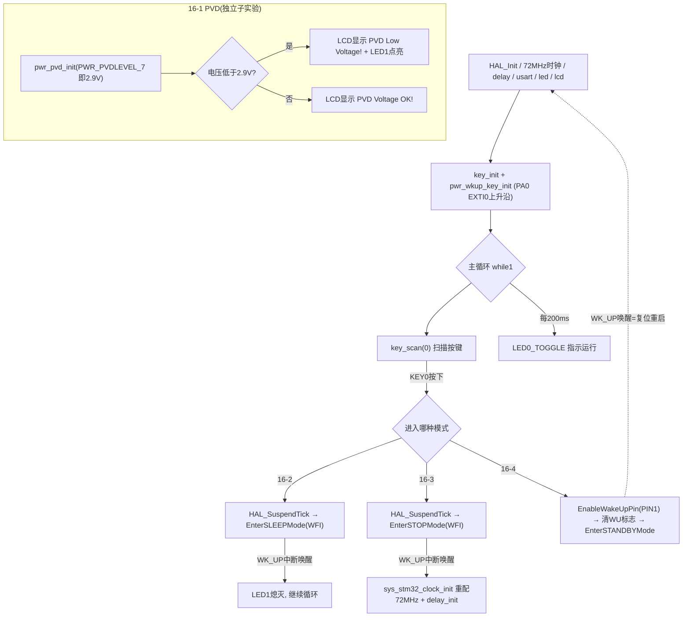

# 实验16 低功耗实验

> 平台：正点原子 战舰 STM32F103 开发板 · HAL 库 · Keil MDK
> 本实验包含 4 个子实验：16-1 PVD电压监控 / 16-2 睡眠模式 / 16-3 停止模式 / 16-4 待机模式

## 一、实验简介

本实验学习 STM32 的低功耗管理：先用 **PVD（可编程电压监测器）** 监视电源电压，再依次体验三种低功耗模式——**睡眠（Sleep）、停止（Stop）、待机（Standby）**。三种模式省电程度递增：睡眠只停 CPU 内核时钟，外设照常工作；停止关闭所有 1.8V 域时钟，仅靠 EXTI 中断唤醒；待机几乎彻底断电，唤醒相当于复位重启。

🏠 **生活类比**：三种模式就像人的三种休息状态——**睡眠**是"闭目养神"，耳朵还听着门铃（外设中断随时唤醒）；**停止**是"深度睡眠"，只有闹钟（EXTI/WK_UP）才能叫醒，醒来还得重新看表对时（重配时钟）；**待机**是"关机出门"，再回来等于从头开机（系统复位）。PVD 则像家里的"电压稳压器报警灯"，电压一低就亮灯提醒。

## 二、实验目的

- 掌握 PVD 可编程电压监测器的配置：8 级检测电压（2.2V~2.9V）、中断触发方式
- 理解三种低功耗模式的区别：时钟关闭范围、唤醒源、唤醒后是否需要重配时钟
- 学会用 `HAL_PWR_EnterSLEEPMode` / `HAL_PWR_EnterSTOPMode` / `HAL_PWR_EnterSTANDBYMode` 进入低功耗
- 掌握 WK_UP（PA0）按键的 EXTI 上升沿中断唤醒配置，以及待机模式的 WakeUp Pin 功能
- 理解进入低功耗前 `HAL_SuspendTick()` 暂停滴答定时器的必要性

## 三、硬件资源与连接图

| 外设 | 引脚 | 说明 |
|------|------|------|
| KEY0 | **PE4** | 按下（低电平）→ 进入低功耗模式 |
| KEY1 | **PE3** | 备用按键 |
| KEY2 | **PE2** | 备用按键 |
| KEY_UP（宏名 WK_UP） | **PA0** | 高电平有效；睡眠/停止模式经 EXTI0 中断唤醒；待机模式作 WKUP 引脚唤醒 |
| PVD 监测输入 | **内部接 VDD（PB7 可外部输入）** | 16-1 用内部监测电源电压，阈值 2.9V |
| LED0 (DS0, 红) | **PB5** | 每 200ms 翻转，指示程序运行/是否已睡眠 |
| LED1 (DS1, 绿) | **PE5** | 低电平点亮：16-1 指示电压过低，16-2/16-3 指示已进入低功耗 |
| LCD (MCU屏) | FSMC 接口（见实验13） | 显示提示信息；待机时熄灭 |
| 串口1 | **PA9/PA10** | 115200 |



## 四、核心寄存器（PWR / SCB / EXTI）

| 寄存器 | 名称 | 作用 |
|--------|------|------|
| `PWR_CR` | 电源控制寄存器 | LPDS(bit0) 停止模式下稳压器低功耗；**PDDS(bit1)=1 选择待机模式**；CWUF(bit2) 清唤醒标志；**PVDE(bit4) 使能 PVD**；PLS[7:5] PVD 检测电压等级（000=2.2V … 111=2.9V） |
| `PWR_CSR` | 电源控制/状态寄存器 | WUF(bit0) 唤醒标志；**SBF(bit1) 待机标志**；PVDO(bit2) PVD 输出（电压低于阈值=1）；**EWUP(bit8) 使能 WKUP 引脚** |
| `SCB_SCR` | 内核系统控制寄存器 | **SLEEPDEEP(bit2)**：0=睡眠（WFI 只停内核），1=深度睡眠（配合 PDDS/LPDS 进停止/待机）。HAL 的 EnterSLEEP/STOPMode 内部就是设置此位后执行 WFI |
| `EXTI_IMR` | 中断屏蔽寄存器 | bit0 开放 PA0（EXTI0）中断，睡眠/停止模式唤醒源 |
| `EXTI_RTSR` | 上升沿触发选择寄存器 | bit0=1，WK_UP 按下产生上升沿触发 |
| `RCC_CFGR` | 时钟配置寄存器 | 停止模式唤醒后系统运行在 HSI 8MHz，需重新配置 PLL 恢复 72MHz |

三种模式对照：

| 模式 | 关闭内容 | 唤醒源 | 唤醒后 |
|------|---------|--------|--------|
| 睡眠 Sleep | 仅 CPU 内核时钟，外设仍运行 | 任意 NVIC 中断 | 从 WFI 下一条继续执行 |
| 停止 Stop | 所有 1.8V 域时钟（HSE/HSI/PLL 停），SRAM/寄存器保持 | EXTI 中断（本实验 WK_UP/PA0） | 时钟回到 HSI 8MHz，**需重配 72MHz** |
| 待机 Standby | 1.8V 域断电，仅后备域保持 | WKUP 引脚(PA0)/RTC 闹钟/NRST | **系统复位重启**，从头执行 |

## 五、软件架构 / 流程



## 六、主要示例代码及讲解

### 1. PVD 初始化与回调（`实验16-1 .../Drivers/BSP/PWR/pwr.c`）

```c
void pwr_pvd_init(uint32_t pls)
{
    PWR_PVDTypeDef pwr_pvd = {0};
    __HAL_RCC_PWR_CLK_ENABLE();                      /* 使能PWR时钟 */
    pwr_pvd.PVDLevel = pls;                          /* 检测电压级别 */
    pwr_pvd.Mode = PWR_PVD_MODE_IT_RISING_FALLING;   /* 中断线上升沿和下降沿双边缘触发 */
    HAL_PWR_ConfigPVD(&pwr_pvd);
    HAL_NVIC_SetPriority(PVD_IRQn, 3 ,3);
    HAL_NVIC_EnableIRQ(PVD_IRQn);
    HAL_PWR_EnablePVD();                             /* 使能PVD检测 */
}

void HAL_PWR_PVDCallback(void)
{
    if (__HAL_PWR_GET_FLAG(PWR_FLAG_PVDO)) /* 电压比PLS所选电压还低 */
    {
        lcd_show_string(30, 110, 200, 16, 16, "PVD Low Voltage!", RED);
        LED1(0);                             /* 点亮绿灯, 表明电压低了 */
    }
    else
    {
        lcd_show_string(30, 110, 200, 16, 16, "PVD Voltage OK! ", BLUE);
        LED1(1);                             /* 灭掉绿灯 */
    }
}
```

**讲解**：
- `pls` 可选 `PWR_PVDLEVEL_0~7`（2.2V~2.9V），写入 `PWR_CR` 的 PLS 位；主函数用 `pwr_pvd_init(PWR_PVDLEVEL_7)` 设 2.9V 阈值。
- PVD 输出接到 EXTI16 中断线，电压跨越阈值（升或降）都触发中断，回调里读 `PWR_CSR` 的 PVDO 位判断当前电压高低。

### 2. 睡眠/停止/待机三种模式（`实验16-4 .../Drivers/BSP/PWR/pwr.c`）

```c
void pwr_enter_sleep(void)
{
    HAL_SuspendTick();  /* 暂停滴答时钟，防止通过滴答时钟中断唤醒 */
    HAL_PWR_EnterSLEEPMode(PWR_MAINREGULATOR_ON, PWR_SLEEPENTRY_WFI);
}

void pwr_enter_stop(void)
{
    __HAL_RCC_PWR_CLK_ENABLE();     /* 使能电源时钟 */
    HAL_SuspendTick();
    HAL_PWR_EnterSTOPMode(PWR_LOWPOWERREGULATOR_ON, PWR_STOPENTRY_WFI);
}

void pwr_enter_standby(void)
{
    __HAL_RCC_PWR_CLK_ENABLE();               /* 使能电源时钟 */
    HAL_PWR_EnableWakeUpPin(PWR_WAKEUP_PIN1); /* 使能KEY_UP引脚(PA0)的唤醒功能 */
    __HAL_PWR_CLEAR_FLAG(PWR_FLAG_WU);        /* 需要清此标记，否则将保持唤醒状态 */
    HAL_PWR_EnterSTANDBYMode();               /* 进入待机模式 */
}
```

**讲解**：
- **睡眠**：SLEEPDEEP=0 + WFI，只停内核；HAL_SysTick 每 1ms 中断一次会立刻把 CPU 叫醒，所以必须先 `HAL_SuspendTick()`。
- **停止**：SLEEPDEEP=1 + LPDS，1.8V 域时钟全停；`PWR_LOWPOWERREGULATOR_ON` 让稳压器也进低功耗，电流降到几十 µA 级。
- **待机**：PDDS=1，靠 `PWR_CSR` 的 EWUP 位使能 PA0 唤醒引脚；进入前必须清 WUF 唤醒标志，否则可能立刻被"假唤醒"。

### 3. 唤醒处理（`实验16-3 .../User/main.c`）

```c
while (1)
{
    key = key_scan(0);
    if (key == KEY0_PRES)
    {
        LED1(0);                            /* 点亮绿灯,提示进入停止模式 */
        pwr_enter_stop();                   /* 进入停止模式 */

        /* 从停止模式唤醒, 需要重新设置系统时钟, 72Mhz */
        sys_stm32_clock_init(RCC_PLL_MUL9); /* 设置时钟, 72Mhz */
        delay_init(72);                     /* 延时初始化 */
        LED1(1);                            /* 关闭绿灯,提示退出停止模式 */
    }
    if ((t % 20) == 0) LED0_TOGGLE();       /* 每200ms,翻转一次LED0 */
    delay_ms(10);
    t++;
}
```

**讲解**：
- 唤醒按键 WK_UP（PA0）由 `pwr_wkup_key_init()` 配成 **EXTI0 上升沿中断 + 下拉输入**，睡眠和停止模式都靠它唤醒。
- 停止模式唤醒后系统时钟是 HSI 8MHz，必须重新执行 `sys_stm32_clock_init(RCC_PLL_MUL9)` 恢复 72MHz，否则串口波特率、延时都会错乱。
- 待机模式唤醒等于复位，`pwr_enter_standby()` 之后的代码永远不会执行，程序从 `main()` 开头重新跑，LCD 也随之重新点亮。

## 七、实验效果

- **16-1 PVD**：供电正常时 LCD 显示 "PVD Voltage OK!"；电压低于 2.9V 时（如降低供电）LED1 点亮并显示 "PVD Low Voltage!"。LED0 每 200ms 闪烁。
- **16-2 睡眠**：按 KEY0 后 LED1 点亮、LED0 停止闪烁（已睡眠）；按 WK_UP 唤醒后 LED1 熄灭、LED0 继续闪烁。
- **16-3 停止**：现象同睡眠，但唤醒后需内部重配时钟（用户无感知），串口/延时恢复正常。
- **16-4 待机**：按 KEY0 后 LCD 熄灭、LED0 停闪（彻底断电）；按 WK_UP 后系统复位重启，LCD 重新点亮并显示初始界面。

## 八、注意事项

- 进睡眠/停止前务必 `HAL_SuspendTick()`，否则 SysTick 中断 1ms 内就把系统唤醒，看起来像"没睡着"。
- 停止模式唤醒后**必须重配系统时钟到 72MHz**，再重初始化依赖时钟的模块（如 delay）。
- 待机模式唤醒 = 复位重启，SRAM 内容全部丢失；需要保存的数据应写入后备域寄存器或 FLASH。
- 进入待机前必须清除 WUF 唤醒标志，否则会立即被唤醒。
- 16-2/16-3/16-4 中 LCD 初始化后长时间不刷新属正常现象；4.3 寸/7 寸屏电流大，建议外接 12V 1A 电源。
- 串口调试助手波特率 115200，推荐 XCOM/SSCOM；烧录失败先运行 `keilkill.bat`。

## 九、文件结构

```
实验16 低功耗实验/
├── 实验16-1 PVD电压监控实验/
│   ├── User/main.c             主程序：pwr_pvd_init(2.9V) + LED0闪烁
│   └── Drivers/BSP/PWR/        pwr.c/h：PVD初始化、PVD中断回调
├── 实验16-2 睡眠模式实验/
│   ├── User/main.c             KEY0进睡眠、WK_UP唤醒
│   └── Drivers/BSP/PWR/        pwr.c/h：pwr_wkup_key_init、pwr_enter_sleep
│   └── Drivers/BSP/KEY/        按键驱动 (key.c/h)
├── 实验16-3 停止模式实验/
│   ├── User/main.c             KEY0进停止、WK_UP唤醒后重配72MHz时钟
│   └── Drivers/BSP/PWR/        pwr.c/h：pwr_enter_stop
├── 实验16-4 待机模式实验/
│   ├── User/main.c             KEY0进待机、WK_UP唤醒=复位重启
│   └── Drivers/BSP/PWR/        pwr.c/h：pwr_enter_standby
└── 各子实验公共目录：
    ├── Drivers/BSP/LCD、LED    LCD与LED驱动
    ├── Drivers/SYSTEM          delay / sys / usart
    ├── Middlewares             (16-1含USMART)
    └── Projects/MDK-ARM        Keil 工程文件 (.uvprojx)
```
