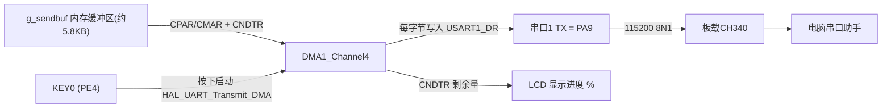
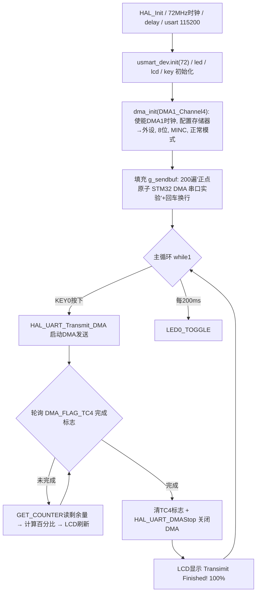

# 实验17 DMA实验

> 平台：正点原子 战舰 STM32F103 开发板 · HAL 库 · Keil MDK

## 一、实验简介

本实验学习 **DMA（直接存储器访问）** 的使用：按 KEY0 后，通过 DMA1_Channel4 把约 5.8KB 的缓冲区数据自动搬运到串口1发送寄存器发出，**整个过程不占用 CPU**；LCD 同时显示传输进度百分比，串口助手能收到 200 遍 "正点原子 STM32 DMA 串口实验"。DMA 是 STM32 高效处理大批量数据（串口收发、ADC 采样、SPI 刷屏等）的核心手段。

🏠 **生活类比**：没有 DMA 时，CPU 发数据像"你亲自一件件把包裹搬到快递站"——搬 5800 件期间什么都干不了；有了 DMA，相当于雇了个"搬运工"：你把仓库地址、快递站窗口和件数告诉它，它就自己搬，搬完喊你一声（传输完成标志），期间你照常干别的活（LED 闪烁、刷屏）。

## 二、实验目的

- 理解 DMA 的搬运模型：源地址、目的地址、传输数量、地址增量、数据宽度
- 掌握 STM32F103 的 DMA 通道映射：串口1_TX 固定对应 **DMA1_Channel4**
- 学会用 `HAL_UART_Transmit_DMA()` 启动 DMA 发送，用 TC 标志查询传输完成
- 学会用 `__HAL_DMA_GET_COUNTER()` 读取剩余数据量，计算并显示传输进度
- 复习按键扫描、LCD 显示与串口的综合应用

## 三、硬件资源与连接图

| 外设 | 引脚/资源 | 说明 |
|------|------|------|
| DMA1_Channel4 | 内部外设 | 映射到 USART1_TX，存储器→外设搬运 |
| 串口1 | **PA9(TX) / PA10(RX)** | 板载 CH340，115200，DMA 数据出口 |
| KEY0 | **PE4** | 按下（低电平）启动 DMA 发送 |
| KEY1 / KEY2 | **PE3 / PE2** | 备用按键 |
| KEY_UP (WK_UP) | **PA0** | 备用按键（高电平有效） |
| LCD (MCU屏) | FSMC 接口（见实验13） | 显示进度百分比与提示信息 |
| LED0 (DS0, 红) | **PB5** | 每 200ms 翻转，提示程序运行 |
| LED1 (DS1, 绿) | **PE5** | 低电平点亮 |



## 四、核心寄存器（DMA1_Channel4）

| 寄存器 | 名称 | 作用 |
|--------|------|------|
| `DMA_CCR4` | 通道4 配置寄存器 | **EN(bit0)** 通道使能；**TCIE(bit1)** 传输完成中断使能；**DIR(bit4)**=1 存储器→外设；**CIRC(bit5)** 循环模式（本实验用正常模式=0）；**PINC(bit6)** 外设地址增量（禁）；**MINC(bit7)** 存储器地址增量（使能）；**PSIZE[9:8]** 外设数据宽度（00=8位）；**MSIZE[11:10]** 存储器数据宽度（00=8位）；**PL[13:12]** 优先级（中等） |
| `DMA_CNDTR4` | 通道4 传输数量寄存器 | 待传输的数据个数（本实验 = SEND_BUF_SIZE）；每传一个自动减 1，**读它可知剩余进度** |
| `DMA_CPAR4` | 通道4 外设地址寄存器 | 外设侧地址 = `&USART1->DR`（由 `__HAL_LINKDMA` + HAL_UART_Transmit_DMA 自动填写） |
| `DMA_CMAR4` | 通道4 存储器地址寄存器 | 存储器侧地址 = `g_sendbuf` 首地址；MINC=1 时每传一字节自动加 1 |
| `DMA_ISR / DMA_IFCR` | 中断状态/标志清除寄存器 | GIF4/TCIF4/HTIF4/TEIF4 为通道4 的全局/传输完成/半传输/错误标志；写 IFCR 对应位清除 |
| `USART_CR3` | 串口控制寄存器3 | **DMAT(bit7)**=1 使能串口发送 DMA 请求（HAL_UART_Transmit_DMA 内部设置） |

## 五、软件架构 / 流程



## 六、主要示例代码及讲解

### 1. DMA 初始化（`Drivers/BSP/DMA/dma.c`）

```c
void dma_init(DMA_Channel_TypeDef* DMAx_CHx)
{
    if ((uint32_t)DMAx_CHx > (uint32_t)DMA1_Channel7)   /* 大于DMA1_Channel7, 则为DMA2的通道了 */
        __HAL_RCC_DMA2_CLK_ENABLE();                    /* DMA2时钟使能 */
    else
        __HAL_RCC_DMA1_CLK_ENABLE();                    /* DMA1时钟使能 */

    __HAL_LINKDMA(&g_uart1_handle, hdmatx, g_dma_handle); /* 将DMA与USART1联系起来(发送DMA) */

    g_dma_handle.Instance = DMAx_CHx;                            /* USART1_TX用 DMA1_Channel4 */
    g_dma_handle.Init.Direction = DMA_MEMORY_TO_PERIPH;          /* 存储器到外设模式 */
    g_dma_handle.Init.PeriphInc = DMA_PINC_DISABLE;              /* 外设非增量模式 */
    g_dma_handle.Init.MemInc = DMA_MINC_ENABLE;                  /* 存储器增量模式 */
    g_dma_handle.Init.PeriphDataAlignment = DMA_PDATAALIGN_BYTE; /* 外设数据长度:8位 */
    g_dma_handle.Init.MemDataAlignment = DMA_MDATAALIGN_BYTE;    /* 存储器数据长度:8位 */
    g_dma_handle.Init.Mode = DMA_NORMAL;                         /* DMA模式:正常模式 */
    g_dma_handle.Init.Priority = DMA_PRIORITY_MEDIUM;            /* 中等优先级 */
    HAL_DMA_Init(&g_dma_handle);
}
```

**讲解**：
- STM32F103 的 DMA 通道与外设是**固定映射**的：USART1_TX 必须用 DMA1_Channel4，选错通道无法工作（见手册 10.3.7 节 DMA 请求映射表）。
- `PeriphInc=DISABLE`：外设地址永远是 `USART1->DR`，不能动；`MemInc=ENABLE`：缓冲区地址每发一字节自动 +1。
- `DMA_NORMAL` 正常模式发完 CNDTR 个数据就停；若配 `DMA_CIRCULAR` 循环模式则自动重装、连续发送（ADC+DMA 常用）。
- `__HAL_LINKDMA` 把 DMA 句柄挂到串口句柄的 `hdmatx` 上，之后 HAL 才知道 `HAL_UART_Transmit_DMA` 该用哪个通道。

### 2. 启动发送与进度显示（`User/main.c`）

```c
#define SEND_BUF_SIZE  (sizeof(TEXT_TO_SEND) + 2) * 200  /* 发送数据长度 */
uint8_t g_sendbuf[SEND_BUF_SIZE];                        /* 发送数据缓冲区 */

if (key == KEY0_PRES)       /* KEY0按下 */
{
    HAL_UART_Transmit_DMA(&g_uart1_handle, g_sendbuf, SEND_BUF_SIZE);

    while (1)
    {
        if (__HAL_DMA_GET_FLAG(&g_dma_handle, DMA_FLAG_TC4)) /* 等待传输完成 */
        {
            __HAL_DMA_CLEAR_FLAG(&g_dma_handle, DMA_FLAG_TC4);
            HAL_UART_DMAStop(&g_uart1_handle);              /* 传输完成以后关闭串口DMA */
            break;
        }
        pro = __HAL_DMA_GET_COUNTER(&g_dma_handle); /* 得到当前还剩余多少个数据 */
        len = SEND_BUF_SIZE;                        /* 总长度 */
        pro = 1 - (pro / len);                      /* 得到百分比 */
        pro *= 100;                                 /* 扩大100倍 */
        lcd_show_num(30, 150, pro, 3, 16, BLUE);
    }
    lcd_show_num(30, 150, 100, 3, 16, BLUE);        /* 显示100% */
    lcd_show_string(30, 130, 200, 16, 16, "Transimit Finished!", BLUE);
}
```

**讲解**：
- `HAL_UART_Transmit_DMA` 做三件事：把 `g_sendbuf` 地址写入 CMAR4、把数量写入 CNDTR4、置位 USART_CR3 的 DMAT 和 DMA_CCR4 的 EN，随后 CPU 立即返回——搬运全由硬件完成。
- 等待循环里 CPU 并没有闲着：通过读 `DMA_CNDTR4`（`__HAL_DMA_GET_COUNTER`）算出剩余比例，实时刷新 LCD 进度条。这正是 DMA 的意义——**传输期间 CPU 可以做别的事**。
- TC4 是 DMA_ISR 里通道4 的传输完成标志，用后必须写 DMA_IFCR 清除；`HAL_UART_DMAStop` 关闭 DMAT 和 EN，为下次发送做准备。

### 3. 缓冲区填充（`User/main.c`）

```c
const uint8_t TEXT_TO_SEND[] = {"正点原子 STM32 DMA 串口实验"};
len = sizeof(TEXT_TO_SEND);
for (i = 0; i < SEND_BUF_SIZE; i++) /* 填充ASCII字符集数据 */
{
    if (k >= len)   /* 入换行符 */
    {
        if (mask) { g_sendbuf[i] = 0x0a; k = 0; }  /* \n */
        else      { g_sendbuf[i] = 0x0d; mask++; } /* \r */
    }
    else            /* 复制TEXT_TO_SEND语句 */
    {
        mask = 0;
        g_sendbuf[i] = TEXT_TO_SEND[k];
        k++;
    }
}
```

**讲解**：把一句字符串复制 200 遍、每遍后面加 `0x0D 0x0A`（回车换行），凑成约 5.8KB 的大缓冲区。数据量够大，115200 波特率下要发约半秒，才能明显看到进度百分比逐渐增加的效果。

## 七、实验效果

程序下载后 LCD 显示 "STM32 / DMA TEST / ATOM@ALIENTEK / KEY0:Start"，LED0 每 200ms 闪烁。按下 KEY0：LCD 显示 "Start Transimit...." 和百分比进度（0→100 逐渐增加）；电脑串口助手（115200）连续收到 200 行 "正点原子 STM32 DMA 串口实验"；传输结束 LCD 显示 "Transimit Finished!" 和 100%。发送期间 LED0 仍在闪烁，证明 CPU 未被占用。

## 八、注意事项

- USART1_TX 与 DMA1_Channel4 的映射关系是**硬件固定的**，`dma_init` 传入其他通道将无法触发发送。
- 本实验用查询 TC 标志的方式等待完成，也可以开启 `DMA_CCR` 的 TCIE 用传输完成中断（HAL 的 `TxCpltCallback`），后者效率更高。
- 5.8KB 数据在 115200 波特率下约需 0.5s 发完，进度显示是正常现象，不是程序卡死。
- 发送完成后可再按 KEY0 重复发送；若中途调用 `HAL_UART_DMAStop` 强制停止，剩余数据不会发出。
- 串口调试助手波特率必须 115200，推荐 XCOM/SSCOM；P4 的 PA9/PA10 跳线帽要接 RXD/TXD。
- 本例程 LCD 仅支持 MCU 屏；4.3 寸/7 寸屏建议外接 12V 1A 电源。
- 烧录失败时先运行根目录 `keilkill.bat` 结束占用进程。

## 九、文件结构

```
实验17 DMA实验/
├── User/
│   ├── main.c                  主程序：填充缓冲区、KEY0启动DMA发送、进度显示
│   ├── stm32f1xx_it.c          中断服务函数
│   └── stm32f1xx_hal_conf.h    HAL 配置
├── Middlewares/
│   └── USMART/                 USMART 串口调试组件
├── Drivers/
│   ├── BSP/
│   │   ├── DMA/                DMA 驱动
│   │   │   ├── dma.c           dma_init: DMA1_Channel4 存储器→外设配置
│   │   │   └── dma.h           g_dma_handle 声明
│   │   ├── KEY/                按键驱动 (key.c / key.h)
│   │   ├── LCD/                LCD 驱动
│   │   └── LED/                LED 驱动
│   ├── SYSTEM/                 delay / sys / usart（含 USART1 DMA 发送支持）
│   ├── CMSIS/                  内核启动与设备定义
│   └── STM32F1xx_HAL_Driver/   ST HAL 库（含 DMA/UART DMA 驱动）
├── Projects/MDK-ARM/           Keil 工程文件 (.uvprojx)
└── readme.txt                  实验说明(厂商原始文档)
```
