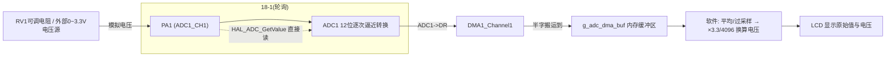
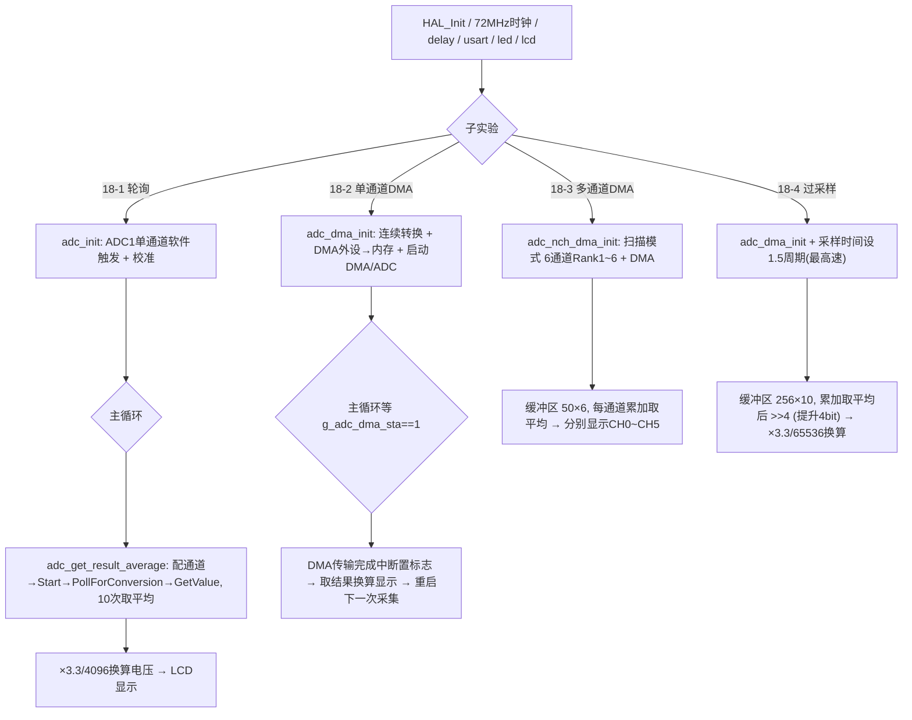

# 实验18 ADC实验

> 平台：正点原子 战舰 STM32F103 开发板 · HAL 库 · Keil MDK
> 本实验包含 4 个子实验：18-1 单通道采集 / 18-2 单通道(DMA读取) / 18-3 多通道(DMA读取) / 18-4 单通道过采样(16位分辨率)

## 一、实验简介

本实验学习 STM32 内部 **ADC（模数转换器）**：把引脚上的模拟电压（0~3.3V）转换成 12 位数字量（0~4095）。四个子实验层层递进——先用软件轮询单通道采集，再用 DMA 免 CPU 搬运结果，接着扩展成 6 通道扫描采集，最后用**过采样技术**把 12 位精度提升到 16 位。ADC1 的采样时钟由 72MHz 分频得到（本实验 72/6=12MHz）。

🏠 **生活类比**：ADC 像一杆"电子秤"，把连续的电压"称重"成一个数字读数。单通道轮询好比"你每次亲自去读一次秤"；DMA 则是"装个自动记录仪，秤每称一次就自动抄下来"，你不用一直盯着；多通道扫描像"一台多盘位秤轮流称 6 样东西"；过采样就是"同一个东西称 256 次取平均"，读数更精细、更稳。

## 二、实验目的

- 掌握 ADC 单通道软件轮询采集：配置通道、采样时间、启动转换、读结果
- 理解 ADC + DMA 自动搬运：连续转换 + 外设到存储器 DMA，CPU 零参与
- 掌握多通道扫描模式（ScanConvMode）与规则序列 Rank 的概念
- 理解过采样提高分辨率的原理：每 4 倍采样提升 1 bit，256 倍采样 +4 bit（12→16 位）
- 学会把 ADC 原始值换算成实际电压（`原始值 × 3.3 / 4096`）并在 LCD 显示

## 三、硬件资源与连接图

| 外设 | 引脚/资源 | 说明 |
|------|------|------|
| ADC1 通道1 (18-1/2/4) | **PA1** | 单通道模拟输入，可接 RV1 可调电阻分压 |
| ADC1 通道0~5 (18-3) | **PA0~PA5** | 6 通道扫描采集，各接 0~3.3V 待测电压 |
| DMA1_Channel1 | 内部外设 | 映射到 ADC1，把转换结果自动搬到内存缓冲区 |
| LCD (MCU屏) | FSMC 接口（见实验13） | 显示 ADC 原始值与换算电压 |
| 串口1 | **PA9/PA10** | 115200（USMART 通道） |
| LED0 (DS0, 红) | **PB5** | 每 100ms 翻转，提示程序运行 |
| LED1 (DS1, 绿) | **PE5** | 低电平点亮 |



> 接线说明：ADC 输入引脚必须接 **0~3.3V** 之间的电压，超过 3.3V 可能烧坏芯片。可把 PA1（或 PA0~PA5）用杜邦线接到板载 RV1 可调电阻，旋转螺丝刀即可看到读数连续变化。

## 四、核心寄存器（ADC / DMA）

| 寄存器 | 名称 | 作用 |
|--------|------|------|
| `ADC_SR` | 状态寄存器 | EOC(bit1) 规则通道转换结束标志；轮询转换即等待此位 |
| `ADC_CR1` | 控制寄存器1 | SCAN(bit8) 扫描模式使能（多通道用）；RES 分辨率；DUALMOD 双ADC模式 |
| `ADC_CR2` | 控制寄存器2 | **ADON(bit0)** 开/关 ADC；CONT(bit1) 连续转换；CAL(bit2) 校准；DMA(bit8) 使能DMA请求；ALIGN(bit11) 数据对齐；EXTTRIG(bit20) 外部触发；**SWSTART(bit22)** 软件启动规则转换 |
| `ADC_SMPR1 / SMPR2` | 采样时间寄存器 | 每通道 3 位设采样周期，可选 1.5/7.5/13.5/28.5/41.5/55.5/71.5/239.5 个 ADC 周期。SMPR2 管通道0~9，SMPR1 管通道10~17 |
| `ADC_SQR1/2/3` | 规则序列寄存器 | 设置转换顺序：SQR3 存序列第 1~6 个通道号，SQR1 的 L[23:20] 存序列总长度 |
| `ADC_DR` | 数据寄存器 | 12 位转换结果（右对齐时低 12 位有效），DMA 从这里搬数据 |
| `DMA_CCR1` | DMA1通道1配置寄存器 | EN(bit0)；DIR(bit4)=0 外设→存储器；MINC(bit7) 内存增量；PSIZE/MSIZE=01 半字(16位)；CIRC(bit5) 循环模式 |
| `DMA_CNDTR1` | 传输数量寄存器 | 待搬运数据个数（缓冲区大小），传完自动减到 0 |
| `DMA_CPAR1 / DMA_CMAR1` | 外设/存储器地址寄存器 | CPAR1 = `&ADC1->DR`，CMAR1 = `g_adc_dma_buf` 首地址 |
| `DMA_ISR / IFCR` | DMA中断状态/清除寄存器 | TCIF1(ISR bit1) 通道1 传输完成标志；写 IFCR bit1 清除 |

转换时间计算（本实验 ADC 时钟 12MHz）：`转换时间 = 采样周期 + 12.5 个 ADC 周期`。取最大采样周期 239.5 时，转换时间 = 252 周期 ≈ **21µs**。

## 五、软件架构 / 流程



## 六、主要示例代码及讲解

### 1. ADC 单通道轮询（`实验18-1 .../Drivers/BSP/ADC/adc.c`）

```c
void adc_init(void)
{
    g_adc_handle.Instance = ADC_ADCX;                        /* 选择ADC1 */
    g_adc_handle.Init.DataAlign = ADC_DATAALIGN_RIGHT;       /* 数据右对齐 */
    g_adc_handle.Init.ScanConvMode = ADC_SCAN_DISABLE;       /* 非扫描模式，仅一个通道 */
    g_adc_handle.Init.ContinuousConvMode = DISABLE;          /* 关闭连续转换模式 */
    g_adc_handle.Init.NbrOfConversion = 1;                   /* 1个规则通道序列 */
    g_adc_handle.Init.ExternalTrigConv = ADC_SOFTWARE_START; /* 软件触发 */
    HAL_ADC_Init(&g_adc_handle);
    HAL_ADCEx_Calibration_Start(&g_adc_handle);              /* 校准ADC */
}

uint32_t adc_get_result(uint32_t ch)
{
    adc_channel_set(&g_adc_handle, ch, ADC_REGULAR_RANK_1,
                    ADC_SAMPLETIME_239CYCLES_5);   /* 设置通道、序列和采样时间 */
    HAL_ADC_Start(&g_adc_handle);                   /* 开启ADC */
    HAL_ADC_PollForConversion(&g_adc_handle, 10);   /* 轮询转换(等EOC) */
    return (uint16_t)HAL_ADC_GetValue(&g_adc_handle);/* 读ADC1->DR */
}
```

**讲解**：
- `HAL_ADC_MspInit` 里把 ADC 时钟设为 `RCC_ADCPCLK2_DIV6`（72/6=12MHz，ADC 时钟上限 14MHz），并把 PA1 配成 `GPIO_MODE_ANALOG` 模拟输入（无上下拉、无数字施密特触发）。
- `HAL_ADCEx_Calibration_Start` 执行 ADC 上电自校准，提高精度，每次初始化后都应调用。
- `adc_get_result_average(ch, 10)` 把单次结果取 10 次平均，抑制随机噪声。

### 2. 主循环采集与电压换算（`实验18-1 .../User/main.c`）

```c
while (1)
{
    adcx = adc_get_result_average(ADC_ADCX_CHY, 10); /* 通道1，10次取平均 */
    lcd_show_xnum(134, 110, adcx, 5, 16, 0, BLUE);   /* 显示原始值 */

    temp = (float)adcx * (3.3 / 4096);  /* 换算成实际电压，如3.1111 */
    adcx = temp;                        /* 取整数部分 */
    lcd_show_xnum(134, 130, adcx, 1, 16, 0, BLUE);   /* 显示整数位 */
    temp -= adcx;                       /* 留下小数部分 */
    temp *= 1000;                       /* 保留三位小数 */
    lcd_show_xnum(150, 130, temp, 3, 16, 0X80, BLUE);/* 显示小数部分 */

    LED0_TOGGLE();
    delay_ms(100);
}
```

**讲解**：12 位 ADC 满量程 4096 对应 3.3V，故 `电压 = 原始值 × 3.3 / 4096`。因 LCD 数字显示函数不支持小数点，代码把电压拆成整数部分和放大了 1000 倍的小数部分分别显示（`0X80` 模式表示叠加显示，不覆盖背景）。

### 3. ADC + DMA 采集与过采样（`实验18-2/18-4 .../Drivers/BSP/ADC/adc.c`）

```c
/* DMA配置：ADC1->DR 自动搬到内存 */
g_dma_adc_handle.Instance = ADC_ADCX_DMACx;                 /* DMA1_Channel1 */
g_dma_adc_handle.Init.Direction = DMA_PERIPH_TO_MEMORY;     /* 外设到存储器 */
g_dma_adc_handle.Init.PeriphInc = DMA_PINC_DISABLE;         /* 外设地址不增(固定DR) */
g_dma_adc_handle.Init.MemInc = DMA_MINC_ENABLE;             /* 内存地址自增 */
g_dma_adc_handle.Init.PeriphDataAlignment = DMA_PDATAALIGN_HALFWORD; /* 16位 */
g_dma_adc_handle.Init.MemDataAlignment = DMA_MDATAALIGN_HALFWORD;
g_adc_dma_handle.Init.ContinuousConvMode = ENABLE;          /* 使能连续转换 */
HAL_DMA_Start_IT(&g_dma_adc_handle, (uint32_t)&ADC1->DR, mar, 0); /* 启动DMA+中断 */
HAL_ADC_Start_DMA(&g_adc_dma_handle, &mar, 0);              /* 开启ADC DMA */

/* 过采样提升分辨率(实验18-4, main.c) */
for (i = 0; i < ADC_DMA_BUF_SIZE; i++) sum += g_adc_dma_buf[i]; /* 累加 */
adcx = sum / (ADC_DMA_BUF_SIZE / ADC_OVERSAMPLE_TIMES);         /* 取平均 */
adcx >>= 4;   /* 除以2^4, 得到12+4位精度值; 提高N bit需 >>N */
temp = (float)adcx * (3.3 / 65536);   /* 16位满量程65536 */
```

**讲解**：
- 开启连续转换 + DMA 后，ADC 每转换完一次就触发 DMA 把 `ADC1->DR` 搬进缓冲区，CPU 完全不参与；传满 CNDTR 个数据产生 DMA 传输完成中断，`g_adc_dma_sta=1`。
- `adc_dma_enable(cndtr)` 用寄存器直接重启一轮采集：关 ADC→关 DMA→设 CNDTR→开 DMA→开 ADC→置 SWSTART(bit22) 启动转换。
- **过采样**：采样速度每提高 4 倍可提升 1 bit 分辨率。18-4 采 256 倍（`ADC_OVERSAMPLE_TIMES=256`）并取平均，再 `>>4`（除以 16）得到 12+4=**16 位**结果，换算电压时满量程相应改成 65536。

## 七、实验效果

- **18-1**：LCD 显示 `ADC1_CH1_VAL:` 原始值（0~4095）和 `ADC1_CH1_VOL:x.xxxV` 电压；旋转 RV1 可调电阻，两个数值实时变化。
- **18-2**：现象同 18-1，但采集由 DMA 自动完成，CPU 占用更低。
- **18-3**：LCD 同时显示 CH0~CH5 六路的原始值与电压；把 PA0~PA5 分别接不同电压即可看到 6 组独立读数。
- **18-4**：LCD 显示的原始值范围扩大到 0~65535（16 位），电压分辨率更细、跳动更小；可接 VCC/GND/TPAD 验证。
- 四个子实验中 LED0 均每 100ms 闪烁，提示程序运行。

## 八、注意事项

- **ADC 输入电压必须在 0~3.3V 之间**，超过会烧坏芯片引脚。
- ADC 时钟不能超过 14MHz，本实验用 PCLK2/6=12MHz；分频选错会导致转换结果异常。
- 每次 `HAL_ADC_Init` 后应调用 `HAL_ADCEx_Calibration_Start` 校准，否则精度下降。
- 采样时间越短转换越快但精度略降：18-1 用最大 239.5 周期求稳，18-4 过采样为求高速用 1.5 周期。
- 多通道采集（18-3）DMA 缓冲区大小必须是**通道数的整数倍**（本实验 50×6=300），且 Rank 顺序要与缓冲区索引对应。
- 过采样倍数与移位要匹配：提升 N bit 需 4^N 倍采样并右移 N 位。
- 串口调试助手波特率 115200；LCD 仅支持 MCU 屏；4.3/7 寸屏建议外接 12V 1A 电源；烧录失败先运行 `keilkill.bat`。

## 九、文件结构

```
实验18 ADC实验/
├── 实验18-1 单通道ADC采集实验/
│   ├── User/main.c             主程序：轮询采集 + 电压换算显示
│   └── Drivers/BSP/ADC/        adc.c/h：adc_init、adc_get_result(_average)
├── 实验18-2 单通道ADC采集（DMA读取）实验/
│   ├── User/main.c             等DMA完成标志 → 换算显示
│   └── Drivers/BSP/ADC/        adc.c/h：新增 adc_dma_init、adc_dma_enable、DMA中断
├── 实验18-3 多通道ADC采集（DMA读取）实验/
│   ├── User/main.c             6通道各取平均分别显示
│   └── Drivers/BSP/ADC/        adc.c/h：新增 adc_nch_dma_init（扫描6通道Rank1~6）
├── 实验18-4 单通道ADC过采样（16位分辨率）实验/
│   ├── User/main.c             256倍过采样累加平均 >>4 得16位
│   └── Drivers/BSP/ADC/        adc.c/h：DMA采集 + 过采样处理
└── 各子实验公共目录：
    ├── Drivers/BSP/LCD、LED    LCD与LED驱动
    ├── Drivers/SYSTEM          delay / sys / usart
    ├── Middlewares/USMART      USMART 串口调试组件
    └── Projects/MDK-ARM        Keil 工程文件 (.uvprojx)
```
