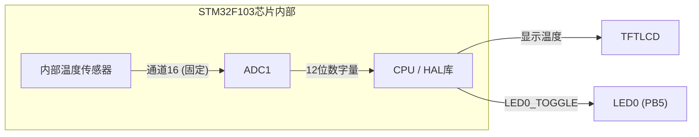
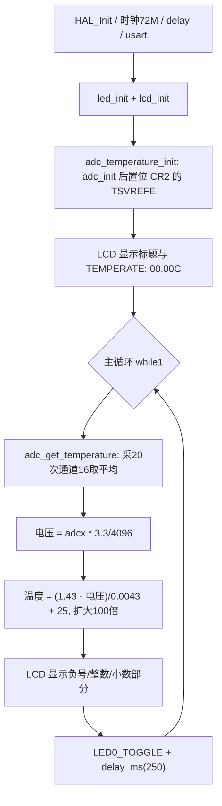

# 实验19 内部温度传感器实验

> 平台：正点原子 STM32F103（战舰）开发板 · HAL 库 · Keil MDK

## 一、实验简介

本实验利用 STM32F103 **芯片内部自带的温度传感器**，通过 ADC1 的通道16 采集其电压值，再按官方公式换算成温度，实时显示在 TFTLCD 屏幕上。整个过程不需要任何外接传感器，一颗芯片就能"自己量自己的体温"。

🏠 **生活类比**：内部温度传感器就像芯片自带的"体温计"。人发烧了用体温计一量就知道，芯片工作发热时，也靠这个内置的"体温计"测出自己的温度——只不过它输出的不是水银柱高度，而是一个随温度变化的电压值。

## 二、实验目的

- 了解 STM32 内部温度传感器的原理及其与 **ADC1 通道16** 的固定连接关系
- 掌握 `ADC_CR2` 寄存器 **TSVREFE 位**使能内部温度传感器的方法
- 掌握 ADC 采样值 → 电压 → 温度的换算公式
- 理解为什么内部温度传感器必须使用**长采样时间**（239.5 周期）
- 进一步熟悉 HAL 库 ADC 驱动的编写与 LCD 显示

## 三、硬件资源与连接图

| 外设 | 引脚 | 说明 |
|------|------|------|
| 内部温度传感器 | **ADC1_IN16**（芯片内部） | STM32F1 中只有 ADC1 的通道16 连接内部温度传感器 |
| LED0 (DS0, 红) | PB5 | 低电平点亮，闪烁提示程序运行 |
| 串口1 | PA9 / PA10 | 连接板载 CH340，波特率 115200 |
| TFTLCD | 16位8080并口 | 显示温度值 |



> 连接说明：内部温度传感器**没有外部引脚**，它在芯片内部直接连到 ADC1_IN16。使能 `TSVREFE` 位后，传感器电压才能送入 ADC 进行转换，因此本实验无需任何跳线。

## 四、核心寄存器（ADC + 内部温度传感器）

| 寄存器 | 名称 | 作用 |
|--------|------|------|
| `ADC_CR2` | 控制寄存器2 | bit0 ADON 开/关 ADC；bit23 **TSVREFE=1 使能内部温度传感器和 Vrefint**；bit22 SWSTART 软件启动规则组转换 |
| `ADC_SMPR1/2` | 采样时间寄存器 | 每通道 3 位 SMP，本实验设为 111 = 239.5 个 ADC 周期（内部温度传感器要求采样时间 ≥ 17.1us） |
| `ADC_SQR3` | 规则序列寄存器3 | 低 5 位 SQ1 选择第 1 个转换的通道号（写 16） |
| `ADC_DR` | 数据寄存器 | 存放 12 位转换结果（右对齐） |
| `ADC_SR` | 状态寄存器 | bit1 EOC=1 表示转换结束 |

**温度换算公式**（数据手册给出）：

```
V25 = 1.43V（25℃时的传感器电压）
Avg_Slope = 4.3mV/℃（温度每升高1℃，电压增加4.3mV）

Temperature(℃) = (V25 - VSENSE) / Avg_Slope + 25
其中 VSENSE = ADC采样值 × 3.3 / 4096
```

ADC 时钟配置为 PCLK2/6 = 72M/6 = **12MHz**，采样周期 239.5 + 12.5 = 252 个 ADC 周期 ≈ 21us，满足传感器最小采样时间要求。

## 五、软件架构 / 流程



## 六、主要示例代码及讲解

### 1. 温度传感器初始化（`Drivers/BSP/ADC/adc.c`）

```c
void adc_temperature_init(void)
{
    adc_init();                                            /* 先初始化ADC */
    SET_BIT(g_adc_handle.Instance->CR2, ADC_CR2_TSVREFE);  /* TSVREFE = 1, 启用内部温度传感器和Vrefint */
}
```

**讲解**：
- 内部温度传感器复用普通 ADC 的全部配置流程（`adc_init()` 里完成 12 位右对齐、软件触发、单通道、ADC 时钟 12MHz、校准）。
- 关键多了一步：置位 `ADC_CR2` 的 **TSVREFE** 位。这个位相当于把芯片内部"体温计"接到 ADC 输入端的开关，不置位时通道16 采不到任何有效值。
- 注意：**STM32F103 的内部温度传感器只连接在 ADC1 通道16**，ADC2/ADC3 无法采集。

### 2. 获取温度值（`Drivers/BSP/ADC/adc.c`）

```c
short adc_get_temperature(void)
{
    uint32_t adcx;
    short result;
    double temperature;

    adcx = adc_get_result_average(ADC_TEMPSENSOR_CHX, 20);  /* 读取内部温度传感器通道,10次取平均 */
    temperature = (float)adcx * (3.3 / 4096);               /* 转化为电压值 */
    temperature = (1.43 - temperature) / 0.0043 + 25;       /* 计算温度 */
    result = temperature *= 100;                            /* 扩大100倍. */
    return result;
}
```

**讲解**：
- `ADC_TEMPSENSOR_CHX` 在 `adc.h` 中定义为 `ADC_CHANNEL_16`。
- 单次采样噪声较大，调用 `adc_get_result_average()` 采 20 次取平均（内部每次采样时间 239.5 周期）。
- 第一步按 12 位精度把采样值换算成电压：`V = adcx × 3.3 / 4096`。
- 第二步套手册公式 `(1.43 - V) / 0.0043 + 25` 得到摄氏温度；乘 100 后以 `short` 返回，如 3025 表示 30.25℃，负值表示零下。

### 3. 主循环显示（`User/main.c`）

```c
while (1)
{
    temp = adc_get_temperature();   /* 得到温度值 */

    if (temp < 0)
    {
        temp = -temp;
        lcd_show_string(30 + 10 * 8, 120, 16, 16, 16, "-", BLUE);   /* 显示负号 */
    }
    else
    {
        lcd_show_string(30 + 10 * 8, 120, 16, 16, 16, " ", BLUE);   /* 无符号 */
    }
    lcd_show_xnum(30 + 11 * 8, 120, temp / 100, 2, 16, 0, BLUE);    /* 显示整数部分 */
    lcd_show_xnum(30 + 14 * 8, 120, temp % 100, 2, 16, 0X80, BLUE); /* 显示小数部分 */

    LED0_TOGGLE();  /* LED0闪烁,提示程序运行 */
    delay_ms(250);
}
```

**讲解**：温度值扩大了 100 倍，`temp / 100` 是整数部分、`temp % 100` 是两位小数；负温度先显示负号再取绝对值。`0X80` 参数表示透明叠加显示小数。每 250ms 刷新一次并翻转 LED0。

## 七、实验效果

烧录后，LCD 显示 `TEMPERATE: XX.XXC`，即**芯片内部实时温度**（通常比室温高几度，因为芯片自身发热）。用手指按住芯片表面，温度会缓慢上升；LED0 每 250ms 翻转一次，提示程序在运行。

## 八、注意事项

- 内部温度传感器精度有限（出厂未逐片校准），测量误差可达 ±3℃ 以上，**只能用于监测芯片温度变化趋势**，不能当精密温度计。
- 必须使用 ADC1，通道16 是芯片内部固定连线，不可更改。
- 采样时间必须够长（本实验用最大的 239.5 周期），否则采样电容充不满，读数会失真。
- 电脑端串口调试助手波特率 115200；PA9/PA10 需通过跳线帽连接在 RXD/TXD 上。
- 4.3 寸和 7 寸屏电流较大，USB 供电可能不足，建议外接 12V 1A 电源。
- 烧录失败时先运行根目录 `keilkill.bat` 结束占用进程。

## 九、文件结构

```
实验19 内部温度传感器实验/
├── User/
│   ├── main.c                  主程序（温度采集+LCD显示）
│   ├── stm32f1xx_it.c          中断服务函数
│   └── stm32f1xx_hal_conf.h    HAL配置
├── Drivers/
│   ├── BSP/
│   │   ├── ADC/                ADC驱动 (adc.c / adc.h, 含温度传感器代码)
│   │   ├── LCD/                LCD驱动
│   │   └── LED/                LED驱动
│   ├── SYSTEM/                 delay / sys / usart 系统支持
│   ├── CMSIS/                  内核启动与设备定义
│   └── STM32F1xx_HAL_Driver/   ST HAL 库
├── Middlewares/USMART/         usmart 串口调试组件
├── Projects/MDK-ARM/           Keil 工程文件 (.uvprojx)
└── readme.txt                  原厂实验说明
```
