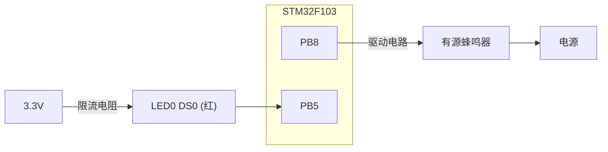
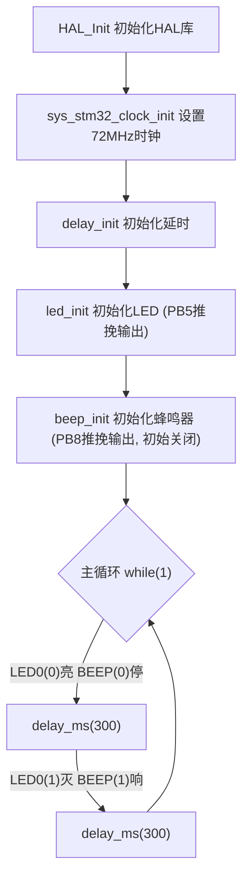

# 实验2 蜂鸣器实验

> 平台：正点原子 STM32F103（战舰/精英/mini）开发板 · HAL 库 · Keil MDK

## 一、实验简介

本实验在跑马灯的基础上，用 GPIO 驱动板载**有源蜂鸣器**：让蜂鸣器每隔 300ms 响/停一次，同时 LED0 每隔 300ms 亮/灭一次。它仍然是 GPIO 输出的应用，只是负载从 LED 换成了发声器件。

🏠 **生活类比**：蜂鸣器就像家里的门铃按钮电路——开关闭合（引脚输出有效电平）铃就响，断开就停。这里 STM32 的 PB8 就是那只"电子开关"，程序按 300ms 的节奏不停地通断，蜂鸣器就发出"滴—停—滴—停"的节拍声。

## 二、实验目的

- 巩固 GPIO **推挽输出**的配置方法（时钟、模式、上下拉、速度）
- 学会用 `HAL_GPIO_WritePin()` 控制蜂鸣器鸣叫/停止
- 理解 BSP 驱动分层思想：引脚宏定义（beep.h）+ 初始化函数（beep.c）
- 掌握用 `delay_ms()` 控制外设动作节奏的方法

## 三、硬件资源与连接图

| 外设 | 引脚 | 说明 |
|------|------|------|
| 蜂鸣器 BEEP | **PB8** | 高电平鸣叫（`BEEP(1)` 响，`BEEP(0)` 停） |
| LED0 (DS0, 红) | **PB5** | 低电平点亮（`LED0(0)` 亮） |



> 接线说明：蜂鸣器由 PB8 经驱动电路供电，引脚输出高电平时蜂鸣器鸣叫；LED0 为灌电流接法，引脚输出低电平时点亮。注意两者有效电平方向相反。

## 四、核心寄存器（GPIO）

| 寄存器 | 名称 | 作用 |
|--------|------|------|
| `RCC_APB2ENR` | 时钟使能寄存器 | 置位 IOPBEN 使能 PB 口时钟（用前必开） |
| `GPIOB_CRL` | 端口配置低寄存器 | 配置 PB5（bit20~23 为 PB5 的 MODE/CNF） |
| `GPIOB_CRH` | 端口配置高寄存器 | 配置 PB8（bit0~3 为 PB8 的 MODE/CNF） |
| `GPIOB_ODR` | 输出数据寄存器 | 写 1 输出高电平，写 0 输出低电平 |
| `GPIOB_BSRR` | 位设置/复位寄存器 | 原子操作置位/复位单个引脚（HAL 的 WritePin/TogglePin 底层使用） |

每 4 位控制一个引脚（MODE[1:0] + CNF[1:0]）：

```
MODE[1:0]: 00=输入  01=输出2MHz  10=输出10MHz  11=输出50MHz
CNF (输出): x0=推挽  x1=开漏     (输入): 00=模拟 01=浮空 10=上/下拉
```

本实验把 PB5、PB8 都配为 **50MHz 推挽输出 + 上拉**（HAL 内部通过 `HAL_GPIO_Init` 完成上述寄存器配置）。

## 五、软件架构 / 流程



## 六、主要示例代码及讲解

### 1. 蜂鸣器引脚宏定义（`Drivers/BSP/BEEP/beep.h`）

```c
#define BEEP_GPIO_PORT                  GPIOB
#define BEEP_GPIO_PIN                   GPIO_PIN_8
#define BEEP_GPIO_CLK_ENABLE()          do{ __HAL_RCC_GPIOB_CLK_ENABLE(); }while(0)   /* PB口时钟使能 */

/* 蜂鸣器控制 */
#define BEEP(x)         do{ x ? \
                            HAL_GPIO_WritePin(BEEP_GPIO_PORT, BEEP_GPIO_PIN, GPIO_PIN_SET) : \
                            HAL_GPIO_WritePin(BEEP_GPIO_PORT, BEEP_GPIO_PIN, GPIO_PIN_RESET); \
                        }while(0)

/* BEEP状态翻转 */
#define BEEP_TOGGLE()   do{ HAL_GPIO_TogglePin(BEEP_GPIO_PORT, BEEP_GPIO_PIN); }while(0)
```

**讲解**：
- 引脚号、端口、时钟使能全部集中成宏，换板子/换引脚只需改这三行，驱动代码不用动。
- `BEEP(1)` = 写高电平（响），`BEEP(0)` = 写低电平（停），比直接调 `HAL_GPIO_WritePin` 直观得多。
- `BEEP_TOGGLE()` 用 HAL 的翻转函数把当前电平取反，实验3 中按键控制蜂鸣器就靠它。

### 2. 蜂鸣器初始化（`Drivers/BSP/BEEP/beep.c`）

```c
void beep_init(void)
{
    GPIO_InitTypeDef gpio_init_struct;
    BEEP_GPIO_CLK_ENABLE();                             /* BEEP时钟使能 */

    gpio_init_struct.Pin = BEEP_GPIO_PIN;               /* 蜂鸣器引脚 */
    gpio_init_struct.Mode = GPIO_MODE_OUTPUT_PP;        /* 推挽输出 */
    gpio_init_struct.Pull = GPIO_PULLUP;                /* 上拉 */
    gpio_init_struct.Speed = GPIO_SPEED_FREQ_HIGH;      /* 高速 */
    HAL_GPIO_Init(BEEP_GPIO_PORT, &gpio_init_struct);   /* 初始化蜂鸣器引脚 */

    BEEP(0);                                            /* 关闭蜂鸣器 */
}
```

**讲解**：
- 流程与 LED 初始化完全一致：开时钟 → 填"配置单" → `HAL_GPIO_Init()` 写寄存器。
- `GPIO_MODE_OUTPUT_PP` 推挽输出可主动拉高/拉低，才能持续驱动蜂鸣器电路。
- 末尾 `BEEP(0)` 给一个确定的初始状态（静音），避免上电后蜂鸣器乱叫。

### 3. 主函数（`User/main.c`）

```c
int main(void)
{
    HAL_Init();                         /* 初始化HAL库 */
    sys_stm32_clock_init(RCC_PLL_MUL9); /* 设置时钟,72M */
    delay_init(72);                     /* 初始化延时函数 */
    led_init();                         /* 初始化LED */
    beep_init();                        /* 初始化蜂鸣器 */

    while (1)
    {
        LED0(0);
        BEEP(0);
        delay_ms(300);
        LED0(1);
        BEEP(1);
        delay_ms(300);
    }
}
```

**讲解**：
- 主循环每 300ms 切换一次状态：前 300ms"灯亮 + 蜂鸣器停"，后 300ms"灯灭 + 蜂鸣器响"，灯与声音交替出现。
- 注意 `LED0(0)` 是**亮**（低电平点亮），`BEEP(1)` 是**响**（高电平驱动），有效电平刚好相反。
- 修改 `delay_ms(300)` 即可改变响/停节奏；数值越小，"滴滴"声越急促。

## 七、实验效果

烧录程序后：

1. 开发板上的**蜂鸣器每隔 300ms 响/停一次**；
2. 开发板上的 **LED0 每隔 300ms 亮/灭一次**。

## 八、注意事项

- 蜂鸣器与 LED 有效电平相反：`BEEP(1)` 响、`BEEP(0)` 停；`LED0(0)` 亮、`LED0(1)` 灭，初学易混。
- 板载为**有源蜂鸣器**（内置振荡源），通电即响，无需 PWM；若换用无源蜂鸣器则需要输出方波才能发声。
- 使用外设前必须 `BEEP_GPIO_CLK_ENABLE()` 开时钟，否则寄存器写不进去。
- 修改代码后需重新编译并烧录；若烧录失败先运行根目录 `keilkill.bat` 结束占用进程。

## 九、文件结构

```
实验2 蜂鸣器实验/
├── User/
│   ├── main.c                  主程序(蜂鸣器+LED交替)
│   ├── stm32f1xx_it.c          中断服务函数
│   └── stm32f1xx_hal_conf.h    HAL配置
├── Drivers/
│   ├── BSP/
│   │   ├── BEEP/               蜂鸣器驱动 (beep.c / beep.h)
│   │   └── LED/                LED驱动 (led.c / led.h)
│   ├── SYSTEM/                 delay / sys / usart 系统支持
│   ├── CMSIS/                  内核启动与设备定义
│   └── STM32F1xx_HAL_Driver/   ST HAL库
├── Middlewares/                中间件
├── Projects/MDK-ARM/           Keil工程文件 (.uvprojx)
├── keilkill.bat                结束Keil占用进程
└── readme.txt                  实验说明(GBK编码)
```
