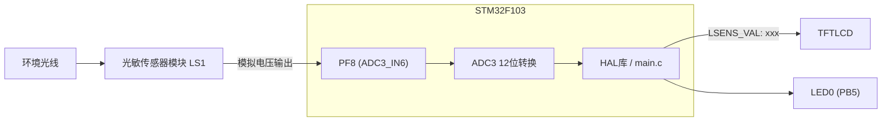
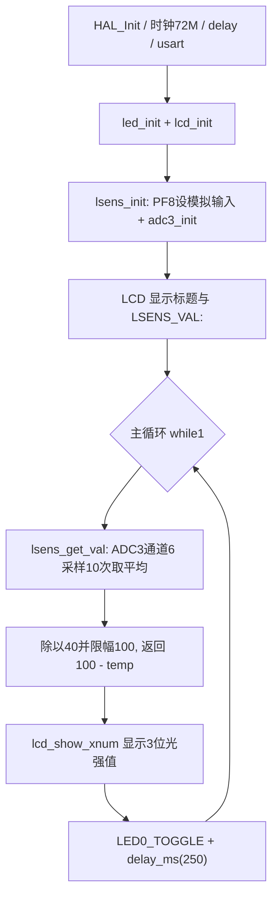

# 实验20 光敏传感器实验

> 平台：正点原子 STM32F103（战舰）开发板 · HAL 库 · Keil MDK

## 一、实验简介

本实验通过 **ADC3 的通道6（PF8）** 读取开发板上光敏传感器模块（LS1）输出的模拟电压，把它转换成 **0~100 的光线强度值**显示在 TFTLCD 上：光线越亮值越大，越暗值越小。这是在实验18 ADC 采样基础上，对外部模拟传感器的典型应用。

🏠 **生活类比**：光敏传感器就像一只"电子眼睛"。天亮时它"睁大眼睛"输出电压变化，天黑时"眯起眼睛"。STM32 的 ADC 则像大脑，把眼睛看到的亮度（模拟电压）翻译成一个能看懂的数字（光强值）。

## 二、实验目的

- 掌握光敏传感器模块的工作原理及其电压输出特性
- 学会用 **ADC3 + 通道6（PF8）** 采集外部模拟电压
- 掌握多次采样取平均的滤波方法，提高读数稳定性
- 掌握把 ADC 原始值换算为 0~100 光强值的标定方法
- 进一步熟悉 HAL 库 ADC 驱动与 LCD 显示

## 三、硬件资源与连接图

| 外设 | 引脚 | 说明 |
|------|------|------|
| 光敏传感器 LS1 | 输出接 **PF8** | PF8 = ADC3_IN6，光强变化 → 电压变化 |
| ADC3 | 通道6 (`ADC_CHANNEL_6`) | 12 位采样，ADC 时钟 12MHz |
| LED0 (DS0, 红) | PB5 | 低电平点亮，闪烁提示程序运行 |
| 串口1 | PA9 / PA10 | 连接板载 CH340，波特率 115200 |
| TFTLCD | 16位8080并口 | 显示 LSENS_VAL 光强值 |



> 接线说明：光敏传感器模块已在板载连接至 PF8，无需额外跳线。传感器分压电路随光照变化输出不同电压，PF8 必须配置为**模拟输入模式**（`GPIO_MODE_ANALOG`），断开数字施密特触发器。

## 四、核心寄存器（ADC）

| 寄存器 | 名称 | 作用 |
|--------|------|------|
| `ADC3_CR2` | 控制寄存器2 | bit0 ADON 使能 ADC；bit22 SWSTART 软件启动转换；数据右对齐 |
| `ADC3_SMPR1` | 采样时间寄存器1 | 通道6 的 SMP[2:0]，本实验设 239.5 个周期（最大），转换时间约 21us |
| `ADC3_SQR3` | 规则序列寄存器3 | SQ1 写入通道号 6，选择 PF8 为第 1 个转换通道 |
| `ADC3_SR` | 状态寄存器 | bit1 EOC=1 表示转换完成（HAL 轮询此标志） |
| `ADC3_DR` | 数据寄存器 | 12 位转换结果，右对齐存放 0~4095 |

**光强换算**（`lsens.c` 中的标定）：

```
ADC平均值 temp_val（0~4095）
temp_val /= 40            → 映射到约 0~102
大于100则截为100
返回 100 - temp_val       → 光越强 ADC 电压越高, 换算后数值越大(0~100)
```

ADC 时钟 = PCLK2/6 = 72M/6 = 12MHz（`RCC_ADCPCLK2_DIV6`），初始化后执行 `HAL_ADCEx_Calibration_Start()` 校准。

## 五、软件架构 / 流程



## 六、主要示例代码及讲解

### 1. 光敏传感器初始化（`Drivers/BSP/LSENS/lsens.c`）

```c
void lsens_init(void)
{
    GPIO_InitTypeDef gpio_init_struct;

    LSENS_ADC3_CHX_GPIO_CLK_ENABLE();   /* IO口时钟使能 */

    /* 设置AD采集通道对应IO引脚工作模式 */
    gpio_init_struct.Pin = LSENS_ADC3_CHX_GPIO_PIN;
    gpio_init_struct.Mode = GPIO_MODE_ANALOG;
    HAL_GPIO_Init(LSENS_ADC3_CHX_GPIO_PORT, &gpio_init_struct);

    adc3_init();                       /* 初始化ADC */
}
```

**讲解**：
- `lsens.h` 中定义：`LSENS_ADC3_CHX_GPIO_PORT = GPIOF`、`GPIO_PIN_8`、`LSENS_ADC3_CHX = ADC_CHANNEL_6`，即 PF8 对应 ADC3_IN6。
- ADC 输入引脚必须设为 `GPIO_MODE_ANALOG` 模拟模式，这样引脚与数字电路断开，电压原样送入 ADC 采样保持电路。
- `adc3_init()` 完成 ADC3 的全部配置：12 位右对齐、非扫描、软件触发、ADC 时钟 12MHz，并做 ADC 校准。

### 2. 读取光强值（`Drivers/BSP/LSENS/lsens.c`）

```c
uint8_t lsens_get_val(void)
{
    uint32_t temp_val = 0;
    temp_val = adc3_get_result_average(LSENS_ADC3_CHX, 10);  /* 读取平均值 */
    temp_val /= 40;

    if (temp_val > 100)temp_val = 100;

    return (uint8_t)(100 - temp_val);
}
```

**讲解**：
- `adc3_get_result_average(ch, 10)` 连续采样 10 次（每次间隔 5ms）求平均，滤除随机噪声。
- 12 位结果除以 40（4096/40 ≈ 102）把 0~4095 粗略映射到 0~100，超过 100 截断。
- 返回 `100 - temp_val`：本模块光越强输出电压越高，经此换算后**数值越大表示越亮**，符合直觉（0 = 最暗，100 = 最亮）。

### 3. 主循环（`User/main.c`）

```c
while (1)
{
    adcx = lsens_get_val();
    lcd_show_xnum(30 + 10 * 8, 110, adcx, 3, 16, 0, BLUE); /* 显示ADC的值 */
    LED0_TOGGLE();                                         /* LED0闪烁,提示程序运行 */
    delay_ms(250);
}
```

**讲解**：每 250ms 读取一次光强值，用 `lcd_show_xnum` 以 3 位数字刷新到 LCD 的 `LSENS_VAL:` 后面，同时翻转 LED0 作为"心跳"指示。

## 七、实验效果

烧录后，LCD 显示 `LSENS_VAL: xxx`（0~100）。**用手指遮挡 LS1 时数值变小（变暗），用手电筒照射 LS1 时数值变大（变亮）**。LED0 每 250ms 翻转一次，提示程序运行。

## 八、注意事项

- PF8 只能配置为模拟输入，若误设为数字模式将无法正确采样。
- 光强换算 `/40` 是正点原子针对板载传感器模块的经验标定，换用其它光敏模块时需重新标定。
- 传感器读数受环境光影响明显，测试时避免强光直射整块开发板造成误判。
- 采样时间用最大的 239.5 周期，牺牲速度换取高阻抗信号源的采样精度。
- 电脑端串口调试助手波特率 115200；P4 的 PA9/PA10 必须通过跳线帽连接在 RXD/TXD 上。
- 4.3 寸和 7 寸屏电流较大，USB 供电可能不足，建议外接 12V 1A 电源；烧录失败先运行根目录 `keilkill.bat`。

## 九、文件结构

```
实验20 光敏传感器实验/
├── User/
│   ├── main.c                  主程序（光强采集+LCD显示）
│   ├── stm32f1xx_it.c          中断服务函数
│   └── stm32f1xx_hal_conf.h    HAL配置
├── Drivers/
│   ├── BSP/
│   │   ├── ADC/                ADC3驱动 (adc3.c / adc3.h)
│   │   ├── LSENS/              光敏传感器驱动 (lsens.c / lsens.h)
│   │   ├── LCD/                LCD驱动
│   │   └── LED/                LED驱动
│   ├── SYSTEM/                 delay / sys / usart 系统支持
│   ├── CMSIS/                  内核启动与设备定义
│   └── STM32F1xx_HAL_Driver/   ST HAL 库
├── Middlewares/USMART/         usmart 串口调试组件
├── Projects/MDK-ARM/           Keil 工程文件 (.uvprojx)
└── readme.txt                  原厂实验说明
```
