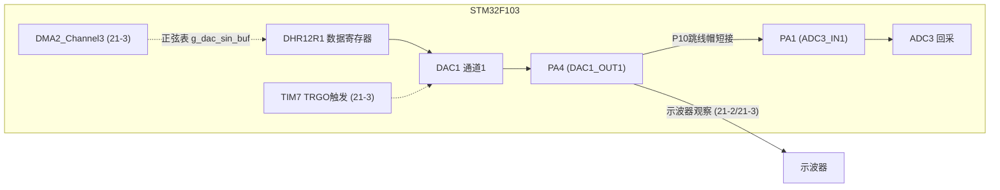
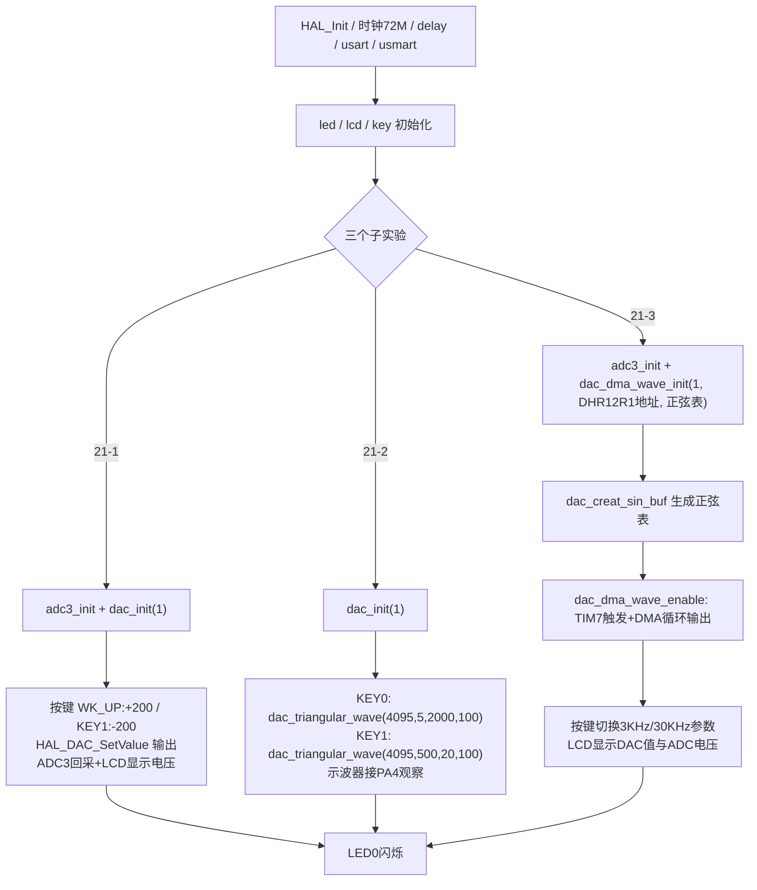

# 实验21 DAC实验

> 平台：正点原子 STM32F103（战舰）开发板 · HAL 库 · Keil MDK

## 一、实验简介

本实验学习 STM32F103 **内部 DAC（数模转换器）** 的使用，包含三个子实验：**21-1 DAC 输出**（按键调节直流电压）、**21-2 DAC 输出三角波**（软件延时逐点输出）、**21-3 DAC 输出正弦波**（TIM7 触发 + DMA 自动搬运波形表）。DAC 是 ADC 的"反过程"——把数字量变成模拟电压从 PA4 输出。

🏠 **生活类比**：DAC 就像音响的音量旋钮。手机里存的是数字音乐（0 和 1），但喇叭只能播放连续的声波（模拟信号），中间必须有一个"翻译官"把数字变成连续电压——这就是 DAC。三个子实验分别相当于：调一个固定音量（直流）、让音量匀速起伏（三角波）、按正弦曲线平滑起伏（正弦波）。

## 二、实验目的

- 掌握 STM32 内部 DAC 的初始化与 `DAC_CR / DHR12R1 / DOR` 寄存器工作原理
- 学会用 `HAL_DAC_SetValue()` 输出任意 0~3.3V 直流电压（21-1）
- 理解软件逐点刷新产生三角波的方法与局限（21-2）
- 掌握 **定时器 TRGO 触发 + DMA 循环搬运** 输出高速正弦波的方法（21-3）
- 学会用 ADC3 回采 DAC 输出电压进行验证

## 三、硬件资源与连接图

| 外设 | 引脚 | 说明 |
|------|------|------|
| DAC1 通道1 | **PA4**（DAC1_OUT1） | 模拟输出 0~3.3V；PA5 为 DAC1_OUT2（本实验未用） |
| ADC3 通道1 | PA1 | 21-1/21-3 回采 DAC 输出电压（需跳线帽短接 P10 的 ADC 和 DAC） |
| 按键 | KEY0-PE4 / KEY1-PE3 / KEY2-PE2 / WK_UP-PA0 | 控制电压增减与波形切换 |
| LED0 (DS0, 红) | PB5 | 低电平点亮，闪烁提示程序运行 |
| 串口1 | PA9 / PA10 | 板载 CH340，115200，支持 USMART 调参 |
| TFTLCD | 16位8080并口 | 显示 DAC 值、电压、ADC 电压 |
| DMA（21-3） | DMA2_Channel3 | DAC1_OUT1 固定对应 DMA2 通道3 |
| TIM7（21-3） | 内部触发源 | TRGO 更新事件触发 DAC 转换 |



> 接线说明：**用跳线帽短接 P10 的 ADC 和 DAC**，PA4 输出的电压才能送到 PA1 被 ADC3 采样，实现"自己输出、自己测量"的闭环验证；观察三角波/正弦波时把示波器探头接 PA4。

## 四、核心寄存器（DAC / TIM7 / DMA）

| 寄存器 | 名称 | 作用 |
|--------|------|------|
| `DAC_CR` | 控制寄存器 | bit0 EN1 使能通道1；bit2 TEN1 使能触发；bit3~5 TSEL1 触发源选择（110 = TIM7 TRGO）；bit12 DMAEN1 使能 DMA 请求；bit30 TEN2/bit31 通道2 对应位 |
| `DAC_DHR12R1` | 12位右对齐数据保持寄存器（通道1） | 写入 0~4095，无触发时直接装入输出寄存器；DMA 也向此地址搬数据 |
| `DAC_DOR1` | 数据输出寄存器（通道1） | 只读，当前实际输出值（`HAL_DAC_GetValue` 读的是它） |
| `TIM7_CR2` | 定时器7控制寄存器2 | MMS[6:4]=010，更新事件作为 TRGO 输出触发 DAC |
| `TIM7_ARR / PSC` | 自动重装载 / 预分频 | 触发频率 ftrgo = 72M / ((psc+1)×(arr+1)) |
| `DMA2_Channel3 CCR/CPAR/CMAR/CNDTR` | DMA 控制寄存器 | 存储器→外设、半字、循环模式，把正弦表循环写入 DHR12R1 |

**输出电压公式**：

```
Vout = DOR值 × VREF / 4096 = dacval × 3.3 / 4096   (0 ~ 3.3V, 12位分辨率约0.8mV)
```

**波形频率公式（21-3）**：

```
波形频率 = ftrgo / 每周期的点数(ndtr)
例: psc=72-1, arr=10-1 → ftrgo=100KHz, 100点 → 1KHz 正弦波
```

DAC 输入时钟来自 APB1（36MHz），输出缓冲关闭时建立时间 tSETTLING ≈ 4us，因此 DAC 输出更新速度最高约 250KHz。

## 五、软件架构 / 流程



## 六、主要示例代码及讲解

### 1. DAC 初始化与设电压（21-1，`Drivers/BSP/DAC/dac.c`）

```c
void dac_init(uint8_t outx)
{
    GPIO_InitTypeDef gpio_init_struct;
    DAC_ChannelConfTypeDef dac_ch_conf;

    __HAL_RCC_DAC_CLK_ENABLE();                                 /* 使能DAC1的时钟 */
    __HAL_RCC_GPIOA_CLK_ENABLE();                               /* 使能DAC OUT1/2的IO口时钟(都在PA口,PA4/PA5) */

    gpio_init_struct.Pin = (outx==1)? GPIO_PIN_4 : GPIO_PIN_5;  /* STM32单片机, 总是PA4=DAC1_OUT1, PA5=DAC1_OUT2 */
    gpio_init_struct.Mode = GPIO_MODE_ANALOG;
    HAL_GPIO_Init(GPIOA, &gpio_init_struct);

    g_dac_handle.Instance = DAC;
    HAL_DAC_Init(&g_dac_handle);                                /* 初始化DAC */

    dac_ch_conf.DAC_Trigger = DAC_TRIGGER_NONE;                 /* 不使用触发功能 */
    dac_ch_conf.DAC_OutputBuffer = DAC_OUTPUTBUFFER_DISABLE;    /* DAC1输出缓冲关闭 */

    switch(outx)
    {
        case 1:
            HAL_DAC_ConfigChannel(&g_dac_handle, &dac_ch_conf, DAC_CHANNEL_1);  /* 配置DAC通道1 */
            HAL_DAC_Start(&g_dac_handle,DAC_CHANNEL_1);                         /* 开启DAC通道1 */
            break;
        ...
    }
}

void dac_set_voltage(uint8_t outx, uint16_t vol)
{
    double temp = vol;
    temp /= 1000;
    temp = temp * 4096 / 3.3;

    if (temp >= 4096)temp = 4095;   /* 如果值大于等于4096, 则取4095 */

    if (outx == 1)   /* 通道1 */
    {
        HAL_DAC_SetValue(&g_dac_handle, DAC_CHANNEL_1, DAC_ALIGN_12B_R, temp); /* 12位右对齐数据格式设置DAC值 */
    }
    ...
}
```

**讲解**：
- DAC 输出引脚同样要配成**模拟模式**；PA4/PA5 与 DAC1_OUT1/OUT2 是芯片固定映射，不可更改。
- `DAC_TRIGGER_NONE`：不用触发，写入 `DHR12R1` 的值经 1 个 APB1 周期后直接进入 `DOR` 输出，适合输出直流。
- `dac_set_voltage(1, 1500)` 即输出 1.5V：先把毫伏换成伏，再按 `× 4096 / 3.3` 折算成 12 位码值。此函数注册在 USMART 中，可串口直接调用。

### 2. 软件输出三角波（21-2，`Drivers/BSP/DAC/dac.c`）

```c
void dac_triangular_wave(uint16_t maxval, uint16_t dt, uint16_t samples, uint16_t n)
{
    uint16_t i, j;
    float incval;                           /* 递增量 */
    float Curval;                           /* 当前值 */

    if((maxval + 1) <= samples)return ;     /* 数据不合法 */

    incval = (maxval + 1) / (samples / 2);  /* 计算递增量 */

    for(j = 0; j < n; j++)
    {
        Curval = 0;
        HAL_DAC_SetValue(&g_dac_handle, DAC_CHANNEL_1, DAC_ALIGN_12B_R, Curval);    /* 先输出0 */
        for(i = 0; i < (samples / 2); i++)  /* 输出上升沿 */
        {
            Curval  +=  incval;             /* 新的输出值 */
            HAL_DAC_SetValue(&g_dac_handle, DAC_CHANNEL_1, DAC_ALIGN_12B_R, Curval);
            delay_us(dt);
        }
        for(i = 0; i < (samples / 2); i++)  /* 输出下降沿 */
        {
            Curval  -=  incval;             /* 新的输出值 */
            HAL_DAC_SetValue(&g_dac_handle, DAC_CHANNEL_1, DAC_ALIGN_12B_R, Curval);
            delay_us(dt);
        }
    }
}
```

**讲解**：
- 原理是"爬楼梯"：前半周期每 `dt` 微秒把输出值加一个递增量（上升沿），后半周期递减（下降沿），循环 `n` 次。
- 输出频率 ≈ `1000 / (dt × samples)` kHz。如 `dac_triangular_wave(4095, 5, 2000, 100)`：幅值 4095、点间隔 5us、2000 点/周期 → 约 100Hz；`dt` 很小时 `delay_us` 本身误差变大，实测频率会偏小。
- 这是纯 CPU 阻塞输出，波形期间主循环被占用——这正是 21-3 要引入 DMA 的原因。

### 3. DMA + TIM7 输出正弦波（21-3，`Drivers/BSP/DAC/dac.c` 与 `User/main.c`）

```c
void dac_dma_wave_init(uint8_t outx, uint32_t par, uint32_t mar)
{
    ...
    if (outx == 1) dmax_chy = DMA2_Channel3;       /* OUT1对应DMA2_Channel3 */
    else           dmax_chy = DMA2_Channel4;       /* OUT2对应DMA2_Channel4 */
    ...
    g_dma_dac_handle.Init.Direction = DMA_MEMORY_TO_PERIPH;                 /* 从存储器到外设模式 */
    g_dma_dac_handle.Init.MemInc = DMA_MINC_ENABLE;                         /* 存储器增量模式 */
    g_dma_dac_handle.Init.PeriphDataAlignment = DMA_PDATAALIGN_HALFWORD;    /* 外设数据长度:16位 */
    g_dma_dac_handle.Init.Mode = DMA_CIRCULAR;                              /* 循环模式 */
    HAL_DMA_Init(&g_dma_dac_handle);                                        /* 初始化DMA */
    HAL_DMA_Start(&g_dma_dac_handle, mar, par, 0);                          /* 配置DMA传输参数 */
    ...
    dac_ch_conf.DAC_Trigger = DAC_TRIGGER_T7_TRGO;                          /* TIM7 TRGO 触发 */
    dac_ch_conf.DAC_OutputBuffer = DAC_OUTPUTBUFFER_DISABLE;                /* DAC1输出缓冲关闭 */
    HAL_DAC_ConfigChannel(&g_dac_dma_handle, &dac_ch_conf, DAC_CHANNEL_1);   /* 配置DAC通道1 */
}

void dac_dma_wave_enable(uint16_t cndtr, uint16_t arr, uint16_t psc)
{
    ...
    tim7_handle.Instance = TIM7;                              /* 选择定时器7 */
    tim7_handle.Init.Prescaler = psc;                         /* 预分频 */
    tim7_handle.Init.Period = arr;                            /* 自动装载值 */
    HAL_TIM_Base_Init(&tim7_handle);                          /* 初始化定时器7 */

    tim_master_config.MasterOutputTrigger = TIM_TRGO_UPDATE;                  /* 定时器更新事件用于触发 */
    HAL_TIMEx_MasterConfigSynchronization(&tim7_handle, &tim_master_config);  /* 更新事件触发DAC转换 */
    HAL_TIM_Base_Start(&tim7_handle);                                         /* 启动定时器7 */

    HAL_DAC_Stop_DMA(&g_dac_dma_handle, DAC_CHANNEL_1);                       /* 先停止之前的传输 */
    HAL_DAC_Start_DMA(&g_dac_dma_handle, DAC_CHANNEL_1, (uint32_t *)g_dac_sin_buf, cndtr, DAC_ALIGN_12B_R);
}
```

**讲解**：
- 工作链条：**TIM7 每隔 (arr+1)×(psc+1) 个时钟发出一次 TRGO 触发 → DAC 收到触发后经 DMA 从 `g_dac_sin_buf[]` 取一个点写入 DHR12R1 并转换输出 → DMA 循环模式自动回到表头**，CPU 全程零参与。
- 正弦表由 `dac_creat_sin_buf(2048, 100)` 生成：`outdata = maxval × (1 + sin(inc × i))`，把正弦偏移到 0~4095 的正数区。
- `dac_dma_wave_enable(100, 10-1, 24-1)`：触发频率 72M/(10×24)=300KHz，100 点一周期 → 3KHz 正弦波；KEY1 改用 10 点表 → 30KHz。

## 七、实验效果

- **21-1**：按 WK_UP 电压升、按 KEY1 电压降（步进 200 码值），LCD 同时显示 DAC 码值、DAC 设定电压和 ADC3 回采电压，两者基本一致（差几十 mV 属正常）；也可用 USMART 调 `dac_set_voltage(1, vol)` 直接设电压。
- **21-2**：按 KEY0 输出高采样率三角波（幅值4095、点间隔5us、2000点、100个波形），按 KEY1 输出低采样率三角波（点间隔500us、20点、阶梯明显），示波器接 PA4 可见波形，频率按 `1000/(dt×samples)` kHz 估算。
- **21-3**：上电默认输出 1KHz 正弦波，按 KEY0 切到约 3KHz、KEY1 切到约 30KHz，示波器接 PA4 观察；LCD 实时刷新 DAC 当前值与 ADC 回采电压。LED0 均周期闪烁。

## 八、注意事项

- **必须用跳线帽短接 P10 的 ADC 和 DAC**，ADC3 才能采到 DAC 输出电压（21-1）。
- DAC 输出范围 0~VREF（本板 3.3V），代码里对 ≥4096 的码值做了限幅，不要试图输出负电压或超过 3.3V。
- 21-2 三角波只操作了通道1，如需通道2 要自行修改 `dac_triangular_wave` 中的通道号。
- 21-3 中 DAC1_OUT1 的 DMA 请求固定走 **DMA2_Channel3**，OUT2 走 DMA2_Channel4，不可挪用。
- DAC 最高更新率约 250KHz（tSETTLING=4us），30KHz 正弦波（10 点/周期 = 300KHz 更新率）已接近极限，波形会略失真。
- 电脑端串口波特率 115200，串口输入字符串以回车换行结束；本例程仅支持 MCU 屏。
- 4.3 寸和 7 寸屏建议外接 12V 1A 电源；烧录失败先运行 `keilkill.bat`。

## 九、文件结构

```
实验21 DAC实验/
├── 实验21-1 DAC输出实验/
│   ├── User/main.c             按键调压 + ADC3回采显示
│   ├── Drivers/BSP/
│   │   ├── DAC/                DAC驱动 (dac.c: dac_init / dac_set_voltage)
│   │   ├── ADC/                ADC3驱动 (adc3.c / adc3.h)
│   │   ├── KEY/ LCD/ LED/      按键、LCD、LED驱动
│   ├── Projects/MDK-ARM/       Keil工程
│   └── readme.txt              原厂说明
├── 实验21-2 DAC输出三角波实验/
│   ├── User/main.c             按键切换两种三角波
│   ├── Drivers/BSP/DAC/        dac.c 增加 dac_triangular_wave
│   └── Projects/MDK-ARM/       Keil工程
├── 实验21-3 DAC输出正弦波实验/
│   ├── User/main.c             dac_creat_sin_buf 生成正弦表 + 按键切换频率
│   ├── Drivers/BSP/DAC/        dac.c 增加 dac_dma_wave_init / dac_dma_wave_enable
│   ├── Drivers/BSP/ADC/        ADC3回采
│   └── Projects/MDK-ARM/       Keil工程
└── readme.md                   本文档
```
