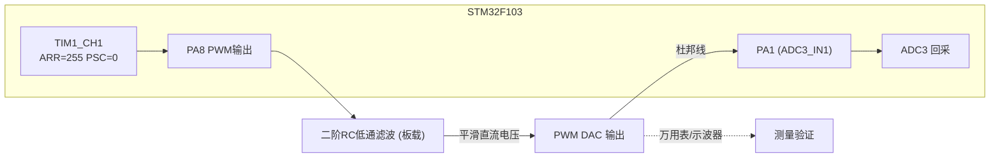
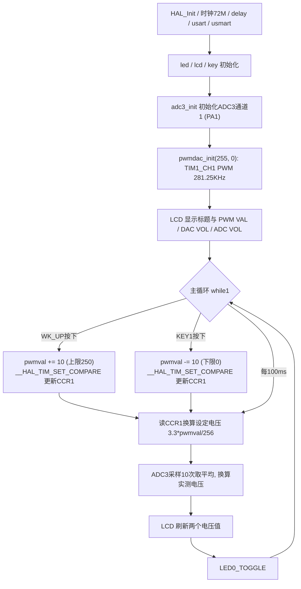

# 实验22 PWM DAC实验

> 平台：正点原子 STM32F103（战舰）开发板 · HAL 库 · Keil MDK

## 一、实验简介

本实验不使用芯片内部 DAC，而是用 **TIM1 通道1 输出高频 PWM（PA8）**，经过板载**二阶 RC 低通滤波**后得到平滑的直流电压，构成一个"PWM DAC"。通过 KEY_UP/KEY1 调节 PWM 占空比，滤波后的输出电压随之变化，再用 ADC3 通道1（PA1）回采验证，LCD 同时显示设定电压与实测电压。这也是 SPWM（正弦波 PWM）技术的底层原理。

🏠 **生活类比**：PWM DAC 就像用"快速开关水龙头"来调节水流大小：全开是 3.3V，全关是 0V，一半时间开一半时间关，平均下来就是 1.65V。RC 滤波电容相当于一个"蓄水池"，把忽开忽关的脉冲水流抹平成稳定的细流——占空比越大，平均电压越高。

## 二、实验目的

- 理解 **PWM + RC 低通滤波 = 简易 DAC** 的原理
- 掌握 TIM1（高级定时器）PWM 输出的初始化与占空比调节（`__HAL_TIM_SET_COMPARE`）
- 理解 PWM 频率、分辨率（ARR）与滤波后纹波之间的关系
- 学会用 ADC3 回采 PWM DAC 输出电压并与理论值对比
- 了解 SPWM 的实现思路（按正弦规律改变占空比即可）

## 三、硬件资源与连接图

| 外设 | 引脚 | 说明 |
|------|------|------|
| TIM1_CH1 PWM 输出 | **PA8** | 72M/256 = 281.25KHz PWM，8 位分辨率（0~255） |
| 二阶 RC 滤波 | 板载 | PA8 的 PWM 经二阶 RC 低通滤波输出平滑电压 |
| ADC3 通道1 | PA1 | 回采滤波后的电压（需杜邦线连接滤波输出与 ADC 插针） |
| 按键 | KEY1-PE3 / WK_UP-PA0 | KEY_UP 调高占空比、KEY1 调低占空比 |
| LED0 (DS0, 红) | PB5 | 低电平点亮，闪烁提示程序运行 |
| 串口1 | PA9 / PA10 | 板载 CH340，115200，支持 USMART 调 `pwmdac_set_voltage` |
| TFTLCD | 16位8080并口 | 显示 PWM 值、DAC 电压、ADC 电压 |



> 接线说明：PWM 从 PA8 输出，经二阶 RC 滤波后变成直流电压；**用杜邦线把滤波输出接到 ADC 插针（PA1）**，即可用 ADC3 实测输出电压。PWM 频率 281.25KHz 远高于 RC 滤波截止频率，纹波很小。

## 四、核心寄存器（TIM1 PWM）

| 寄存器 | 名称 | 作用 |
|--------|------|------|
| `TIM1_CR1` | 控制寄存器1 | bit0 CEN 使能计数器；向上计数模式；bit7 ARPE 自动重装载预装载 |
| `TIM1_PSC` | 预分频器 | 本实验 psc=0，计数器时钟 = 72MHz |
| `TIM1_ARR` | 自动重装载值 | arr=255，PWM 频率 = 72M/((0+1)×(255+1)) = **281.25KHz**，占空比分辨率 8 位（0~255） |
| `TIM1_CCR1` | 捕获/比较寄存器1 | 比较值即占空比：CNT<CCR1 时输出高电平；`__HAL_TIM_SET_COMPARE` 写的就是它 |
| `TIM1_CCMR1` | 捕获/比较模式寄存器1 | OC1M=110 选择 **PWM 模式1**；OC1PE 使能 CCR1 预装载 |
| `TIM1_CCER` | 捕获/比较使能寄存器 | CC1E=1 使能 CH1 输出；CC1P=0 高电平有效 |
| `TIM1_BDTR` | 刹车和死区寄存器 | 高级定时器特有，bit15 **MOE=1 主输出使能**（HAL_TIM_PWM_Start 内部置位） |

**输出电压公式**：

```
Vout = VCC × 占空比 = 3.3 × CCR1 / (ARR + 1) = 3.3 × pwmval / 256
即 main.c 中: temp = (float)adcx * (3.3 / 256);
```

> 分辨率与纹波是一对矛盾：ARR 越大分辨率越高，但同样时钟下 PWM 频率越低，滤波后纹波越大。281.25KHz + 8 位是折中选择。

## 五、软件架构 / 流程



## 六、主要示例代码及讲解

### 1. PWM DAC 初始化（`Drivers/BSP/PWMDAC/pwmdac.c`）

```c
void pwmdac_init(uint16_t arr, uint16_t psc)
{
    TIM_OC_InitTypeDef timx_oc_pwmdac = {0};

    PWMDAC_TIMX_CLK_ENABLE();                                                     /* PWM DAC 定时器时钟使能 */

    g_tim1_handle.Instance = TIM1;                                                /* 定时器1 */
    g_tim1_handle.Init.Prescaler = psc;                                           /* 定时器分频 */
    g_tim1_handle.Init.CounterMode = TIM_COUNTERMODE_UP;                          /* 递增计数模式 */
    g_tim1_handle.Init.Period = arr;                                              /* 自动重装载值 */
    g_tim1_handle.Init.AutoReloadPreload = TIM_AUTORELOAD_PRELOAD_ENABLE;         /* 使能TIMx_ARR进行缓冲 */
    HAL_TIM_PWM_Init(&g_tim1_handle);                                             /* 初始化PWM */

    timx_oc_pwmdac.OCMode = TIM_OCMODE_PWM1;                                      /* CH1/2 PWM模式1 */
    timx_oc_pwmdac.Pulse = 0;                                                     /* 设置比较值,此值用来确定占空比 */
    timx_oc_pwmdac.OCPolarity = TIM_OCPOLARITY_HIGH;                              /* 输出比较极性为高 */
    HAL_TIM_PWM_ConfigChannel(&g_tim1_handle, &timx_oc_pwmdac, PWMDAC_TIMX_CHY);  /* 配置TIM1通道1 */

    HAL_TIM_PWM_Start(&g_tim1_handle, TIM_CHANNEL_1);                             /* 开启定时器1通道1 */
}
```

**讲解**：
- `pwmdac.h` 定义 `PWMDAC_TIMX = TIM1`、`PWMDAC_TIMX_CHY = TIM_CHANNEL_1`、引脚 `PA8`。
- 主函数以 `pwmdac_init(256-1, 0)` 调用：ARR=255、PSC=0，PWM 频率 72M/256 = 281.25KHz。
- PWM 模式1：CNT 从 0 数到 ARR，**CNT < CCR1 输出高电平**，其余输出低电平，所以 CCR1 直接决定占空比。
- TIM1 是高级定时器，`HAL_TIM_PWM_Start()` 会自动置位 BDTR 的 MOE 主输出使能位，否则引脚无输出。
- 底层 `HAL_TIM_PWM_MspInit()` 里把 PA8 配为**复用推挽输出**，并做了 TIM1 部分重映射（CH1 仍在 PA8）。

### 2. 设置 PWM DAC 输出电压（`Drivers/BSP/PWMDAC/pwmdac.c`）

```c
void pwmdac_set_voltage(uint16_t vol)
{
    float temp = vol;
    temp /= 100;                                                    /* 缩小100倍, 得到实际电压值 */
    temp = temp * 256 / 3.3;                                        /* 将电压转换成PWM占空比 */
    __HAL_TIM_SET_COMPARE(&g_tim1_handle, PWMDAC_TIMX_CHY, temp);   /* 设置新的占空比 */
}
```

**讲解**：
- 入参 `vol` 单位是 10mV（0~330 代表 0~3.3V），先除 100 换成伏，再按 `× 256 / 3.3` 反推出 CCR1 值。
- `__HAL_TIM_SET_COMPARE` 是 HAL 宏，直接写 `TIM1_CCR1` 寄存器，立即生效（CCR1 有预装载，在下一个更新事件载入）。
- 此函数注册在 USMART 中，串口输入 `pwmdac_set_voltage(165)` 即可输出约 1.65V。

### 3. 主循环按键调压与回采（`User/main.c`）

```c
if (key == WKUP_PRES)      /* PWM占空比调高 */
{
    if (pwmval < 250)      /* 范围限定 */
    {
        pwmval += 10;
    }
    __HAL_TIM_SET_COMPARE(&g_tim1_handle, PWMDAC_TIMX_CHY, pwmval); /* 输出新的PWM占空比 */
}
else if (key == KEY1_PRES) /* PWM占空比调低 */
{
    if (pwmval > 10) pwmval -= 10;
    else pwmval = 0;
    __HAL_TIM_SET_COMPARE(&g_tim1_handle, PWMDAC_TIMX_CHY, pwmval); /* 输出新的PWM占空比 */
}
...
temp = (float)adcx * (3.3 / 256);                   /* 得到DAC电压值 */
...
adcx = adc3_get_result_average(ADC3_CHY, 10);       /* 得到ADC3通道1的转换结果 */
temp = (float)adcx * (3.3 / 4096);                  /* 得到ADC电压值(adc是12bit的) */
```

**讲解**：
- 每按一次键占空比增减 10（范围 0~250），设定电压 = `3.3 × pwmval / 256`。
- ADC3 通道1（PA1）采样 10 次取平均后按 12 位精度换算实测电压，与设定电压在 LCD 上并排显示，直观验证"PWM+滤波=DAC"。

## 七、实验效果

烧录后，按 **WK_UP** 电压升高、按 **KEY1** 电压降低（每步约 0.13V）。LCD 显示 `PWM VAL`（CCR1 值）、`DAC VOL`（设定电压）、`ADC VOL`（实测电压），两者基本吻合（差几十 mV 属正常，来自 RC 纹波与 ADC 误差）。用万用表量滤波输出端也能看到相同电压；LED0 周期闪烁。

## 八、注意事项

- **必须用杜邦线把 PA8 经 RC 滤波后的输出连接到 ADC 插针（PA1）**，否则 ADC 读数为 0。
- PWM DAC 只能输出"慢变化"的直流/低频信号；若占空比变化太快，RC 滤波跟不上，输出会失真。
- 分辨率受 ARR 限制（本例 8 位 = 256 级，每级约 13mV），想更精细可增大 ARR，但 PWM 频率会下降、纹波变大。
- TIM1 是高级定时器，除 CCR/ARR 外还必须使能 **MOE 主输出**（HAL 已代劳），这是与通用定时器 TIM2~5 的区别。
- 电脑端串口波特率 115200；P4 的 PA9/PA10 必须通过跳线帽连接在 RXD/TXD 上；本例程仅支持 MCU 屏。
- 4.3 寸和 7 寸屏建议外接 12V 1A 电源；烧录失败先运行根目录 `keilkill.bat`。

## 九、文件结构

```
实验22 PWM DAC实验/
├── User/
│   ├── main.c                  主程序（按键调占空比 + ADC回采显示）
│   ├── stm32f1xx_it.c          中断服务函数
│   └── stm32f1xx_hal_conf.h    HAL配置
├── Drivers/
│   ├── BSP/
│   │   ├── PWMDAC/             PWM DAC驱动 (pwmdac.c / pwmdac.h)
│   │   ├── ADC/                ADC3驱动 (adc3.c / adc3.h, 回采电压)
│   │   ├── KEY/ LCD/ LED/      按键、LCD、LED驱动
│   │   └── DAC/                DAC驱动（本实验未调用, 供对比参考）
│   ├── SYSTEM/                 delay / sys / usart 系统支持
│   ├── CMSIS/                  内核启动与设备定义
│   └── STM32F1xx_HAL_Driver/   ST HAL 库
├── Middlewares/USMART/         usmart 串口调试组件（可调 pwmdac_set_voltage）
├── Projects/MDK-ARM/           Keil 工程文件 (.uvprojx)
└── readme.txt                  原厂实验说明
```
