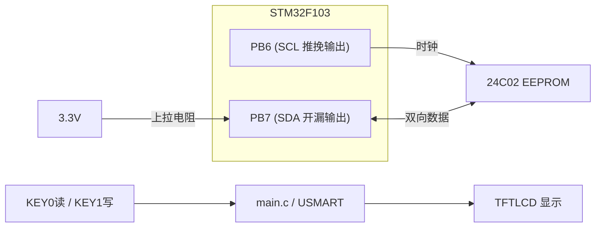
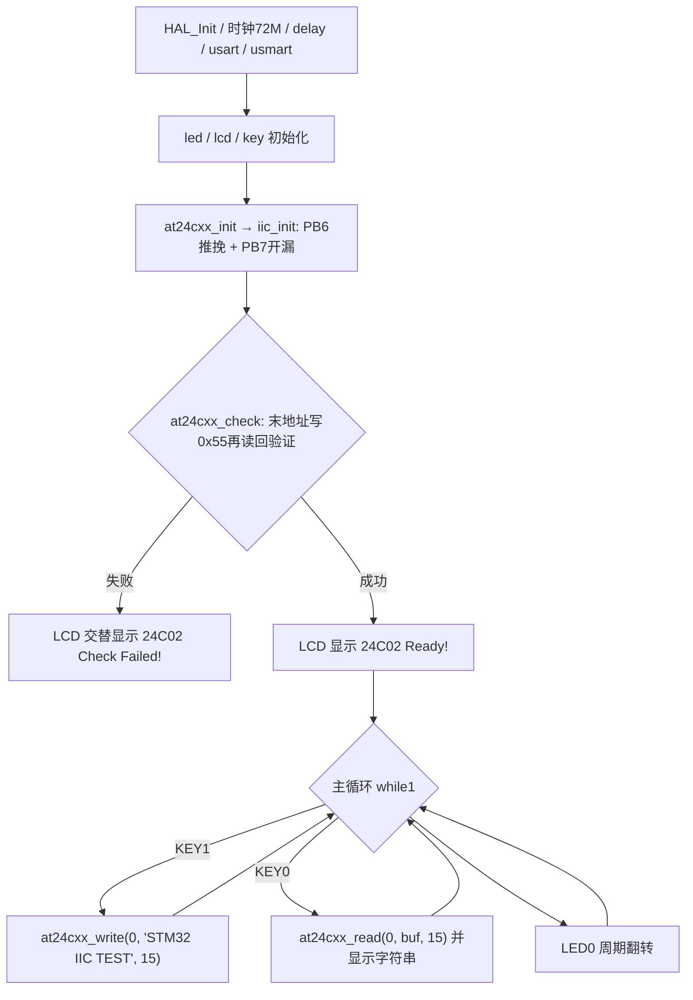

# 实验23 IIC实验

> 平台：正点原子 STM32F103（战舰）开发板 · HAL 库 · Keil MDK

## 一、实验简介

本实验用两个普通 GPIO（**PB6-SCL、PB7-SDA**）**软件模拟 IIC（I2C）总线时序**，驱动板载 **24C02 EEPROM**，实现掉电不丢失的数据读写。按 KEY1 把字符串 "STM32 IIC TEST" 写入 24C02，按 KEY0 读出来显示在 LCD 上——即使中途断电重启，数据依然在。

🏠 **生活类比**：IIC 总线就像"两人用一根绳传纸条"：SCL 是发话人敲的节拍（时钟），SDA 是传纸条的绳子（数据线）。规矩很简单：节拍高时不许换纸条（数据稳定），节拍低时才能换。START 是"我要说话了"（节拍高时绳子突然拉低），STOP 是"说完了"（节拍高时绳子突然拉高）。

## 二、实验目的

- 理解 IIC 总线的两线制结构、START/STOP/ACK 信号与器件寻址方式
- 掌握用 GPIO **软件模拟 IIC 时序**的方法（推挽 SCL + 开漏 SDA）
- 掌握 24C02（AT24CXX 系列）EEPROM 的字节读写时序与器件地址 0xA0/0xA1
- 理解 EEPROM 写入需要 10ms 内部写周期，不能连续快速写
- 学会用 USMART 在任意地址读写 24C02

## 三、硬件资源与连接图

| 外设 | 引脚 | 说明 |
|------|------|------|
| IIC_SCL | **PB6** | 软件模拟时钟线，推挽输出+上拉 |
| IIC_SDA | **PB7** | 软件模拟数据线，开漏输出+上拉（开漏高电平时可读外部电平） |
| 24C02 | 板载 EEPROM | 器件地址 1010xxx，容量 256 字节（`EE_TYPE = AT24C02`） |
| 按键 | KEY0-PE4 / KEY1-PE3 | KEY1 写入、KEY0 读取 |
| LED0 (DS0, 红) | PB5 | 低电平点亮，闪烁提示程序运行 |
| 串口1 | PA9 / PA10 | 板载 CH340，115200，USMART 调试 |
| TFTLCD | 16位8080并口 | 显示读写状态与数据 |



> 接线说明：SCL/SDA 均为板载连接至 24C02，无需跳线。SDA 需要双向传输（主机发数据、从机回 ACK/数据），配置为**开漏输出+上拉**后，输出 1 释放总线时即可直接读取外部电平，省去方向切换。

## 四、核心寄存器与时序

本实验为**软件模拟 IIC**，不使用硬件 I2C 外设（即不涉及 I2C_CR1/CR2），核心是 GPIO 寄存器与位操作时序：

| 寄存器/宏 | 名称 | 作用 |
|--------|------|------|
| `GPIOB_ODR`（经 `IIC_SCL(x)`/`IIC_SDA(x)` 宏 → `HAL_GPIO_WritePin`） | 输出数据寄存器 | 控制 SCL/SDA 输出高低电平 |
| `GPIOB_IDR`（经 `IIC_READ_SDA` → `HAL_GPIO_ReadPin`） | 输入数据寄存器 | 读取 SDA 电平（收 ACK、收数据位） |
| `GPIOB_CRL` | 端口配置寄存器 | PB6 配推挽输出、PB7 配开漏输出（HAL_GPIO_Init 完成） |
| `RCC_APB2ENR` | 时钟使能 | 使能 GPIOB 时钟（用前必开） |

**IIC 基本时序规则**（`myiic.c` 实现）：

```
START : SCL=1 时, SDA 由 1 → 0
STOP  : SCL=1 时, SDA 由 0 → 1
数据位: SCL=0 时改变 SDA, SCL=1 期间数据必须稳定, 高位先发
ACK   : 每发完 1 字节, 主机释放SDA, 发第 9 个时钟, 从机拉低SDA为应答
```

**24C02 器件地址格式（8bit）**：`1 0 1 0 A2 A1 A0 R/W`，写操作发 `0xA0`，读操作发 `0xA1`；24C16 及以下型号的高位地址（a8~a10）藏在器件地址的 bit1~bit3 中。

## 五、软件架构 / 流程



## 六、主要示例代码及讲解

### 1. IIC 起始/停止信号（`Drivers/BSP/IIC/myiic.c`）

```c
void iic_start(void)
{
    IIC_SDA(1);
    IIC_SCL(1);
    iic_delay();
    IIC_SDA(0);     /* START信号: 当SCL为高时, SDA从高变成低, 表示起始信号 */
    iic_delay();
    IIC_SCL(0);     /* 钳住I2C总线，准备发送或接收数据 */
    iic_delay();
}

void iic_stop(void)
{
    IIC_SDA(0);     /* STOP信号: 当SCL为高时, SDA从低变成高, 表示停止信号 */
    iic_delay();
    IIC_SCL(1);
    iic_delay();
    IIC_SDA(1);     /* 发送I2C总线结束信号 */
    iic_delay();
}
```

**讲解**：
- START 和 STOP 是 IIC 上唯一允许"SCL 高电平期间 SDA 变化"的时刻，从机靠这个边沿识别帧的开始与结束。
- `iic_delay()` 是 `delay_us(2)`，决定总线速度约在 250KHz 以内。
- 初始化时 `iic_init()` 把 PB6 配为**推挽输出**（时钟只由主机驱动）、PB7 配为**开漏输出+上拉**（数据线需要多设备共享与读取）。

### 2. 发送/接收一个字节（`Drivers/BSP/IIC/myiic.c`）

```c
void iic_send_byte(uint8_t data)
{
    uint8_t t;

    for (t = 0; t < 8; t++)
    {
        IIC_SDA((data & 0x80) >> 7);    /* 高位先发送 */
        iic_delay();
        IIC_SCL(1);
        iic_delay();
        IIC_SCL(0);
        data <<= 1;     /* 左移1位,用于下一次发送 */
    }
    IIC_SDA(1);         /* 发送完成, 主机释放SDA线 */
}

uint8_t iic_read_byte(uint8_t ack)
{
    uint8_t i, receive = 0;

    for (i = 0; i < 8; i++ )    /* 接收1个字节数据 */
    {
        receive <<= 1;  /* 高位先输出,所以先收到的数据位要左移 */
        IIC_SCL(1);
        iic_delay();

        if (IIC_READ_SDA)
        {
            receive++;
        }

        IIC_SCL(0);
        iic_delay();
    }

    if (!ack) iic_nack();       /* 发送nACK */
    else      iic_ack();        /* 发送ACK */

    return receive;
}
```

**讲解**：
- 发送：每次取最高位 `(data & 0x80) >> 7` 放到 SDA，拉高 SCL 一个周期让从机采样，再左移准备下一位，共 8 个时钟。
- 接收：主机释放 SDA，在 SCL 高电平期间读 `IIC_READ_SDA`（开漏输出 1 时可读外部电平），高位先收所以先左移再累加。
- 收完 1 字节按参数回 ACK（继续收）或 NACK（最后一字节，告诉从机结束）。
- 配套的 `iic_wait_ack()` 释放 SDA、发第 9 个时钟，循环检测 SDA 是否被从机拉低，超时 250 次则发 STOP 并报失败。

### 3. 24C02 读一个字节（`Drivers/BSP/24CXX/24cxx.c`）

```c
uint8_t at24cxx_read_one_byte(uint16_t addr)
{
    uint8_t temp = 0;
    iic_start();                /* 发送起始信号 */

    if (EE_TYPE > AT24C16)      /* 24C16以上的型号, 分2个字节发送地址 */
    {
        iic_send_byte(0XA0);    /* 发送写命令, IIC规定最低位是0, 表示写入 */
        iic_wait_ack();
        iic_send_byte(addr >> 8);/* 发送高字节地址 */
    }
    else
    {
        iic_send_byte(0XA0 + ((addr >> 8) << 1));   /* 发送器件 0XA0 + 高位a8/a9/a10地址,写数据 */
    }

    iic_wait_ack();
    iic_send_byte(addr % 256);  /* 发送低位地址 */
    iic_wait_ack();             /* 等待ACK, 此时地址发送完成了 */

    iic_start();                /* 重新发送起始信号 */
    iic_send_byte(0XA1);        /* 进入接收模式, IIC规定最低位是0, 表示读取 */
    iic_wait_ack();
    temp = iic_read_byte(0);    /* 接收一个字节数据 */
    iic_stop();                 /* 产生一个停止条件 */
    return temp;
}
```

**讲解**：
- EEPROM 随机读的标准流程：**先"假写"再"真读"**——START → 0xA0（写）→ 目标地址 → 重新 START → 0xA1（读）→ 收 1 字节（回 NACK）→ STOP。第一步"假写"是为了把内部地址指针定位到目标单元。
- 24C02 只有 256 字节（8 位地址），走 `else` 分支：器件地址低 3 位可以携带 a8~a10 高位地址（24C02 时恒为 0）。
- 写函数 `at24cxx_write_one_byte()` 流程类似，但发完数据直接 STOP，且**必须 `delay_ms(10)`**——EEPROM 内部写周期约 5ms，期间不响应总线。

## 七、实验效果

上电先自检：LCD 显示 `24C02 Ready!`（自检失败则交替闪烁 `24C02 Check Failed!`）。之后按 **KEY1** 把字符串 `STM32 IIC TEST` 写入 24C02 地址 0，LCD 提示 `24C02 Write Finished!`；按 **KEY0** 读出并显示在 `The Data Readed Is:` 下方。**断电重启后再按 KEY0，数据依然完好**——这就是 EEPROM 的意义。也可用 USMART 调用 `at24cxx_write/at24cxx_read` 操作任意地址。LED0 周期闪烁。

## 八、注意事项

- SDA 必须配**开漏输出**，若配成推挽，多设备（或从机拉低 ACK 时）会造成电源短路。
- EEPROM 每写 1 字节后有约 5ms 内部写周期，驱动里固定延时 10ms；跳过它会导致写丢失。
- 24C02 容量仅 256 字节（地址 0~255），访问越界会回卷或失败；`EE_TYPE` 宏决定驱动对大容量型号（>24C16）的双字节地址处理。
- 自检函数会向 24C02 末地址写入 0x55，占用最后一个存储单元，用户数据请避开该地址。
- 软件模拟 IIC 速度受 `delay_us(2)` 限制（≤250KHz），比硬件 I2C 灵活但占 CPU；换引脚只需改 `myiic.h` 里的宏定义。
- 电脑端串口波特率 115200；P4 的 PA9/PA10 必须通过跳线帽连接在 RXD/TXD 上；本例程仅支持 MCU 屏。
- 4.3 寸和 7 寸屏建议外接 12V 1A 电源；烧录失败先运行根目录 `keilkill.bat`。

## 九、文件结构

```
实验23 IIC实验/
├── User/
│   ├── main.c                  主程序（按键触发24C02读写+LCD显示）
│   ├── stm32f1xx_it.c          中断服务函数
│   └── stm32f1xx_hal_conf.h    HAL配置
├── Drivers/
│   ├── BSP/
│   │   ├── IIC/                软件IIC底层 (myiic.c / myiic.h)
│   │   ├── 24CXX/              24C02 EEPROM驱动 (24cxx.c / 24cxx.h)
│   │   ├── KEY/ LCD/ LED/      按键、LCD、LED驱动
│   ├── SYSTEM/                 delay / sys / usart 系统支持
│   ├── CMSIS/                  内核启动与设备定义
│   └── STM32F1xx_HAL_Driver/   ST HAL 库
├── Middlewares/USMART/         usmart 串口调试组件
├── Projects/MDK-ARM/           Keil 工程文件 (.uvprojx)
└── readme.txt                  原厂实验说明
```
