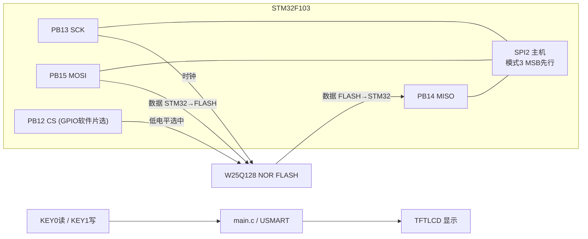
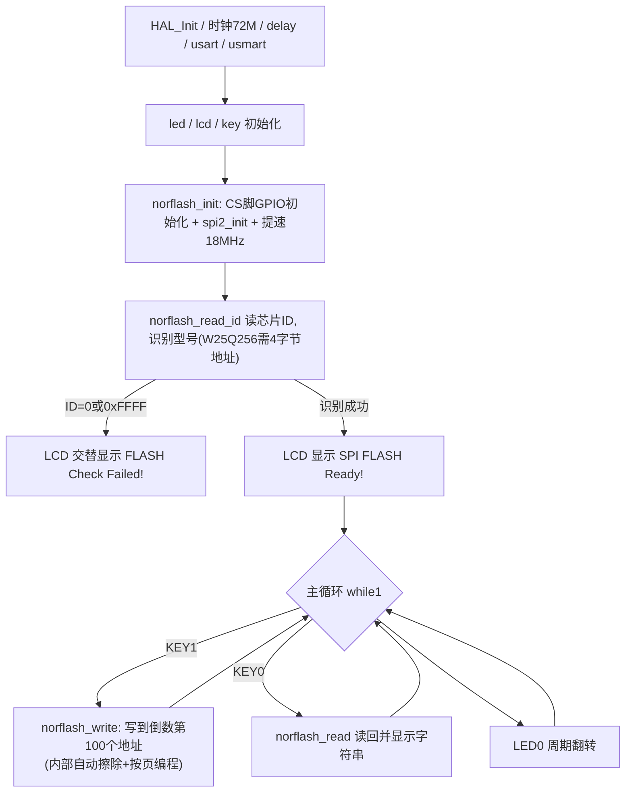

# 实验24 SPI实验

> 平台：正点原子 STM32F103（战舰）开发板 · HAL 库 · Keil MDK

## 一、实验简介

本实验使用 STM32 **硬件 SPI2 外设**（PB13-SCK、PB14-MISO、PB15-MOSI，PB12 软件片选）驱动板载 **W25Q128（25QXX 系列）NOR FLASH**，实现大容量 Flash 的数据读写。按 KEY1 把字符串写入 Flash，按 KEY0 读回显示。SPI 是四线制全双工同步总线，比 IIC 速度高得多（本实验可达 18MHz）。

🏠 **生活类比**：SPI 就像打电话：SCK 是双方约定的语速节拍，MOSI 是"我说话你听"的专线，MISO 是"你说话我听"的专线（收发同时进行，全双工），CS 片选则是"拨号"——只有被拨通（CS 拉低）的那部电话才能通话，其他设备保持沉默。

## 二、实验目的

- 理解 SPI 总线四线制（SCK/MISO/MOSI/CS）、主从结构与全双工通信原理
- 掌握 STM32 硬件 SPI 的配置：主模式、**模式3（CPOL=1, CPHA=第2边沿）**、8 位、MSB 先行、软件 NSS
- 掌握 `SPI_CR1 / SPI_SR / SPI_DR` 寄存器与波特率预分频的设置
- 学会用 SPI 驱动 W25Q128 NOR FLASH：读 ID、读/写数据、扇区擦除
- 对比软件片选（GPIO CS）与硬件 NSS 的使用差异

## 三、硬件资源与连接图

| 外设 | 引脚 | 说明 |
|------|------|------|
| SPI2_SCK | **PB13** | 串行时钟，复用推挽输出 |
| SPI2_MISO | **PB14** | 主入从出（Flash → STM32），复用推挽 |
| SPI2_MOSI | **PB15** | 主出从入（STM32 → Flash），复用推挽 |
| NORFLASH_CS | **PB12** | 片选，普通推挽输出（软件控制，不用硬件 NSS） |
| W25Q128 Flash | 板载 | 容量 16M 字节（128Mbit），支持 W25Q/25Q 系列多型号自动识别 |
| 按键 | KEY0-PE4 / KEY1-PE3 | KEY1 写入、KEY0 读取 |
| LED0 (DS0, 红) | PB5 | 低电平点亮，闪烁提示程序运行 |
| 串口1 | PA9 / PA10 | 板载 CH340，115200，USMART 可读 ID/整片擦除 |
| TFTLCD | 16位8080并口 | 显示读写状态与数据 |



> 接线说明：四根线均板载连接，无需跳线。CS 用普通 GPIO 软件控制，好处是时序灵活、可在任意时刻拉高拉低，且不受硬件 NSS 只能主模式的限制。

## 四、核心寄存器（SPI2）

| 寄存器 | 名称 | 作用 |
|--------|------|------|
| `SPI2_CR1` | 控制寄存器1 | bit2 MSTR=1 主机模式；bit11 DFF 数据帧长（0=8位）；bit3~5 **BR[2:0] 波特率预分频**（fPCLK1/2^(BR+1)）；bit6 SPE 使能 SPI；bit8 SSI 软件片选电平；bit9 SSM=1 软件 NSS；bit10 RXONLY；bit7 LSBFIRST（0=MSB先行）；bit1 CPOL 空闲时钟电平、bit0 CPHA 采样边沿 |
| `SPI2_SR` | 状态寄存器 | bit1 **TXE** 发送缓冲空（可写 DR）；bit0 **RXNE** 接收缓冲非空（可读 DR）；bit7 **BSY** 忙标志 |
| `SPI2_DR` | 数据寄存器 | 读写数据端口：写 DR 启动发送，收满一帧后数据进接收缓冲置 RXNE |

**本实验 SPI 配置**（`spi2_init()`）：主模式、双线全双工、8 位、**CPOL=1 + CPHA=2EDGE（即 SPI 模式3）**、软件 NSS、MSB 先行、初始 256 分频（36M/256 ≈ 140KHz，保证低速可靠启动），随后 `spi2_set_speed(SPI_SPEED_2)` 切到 2 分频 = **18MHz**（SPI2 挂 APB1，PCLK1 = 36MHz）。

**速度换算**：`SPI速度 = PCLK1 / 2^(BR+1)`，BR 即 CR1 的 bit3~5，`spi2_set_speed()` 直接操作 `CR1 &= 0xFFC7; CR1 |= speed << 3;` 完成设置。

## 五、软件架构 / 流程



## 六、主要示例代码及讲解

### 1. SPI2 初始化（`Drivers/BSP/SPI/spi.c`）

```c
void spi2_init(void)
{
    SPI2_SPI_CLK_ENABLE(); /* SPI2时钟使能 */

    g_spi2_handler.Instance = SPI2_SPI;                                /* SPI2 */
    g_spi2_handler.Init.Mode = SPI_MODE_MASTER;                        /* 设置SPI工作模式，设置为主模式 */
    g_spi2_handler.Init.Direction = SPI_DIRECTION_2LINES;              /* 设置SPI单向或者双向的数据模式:SPI设置为双线模式 */
    g_spi2_handler.Init.DataSize = SPI_DATASIZE_8BIT;                  /* 设置SPI的数据大小:SPI发送接收8位帧结构 */
    g_spi2_handler.Init.CLKPolarity = SPI_POLARITY_HIGH;               /* 串行同步时钟的空闲状态为高电平 */
    g_spi2_handler.Init.CLKPhase = SPI_PHASE_2EDGE;                    /* 串行同步时钟的第二个跳变沿（上升或下降）数据被采样 */
    g_spi2_handler.Init.NSS = SPI_NSS_SOFT;                            /* NSS信号由硬件（NSS管脚）还是软件（使用SSI位）管理:内部NSS信号有SSI位控制 */
    g_spi2_handler.Init.BaudRatePrescaler = SPI_BAUDRATEPRESCALER_256; /* 定义波特率预分频的值:波特率预分频值为256 */
    g_spi2_handler.Init.FirstBit = SPI_FIRSTBIT_MSB;                   /* 指定数据传输从MSB位还是LSB位开始:数据传输从MSB位开始 */
    ...
    HAL_SPI_Init(&g_spi2_handler);                                     /* 初始化 */

    __HAL_SPI_ENABLE(&g_spi2_handler); /* 使能SPI2 */

    spi2_read_write_byte(0Xff); /* 启动传输, 实际上就是产生8个时钟脉冲, 达到清空DR的作用, 非必需 */
}
```

**讲解**：
- `CLKPolarity=HIGH`（CPOL=1，SCK 空闲为高）+ `CLKPhase=2EDGE`（第二个跳变沿采样）= **SPI 模式3**，正是 W25QXX 系列 Flash 支持的模式。
- 初始分频 256 是为了上电阶段低速稳定通信，随后在 `norflash_init()` 中调 `spi2_set_speed(SPI_SPEED_2)` 提速到 18MHz。
- 底层 `HAL_SPI_MspInit()` 把 PB13/14/15 配为**复用推挽输出+上拉**，SPI 外设接管引脚。
- 末尾空发一个 0xFF 产生 8 个时钟，清空 DR，属于习惯性动作。

### 2. 收发一个字节（`Drivers/BSP/SPI/spi.c`）

```c
uint8_t spi2_read_write_byte(uint8_t txdata)
{
    uint8_t rxdata;
    HAL_SPI_TransmitReceive(&g_spi2_handler, &txdata, &rxdata, 1, 1000);
    return rxdata; /* 返回收到的数据 */
}
```

**讲解**：
- SPI 是**天然全双工**：发 1 字节的同时必然收 1 字节。HAL 内部就是"等 TXE → 写 DR → 等 RXNE → 读 DR"。
- 只"读"时也要发数据（通常发 0xFF）来产生时钟，否则从机不会输出——这是初学者最常见的困惑。
- 整个 Flash 驱动都建立在这一个函数之上：指令、地址、数据全部逐字节收发。

### 3. 读取 Flash ID（`Drivers/BSP/NORFLASH/norflash.c`）

```c
uint16_t norflash_read_id(void)
{
    uint16_t deviceid;

    NORFLASH_CS(0);
    spi2_read_write_byte(FLASH_ManufactDeviceID);   /* 发送读 ID 命令 */
    spi2_read_write_byte(0);    /* 写入一个字节 */
    spi2_read_write_byte(0);
    spi2_read_write_byte(0);
    deviceid = spi2_read_write_byte(0xFF) << 8;     /* 读取高8位字节 */
    deviceid |= spi2_read_write_byte(0xFF);         /* 读取低8位字节 */
    NORFLASH_CS(1);

    return deviceid;
}
```

**讲解**：
- 一次典型的 Flash 事务：**CS 拉低选中 → 发指令 0x90 → 发 3 字节地址（0x000000）→ 连收 2 字节（厂商码+器件码）→ CS 拉高结束**。CS 必须保持拉低到整个事务结束。
- W25Q128 返回 0xEF17，诺存 NM25Q128 返回 0x5217，驱动据此自动识别型号（见 `norflash.h` 的芯片 ID 列表）。
- 写数据前 Flash 要求先"写使能"（指令 0x06），擦除以 4KB 扇区为单位（指令 0x20），编程按 256 字节页进行（指令 0x02）——`norflash_write()` 内部自动处理"读回-擦除-合并-按页写"，且每步后 `norflash_wait_busy()` 轮询状态寄存器 BUSY 位等待芯片空闲。

## 七、实验效果

上电自检：LCD 显示 `SPI FLASH Ready!`（读不到 ID 则交替闪烁 `FLASH Check Failed!`）。按 **KEY1** 把字符串（带写入次数，如 `STM32 SPI TEST5`）写入 Flash 倒数第 100 个地址处，提示 `FLASH Write Finished!`；按 **KEY0** 读回并显示在 `The Data Readed Is:` 下方。多次"先写后读"数据一致。USMART 还可调用 `norflash_read_id()`、`norflash_erase_chip()` 等函数。LED0 周期闪烁。

## 八、注意事项

- Flash **写前必擦**：NOR FLASH 只能把 1 写成 0，擦除（全部变 1）后才能重新写入，驱动已自动处理，但理解这一点能避免很多疑惑。
- 页编程一次最多 256 字节且不能跨页，`norflash_write()` 内部已按页拆分。
- 扇区擦除约 50~400ms、整片擦除可达几十秒，期间芯片不响应，必须等待状态寄存器 BUSY 位清零；**整片擦除会清空全部数据，慎用**。
- CS 在整个指令事务期间必须保持低电平，中途拉高会导致 Flash 忽略本次指令。
- SPI 速度不要盲目拉高：18MHz 对 W25Q128 是安全的，超过芯片手册上限会读出错误数据。
- 电脑端串口波特率 115200；P4 的 PA9/PA10 必须通过跳线帽连接在 RXD/TXD 上；本例程仅支持 MCU 屏。
- 4.3 寸和 7 寸屏建议外接 12V 1A 电源；烧录失败先运行根目录 `keilkill.bat`。

## 九、文件结构

```
实验24 SPI实验/
├── User/
│   ├── main.c                  主程序（按键触发FLASH读写+LCD显示）
│   ├── stm32f1xx_it.c          中断服务函数
│   └── stm32f1xx_hal_conf.h    HAL配置
├── Drivers/
│   ├── BSP/
│   │   ├── SPI/                硬件SPI2驱动 (spi.c / spi.h)
│   │   ├── NORFLASH/           W25QXX驱动 (norflash.c / norflash.h)
│   │   ├── KEY/ LCD/ LED/      按键、LCD、LED驱动
│   ├── SYSTEM/                 delay / sys / usart 系统支持
│   ├── CMSIS/                  内核启动与设备定义
│   └── STM32F1xx_HAL_Driver/   ST HAL 库
├── Middlewares/USMART/         usmart 串口调试组件
├── Projects/MDK-ARM/           Keil 工程文件 (.uvprojx)
└── readme.txt                  原厂实验说明
```
