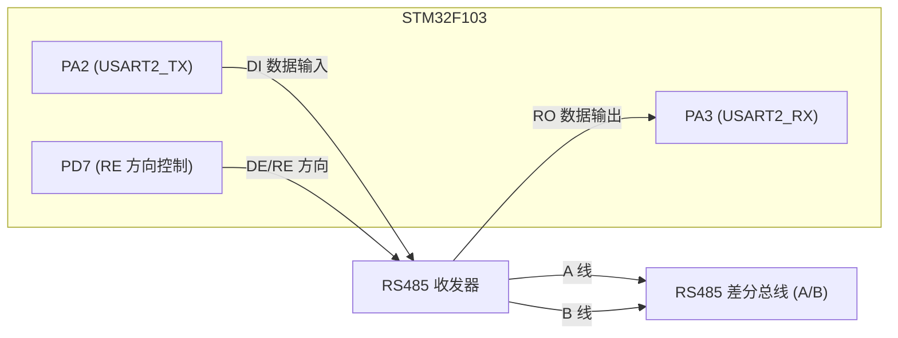
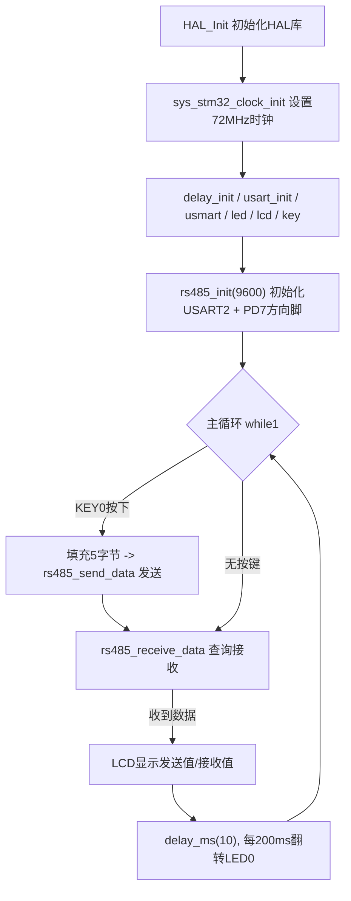

# 实验25 485实验

> 平台：正点原子 战舰 STM32F103 开发板 · HAL 库 · Keil MDK

## 一、实验简介

本实验学习 **RS485 总线**的使用。RS485 是一种差分信号、半双工的串行通信标准，抗干扰强、传输距离远（可达上千米），常用于工业现场多设备组网。本例用 STM32 的 **USART2** 收发数据，再用一个 **GPIO（PD7）** 控制 485 收发器的方向：按 KEY0 向总线发送 5 个字节，同时把发送值和接收值显示在 LCD 上。两块战舰板的 485 接口对接后即可互发数据。

🏠 **生活类比**：RS485 就像一条"对讲机通道"。同一时刻只能一方说话（半双工），说完要切换成"听"的状态。PD7 这个方向脚就是对讲机上的"收发切换开关"——按下说话（发送模式），松开收听（接收模式）。

## 二、实验目的

- 理解 RS485 半双工、差分总线的工作原理，以及"方向控制脚"的作用
- 掌握用 **USART2 + 一个 GPIO** 实现 RS485 收发切换的方法
- 学会配置串口接收中断（RXNE），在中断里把数据存入缓冲区
- 掌握通过"帧间空闲超时"判断一帧数据接收结束的软件技巧
- 熟悉用 USMART 调用 `rs485_send_data()` 发送指定数据

## 三、硬件资源与连接图

| 外设 | 引脚 | 说明 |
|------|------|------|
| RS485 方向控制 (RE) | **PD7** | 输出：0=接收模式，1=发送模式 |
| USART2_TX | **PA2** | 复用推挽输出，MCU 发送数据 |
| USART2_RX | **PA3** | 复用输入，MCU 接收数据 |
| LED0 (DS0, 红) | **PB5** | 闪烁指示程序运行 |
| KEY0 | **PE4** | 按下发送一次数据 |



> 接线说明：MCU 的 PA2(TX) 把数据送给收发器，收发器把它转成 A/B 差分信号发到总线；接收时总线信号经收发器还原后由 PA3(RX) 读回。**PD7 决定收发器是"发"还是"收"**。两块板的 **A 接 A、B 接 B**，切勿接反。

## 四、核心寄存器（USART2 + 方向控制 GPIO）

RS485 = 一个标准串口（USART）+ 一个方向控制 GPIO。串口部分用到的关键寄存器：

| 寄存器 | 名称 | 作用 |
|--------|------|------|
| `USART_SR` | 状态寄存器 | 关注 `RXNE`(接收非空)、`TXE`(发送空)、`TC`(发送完成) 等标志位 |
| `USART_DR` | 数据寄存器 | 写 DR 发送数据，读 DR 取接收数据（同时清 RXNE） |
| `USART_BRR` | 波特率寄存器 | 由 PCLK 与目标波特率算出分频值，本实验 9600 |
| `USART_CR1` | 控制寄存器1 | 使能 UE、RE(接收)、TE(发送)、RXNEIE(接收中断) |
| `USART_CR3` | 控制寄存器3 | 硬件流控 RTS/CTS 相关（本实验不用流控） |
| `GPIOx_CRL/CRH` | 端口配置寄存器 | 配置 PA2 复用推挽、PA3 浮空/上拉输入、PD7 推挽输出 |
| `GPIOx_ODR/BSRR` | 输出数据/置位复位寄存器 | 控制 PD7 高低电平切换收发方向 |

> HAL 库通过 `HAL_UART_Init()`、`HAL_GPIO_Init()` 完成上述寄存器配置。方向脚宏 `RS485_RE(x)`：x=1 拉高 PD7 进入发送，x=0 拉低进入接收。

## 五、软件架构 / 流程



接收采用**中断方式**：USART2 收到一个字节触发 RXNE 中断，把数据存进 `g_RS485_rx_buf[]` 并让计数 `g_RS485_rx_cnt++`；主循环用 `rs485_receive_data()` 查询，若连续 10ms 计数不再变化则认为一帧接收完毕。

## 六、主要示例代码及讲解

### 1. RS485 初始化（`Drivers/BSP/RS485/rs485.c`）

```c
void rs485_init(uint32_t baudrate)
{
    RS485_RE_GPIO_CLK_ENABLE();   /* 使能 RS485_RE 脚时钟 (PD7) */
    RS485_TX_GPIO_CLK_ENABLE();   /* 使能 串口TX脚 时钟 (PA2) */
    RS485_RX_GPIO_CLK_ENABLE();   /* 使能 串口RX脚 时钟 (PA3) */
    RS485_UX_CLK_ENABLE();        /* 使能 USART2 时钟 */

    GPIO_InitTypeDef gpio_initure;
    gpio_initure.Pin   = RS485_TX_GPIO_PIN;
    gpio_initure.Mode  = GPIO_MODE_AF_PP;      /* TX 复用推挽输出 */
    gpio_initure.Pull  = GPIO_PULLUP;
    gpio_initure.Speed = GPIO_SPEED_FREQ_HIGH;
    HAL_GPIO_Init(RS485_TX_GPIO_PORT, &gpio_initure);

    gpio_initure.Pin  = RS485_RX_GPIO_PIN;
    gpio_initure.Mode = GPIO_MODE_AF_INPUT;    /* RX 必须为输入模式 */
    HAL_GPIO_Init(RS485_RX_GPIO_PORT, &gpio_initure);

    gpio_initure.Pin   = RS485_RE_GPIO_PIN;
    gpio_initure.Mode  = GPIO_MODE_OUTPUT_PP;  /* RE 方向脚 推挽输出 */
    gpio_initure.Pull  = GPIO_PULLUP;
    gpio_initure.Speed = GPIO_SPEED_FREQ_HIGH;
    HAL_GPIO_Init(RS485_RE_GPIO_PORT, &gpio_initure);

    g_rs458_handler.Instance = RS485_UX;                  /* USART2 */
    g_rs458_handler.Init.BaudRate = baudrate;             /* 9600 */
    g_rs458_handler.Init.WordLength = UART_WORDLENGTH_8B; /* 8位数据 */
    g_rs458_handler.Init.StopBits = UART_STOPBITS_1;      /* 1停止位 */
    g_rs458_handler.Init.Parity = UART_PARITY_NONE;       /* 无校验 */
    g_rs458_handler.Init.HwFlowCtl = UART_HWCONTROL_NONE; /* 无流控 */
    g_rs458_handler.Init.Mode = UART_MODE_TX_RX;          /* 收发模式 */
    HAL_UART_Init(&g_rs458_handler);

    __HAL_UART_ENABLE_IT(&g_rs458_handler, UART_IT_RXNE); /* 开接收中断 */
    HAL_NVIC_EnableIRQ(RS485_UX_IRQn);                    /* 使能USART2中断 */
    HAL_NVIC_SetPriority(RS485_UX_IRQn, 3, 3);            /* 抢占3,子3 */
    RS485_RE(0);                                          /* 默认接收模式 */
}
```

**讲解**：
- 与普通串口相比，RS485 多了一个 **方向控制脚 PD7**，其余就是标准 USART2 配置。
- TX(PA2) 用**复用推挽** `GPIO_MODE_AF_PP`，交给串口外设驱动；RX(PA3) 用**输入** `GPIO_MODE_AF_INPUT`。
- 末尾 `RS485_RE(0)` 把 PD7 拉低，让收发器默认处于**接收**状态，随时准备收数据。

### 2. 发送与方向切换（`Drivers/BSP/RS485/rs485.c`）

```c
void rs485_send_data(uint8_t *buf, uint8_t len)
{
    RS485_RE(1);                                         /* 进入发送模式 */
    HAL_UART_Transmit(&g_rs458_handler, buf, len, 1000); /* USART2 发送 */
    g_RS485_rx_cnt = 0;                                  /* 清接收计数 */
    RS485_RE(0);                                         /* 发完切回接收 */
}
```

**讲解**：发送前必须先把方向脚拉高（`RS485_RE(1)`），否则数据发不到总线上；发送完成后立即拉低切回接收，这样才能收到对方的回复。这就是半双工"发完就收"的核心动作。

### 3. 中断接收 + 主循环（`rs485.c` / `User/main.c`）

```c
void RS485_UX_IRQHandler(void)          /* USART2 中断服务函数 */
{
    uint8_t res;
    if ((__HAL_UART_GET_FLAG(&g_rs458_handler, UART_FLAG_RXNE) != RESET))
    {
        HAL_UART_Receive(&g_rs458_handler, &res, 1, 1000);
        if (g_RS485_rx_cnt < RS485_REC_LEN)      /* 缓冲区未满 */
        {
            g_RS485_rx_buf[g_RS485_rx_cnt] = res;/* 存入缓冲区 */
            g_RS485_rx_cnt++;                    /* 计数加1 */
        }
    }
}

/* main.c 主循环片段 */
if (key == KEY0_PRES)                   /* KEY0 按下, 发送一次 */
{
    for (i = 0; i < 5; i++)
    {
        rs485buf[i] = cnt + i;          /* 填充发送缓冲区 */
        lcd_show_xnum(30 + i * 32, 170, rs485buf[i], 3, 16, 0X80, BLUE);
    }
    rs485_send_data(rs485buf, 5);       /* 发送5个字节 */
}
rs485_receive_data(rs485buf, &key);     /* 查询接收 */
```

**讲解**：中断里只做"存字节 + 计数"这一件轻量的事，避免阻塞；真正的"一帧是否收完"由主循环的 `rs485_receive_data()` 用 **10ms 空闲超时**判断（`delay_ms(10)` 后比较计数是否变化）。主循环按 KEY0 时把 `cnt+0..cnt+4` 五个字节发出并显示，收到数据后显示在下一行。

## 七、实验效果

用排线把两块战舰板的 RS485 接口对接（A—A、B—B），上电后：

- 两板 LCD 均显示 `RS485 TEST`、计数 `Count`、`Send Data`、`Receive Data` 等信息；
- 按下某板的 **KEY0**，该板向总线发送 5 个字节并在 `Send Data` 行显示；另一块板在 `Receive Data` 行显示出收到的相同数据；
- **LED0 每约 200ms 翻转一次**，提示程序正在运行。也可用 USMART 调用 `rs485_send_data()` 发送指定数据。

## 八、注意事项

- **P7 跳线帽**必须连接正确（板载丝印：485_TX—PA3、485_RX—PA2）；MCU 侧驱动中 PA2 为 USART2_TX、PA3 为 USART2_RX，方向脚为 PD7。
- RS485 的 **A/B 差分线不能接反**，必须 A 接 A、B 接 B，否则通信失败。
- 发送与接收靠 PD7 切换方向，**发完一定要切回接收**（`RS485_RE(0)`），否则收不到对方数据。
- 4.3 寸 / 7 寸屏电流较大，USB 供电可能不足，建议外接 12V 1A 电源适配器。
- 修改代码后需重新编译烧录；若烧录失败先运行根目录 `keilkill.bat` 结束占用进程。

## 九、文件结构

```
实验25 485实验/
├── User/
│   ├── main.c                 主程序：按键发送 + 接收显示
│   ├── stm32f1xx_it.c         中断服务函数
│   └── stm32f1xx_hal_conf.h   HAL 配置
├── Drivers/
│   ├── BSP/
│   │   ├── RS485/             RS485 驱动 (rs485.c / rs485.h)
│   │   ├── LED/               LED 驱动
│   │   ├── KEY/               按键驱动
│   │   └── LCD/               LCD 显示驱动
│   ├── SYSTEM/                delay / sys / usart 系统支持
│   ├── USMART/                USMART 调试组件
│   ├── CMSIS/                 内核启动与设备定义
│   └── STM32F1xx_HAL_Driver/  ST HAL 库
├── Middlewares/               中间件
└── Projects/MDK-ARM/          Keil 工程文件 (.uvprojx)
```
