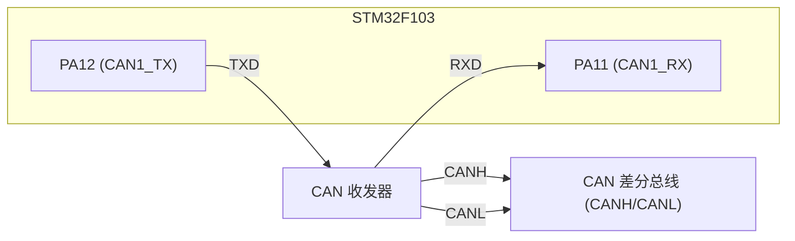
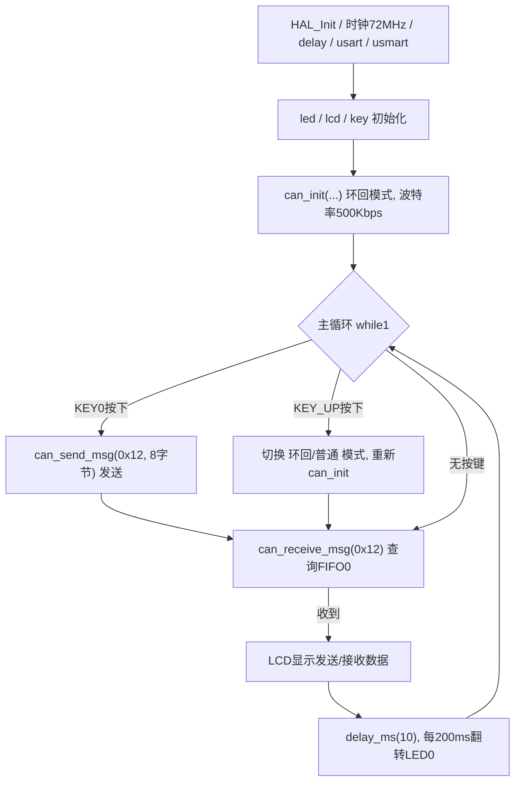

# 实验26 CAN通信实验

> 平台：正点原子 战舰 STM32F103 开发板 · HAL 库 · Keil MDK

## 一、实验简介

本实验学习 STM32 内置 **bxCAN 控制器**的使用。CAN 是一种多主、差分、带硬件纠错与仲裁的串行总线，广泛用于汽车电子和工业控制。STM32F103 的 CAN 挂在 **APB1（36MHz）** 上，通过 **PA11(RX)/PA12(TX)** 外接 CAN 收发器。本例支持**环回模式**（一块板自发自收，便于验证）和**普通模式**（两块板对接通信），用 KEY_UP 切换模式、KEY0 发送数据。

🏠 **生活类比**：CAN 总线像一个"多人会议室广播"。谁都能发言（多主），发言前先"举手"按优先级排队（仲裁），大家都能听到（广播），并且每个人自行判断"这条消息是不是叫我"（报文过滤/ID 匹配）。环回模式则像"自言自语"——自己说的话直接录下来再放给自己听。

## 二、实验目的

- 理解 CAN 总线的多主、差分、非破坏性仲裁与报文过滤机制
- 掌握 bxCAN 的**位时序**配置（同步段/时间段1/时间段2/分频）与波特率计算
- 学会用 HAL 库配置 CAN 的**环回模式 / 普通模式**并理解其区别
- 掌握 CAN 报文的发送（标准帧、数据帧）与查询接收
- 理解 CAN 过滤器组（Filter Bank）的配置方法

## 三、硬件资源与连接图

| 外设 | 引脚 | 说明 |
|------|------|------|
| CAN1_RX | **PA11** | 复用输入，接收总线数据 |
| CAN1_TX | **PA12** | 复用推挽输出，发送总线数据 |
| LED0 (DS0, 红) | **PB5** | 闪烁指示程序运行 |
| KEY0 | **PE4** | 按下发送一帧数据 (ID=0x12, 8字节) |
| KEY_UP (WK_UP) | **PA0** | 切换 环回/普通 模式 |



> 接线说明：MCU 的 PA12(TX)/PA11(RX) 是**逻辑电平**，需经 CAN 收发器转成 **CANH/CANL 差分信号**上总线。普通模式下两块板的 **CANH 接 CANH、CANL 接 CANL**，并在总线两端接 120Ω 终端电阻。

## 四、核心寄存器（bxCAN）

CAN 控制器的关键寄存器（HAL 库通过 `HAL_CAN_Init/Start/AddTxMessage/GetRxMessage` 等函数读写它们）：

| 寄存器 | 名称 | 作用 |
|--------|------|------|
| `CAN_MCR` | 主控制寄存器 | 控制 INRQ(初始化请求)、SLEEP(睡眠)、**LBKM(环回模式)**、SILM(静默)、NART(自动重传)、TTCM 等 |
| `CAN_MSR` | 主状态寄存器 | 反映 INAK(初始化确认)、SLAK(睡眠确认)、TXM/RXM 收发状态 |
| `CAN_TSR` | 发送状态寄存器 | 各发送邮箱的 TME(空闲)、请求发送 RQ、发送完成标志 |
| `CAN_RF0R` / `CAN_RF1R` | 接收 FIFO0/1 寄存器 | FMP(存放报文数)、RFOM(释放FIFO)、溢出/锁定标志 |
| `CAN_IER` | 中断使能寄存器 | 使能 FIFO 消息挂号、发送、错误等中断 |
| `CAN_ESR` | 错误状态寄存器 | 记录 TEC/REC 错误计数与 EWG/EPG/BOF 错误状态 |
| `CAN_BTR` | 位时序寄存器 | 配置 **BRP(分频)、TS1、TS2、SJW** 及 LBKM/SILM 位 |
| `CAN_TI0R`/`CAN_TDT0R` | 发送邮箱标识符/数据寄存器 | 存放待发报文的 ID、DLC 与数据字节 |
| `CAN_RI0R`/`CAN_RDT0R` | 接收 FIFO 标识符/数据寄存器 | 存放收到报文的 ID、DLC 与数据字节 |
| `CAN_FMR`/`CAN_FA1R`/`CAN_FiRx` | 过滤器主/激活/组寄存器 | 配置过滤器组模式、位宽、ID/MASK 及关联的 FIFO |

> **波特率计算**：`波特率 = Fpclk1 / ((TS1 + TS2 + 1) × BRP)`，其中 `Fpclk1 = PCLK1 = 36MHz`。本实验 `can_init(CAN_SJW_1TQ, CAN_BS2_8TQ, CAN_BS1_9TQ, 4, ...)`：TS1=9、TS2=8、BRP=4 → `36M / ((9+8+1)×4) = 500Kbps`。

## 五、软件架构 / 流程



## 六、主要示例代码及讲解

### 1. CAN 初始化（`Drivers/BSP/CAN/can.c`）

```c
uint8_t can_init(uint32_t tsjw, uint32_t tbs2, uint32_t tbs1, uint16_t brp, uint32_t mode)
{
    g_canx_handler.Instance = CAN1;
    g_canx_handler.Init.Prescaler = brp;             /* 波特率分频 BRP */
    g_canx_handler.Init.Mode = mode;                 /* 环回/普通模式 (MCR.LBKM) */
    g_canx_handler.Init.SyncJumpWidth = tsjw;        /* 同步跳跃宽度 SJW */
    g_canx_handler.Init.TimeSeg1 = tbs1;             /* 时间段1 TS1 */
    g_canx_handler.Init.TimeSeg2 = tbs2;             /* 时间段2 TS2 */
    g_canx_handler.Init.AutoRetransmission = ENABLE; /* 报文自动重传 */
    g_canx_handler.Init.ReceiveFifoLocked = DISABLE; /* 新报文覆盖旧的 */
    if (HAL_CAN_Init(&g_canx_handler) != HAL_OK) return 1;

    CAN_FilterTypeDef sFilterConfig;
    sFilterConfig.FilterBank = 0;                    /* 过滤器组0 */
    sFilterConfig.FilterMode = CAN_FILTERMODE_IDMASK;/* 标识符掩码模式 */
    sFilterConfig.FilterScale = CAN_FILTERSCALE_32BIT;/* 32位位宽 */
    sFilterConfig.FilterIdHigh = 0x0000;             /* ID 全0 */
    sFilterConfig.FilterIdLow  = 0x0000;
    sFilterConfig.FilterMaskIdHigh = 0x0000;         /* MASK 全0 -> 接收所有ID */
    sFilterConfig.FilterMaskIdLow  = 0x0000;
    sFilterConfig.FilterFIFOAssignment = CAN_FILTER_FIFO0; /* 关联到 FIFO0 */
    sFilterConfig.FilterActivation = CAN_FILTER_ENABLE;    /* 激活过滤器 */
    if (HAL_CAN_ConfigFilter(&g_canx_handler, &sFilterConfig) != HAL_OK) return 2;

    if (HAL_CAN_Start(&g_canx_handler) != HAL_OK) return 3;/* 启动CAN */
    return 0;
}
```

**讲解**：
- `Init` 里的 TS1/TS2/SJW/BRP 决定**位时序与波特率**，最终写入 `CAN_BTR`；`Mode` 决定 `CAN_MCR` 的环回位 LBKM。
- 过滤器 MASK 全 0 表示"不关心任何位"，即**接收所有 ID** 的报文，方便实验；过滤器组 0 关联到 **FIFO0**，收到的报文进入 FIFO0。
- `HAL_CAN_Start()` 让 CAN 脱离初始化状态、正式上总线工作。

### 2. 发送一帧数据（`Drivers/BSP/CAN/can.c`）

```c
uint8_t can_send_msg(uint32_t id, uint8_t *msg, uint8_t len)
{
    uint32_t TxMailbox = CAN_TX_MAILBOX0;
    g_canx_txheader.StdId = id;         /* 标准标识符 (11位) */
    g_canx_txheader.ExtId = id;         /* 扩展标识符 (29位) */
    g_canx_txheader.IDE = CAN_ID_STD;   /* 使用标准帧 */
    g_canx_txheader.RTR = CAN_RTR_DATA; /* 数据帧 */
    g_canx_txheader.DLC = len;          /* 数据长度 */
    if (HAL_CAN_AddTxMessage(&g_canx_handler, &g_canx_txheader, msg, &TxMailbox) != HAL_OK)
        return 1;
    while (HAL_CAN_GetTxMailboxesFreeLevel(&g_canx_handler) != 3); /* 等发送完成 */
    return 0;
}
```

**讲解**：发送前填好**发送头**（ID、帧类型、数据长度 DLC），`HAL_CAN_AddTxMessage()` 把报文写入发送邮箱并置 `CAN_TSR` 的请求发送位；随后轮询"3 个邮箱都空闲"表示这一帧已经发完。本实验固定用**标准帧 + 数据帧**，ID = 0x12。

### 3. 查询接收 + 主循环（`can.c` / `User/main.c`）

```c
uint8_t can_receive_msg(uint32_t id, uint8_t *buf)
{
    if (HAL_CAN_GetRxFifoFillLevel(&g_canx_handler, CAN_RX_FIFO0) == 0) return 0; /* FIFO0空 */
    if (HAL_CAN_GetRxMessage(&g_canx_handler, CAN_RX_FIFO0, &g_canx_rxheader, buf) != HAL_OK) return 0;
    if (g_canx_rxheader.StdId != id || g_canx_rxheader.IDE != CAN_ID_STD ||
        g_canx_rxheader.RTR != CAN_RTR_DATA) return 0;  /* ID/帧类型不匹配则丢弃 */
    return g_canx_rxheader.DLC;                          /* 返回数据长度 */
}

/* main.c 片段: KEY_UP 切换模式 */
else if (key == WKUP_PRES)
{
    mode = !mode;
    if (mode == 0)  /* 普通模式, 需要两块板 */
        can_init(CAN_SJW_1TQ, CAN_BS2_8TQ, CAN_BS1_9TQ, 4, CAN_MODE_NORMAL);
    else            /* 环回模式, 一块板即可测试 */
        can_init(CAN_SJW_1TQ, CAN_BS2_8TQ, CAN_BS1_9TQ, 4, CAN_MODE_LOOPBACK);
}
```

**讲解**：本实验默认**关闭接收中断**（`CAN_RX0_INT_ENABLE = 0`），改用**查询方式**读取 FIFO0：先看 FIFO 里有没有报文，有就取出并校验 ID 是否为 0x12、是否为标准数据帧。KEY_UP 通过重新调用 `can_init()` 在环回/普通模式间切换。

## 七、实验效果

- **环回模式（默认）**：LCD 显示 `LoopBack Mode`。按 KEY0，发送的 8 字节数据被自己收回，`Receive Data` 区显示与 `Send Data` 相同的数据，发送状态显示 `OK`。
- **普通模式**：按 KEY_UP 切到 `Normal Mode`，用线连接两块板的 CANH/CANL（并保证 P9 跳线帽正确）。按一块板的 KEY0，另一块板 LCD 上显示收到的数据。
- **LED0 每约 200ms 翻转一次**，提示程序运行。

## 八、注意事项

- **P9 跳线帽**必须连接为：CAN_TX—PA12、CAN_RX—PA11。
- CAN 的 **CANH/CANL 不能接反**，必须 CANH 接 CANH、CANL 接 CANL；普通模式总线两端应各接一个 **120Ω 终端电阻**。
- 环回模式下一块板即可自发自收，最适合初次验证；普通模式必须有第二个 CAN 节点（另一块板或 USB-CAN 工具），否则发送会因无应答而失败。
- 波特率由 TS1/TS2/SJW/BRP 决定，通信双方**必须一致**（本例 500Kbps）。
- 4.3/7 寸屏电流较大，USB 供电不足时请用外接 12V 1A 电源；烧录失败先运行根目录 `keilkill.bat`。

## 九、文件结构

```
实验26 CAN通信实验/
├── User/
│   ├── main.c                 主程序：模式切换 + 收发显示
│   ├── stm32f1xx_it.c         中断服务函数
│   └── stm32f1xx_hal_conf.h   HAL 配置
├── Drivers/
│   ├── BSP/
│   │   ├── CAN/               CAN 驱动 (can.c / can.h)
│   │   ├── LED/               LED 驱动
│   │   ├── KEY/               按键驱动
│   │   └── LCD/               LCD 显示驱动
│   ├── SYSTEM/                delay / sys / usart 系统支持
│   ├── USMART/                USMART 调试组件
│   ├── CMSIS/                 内核启动与设备定义
│   └── STM32F1xx_HAL_Driver/  ST HAL 库(含 bxCAN 驱动)
├── Middlewares/               中间件
└── Projects/MDK-ARM/          Keil 工程文件 (.uvprojx)
```
