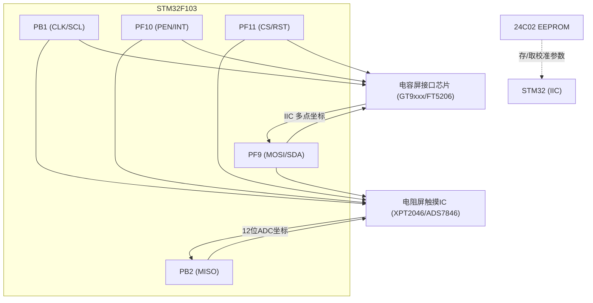
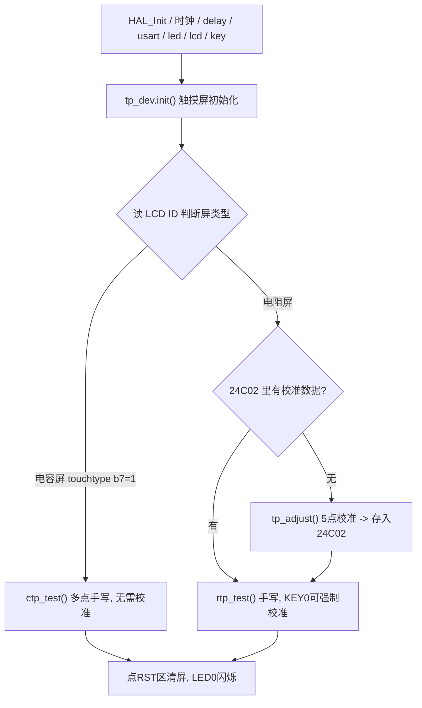

# 实验27 触摸屏实验

> 平台：正点原子 战舰 STM32F103 开发板 · HAL 库 · Keil MDK

## 一、实验简介

本实验学习**电阻式 / 电容式触摸屏**的使用，程序开机后自动根据 LCD ID 判断当前接的是哪种屏并进入对应手写测试。**电阻屏**通过一颗触摸控制 IC（XPT2046 / ADS7846 / TSC2046 等）内部的 **12 位 ADC** 采集触点电压，MCU 用 **GPIO 软件模拟 SPI** 读取坐标，并需经 **5 点校准**（校准参数存在板载 **24C02 EEPROM** 里）；**电容屏**（FT5206 / GT9xxx / GT1151）自带触摸识别，通过 **软件模拟 IIC** 直接读取多点坐标，无需校准。手指在屏上滑动即可手写，点右上角 `RST` 清屏，电阻屏按 KEY0 可强制重新校准。

🏠 **生活类比**：电阻屏像"老式压感秤"——你按下哪里，那一点的电压就变了，测电压就知道位置，所以要先"校准刻度"。电容屏像"手机屏幕"——手指一碰，芯片自己算好坐标直接告诉你，还能同时识别多根手指。

## 二、实验目的

- 理解电阻屏与电容屏的**工作原理差异**及各自的接口方式
- 掌握用 **GPIO 软件模拟 SPI** 读取电阻屏触摸 IC 的 12 位 ADC 坐标
- 理解电阻屏的 **5 点校准**算法与坐标的物理值↔屏幕值转换
- 掌握用电容屏接口芯片（GT9xxx/FT5206）通过 **软件模拟 IIC** 读取多点坐标
- 了解如何用 **24C02 EEPROM** 保存/读取校准参数

## 三、硬件资源与连接图

电阻屏（软件模拟 SPI）与电容屏（软件模拟 IIC）在板上**复用同一组引脚**：

| 信号 | 引脚 | 电阻屏用途 | 电容屏用途 |
|------|------|-----------|-----------|
| T_CLK / SCL | **PB1** | SPI 时钟（输出） | IIC 时钟 SCL |
| T_MISO / — | **PB2** | SPI 数据输入（读 ADC） | — |
| T_MOSI / SDA | **PF9** | SPI 数据输出（发命令） | IIC 数据 SDA |
| T_PEN / INT | **PF10** | 触摸检测输入（按下=低） | 触摸中断输入 INT |
| T_CS / RST | **PF11** | SPI 片选（输出） | 复位 RST（输出） |
| LED0 | **PB5** | 闪烁指示运行 | 闪烁指示运行 |
| KEY0 | **PE4** | 电阻屏强制校准 | — |



> 接线说明：电阻屏与电容屏共用 PB1/PB2/PF9/PF10/PF11，程序据 LCD ID 自动选择驱动路径。电阻屏校准数据保存在 **24C02**，掉电不丢失。

## 四、核心寄存器（ADC + SPI/接口芯片）

本实验的核心不是 MCU 内部外设寄存器，而是**触摸 IC / 接口芯片的控制字与寄存器**，MCU 侧用 GPIO 模拟时序访问：

| 对象 | 寄存器 / 控制字 | 作用 |
|------|----------------|------|
| MCU GPIO | `GPIOx_CRL/CRH`、`GPIOx_ODR`、`GPIOx_IDR` | 配置引脚方向并产生 SPI/IIC 波形、读取电平 |
| 电阻屏触摸 IC | 控制字 `0xD0` | 读取 **X 轴** 坐标（竖屏），启动内部 ADC 转换 |
| 电阻屏触摸 IC | 控制字 `0x90` | 读取 **Y 轴** 坐标（竖屏） |
| 电阻屏触摸 IC | ADC 数据寄存器 | 返回 **12 位** AD 值（16 位时钟，仅高 12 位有效） |
| 电容屏 GT9xxx | `0x8040` (CTRL) | 控制寄存器（读写模式/坐标刷新） |
| 电容屏 GT9xxx | `0x814E` (GSTID) | 当前触摸状态与触摸点数量 |
| 电容屏 GT9xxx | `0x8150` (TP1) | 第 1 个触摸点坐标数据起始地址 |
| 电容屏 GT9xxx | `0x8140` (PID) | 产品 ID 寄存器，用于识别芯片型号 |
| 24C02 | EEPROM 存储单元 | 保存 xfac/yfac/xc/yc 等校准参数 |

> 电阻屏 IC 控制字最高位为起始位，随后是通道选择、转换精度、差分/单端、掉电模式等位。触摸状态字段 `tp_dev.sta`：`b15=TP_PRES_DOWN(0x8000)` 表示按下、`b14=TP_CATH_PRES(0x4000)`、`b9~b0` 为电容屏按下的点数。

## 五、软件架构 / 流程



## 六、主要示例代码及讲解

### 1. 软件模拟 SPI 读 ADC（`Drivers/BSP/TOUCH/touch.c`）

```c
static uint16_t tp_read_ad(uint8_t cmd)
{
    uint8_t count = 0;
    uint16_t num = 0;
    T_CLK(0);           /* 先拉低时钟 */
    T_MOSI(0);          /* 拉低数据线 */
    T_CS(0);            /* 选中触摸屏IC */
    tp_write_byte(cmd); /* 发送命令字 (0xD0=X / 0x90=Y) */
    delay_us(6);        /* ADS7846 转换时间最长约6us */
    T_CLK(0); delay_us(1); T_CLK(1);  /* 给1个时钟, 清除BUSY */
    delay_us(1); T_CLK(0);

    for (count = 0; count < 16; count++)  /* 读16位, 只有高12位有效 */
    {
        num <<= 1;
        T_CLK(0);         /* 下降沿有效 */
        delay_us(1);
        T_CLK(1);
        if (T_MISO) num++;
    }
    num >>= 4;          /* 只保留高12位 */
    T_CS(1);            /* 释放片选 */
    return num;
}
```

**讲解**：
- 全程用 `T_CLK/T_MOSI/T_CS` 三个 GPIO 手动"打拍子"模拟 SPI 时序，先送命令字再逐位读回 **12 位 ADC** 值。
- 芯片输出 16 个时钟的数据，但**只有高 12 位有效**，故末尾 `num >>= 4` 丢掉低 4 位。
- 每次拉低片选 `T_CS(0)` 选中、读完 `T_CS(1)` 释放，是 SPI 器件的标准操作。

### 2. 触摸扫描与坐标转换（`Drivers/BSP/TOUCH/touch.c`）

```c
uint8_t tp_scan(uint8_t mode)
{
    if (T_PEN == 0)     /* PEN 为低 -> 有按下 */
    {
        if (mode)       /* 物理坐标, 无需转换 */
            tp_read_xy2(&tp_dev.x[0], &tp_dev.y[0]);
        else if (tp_read_xy2(&tp_dev.x[0], &tp_dev.y[0]))  /* 屏幕坐标, 需转换 */
        {
            /* 物理AD值 -> LCD逻辑坐标 */
            tp_dev.x[0] = (signed short)(tp_dev.x[0] - tp_dev.xc) / tp_dev.xfac + lcddev.width / 2;
            tp_dev.y[0] = (signed short)(tp_dev.y[0] - tp_dev.yc) / tp_dev.yfac + lcddev.height / 2;
        }
        if ((tp_dev.sta & TP_PRES_DOWN) == 0)  /* 之前未按下 */
        {
            tp_dev.sta = TP_PRES_DOWN | TP_CATH_PRES;   /* 标记按下 */
            tp_dev.x[CT_MAX_TOUCH - 1] = tp_dev.x[0];   /* 记录首次按下坐标 */
            tp_dev.y[CT_MAX_TOUCH - 1] = tp_dev.y[0];
        }
    }
    else { /* 松开: 清除 TP_PRES_DOWN 标志 ... */ }
    return tp_dev.sta & TP_PRES_DOWN;
}
```

**讲解**：
- 先读 `T_PEN`（PF10）判断是否被按下；`tp_read_xy2()` 会连读两次并滤波，两次偏差在允许范围内才认为有效，抗抖动。
- **坐标转换**是电阻屏的核心：用 5 点校准得到的比例因子 `xfac/yfac` 和中心物理值 `xc/yc`，把 AD 原始值换算成 LCD 上的像素坐标。电容屏由芯片直接给出坐标，无需此步。

### 3. 主程序按屏类型分流（`User/main.c`）

```c
tp_dev.init();                          /* 触摸屏初始化 */
if (tp_dev.touchtype != 0XFF)           /* 电阻屏才提示校准 */
    lcd_show_string(30, 110, 200, 16, 16, "Press KEY0 to Adjust", RED);
delay_ms(1500);
load_draw_dialog();                     /* 清屏并显示右上角 RST */
if (tp_dev.touchtype & 0X80) ctp_test();/* b7=1 -> 电容屏多点测试 */
else                         rtp_test();/* 否则 -> 电阻屏手写测试 */
```

**讲解**：`tp_dev.touchtype` 的 **b7** 位区分屏类型（1=电容、0=电阻），**b0** 位区分横/竖屏。主程序据此进入 `ctp_test()`（电容屏，支持多点画线、每点不同颜色）或 `rtp_test()`（电阻屏，画点 + KEY0 强制校准）。两个测试循环里都点 `RST` 区清屏、翻转 LED0 指示运行。

## 七、实验效果

- 开机后自动识别屏类型并清屏，右上角显示 **RST** 清屏区。
- **电阻屏**：若未校准则先进入 5 点校准（依次点击屏幕上 5 个十字中心，直到提示 `Touch Screen Adjust OK!`）；校准参数存入 24C02。之后手指/笔尖在屏上滑动即可**手写画点**，点 RST 清屏，按 **KEY0** 可强制重新校准。
- **电容屏**：直接进入手写测试，支持最多 **5 点（部分屏 10 点）同时触摸**，每个触点用不同颜色画线，无需校准，点 RST 清屏。
- **LED0 周期性翻转**，提示程序运行。

## 八、注意事项

- 电脑端串口调试助手波特率必须为 **115200**，请用 XCOM/SSCOM，其他助手可能因控制 DTR/RTS 导致 MCU 复位。
- **P4 的 PA9/PA10 必须通过跳线帽连接在 RXD/TXD 上**；用 USB 线接 USB_UART 口测试。
- 电阻屏必须**校准**后坐标才准确，校准时尽量用笔尖点击十字最中央；校准数据存于 24C02，换屏后需重新校准。
- 电容屏与电阻屏共用 PB1/PB2/PF9/PF10/PF11，请勿在运行中热插拔触摸模块。
- 4.3/7 寸屏电流较大，USB 供电不足时请用外接 12V 1A 电源；烧录失败先运行根目录 `keilkill.bat`。

## 九、文件结构

```
实验27 触摸屏实验/
├── User/
│   ├── main.c                 主程序：屏类型分流 + 手写测试
│   ├── stm32f1xx_it.c         中断服务函数
│   └── stm32f1xx_hal_conf.h   HAL 配置
├── Drivers/
│   ├── BSP/
│   │   ├── TOUCH/             触摸屏驱动
│   │   │   ├── touch.c/.h     电阻屏 SPI + 校准 + 扫描核心
│   │   │   ├── ctiic.c/.h     电容屏 软件模拟 IIC
│   │   │   ├── gt9xxx.c/.h    GT9147/GT9271/GT1151 电容屏驱动
│   │   │   └── ft5206.c/.h    FT5206 电容屏驱动
│   │   ├── 24CXX/             24C02 EEPROM 驱动(存校准参数)
│   │   ├── IIC/               IIC 驱动
│   │   ├── KEY/ LED/ LCD/     按键 / LED / LCD 驱动
│   ├── SYSTEM/                delay / sys / usart 系统支持
│   ├── USMART/                USMART 调试组件
│   ├── CMSIS/                 内核启动与设备定义
│   └── STM32F1xx_HAL_Driver/  ST HAL 库
├── Middlewares/               中间件
├── Output/                    编译输出
└── Projects/MDK-ARM/          Keil 工程文件 (.uvprojx)
```
