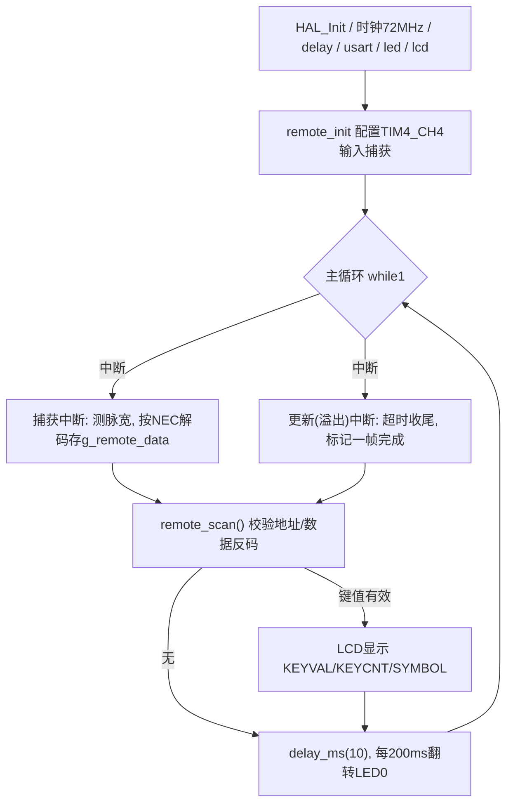

# 实验28 红外遥控实验

> 平台：正点原子 战舰 STM32F103 开发板 · HAL 库 · Keil MDK

## 一、实验简介

本实验学习**红外遥控器**的使用。红外接收头把遥控器发出的 38kHz 载波信号解调成数字电平，输出到 **PB9**。STM32 用 **定时器 TIM4 的通道 4（TIM4_CH4）输入捕获**功能，精确测量每个脉冲的**高电平宽度**，再按 **NEC 协议**把一连串脉冲解码成 32 位数据（地址码 + 地址反码 + 数据码 + 数据反码）。开机后进入等待，收到有效红外信号即在 LCD 上显示键值、按键次数和对应符号。

🏠 **生活类比**：红外遥控像"用闪光灯打摩斯密码"。遥控器用一串长短不一的闪光（脉冲）表达信息，接收头负责把闪光变成电信号；STM32 则像一个"计时裁判"，量出每次闪光亮多久，再对照密码本（NEC 协议）翻译成是哪个按键。

## 二、实验目的

- 理解红外遥控的载波、解调与 **NEC 编码协议**格式
- 掌握定时器**输入捕获**的原理：用计数器测量脉冲高电平宽度
- 学会配置捕获极性（上升沿/下降沿切换）与捕获中断、更新（溢出）中断
- 掌握把脉宽翻译为 0/1、识别引导码与连发码的解码方法
- 理解 32 位红外数据的校验（地址码/数据码与各自反码）

## 三、硬件资源与连接图

| 外设 | 引脚 | 说明 |
|------|------|------|
| 红外接收头输出 (RDATA) | **PB9** | TIM4_CH4 输入捕获，复用输入+上拉 |
| LED0 (DS0, 红) | **PB5** | 闪烁指示程序运行 |


> 接线说明：红外接收头三脚为 VCC / GND / OUT，OUT 接到板上 **PB9**（TIM4_CH4）。PB9 是 TIM4 通道 4 的**默认引脚**，程序中用 `__HAL_AFIO_REMAP_TIM4_DISABLE()` 明确不使用重映射。

## 四、核心寄存器（TIM 输入捕获 + NEC 协议）

本实验的核心是**通用定时器 TIM4 的输入捕获**相关寄存器（HAL 通过 `HAL_TIM_IC_*` 配置）：

| 寄存器 | 名称 | 作用 |
|--------|------|------|
| `TIM_CR1` | 控制寄存器1 | 使能计数器 CEN、计数方向、时钟分频 CKD |
| `TIM_PSC` | 预分频寄存器 | 本实验设 `72-1`，得到 **1MHz** 计数（1us/格） |
| `TIM_ARR` | 自动重装载寄存器 | 本实验设 `10000`，溢出即触发更新中断（超时判断） |
| `TIM_CNT` | 计数寄存器 | 当前计数值，捕获时其值被锁存到 CCR |
| `TIM_CCMR1/2` | 捕获/比较模式寄存器 | 配置通道为输入捕获、映射到 TI4、滤波 IC4F |
| `TIM_CCER` | 捕获/比较使能寄存器 | 使能通道捕获、设置**捕获极性** CC4P（上升/下降沿） |
| `TIM_CCR4` | 捕获/比较寄存器4 | 保存通道4捕获时刻的计数值，即**脉宽测量结果** |
| `TIM_DIER` | DMA/中断使能寄存器 | 使能捕获中断 CC4IE 与更新中断 UIE |
| `TIM_SR` | 状态寄存器 | 标志 CC4IF（捕获）、UIF（更新/溢出） |
| `AFIO_MAPR` | 复用重映射寄存器 | TIM4 是否重映射（本实验禁用重映射，用 PB9） |

> **NEC 协议脉宽判据**（以 1us 计数）：引导码高电平约 **4500us**；数据位高电平 **560us 表示 0**、**1680us 表示 1**；连发（重复）码高电平约 **2250us**。一帧完整数据 32 位 = 地址码 + 地址反码 + 数据码 + 数据反码。

## 五、软件架构 / 流程



解码在**中断**中完成：上升沿捕获时清零计数器并切到下降沿捕获；下降沿捕获时读 `CCR4` 得到刚过去的高电平宽度，据此判 0/1/引导码/连发码，逐位移入 `g_remote_data`。

## 六、主要示例代码及讲解

### 1. 输入捕获初始化（`Drivers/BSP/REMOTE/remote.c`）

```c
void remote_init(void)
{
    TIM_IC_InitTypeDef tim_ic_init_handle;
    g_tim4_handle.Instance = REMOTE_IN_TIMX;              /* TIM4 */
    g_tim4_handle.Init.Prescaler = (72 - 1);             /* 1MHz, 1us加1 */
    g_tim4_handle.Init.CounterMode = TIM_COUNTERMODE_UP; /* 向上计数 */
    g_tim4_handle.Init.Period = 10000;                   /* 自动重装载值 */
    g_tim4_handle.Init.ClockDivision = TIM_CLOCKDIVISION_DIV1;
    HAL_TIM_IC_Init(&g_tim4_handle);

    tim_ic_init_handle.ICPolarity = TIM_ICPOLARITY_RISING;     /* 上升沿捕获 */
    tim_ic_init_handle.ICSelection = TIM_ICSELECTION_DIRECTTI; /* 映射到TI4 */
    tim_ic_init_handle.ICPrescaler = TIM_ICPSC_DIV1;           /* 不分频 */
    tim_ic_init_handle.ICFilter = 0x03;                        /* 8个时钟滤波 */
    HAL_TIM_IC_ConfigChannel(&g_tim4_handle, &tim_ic_init_handle, REMOTE_IN_TIMX_CHY);
    HAL_TIM_IC_Start_IT(&g_tim4_handle, REMOTE_IN_TIMX_CHY);   /* 开启捕获中断 */
    __HAL_TIM_ENABLE_IT(&g_tim4_handle, TIM_IT_UPDATE);        /* 使能更新(溢出)中断 */
}
```

**讲解**：
- `Prescaler = 72-1` 让 72MHz 定时器时钟分频到 **1MHz**，即计数器每 **1us 加 1**，测出的数值直接就是微秒数，非常直观。
- `Period = 10000` 设定计数上限（约 10ms），一旦溢出说明很久没有新脉冲，用更新中断来判定"一帧结束/超时"。
- 同时开启**捕获中断**（测脉宽）和**更新中断**（判超时），二者配合完成解码。

### 2. 捕获中断里的 NEC 解码（`Drivers/BSP/REMOTE/remote.c`）

```c
void HAL_TIM_IC_CaptureCallback(TIM_HandleTypeDef *htim)
{
    if (htim->Instance == REMOTE_IN_TIMX)
    {
        uint16_t dval;
        if (RDATA)   /* 当前为高 -> 刚捕获到上升沿 */
        {
            __HAL_TIM_SET_CAPTUREPOLARITY(&g_tim4_handle, REMOTE_IN_TIMX_CHY, TIM_INPUTCHANNELPOLARITY_FALLING); /* 改下降沿 */
            __HAL_TIM_SET_COUNTER(&g_tim4_handle, 0);  /* 计数器清零, 开始测高电平宽度 */
            g_remote_sta |= 0X10;                      /* 标记已捕获上升沿 */
        }
        else         /* 当前为低 -> 刚捕获到下降沿, 高电平结束 */
        {
            dval = HAL_TIM_ReadCapturedValue(&g_tim4_handle, REMOTE_IN_TIMX_CHY); /* 读CCR4=脉宽 */
            __HAL_TIM_SET_CAPTUREPOLARITY(&g_tim4_handle, REMOTE_IN_TIMX_CHY, TIM_INPUTCHANNELPOLARITY_RISING);  /* 改回上升沿 */
            if (g_remote_sta & 0X10)
            {
                if (g_remote_sta & 0X80)   /* 已收到引导码, 开始收数据位 */
                {
                    if (dval > 300 && dval < 800)        { g_remote_data >>= 1; g_remote_data &= ~(0x80000000); } /* 560us -> 0 */
                    else if (dval > 1400 && dval < 1800) { g_remote_data >>= 1; g_remote_data |= 0x80000000; }     /* 1680us -> 1 */
                    else if (dval > 2000 && dval < 3000) { g_remote_cnt++; g_remote_sta &= 0XF0; }                /* 2250us -> 连发码 */
                }
                else if (dval > 4200 && dval < 4700)     /* 4500us -> 引导码 */
                {
                    g_remote_sta |= 1 << 7;   /* 标记已收到引导码 */
                    g_remote_cnt = 0;
                }
            }
            g_remote_sta &= ~(1 << 4);
        }
    }
}
```

**讲解**：
- 解码采用"**上升沿清零、下降沿读数**"的经典手法：捕获到上升沿时把计数器清 0 并切换到下降沿捕获；捕获到下降沿时读 `CCR4`，得到这段**高电平的微秒宽度 dval**。
- 用 `dval` 落在哪个区间判定含义：约 560us → 数据 **0**，约 1680us → 数据 **1**，约 2250us → **连发码**（长按），约 4500us → **引导码**（一帧开始）。
- 数据位以 `g_remote_data >>= 1` 逐位移入，32 位移满即得到完整一帧。

### 3. 键值校验与主程序（`remote.c` / `User/main.c`）

```c
uint8_t remote_scan(void)
{
    uint8_t sta = 0, t1, t2;
    if (g_remote_sta & (1 << 6))   /* 已得到一个按键的全部信息 */
    {
        t1 = g_remote_data;                 /* 地址码 */
        t2 = (g_remote_data >> 8) & 0xff;   /* 地址反码 */
        if ((t1 == (uint8_t)~t2) && t1 == REMOTE_ID)  /* 校验识别码 */
        {
            t1 = (g_remote_data >> 16) & 0xff;  /* 数据码 */
            t2 = (g_remote_data >> 24) & 0xff;  /* 数据反码 */
            if (t1 == (uint8_t)~t2) sta = t1;   /* 校验通过 -> 键值 */
        }
        if ((sta == 0) || ((g_remote_sta & 0X80) == 0))
        {
            g_remote_sta &= ~(1 << 6);
            g_remote_cnt = 0;
        }
    }
    return sta;
}

/* main.c 片段 */
key = remote_scan();
if (key)
{
    lcd_show_num(86, 110, key, 3, 16, BLUE);          /* 显示键值 */
    lcd_show_num(86, 130, g_remote_cnt, 3, 16, BLUE); /* 显示按键次数 */
    switch (key) { case 69: str = "POWER"; break; /* ... */ }
    lcd_show_string(86, 150, 200, 16, 16, str, BLUE); /* 显示符号 */
}
```

**讲解**：NEC 用"码 + 反码"做校验——地址码与其反码、数据码与其反码都必须互补，且地址码要等于本遥控器识别码 `REMOTE_ID`，全部通过才返回键值。主程序拿到键值后用 `switch` 翻译成 `POWER/UP/PLAY/数字` 等符号显示。

## 七、实验效果

开机后 LCD 显示 `REMOTE TEST`、`KEYVAL:`、`KEYCNT:`、`SYMBOL:` 等信息，进入等待红外触发：

- 按下遥控器任意键，LCD 上显示对应**键值**（KEYVAL）、该键**按下次数**（KEYCNT）和**符号**（SYMBOL，如 POWER、UP、VOL+、数字 0~9 等）；
- 长按某键时 KEYCNT 会随连发码递增；
- **LED0 每约 200ms 翻转一次**，提示程序运行。

## 八、注意事项

- 电脑端串口调试助手波特率必须为 **115200**，请用 XCOM/SSCOM，其他助手可能因控制 DTR/RTS 导致 MCU 复位。
- **P4 的 PA9/PA10 必须通过跳线帽连接在 RXD/TXD 上**；用 USB 线接 USB_UART 口测试。
- 红外接收头方向不要接反（VCC/GND/OUT），OUT 必须接到 **PB9**（TIM4_CH4）。
- 不同遥控器识别码 `REMOTE_ID` 可能不同，若校验不过需按实际遥控器修改该宏；键值与符号的对应关系见 `main.c` 的 `switch`。
- **本例程仅支持 MCU 屏，不支持 RGB 屏**；烧录失败先运行根目录 `keilkill.bat`。

## 九、文件结构

```
实验28 红外遥控实验/
├── User/
│   ├── main.c                 主程序：解码结果显示
│   ├── stm32f1xx_it.c         中断服务函数
│   └── stm32f1xx_hal_conf.h   HAL 配置
├── Drivers/
│   ├── BSP/
│   │   ├── REMOTE/            红外遥控驱动 (remote.c / remote.h)
│   │   ├── LED/               LED 驱动
│   │   └── LCD/               LCD 显示驱动
│   ├── SYSTEM/                delay / sys / usart 系统支持
│   ├── CMSIS/                 内核启动与设备定义
│   └── STM32F1xx_HAL_Driver/  ST HAL 库(含 TIM 输入捕获驱动)
├── Middlewares/               中间件
└── Projects/MDK-ARM/          Keil 工程文件 (.uvprojx)
```
