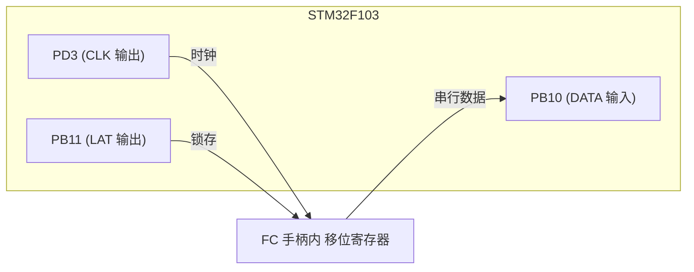
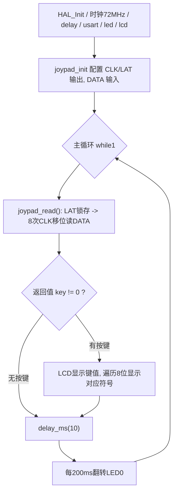

# 实验29 游戏手柄实验

> 平台：正点原子 战舰 STM32F103 开发板 · HAL 库 · Keil MDK

## 一、实验简介

本实验学习 **FC（红白机）游戏手柄**的使用。FC 手柄内部有一颗**并入串出移位寄存器**（原理类似 74HC165），对外只引出 3 根信号线：锁存 **LAT**、时钟 **CLK**、数据 **DATA**。STM32 用 3 个 **GPIO** 模拟这套时序：先给 LAT 一个脉冲把 8 个按键的状态一次性"锁存"进寄存器，再连续给 CLK 8 个脉冲，把 8 位按键状态从 DATA 逐位串行读回。主程序不停扫描手柄，一旦检测到有效按键就在 LCD 上显示键值与对应符号（Left/Right 等）。

🏠 **生活类比**：FC 手柄像一排 8 个开关接了个"传令兵"。LAT 一喊"定格"，8 个开关的当前状态就被拍下来；然后 CLK 每敲一下鼓点，传令兵就沿队报出一个开关的状态（DATA），报完 8 个你就知道了全部按键情况。

## 二、实验目的

- 理解 FC 游戏手柄的 3 线（LAT/CLK/DATA）**串行移位接口**原理
- 掌握用 **GPIO 软件模拟时序**读取并入串出移位寄存器的方法
- 学会"锁存 → 移位 → 逐位读取"的数据采集流程
- 理解手柄返回的 8 位按键位图与按键的对应关系
- 熟悉用位运算把按键状态映射为屏幕符号显示

## 三、硬件资源与连接图

| 信号 | 引脚 | 方向 | 说明 |
|------|------|------|------|
| JOYPAD_CLK | **PD3** | 输出（推挽） | 移位时钟，每脉冲输出一位 |
| JOYPAD_LAT | **PB11** | 输出（推挽） | 锁存信号，锁存当前按键状态 |
| JOYPAD_DATA | **PB10** | 输入（上拉） | 串行数据，读出按键位 |
| LED0 (DS0, 红) | **PB5** | 输出 | 闪烁指示程序运行 |



> 接线说明：手柄接在 9 针 FC 座上。板上 **K1 开关需拨到 JOYPAD 位置**；**P8 跳线帽**需连为 `PB10—COM3_RX`、`PB11—COM3_TX`（PB10/PB11 复用于 USART3 引脚，本实验把它们当普通 GPIO 使用，故需跳线帽把它们切换到手柄电路）。

## 四、核心寄存器（GPIO 移位时序）

FC 手柄没有专用外设，完全靠 **GPIO** 软件模拟时序驱动内部移位寄存器：

| 寄存器 | 名称 | 作用 |
|--------|------|------|
| `GPIOx_CRL` / `GPIOx_CRH` | 端口配置寄存器 | 配置 PD3、PB11 为推挽输出，PB10 为上拉输入 |
| `GPIOx_ODR` | 输出数据寄存器 | 写 1/0 产生 CLK、LAT 的高低电平脉冲 |
| `GPIOx_BSRR` | 位设置/复位寄存器 | `HAL_GPIO_WritePin` 借此原子地置位/复位引脚 |
| `GPIOx_IDR` | 输入数据寄存器 | 读取 PB10(DATA) 的当前电平，得到一位按键状态 |
| `RCC_APB2ENR` | 时钟使能寄存器 | 使能 GPIOD、GPIOB 端口时钟（用前必开） |

> 手柄内部的**并入串出移位寄存器**才是"数据源"：LAT 上升沿把 8 个按键状态并行锁存，之后每个 CLK 脉冲把数据向右移一位并从 DATA 输出。MCU 侧只需 GPIO 输出 CLK/LAT、输入 DATA。

## 五、软件架构 / 流程



`joypad_read()` 返回一个 8 位按键位图：`[7]Right [6]Left [5]Down [4]Up [3]Start [2]Select [1]B [0]A`，某位为 1 表示对应按键按下。

## 六、主要示例代码及讲解

### 1. 手柄接口初始化（`Drivers/BSP/JOYPAD/joypad.c`）

```c
void joypad_init(void)
{
    JOYPAD_CLK_GPIO_CLK_ENABLE();   /* CLK(PD3)  时钟使能 */
    JOYPAD_LAT_GPIO_CLK_ENABLE();   /* LAT(PB11) 时钟使能 */
    JOYPAD_DATA_GPIO_CLK_ENABLE();  /* DATA(PB10)时钟使能 */

    GPIO_InitTypeDef gpio_init_struct;
    gpio_init_struct.Pin   = JOYPAD_CLK_GPIO_PIN;
    gpio_init_struct.Mode  = GPIO_MODE_OUTPUT_PP;      /* CLK 推挽输出 */
    gpio_init_struct.Pull  = GPIO_PULLUP;
    gpio_init_struct.Speed = GPIO_SPEED_FREQ_MEDIUM;
    HAL_GPIO_Init(JOYPAD_CLK_GPIO_PORT, &gpio_init_struct);

    gpio_init_struct.Pin = JOYPAD_LAT_GPIO_PIN;        /* LAT 推挽输出 */
    HAL_GPIO_Init(JOYPAD_LAT_GPIO_PORT, &gpio_init_struct);

    gpio_init_struct.Pin   = JOYPAD_DATA_GPIO_PIN;
    gpio_init_struct.Mode  = GPIO_MODE_INPUT;          /* DATA 输入 */
    gpio_init_struct.Pull  = GPIO_PULLUP;              /* 上拉 */
    HAL_GPIO_Init(JOYPAD_DATA_GPIO_PORT, &gpio_init_struct);
}
```

**讲解**：
- CLK(PD3)、LAT(PB11) 是 MCU **主动输出**的控制信号，配为**推挽输出** `GPIO_MODE_OUTPUT_PP`。
- DATA(PB10) 是手柄**送回来**的数据，配为**输入** `GPIO_MODE_INPUT` 并加**上拉**，保证空闲时为高电平。
- 用任何 GPIO 前都要先使能对应端口时钟（`__HAL_RCC_GPIOx_CLK_ENABLE`）。

### 2. 读取手柄按键（`Drivers/BSP/JOYPAD/joypad.c`）

```c
uint8_t joypad_read(void)
{
    volatile uint8_t temp = 0;
    uint8_t t;
    JOYPAD_LAT(1);          /* 锁存当前按键状态 */
    joypad_delay(80);
    JOYPAD_LAT(0);

    for (t = 0; t < 8; t++) /* 移位输出8位数据 */
    {
        temp >>= 1;
        if (JOYPAD_DATA == 0)   /* DATA 为低 = 该键按下 */
            temp |= 0x80;       /* 置位到最高位 */

        JOYPAD_CLK(1);          /* 时钟上升沿, 移出一位 */
        joypad_delay(80);
        JOYPAD_CLK(0);
        joypad_delay(80);
    }
    return temp;
}
```

**讲解**：
- 先 `JOYPAD_LAT(1)` 再 `LAT(0)`，产生一个**锁存脉冲**，把手柄内 8 个按键的当前状态一次性拍进移位寄存器。
- 循环 8 次：先读 DATA（低电平=按下则把 1 放进 `temp` 最高位），再给 CLK 一个脉冲让寄存器**右移一位**、送出下一个按键状态。
- 由于 `temp` 每轮先右移再在最高位填新值，8 轮后**最先读到的 A 键**落到 bit0、**最后读到的 RIGHT**落到 bit7，正好得到 `[0]A…[7]Right` 的位图。
- 输出顺序为 **A → B → SELECT → START → UP → DOWN → LEFT → RIGHT**。

### 3. 主程序显示符号（`User/main.c`）

```c
const char *JOYPAD_SYMBOL_TBL[8] = {"Right","Left","Down","Up","Start","Select","B","A"};

while (1)
{
    key = joypad_read();
    if (key)                     /* 有按键按下 */
    {
        lcd_show_num(86, 110, key, 3, 16, BLUE);   /* 显示键值 */
        for (i = 0; i < 8; i++)
        {
            if (key & (0X80 >> i))                 /* 从高位到低位检查每一位 */
            {
                lcd_fill(30 + 56, 130, 30 + 56 + 48, 130 + 16, WHITE);   /* 清旧符号 */
                lcd_show_string(30 + 56, 130, 200, 16, 16, (char *)JOYPAD_SYMBOL_TBL[i], BLUE);
            }
        }
    }
    delay_ms(10);
    if (++t == 20) { t = 0; LED0_TOGGLE(); }        /* LED0 闪烁 */
}
```

**讲解**：主循环不断调用 `joypad_read()`。若返回非 0，就用 `key & (0X80 >> i)` 从 bit7 到 bit0 逐位检查，命中哪一位就在符号表 `JOYPAD_SYMBOL_TBL` 里取对应名字显示。符号表按 **bit7→bit0** 排列（Right…A），与返回位图一一对应。

## 七、实验效果

上电后 LCD 显示 `JOYPAD TEST`、`KEYVAL:`、`SYMBOL:` 等信息，程序不停扫描手柄：

- 按下手柄任意键（方向键 / A / B / Start / Select），LCD 的 **KEYVAL** 显示当前按键位图数值，**SYMBOL** 显示对应符号（如 `Right`、`A`、`Start` 等）；
- 同时按多个键时，位图中对应多位为 1；
- **LED0 每约 200ms 翻转一次**，提示程序运行。

## 八、注意事项

- **K1 开关必须拨到 JOYPAD 位置**，否则手柄电路不通。
- **P8 跳线帽**必须连为：`PB10—COM3_RX`、`PB11—COM3_TX`，把手柄信号接到 MCU 引脚。
- 本实验把 PB10/PB11 当普通 GPIO 使用（而非 USART3），务必确认跳线帽连接正确。
- `joypad_delay()` 是软件空循环延时，用于满足移位时序；若更换手柄或时序不稳可适当调整该延时。
- 4.3/7 寸屏电流较大，USB 供电不足时请用外接 12V 1A 电源；烧录失败先运行根目录 `keilkill.bat`。

## 九、文件结构

```
实验29 游戏手柄实验/
├── User/
│   ├── main.c                 主程序：扫描手柄 + 显示符号
│   ├── stm32f1xx_it.c         中断服务函数
│   └── stm32f1xx_hal_conf.h   HAL 配置
├── Drivers/
│   ├── BSP/
│   │   ├── JOYPAD/            FC 手柄驱动 (joypad.c / joypad.h)
│   │   ├── LED/               LED 驱动
│   │   └── LCD/               LCD 显示驱动
│   ├── SYSTEM/                delay / sys / usart 系统支持
│   ├── CMSIS/                 内核启动与设备定义
│   └── STM32F1xx_HAL_Driver/  ST HAL 库
├── Middlewares/               中间件
└── Projects/MDK-ARM/          Keil 工程文件 (.uvprojx)
```
