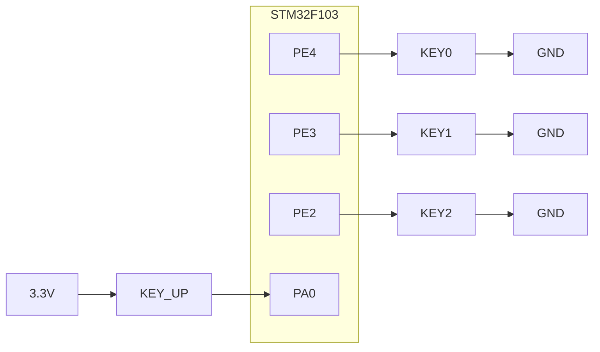
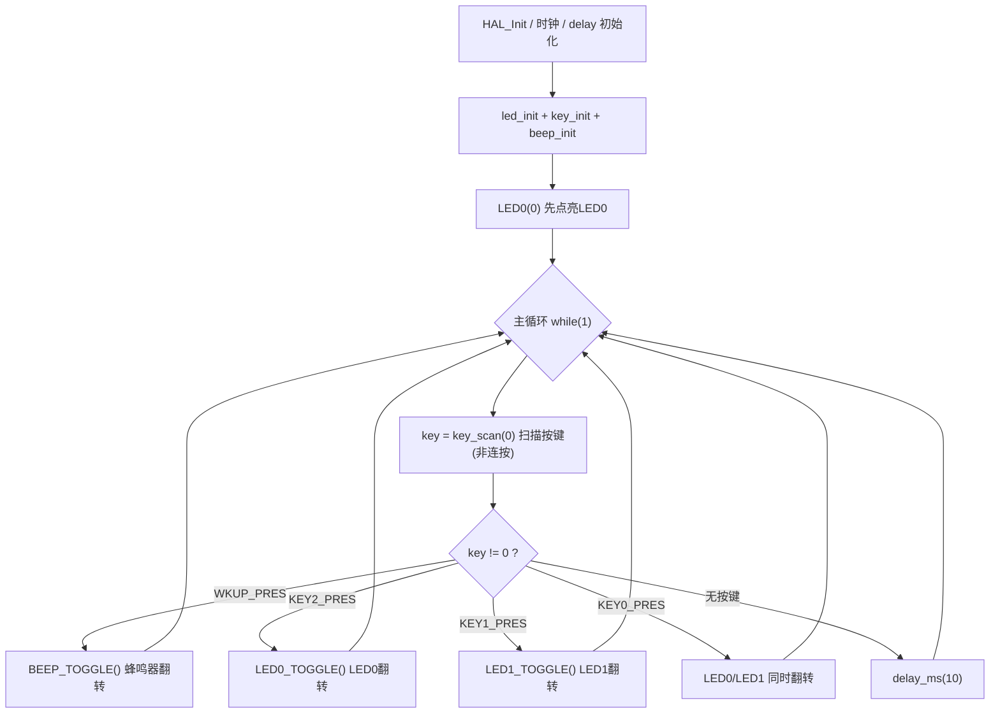

# 实验3 按键输入实验

> 平台：正点原子 STM32F103（战舰/精英/mini）开发板 · HAL 库 · Keil MDK

## 一、实验简介

本实验学习 GPIO 的**输入**功能：用板上 4 个独立按键（KEY0、KEY1、KEY2、KEY_UP）控制 LED 和蜂鸣器。程序通过"按键扫描 + 软件消抖"检测哪个键被按下，再执行对应的翻转动作。

🏠 **生活类比**：按键就像家里的门铃按钮——平时线路断开（上拉输入读到高电平），按下时接通到地（读到低电平）。机械触点按下瞬间会"抖动"好几下，就像拍皮球落地会弹几下；程序要先"等它弹稳"（延时 10ms 消抖）再确认，否则一次按键会被误判成按了好几次。

## 二、实验目的

- 掌握 GPIO 作为**上拉/下拉输入**的配置方法
- 学会用 `HAL_GPIO_ReadPin()` 读取引脚电平
- 理解**按键消抖**的原理与软件实现（延时 + 松开标志）
- 掌握按键扫描函数 `key_scan()` 的两种模式（连按/非连按）与响应优先级

## 三、硬件资源与连接图

| 外设 | 引脚 | 输入模式 | 有效电平 |
|------|------|----------|----------|
| KEY0 | **PE4** | 上拉输入 | 按下 = 低电平 |
| KEY1 | **PE3** | 上拉输入 | 按下 = 低电平 |
| KEY2 | **PE2** | 上拉输入 | 按下 = 低电平 |
| KEY_UP (WK_UP) | **PA0** | 下拉输入 | 按下 = 高电平 |
| LED0 (DS0, 红) | PB5 | 推挽输出 | 低电平点亮 |
| LED1 (DS1, 绿) | PE5 | 推挽输出 | 低电平点亮 |
| 蜂鸣器 BEEP | PB8 | 推挽输出 | 高电平鸣叫 |



> 接线说明：KEY0/KEY1/KEY2 一端接地，引脚内部**上拉**，平时读到高电平，按下接到低电平；KEY_UP 一端接 3.3V，引脚内部**下拉**，平时读到低电平，按下接到高电平。上/下拉方向必须与按键接法匹配。

## 四、核心寄存器（GPIO）

| 寄存器 | 名称 | 作用 |
|--------|------|------|
| `RCC_APB2ENR` | 时钟使能寄存器 | 置位 IOPEEN / IOPAEN / IOPBEN 使能 PE、PA、PB 口时钟 |
| `GPIOx_CRL` | 端口配置低寄存器 | 配置 Pin0~Pin7 的 MODE/CNF（PE2/PE3/PE4、PA0 在此） |
| `GPIOx_CRH` | 端口配置高寄存器 | 配置 Pin8~Pin15（PB8 蜂鸣器在此） |
| `GPIOx_IDR` | 输入数据寄存器 | 读取引脚实际电平，`HAL_GPIO_ReadPin()` 读的就是它 |
| `GPIOx_ODR` | 输出数据寄存器 | 输入模式下，其值决定内部**上拉（=1）或下拉（=0）** |
| `GPIOx_BSRR` | 位设置/复位寄存器 | 原子操作改输出电平（LED/蜂鸣器控制） |

输入模式配置要点（CNF/MODE）：

```
MODE[1:0] = 00 (输入)
CNF[1:0]: 00=模拟  01=浮空输入  10=上拉/下拉输入(方向由ODR决定)  11=保留
```

本实验 KEY0/1/2 配为**上拉输入**（CNF=10，ODR=1），WK_UP 配为**下拉输入**（CNF=10，ODR=0）。

## 五、软件架构 / 流程



## 六、主要示例代码及讲解

### 1. 按键初始化（`Drivers/BSP/KEY/key.c`，节选）

```c
void key_init(void)
{
    GPIO_InitTypeDef gpio_init_struct;
    KEY0_GPIO_CLK_ENABLE();                                     /* KEY0时钟使能 */
    KEY1_GPIO_CLK_ENABLE();                                     /* KEY1时钟使能 */
    KEY2_GPIO_CLK_ENABLE();                                     /* KEY2时钟使能 */
    WKUP_GPIO_CLK_ENABLE();                                     /* WKUP时钟使能 */

    gpio_init_struct.Pin = KEY0_GPIO_PIN;                       /* KEY0引脚 */
    gpio_init_struct.Mode = GPIO_MODE_INPUT;                    /* 输入 */
    gpio_init_struct.Pull = GPIO_PULLUP;                        /* 上拉 */
    gpio_init_struct.Speed = GPIO_SPEED_FREQ_HIGH;              /* 高速 */
    HAL_GPIO_Init(KEY0_GPIO_PORT, &gpio_init_struct);           /* KEY0引脚模式设置,上拉输入 */

    /* KEY1、KEY2 配置同上(略) */

    gpio_init_struct.Pin = WKUP_GPIO_PIN;                       /* WKUP引脚 */
    gpio_init_struct.Mode = GPIO_MODE_INPUT;                    /* 输入 */
    gpio_init_struct.Pull = GPIO_PULLDOWN;                      /* 下拉 */
    gpio_init_struct.Speed = GPIO_SPEED_FREQ_HIGH;              /* 高速 */
    HAL_GPIO_Init(WKUP_GPIO_PORT, &gpio_init_struct);           /* WKUP引脚模式设置,下拉输入 */
}
```

**讲解**：
- `GPIO_MODE_INPUT` 把引脚配成输入，此时 `HAL_GPIO_ReadPin()` 读到的就是按键电平。
- 关键区别：KEY0/1/2 接地，用 `GPIO_PULLUP`（平时高、按下低）；WK_UP 接 3.3V，用 `GPIO_PULLDOWN`（平时低、按下高）。**上/下拉必须与硬件接法相反配对**，否则读不到正确电平。
- 内部上下拉电阻约 30~50kΩ，省去了外接电阻。

### 2. 按键扫描与消抖（`Drivers/BSP/KEY/key.c`）

```c
uint8_t key_scan(uint8_t mode)
{
    static uint8_t key_up = 1;  /* 按键按松开标志 */
    uint8_t keyval = 0;

    if (mode) key_up = 1;       /* 支持连按 */

    if (key_up && (KEY0 == 0 || KEY1 == 0 || KEY2 == 0 || WK_UP == 1))  /* 按键松开标志为1, 且有任意一个按键按下了 */
    {
        delay_ms(10);           /* 去抖动 */
        key_up = 0;

        if (KEY0 == 0)  keyval = KEY0_PRES;
        if (KEY1 == 0)  keyval = KEY1_PRES;
        if (KEY2 == 0)  keyval = KEY2_PRES;
        if (WK_UP == 1) keyval = WKUP_PRES;
    }
    else if (KEY0 == 1 && KEY1 == 1 && KEY2 == 1 && WK_UP == 0) /* 没有任何按键按下, 标记按键松开 */
    {
        key_up = 1;
    }

    return keyval;              /* 返回键值 */
}
```

**讲解**：
- `KEY0` 等宏就是 `HAL_GPIO_ReadPin(...)`，`KEY0 == 0` 表示读到低电平（按下）。
- 检测到按下后先 `delay_ms(10)` 跳过机械抖动期，再确认一次电平，实现**软件消抖**。
- `key_up` 静态标志实现"非连按"：按下不放只返回一次键值，松开后才能再次触发；`mode=1` 时每次都强制置位标志，变成"支持连按"。
- 同时按下多键时按代码顺序判定，响应优先级为 **WK_UP > KEY2 > KEY1 > KEY0**（后判定的覆盖先判定的）。

### 3. 主函数按键分发（`User/main.c`，节选）

```c
while(1)
{
    key = key_scan(0);                  /* 得到键值 */

    if (key)
    {
        switch (key)
        {
            case WKUP_PRES:             /* 控制蜂鸣器 */
                BEEP_TOGGLE();          /* BEEP状态取反 */
                break;

            case KEY2_PRES:             /* 控制LED0(RED)翻转 */
                LED0_TOGGLE();          /* LED0状态取反 */
                break;

            case KEY1_PRES:             /* 控制LED1(GREEN)翻转 */
                LED1_TOGGLE();          /* LED1状态取反 */
                break;

            case KEY0_PRES:             /* 同时控制LED0, LED1翻转 */
                LED0_TOGGLE();          /* LED0状态取反 */
                LED1_TOGGLE();          /* LED1状态取反 */
                break;
        }
    }
    else
    {
        delay_ms(10);
    }
}
```

**讲解**：
- 主循环用 `switch` 把键值分派到不同动作，结构清晰，加新按键功能只需加 `case`。
- 无按键时 `delay_ms(10)` 降低扫描频率、释放 CPU；这也是两次扫描之间的最小间隔。
- `LED0_TOGGLE()` / `BEEP_TOGGLE()` 底层是 `HAL_GPIO_TogglePin()`，把当前电平取反，无需记录状态。

## 七、实验效果

烧录程序后，LED0 初始点亮。通过开发板上的四个独立按键控制 LED 或蜂鸣器：

- **KEY_UP**：控制蜂鸣器翻转（响/停切换）
- **KEY1**：控制 LED1 翻转
- **KEY2**：控制 LED0 翻转
- **KEY0**：控制 LED0 / LED1 同时翻转

## 八、注意事项

- 上/下拉配置必须匹配硬件：KEY0/1/2 接地配**上拉**，KEY_UP 接 3.3V 配**下拉**，配反则按键永远无效或常触发。
- 消抖延时（10ms）不能省，否则一次按压可能触发多次翻转；也不宜过大，否则响应迟钝。
- `key_scan(0)` 为非连按模式，按住不放不会连续触发；需要长按连发时用 `key_scan(1)`。
- 多键同时按下时只响应优先级最高的一个（WK_UP > KEY2 > KEY1 > KEY0），属正常设计。
- 修改代码后需重新编译并烧录；若烧录失败先运行根目录 `keilkill.bat` 结束占用进程。

## 九、文件结构

```
实验3 按键输入实验/
├── User/
│   ├── main.c                  主程序(按键扫描与分发)
│   ├── stm32f1xx_it.c          中断服务函数
│   └── stm32f1xx_hal_conf.h    HAL配置
├── Drivers/
│   ├── BSP/
│   │   ├── KEY/                按键驱动 (key.c / key.h)
│   │   ├── LED/                LED驱动 (led.c / led.h)
│   │   └── BEEP/               蜂鸣器驱动 (beep.c / beep.h)
│   ├── SYSTEM/                 delay / sys / usart 系统支持
│   ├── CMSIS/                  内核启动与设备定义
│   └── STM32F1xx_HAL_Driver/   ST HAL库
├── Middlewares/                中间件
├── Projects/MDK-ARM/           Keil工程文件 (.uvprojx)
├── keilkill.bat                结束Keil占用进程
└── readme.txt                  实验说明(GBK编码)
```
