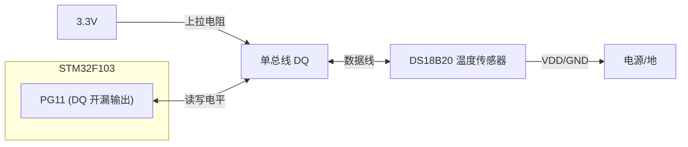
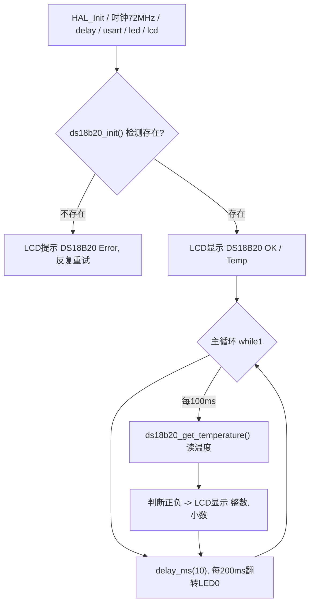

# 实验30 DS18B20数字温度传感器实验

> 平台：正点原子 战舰 STM32F103 开发板 · HAL 库 · Keil MDK

## 一、实验简介

本实验学习 **DS18B20 数字温度传感器**的使用。DS18B20 是 Dallas（现 Maxim）出品的单总线（1-Wire）数字温度计，只用**一根数据线 DQ** 就能完成供电、通信和测温，测量范围 -55℃~+125℃，分辨率可达 0.0625℃。它与 MCU 之间没有专用硬件接口，全靠 STM32 的一个 **GPIO（PG11）软件模拟单总线时序**：先复位并检测传感器是否存在，再发送"启动转换"命令，最后读回温度数据并换算显示。开机检测到 DS18B20 后，程序每约 100ms 读一次温度并显示在 LCD 上。

🏠 **生活类比**：单总线像"一根电话线上的暗号通话"。MCU 和传感器共用一根线，靠**脉冲的长短**（拉低多久）来传 0 和 1，还要严格遵守"谁先说、说多久"的时序规矩。这根线平时被上拉电阻"托"在高电平，任何一方拉低它就变低——就像一根共用的门铃线。

## 二、实验目的

- 理解 **单总线（1-Wire）**协议：一根线完成双向通信与供电
- 掌握用 **GPIO 开漏输出 + 上拉**模拟单总线的硬件配置
- 学会 DS18B20 的**复位/存在脉冲、读写位、读写字节**的精确时序
- 掌握 DS18B20 的 ROM 命令与功能命令（跳过 ROM、启动转换、读暂存器）
- 理解温度原始值（补码）到实际温度（0.1℃ 精度）的换算方法

## 三、硬件资源与连接图

| 外设 | 引脚 | 说明 |
|------|------|------|
| DS18B20 数据线 (DQ) | **PG11** | 单总线，开漏输出 + 上拉，双向通信 |
| LED0 (DS0, 红) | **PB5** | 闪烁指示程序运行 |



> 接线说明：DS18B20 需自备一个，插在开发板的 **U6 位置**（按丝印方向：平面朝内、曲面朝外，靠左插上）。DQ 接 **PG11**，总线需**上拉**（本例用内部上拉 `GPIO_PULLUP`，必要时外加 4.7kΩ 上拉电阻到 3.3V）。

## 四、核心寄存器（单总线 GPIO 时序）

DS18B20 是数字传感器，MCU 侧只用 **GPIO** 模拟单总线时序；数据的含义由 **DS18B20 内部命令/寄存器**决定：

| 对象 | 寄存器 / 命令 | 作用 |
|------|--------------|------|
| MCU GPIO | `GPIOx_CRL/CRH` | 配置 PG11 为**开漏输出 + 上拉**（CNF=开漏，MODE=输出） |
| MCU GPIO | `GPIOx_ODR/BSRR` | 拉低/释放 DQ，产生复位、读、写时序脉冲 |
| MCU GPIO | `GPIOx_IDR` | 读取 DQ 电平（开漏写 1 释放时可读回传感器输出） |
| MCU RCC | `RCC_APB2ENR` | 使能 GPIOG 端口时钟（用前必开） |
| DS18B20 | ROM 命令 `0xCC` | Skip ROM，跳过 64 位 ROM 匹配（单传感器时直接用） |
| DS18B20 | 功能命令 `0x44` | Convert T，启动一次温度转换 |
| DS18B20 | 功能命令 `0xBE` | Read Scratchpad，读回暂存器（含温度字节） |
| DS18B20 | 暂存器 `TL`(LSB)/`TH`(MSB) | 温度原始值（16 位补码，LSB 先传） |

> **温度换算**：原始 16 位为补码，LSB = 0.0625℃。程序返回 `raw × 0.625`，即把温度**放大 10 倍**（分辨率 0.1℃），范围 -550~1250。负温度时 `TH > 7`，需按位取反 +1 处理。

## 五、软件架构 / 流程



单次测温内部流程：**复位 → 检测存在脉冲 → 发 0xCC(跳过ROM) → 发 0x44(启动转换) → 复位 → 发 0xCC → 发 0xBE(读暂存器) → 读 TL、TH → 换算**。

## 六、主要示例代码及讲解

### 1. 初始化与复位/存在检测（`Drivers/BSP/DS18B20/ds18b20.c`）

```c
uint8_t ds18b20_init(void)
{
    GPIO_InitTypeDef gpio_init_struct;
    DS18B20_DQ_GPIO_CLK_ENABLE();                 /* 开 DQ(PG11) 时钟 */
    gpio_init_struct.Pin   = DS18B20_DQ_PIN;
    gpio_init_struct.Mode  = GPIO_MODE_OUTPUT_OD; /* 开漏输出 */
    gpio_init_struct.Pull  = GPIO_PULLUP;         /* 上拉 */
    gpio_init_struct.Speed = GPIO_SPEED_FREQ_HIGH;
    HAL_GPIO_Init(DS18B20_DQ_PORT, &gpio_init_struct);
    ds18b20_reset();
    return ds18b20_check();                       /* 返回0=存在 */
}

static void ds18b20_reset(void)
{
    DS18B20_DQ_OUT(0);  /* 拉低DQ, 复位 */
    delay_us(750);      /* 拉低至少480us, 这里750us */
    DS18B20_DQ_OUT(1);  /* 释放总线(上拉拉高) */
    delay_us(15);
}

uint8_t ds18b20_check(void)   /* 0=DS18B20正常, 1=不存在 */
{
    uint8_t retry = 0;
    while (DS18B20_DQ_IN && retry < 200) { retry++; delay_us(1); }  /* 等DQ被拉低 */
    if (retry >= 200) return 1;
    retry = 0;
    while (!DS18B20_DQ_IN && retry < 240) { retry++; delay_us(1); } /* 等DQ被拉高 */
    if (retry >= 240) return 1;
    return 0;
}
```

**讲解**：
- DQ 配成**开漏输出 + 上拉**是关键：开漏时 MCU 写 1 只是"释放"总线（不主动拉高），此时既能被上拉电阻拉高，又能**读回传感器输出的低电平**，从而在一根线上实现双向通信。
- `ds18b20_reset()`：MCU 把 DQ 拉低约 750us（复位脉冲），再释放。传感器检测到复位后会回一个**存在脉冲**（把 DQ 拉低一段时间）。
- `ds18b20_check()`：在超时范围内等待 DQ 先变低再变高，若等到就是"传感器存在"，返回 0；否则返回 1。

### 2. 单总线读位/写字节（`Drivers/BSP/DS18B20/ds18b20.c`）

```c
static uint8_t ds18b20_read_bit(void)   /* 读1位 */
{
    uint8_t data = 0;
    DS18B20_DQ_OUT(0); delay_us(2);     /* 拉低>1us 发起读时隙 */
    DS18B20_DQ_OUT(1); delay_us(12);    /* 释放, 等待传感器控制电平 */
    if (DS18B20_DQ_IN) data = 1;        /* 在时隙内采样: 高=1, 低=0 */
    delay_us(50);                       /* 等时隙结束(>60us) */
    return data;
}

static void ds18b20_write_byte(uint8_t data)  /* 写1字节, 低位在前 */
{
    uint8_t j;
    for (j = 1; j <= 8; j++)
    {
        if (data & 0x01) { DS18B20_DQ_OUT(0); delay_us(2); DS18B20_DQ_OUT(1); delay_us(60); } /* 写1: 短低 */
        else             { DS18B20_DQ_OUT(0); delay_us(60); DS18B20_DQ_OUT(1); delay_us(2); }  /* 写0: 长低 */
        data >>= 1;                     /* 取下一位 */
    }
}
```

**讲解**：单总线用**拉低时间的长短**区分 0/1。
- **读位**：MCU 先拉低 >1us 打开一个"读时隙"再释放，传感器会在时隙内把线拉低（表示 0）或保持高（表示 1），MCU 在释放后约 12us 处采样。
- **写位**：写 **1** 是"拉低很短(2us)后长时间拉高"；写 **0** 是"拉低较长(60us)"。两者总时隙都 >60us。
- 读写都是**低位（LSB）在前**，`ds18b20_read_byte()` 循环读 8 位拼成一个字节。

### 3. 读取温度与换算（`ds18b20.c` / `User/main.c`）

```c
short ds18b20_get_temperature(void)     /* 返回值放大10倍, 如 253 -> 25.3℃ */
{
    uint8_t flag = 1, TL, TH;
    short temp;
    ds18b20_start();                    /* 复位 + 0xCC + 0x44 启动转换 */
    ds18b20_reset(); ds18b20_check();
    ds18b20_write_byte(0xcc);           /* skip rom */
    ds18b20_write_byte(0xbe);           /* read scratchpad */
    TL = ds18b20_read_byte();           /* 温度低字节 LSB */
    TH = ds18b20_read_byte();           /* 温度高字节 MSB */
    if (TH > 7) { TH = ~TH; TL = ~TL; flag = 0; }  /* 负温度处理 */
    temp = TH; temp <<= 8; temp += TL;             /* 拼成16位原始值 */
    if (flag == 0) { temp = (double)(temp + 1) * 0.625; temp = -temp; }
    else           { temp = (double)temp * 0.625; }
    return temp;
}

/* main.c 片段 */
while (ds18b20_init()) { /* 显示 DS18B20 Error 并反复重试 */ }
temperature = ds18b20_get_temperature();
lcd_show_num(30 + 40 + 8,  130, temperature / 10, 2, 16, BLUE);  /* 整数部分 */
lcd_show_num(30 + 40 + 32, 130, temperature % 10, 1, 16, BLUE);  /* 小数部分 */
```

**讲解**：
- 测温分两步：先发 **0x44** 让传感器完成一次 A/D 转换，再发 **0xBE** 读回暂存器里的 TL/TH 两个温度字节（命令前都要发 **0xCC** 跳过 ROM）。
- 温度是 **16 位补码**、LSB = 0.0625℃。`raw × 0.625` 恰好把结果放大 10 倍（0.0625×10=0.625），于是返回值就是"0.1℃ 为单位的整数"，显示时 `/10` 得整数、`%10` 得小数。
- 负温度时 `TH > 7`（符号位为 1），按补码规则取反 +1 得到数值，再加负号。

## 七、实验效果

- 上电后先检测 DS18B20：**未检测到**则 LCD 反复显示 `DS18B20 Error`；**检测到**则显示 `DS18B20 OK` 和 `Temp:   . C`。
- 之后程序**每约 100ms 读取一次温度**，把当前温度以"整数.小数 ℃"的形式显示在 LCD 上（如 `25.3`）；用手捏住传感器可看到温度上升。
- **LED0 每约 200ms 翻转一次**，提示程序运行。

## 八、注意事项

- 电脑端串口调试助手波特率必须为 **115200**，请用 XCOM/SSCOM，其他助手可能因控制 DTR/RTS 导致 MCU 复位。
- **P4 的 PA9/PA10 必须通过跳线帽连接在 RXD/TXD 上**；用 USB 线接 USB_UART 口测试。
- 需**自备 DS18B20** 一个，插在开发板 **U6 位置**（按丝印：平面朝内、曲面朝外，靠左插上），插反可能损坏器件。
- 单总线时序对**延时精度要求高**，本例用 `delay_us()` 产生微秒级时序；若换晶振或时序不稳需相应校准延时。
- DQ 必须**上拉**（本例内部上拉），长线或多传感器时建议外加 4.7kΩ 上拉电阻。
- **本例程仅支持 MCU 屏，不支持 RGB 屏**；烧录失败先运行根目录 `keilkill.bat`。

## 九、文件结构

```
实验30 DS18B20数字温度传感器实验/
├── User/
│   ├── main.c                 主程序：检测 + 循环读温度显示
│   ├── stm32f1xx_it.c         中断服务函数
│   └── stm32f1xx_hal_conf.h   HAL 配置
├── Drivers/
│   ├── BSP/
│   │   ├── DS18B20/           DS18B20 单总线驱动 (ds18b20.c / ds18b20.h)
│   │   ├── LED/               LED 驱动
│   │   └── LCD/               LCD 显示驱动
│   ├── SYSTEM/                delay / sys / usart 系统支持
│   ├── CMSIS/                 内核启动与设备定义
│   └── STM32F1xx_HAL_Driver/  ST HAL 库
├── Middlewares/               中间件
└── Projects/MDK-ARM/          Keil 工程文件 (.uvprojx)
```
