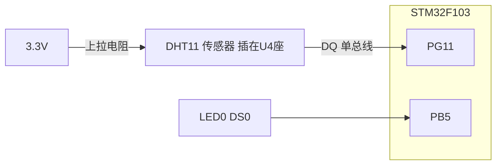
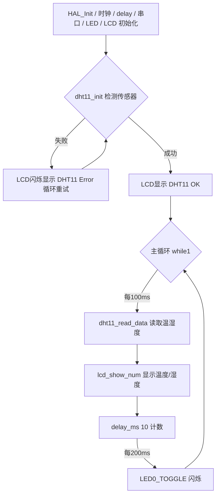

# 实验31 DHT11数字温湿度传感器实验

> 平台：正点原子 STM32F103（战舰/精英/mini）开发板 · HAL 库 · Keil MDK

## 一、实验简介

本实验使用 DHT11 数字温湿度传感器，通过 STM32 的**单总线（1-Wire 类）GPIO 时序**读取环境温度和湿度，并把结果显示在 LCD 上。DHT11 只用一根数据线通信，所有数据位靠"高电平持续时间长短"来区分，是学习**精确 GPIO 时序驱动**的经典案例。

🏠 **生活类比**：DHT11 通信就像摩尔斯电码。发送方（传感器）用"短脉冲"表示 0、"长脉冲"表示 1，接收方（STM32）拿着秒表（延时函数）测量每个脉冲的宽度，就能把整串"电码"翻译回数据。而 STM32 想问话时，要先"拍一下桌子"（拉低总线至少 18ms）引起对方注意。

## 二、实验目的

- 了解 DHT11 数字温湿度传感器的特性与单总线通信协议
- 掌握用 GPIO **开漏输出 + 上拉**实现双向数据线的方法（输出 1 时即可读输入，无需切换方向）
- 掌握用精确延时（`delay_ms`/`delay_us`）构造单总线时序的方法
- 学会读取 40 位数据帧并用校验和验证数据有效性

## 三、硬件资源与连接图

| 外设 | 引脚 | 说明 |
|------|------|------|
| DHT11 数据线 DQ | **PG11** | 单总线，开漏输出+内部上拉 |
| LED0 (DS0, 红) | **PB5** | 低电平点亮，指示程序运行 |
| LED1 (DS1, 绿) | **PE5** | 低电平点亮 |
| 串口1 | **PA9/PA10** | 板载 CH340，波特率 115200 |
| TFTLCD | FSMC 并口 | 16 位 8080 并口 MCU 屏，显示温湿度 |



> 接线说明：DHT11 插在开发板 **U4** 位置（按丝印方向插，网面朝外）。数据线 DQ 与 PG11 相连，靠上拉电阻（STM32 内部上拉）保持总线空闲为高电平。

## 四、核心寄存器（GPIO 单总线时序）

DHT11 没有 SPI/I2C 那样的片内外设寄存器，通信完全由 **GPIO 寄存器 + 软件延时**构造时序：

| 寄存器 | 名称 | 作用 |
|--------|------|------|
| `RCC_APB2ENR` | 时钟使能寄存器 | 置位 IOPGEN 使能 PG 口时钟 |
| `GPIOG_CRH` | 端口配置高寄存器 | PG11 属于 Pin8~15，配置 MODE[1:0]=11（50MHz 输出）、CNF=01/11（开漏+上拉） |
| `GPIOG_ODR` | 输出数据寄存器 | 写 0 拉低总线（复位信号），写 1 释放总线（开漏时靠上拉变高） |
| `GPIOG_IDR` | 输入数据寄存器 | 读取总线上 DHT11 输出的电平 |

**关键点**：PG11 配置为 `GPIO_MODE_OUTPUT_OD`（开漏输出）+ `GPIO_PULLUP`（上拉）。开漏输出 1 时引脚实际为**高阻态**，被上拉电阻拉高，此时**同一引脚仍可通过 IDR 读到外部电平**——实现了单总线"一根线既能发又能收"，不需要来回切换输入/输出模式。

DHT11 时序（驱动中用延时函数实现）：

```
主机复位: 拉低 ≥18ms → 拉高 10~35us
从机应答: 拉低 83us → 拉高 87us
数据位:   每bit以50us低电平开始, 之后高电平 26~28us = '0', 70us = '1'
数据帧:   8bit湿度整数 + 8bit湿度小数 + 8bit温度整数 + 8bit温度小数 + 8bit校验和
```

## 五、软件架构 / 流程



读取一次数据的内部流程：`dht11_reset()`（发复位信号）→ `dht11_check()`（等应答）→ 循环 5 次 `dht11_read_byte()`（每字节 8 次 `dht11_read_bit()`）→ 校验和前 4 字节之和是否等于第 5 字节。

## 六、主要示例代码及讲解

### 1. 引脚定义与初始化（`Drivers/BSP/DHT11/dht11.h` / `dht11.c`）

```c
#define DHT11_DQ_GPIO_PORT      GPIOG
#define DHT11_DQ_GPIO_PIN       GPIO_PIN_11

uint8_t dht11_init(void)
{
    GPIO_InitTypeDef gpio_init_struct;

    DHT11_DQ_GPIO_CLK_ENABLE();     /* 开启DQ引脚时钟 */

    gpio_init_struct.Pin = DHT11_DQ_GPIO_PIN;
    gpio_init_struct.Mode = GPIO_MODE_OUTPUT_OD;            /* 开漏输出 */
    gpio_init_struct.Pull = GPIO_PULLUP;                    /* 上拉 */
    gpio_init_struct.Speed = GPIO_SPEED_FREQ_HIGH;          /* 高速 */
    HAL_GPIO_Init(DHT11_DQ_GPIO_PORT, &gpio_init_struct);   /* 初始化DHT11_DQ引脚 */

    dht11_reset();
    return dht11_check();
}
```

**讲解**：
- PG11 配成**开漏输出 + 上拉**。注释里说得很清楚：这样就不用来回设置 IO 方向，开漏输出 1（高阻）时也能读取外部信号电平，单总线自然形成。
- `dht11_reset()` 拉低 20ms 再拉高 30us，发出"主机请求"信号。
- `dht11_check()` 检测传感器是否应答（先等低电平 83us，再等高电平 87us），返回 1 表示 DHT11 不存在，main 里 `while(dht11_init())` 就会一直报错重试。

### 2. 读一个 bit —— 用脉冲宽度区分 0/1（`dht11.c`）

```c
uint8_t dht11_read_bit(void)
{
    uint8_t retry = 0;

    while (DHT11_DQ_IN && retry < 100)  /* 等待变为低电平 */
    {
        retry++;
        delay_us(1);
    }

    retry = 0;

    while (!DHT11_DQ_IN && retry < 100) /* 等待变高电平 */
    {
        retry++;
        delay_us(1);
    }

    delay_us(40);       /* 等待40us */

    if (DHT11_DQ_IN)    /* 根据引脚状态返回 bit */
    {
        return 1;
    }
    else 
    {
        return 0;
    }
}
```

**讲解**：
- 每个数据位以 50us 低电平开始，随后进入高电平阶段：**高电平持续 26~28us 表示 0，70us 表示 1**。
- 代码先等低电平出现、再等它变高，然后**固定延时 40us 后采样**：如果还是高（说明高电平超过 40us，是长脉冲）就是 1；已经变低（短脉冲）就是 0。这是"测宽度"最简单可靠的办法。
- `retry < 100` 是超时保护，防止传感器异常时死循环。

### 3. 读 40 位数据并校验（`dht11.c`）

```c
uint8_t dht11_read_data(uint8_t *temp, uint8_t *humi)
{
    uint8_t buf[5];
    uint8_t i;
    dht11_reset();

    if (dht11_check() == 0)
    {
        for (i = 0; i < 5; i++)     /* 读取40位数据 */
        {
            buf[i] = dht11_read_byte();
        }

        if ((buf[0] + buf[1] + buf[2] + buf[3]) == buf[4])
        {
            *humi = buf[0];
            *temp = buf[2];
        }
    }
    else
    {
        return 1;
    }
    
    return 0;
}
```

**讲解**：
- 一次完整读取 = 复位 → 应答 → 5 个字节（湿度整数、湿度小数、温度整数、温度小数、校验和）。`dht11_read_byte()` 内部左移拼接 8 个 bit，**高位在前**。
- 校验规则：前 4 字节之和（只保留低 8 位）等于第 5 字节才算有效，防止时序抖动带来的误码。
- DHT11 温度精度约 ±2℃、湿度 ±5%RH，且**两次采样间隔必须 ≥1s 的 1/1**（手册要求至少 1 秒，本实验 100ms 读一次已经够快，实际有效更新率约 1Hz）。

## 七、实验效果

烧录后 LCD 依次显示 "STM32 / DHT11 TEST / ATOM@ALIENTEK"：

- 若未检测到传感器，LCD 闪烁显示 **DHT11 Error**；
- 检测到后显示 **DHT11 OK**，下方 `Temp: xx C`、`Humi: xx %` 每 100ms 刷新一次实时温湿度；
- **LED0 每 200ms 翻转一次**，提示程序正在运行。

## 八、注意事项

- DHT11 必须自备，插在开发板 **U4** 位置，**根据丝印方向插、网面朝外**，插反读不到数据。
- 本例程**仅支持 MCU 屏（16 位 8080 并口），不支持 RGB 屏**。
- 串口调试助手波特率须为 **115200**；建议用 XCOM/SSCOM，其他助手可能控制 DTR/RTS 导致 MCU 复位。P4 的 PA9/PA10 必须用跳线帽连接到 RXD/TXD。
- DHT11 采样率上限约 1Hz，读取过于频繁可能得到无效数据（校验失败时函数不更新温湿度值）。
- 读时序期间**不能被长时间中断打断**，否则脉宽测量出错；若数据经常异常，检查是否启用了太多耗时中断。
- 烧录失败时先运行根目录 `keilkill.bat` 结束占用进程。

## 九、文件结构

```
实验31 DHT11数字温湿度传感器实验/
├── User/
│   ├── main.c              主程序（初始化 + 循环读取显示）
│   ├── stm32f1xx_it.c      中断服务函数
│   └── stm32f1xx_hal_conf.h HAL配置
├── Drivers/
│   ├── BSP/
│   │   ├── DHT11/          DHT11 驱动 (dht11.c / dht11.h) ★本实验核心
│   │   ├── LCD/            LCD 显示驱动
│   │   └── LED/            LED 驱动
│   ├── SYSTEM/             delay / sys / usart 系统支持
│   ├── USMART/             串口调试组件
│   ├── CMSIS/              内核启动与设备定义
│   └── STM32F1xx_HAL_Driver/ ST HAL 库
└── Projects/MDK-ARM/       Keil 工程文件 (.uvprojx)
```
