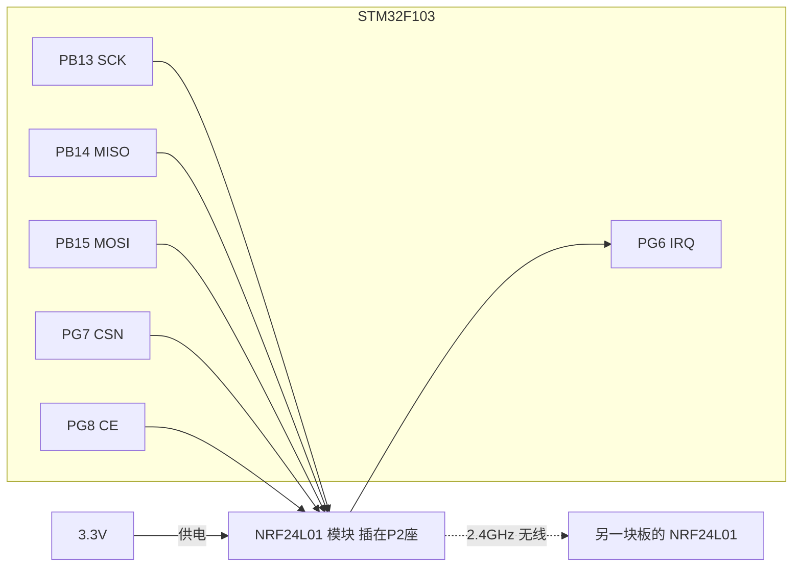
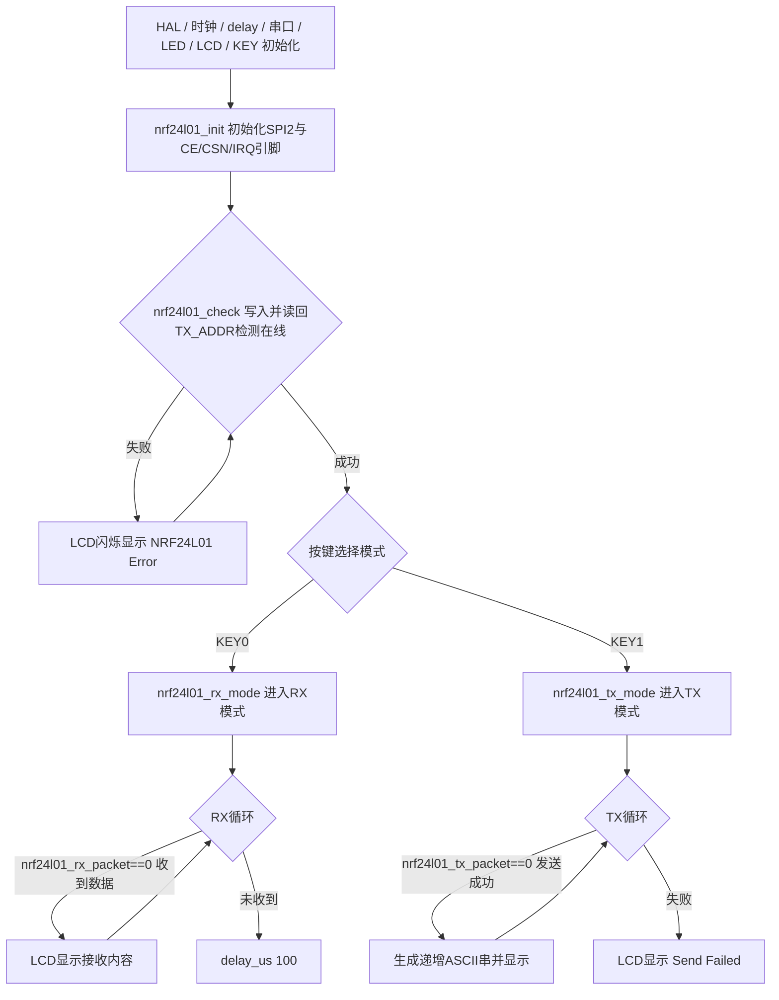

# 实验32 无线通信实验

> 平台：正点原子 STM32F103（战舰/精英/mini）开发板 · HAL 库 · Keil MDK

## 一、实验简介

本实验使用 **NRF24L01** 2.4G 无线模块，通过 STM32 的 **SPI2** 接口对其内部寄存器进行配置，实现两块开发板之间的无线数据收发：一块按 KEY1 设为发送模式（TX），另一块按 KEY0 设为接收模式（RX），发送端不断发送递增的 ASCII 字符串，接收端把收到的内容显示在 LCD 上。

🏠 **生活类比**：NRF24L01 就像一对讲机。使用前要先"对频"（设置相同的 RF 通道 40）和"对暗号"（设置相同的 5 字节地址），一台按住说话键发（TX 模式），另一台竖起耳朵听（RX 模式）。SPI 总线则是你调节对讲机旋钮的手——通过它往模块里写配置、读写数据。

## 二、实验目的

- 了解 NRF24L01 2.4G 无线模块的工作原理与 Enhanced ShockBurst 通信协议
- 掌握 STM32 **SPI2** 外设的配置与使用（模式 0：SCK 空闲低、第一边沿采样）
- 掌握通过 SPI 读写 NRF24L01 **内部配置寄存器**（CONFIG/EN_AA/RF_CH/STATUS 等）的方法
- 学会实现无线模块的发送模式与接收模式切换及数据收发

## 三、硬件资源与连接图

| 外设 | 引脚 | 说明 |
|------|------|------|
| NRF24L01 SCK | **PB13** | SPI2 时钟 |
| NRF24L01 MISO | **PB14** | SPI2 主入从出 |
| NRF24L01 MOSI | **PB15** | SPI2 主出从入 |
| NRF24L01 IRQ | **PG6** | 中断输出，低电平有效（输入上拉） |
| NRF24L01 CSN | **PG7** | SPI 片选（推挽输出） |
| NRF24L01 CE | **PG8** | 模式控制（推挽输出，高=收/发使能） |
| KEY0 | **PE4** | 选择接收模式 |
| KEY1 | **PE3** | 选择发送模式 |
| LED0 (DS0, 红) | **PB5** | 低电平点亮，指示运行 |
| 串口1 | **PA9/PA10** | 板载 CH340，波特率 115200 |
| TFTLCD | FSMC 并口 | 16 位 8080 并口 MCU 屏 |



> 接线说明：NRF24L01 模块插在开发板 **P2** 位置（朝外插）。需要 **2 套开发板**（各带一个模块）才能完整测试：一块做发送、一块做接收。

## 四、核心寄存器（NRF24L01 的 SPI 寄存器）

NRF24L01 的"寄存器"在**模块芯片内部**，STM32 通过 SPI 发送命令字节访问。命令 = `NRF_WRITE_REG(0x20)/NRF_READ_REG(0x00) + 寄存器地址`，另有 `RD_RX_PLOAD(0x61)`、`WR_TX_PLOAD(0xA0)`、`FLUSH_TX(0xE1)`、`FLUSH_RX(0xE2)`、`NOP(0xFF)` 等操作命令。

| 寄存器(地址) | 名称 | 关键位域 |
|--------|------|------|
| `CONFIG` (0x00) | 配置寄存器 | bit0: 1=接收/0=发射模式；bit1: 上电 PWR_UP；bit2: CRC 模式；bit3: CRC 使能；bit4~6: MAX_RT/TX_DS/RX_DR 中断屏蔽 |
| `EN_AA` (0x01) | 自动应答使能 | bit0~5 对应数据通道 0~5 |
| `EN_RXADDR` (0x02) | 接收地址使能 | bit0~5 对应通道 0~5 |
| `SETUP_AW` (0x03) | 地址宽度 | bit1:0 — 01=4 字节，10=5 字节 |
| `SETUP_RETR` (0x04) | 自动重发设置 | bit3:0 重发计数；bit7:4 重发延时 250*x+86us |
| `RF_CH` (0x05) | 射频通道 | bit6:0 — 工作频率 2400+RF_CH MHz（本实验=40） |
| `RF_SETUP` (0x06) | 射频设置 | bit3 速率(0:1Mbps,1:2Mbps)；bit2:1 发射功率 |
| `STATUS` (0x07) | 状态寄存器 | bit0 TX FIFO 满；bit3:1 接收通道号；bit4 MAX_TX；bit5 TX_OK；bit6 RX_OK |
| `RX_ADDR_P0` (0x0A) / `TX_ADDR` (0x10) | 通道0接收/发送地址 | 5 字节，低字节在前 |
| `RX_PW_P0` (0x11) | 通道0有效数据宽度 | 1~32 字节，0 非法 |
| `FIFO_STATUS` (0x17) | FIFO 状态 | bit0 RX 空；bit1 RX 满；bit4 TX 空；bit5 TX 满 |

STM32 侧的 SPI2 由 HAL 配置（`CLKPolarity=LOW`、`CLKPhase=1EDGE`，即 **SPI 模式 0**），速度设为 `SPI_SPEED_32`（2.25MHz 左右，低于 24L01 的 10MHz 上限）。

## 五、软件架构 / 流程



## 六、主要示例代码及讲解

### 1. SPI 读写寄存器（`Drivers/BSP/NRF24L01/nrf24l01.c`）

```c
static uint8_t nrf24l01_write_reg(uint8_t reg, uint8_t value)
{
    uint8_t status;
    NRF24L01_CSN(0);                    /* 使能SPI传输 */
    status = spi2_read_write_byte(reg); /* 发送寄存器号 */
    spi2_read_write_byte(value);        /* 写入寄存器的值 */
    NRF24L01_CSN(1);                    /* 禁止SPI传输 */
    return status;                      /* 返回状态值 */
}

static uint8_t nrf24l01_read_reg(uint8_t reg)
{
    uint8_t reg_val;
    NRF24L01_CSN(0);            /* 使能SPI传输 */
    spi2_read_write_byte(reg);  /* 发送寄存器号 */
    reg_val = spi2_read_write_byte(0XFF);   /* 读取寄存器内容 */
    NRF24L01_CSN(1);            /* 禁止SPI传输 */
    return reg_val;             /* 返回状态值 */
}
```

**讲解**：
- NRF24L01 的 SPI 协议是"**先拉低 CSN → 发命令字节 → 收发数据 → 拉高 CSN**"。命令字节发出时，模块同时把 `STATUS` 寄存器值从 MISO 返回，所以写函数也返回 status。
- 读寄存器时发送 `0xFF` 作为"哑数据"来触发时钟、换回寄存器内容——SPI 是全双工的，想收必须先发。
- 写寄存器的 reg 参数要带上 `NRF_WRITE_REG(0x20)` 前缀，如 `NRF_WRITE_REG + RF_CH`。

### 2. 配置为接收模式（`nrf24l01.c`）

```c
void nrf24l01_rx_mode(void)
{
    NRF24L01_CE(0);
    nrf24l01_write_buf(NRF_WRITE_REG + RX_ADDR_P0, (uint8_t *)RX_ADDRESS, RX_ADR_WIDTH);    /* 写RX节点地址 */

    nrf24l01_write_reg(NRF_WRITE_REG + EN_AA, 0x01);        /* 使能通道0的自动应答 */
    nrf24l01_write_reg(NRF_WRITE_REG + EN_RXADDR, 0x01);    /* 使能通道0的接收地址 */
    nrf24l01_write_reg(NRF_WRITE_REG + RF_CH, 40);          /* 设置RF通信频率 */
    nrf24l01_write_reg(NRF_WRITE_REG + RX_PW_P0, RX_PLOAD_WIDTH);   /* 选择通道0的有效数据宽度 */
    nrf24l01_write_reg(NRF_WRITE_REG + RF_SETUP, 0x0f);     /* 设置TX发射参数,0db增益,2Mbps */
    nrf24l01_write_reg(NRF_WRITE_REG + CONFIG, 0x0f);       /* 配置基本工作模式的参数;PWR_UP,EN_CRC,16BIT_CRC,接收模式 */
    NRF24L01_CE(1); /* CE为高,进入接收模式 */
}
```

**讲解**：
- **写寄存器必须在 CE=0（待机）时进行**，配置完再拉高 CE 进入接收。
- `CONFIG=0x0f`：bit0=1 接收模式、bit1=1 上电、bit2/3=1 使能 16 位 CRC。发送模式则写 `0x0e`（bit0=0 发射）。
- 收发双方的 **RF_CH（40）、地址（0x34,0x43,0x10,0x10,0x01）、速率（2Mbps）、数据宽度（32 字节）必须完全一致**，否则无法通信。
- `SETUP_RETR=0x1a`（发送模式）：自动重发延时 586us、最多重发 10 次，配合 EN_AA 的自动应答实现可靠传输。

### 3. 发送/接收一包数据（`nrf24l01.c`）

```c
uint8_t nrf24l01_tx_packet(uint8_t *ptxbuf)
{
    uint8_t sta;
    uint8_t rval = 0XFF;
    
    NRF24L01_CE(0);
    nrf24l01_write_buf(WR_TX_PLOAD, ptxbuf, TX_PLOAD_WIDTH);    /* 写数据到TX BUF  TX_PLOAD_WIDTH个字节 */
    NRF24L01_CE(1); /* 启动发送 */

    while (NRF24L01_IRQ != 0);          /* 等待发送完成 */

    sta = nrf24l01_read_reg(STATUS);    /* 读取状态寄存器的值 */
    nrf24l01_write_reg(NRF_WRITE_REG + STATUS, sta);    /* 清除TX_DS或MAX_RT中断标志 */

    if (sta & MAX_TX)   /* 达到最大重发次数 */
    {
        nrf24l01_write_reg(FLUSH_TX, 0xff); /* 清除TX FIFO寄存器 */
        rval = 1;
    }

    if (sta & TX_OK)/* 发送完成 */
    {
        rval = 0;   /* 标记发送成功 */
    }

    return rval;    /* 返回结果 */
}
```

**讲解**：
- 用 `WR_TX_PLOAD(0xA0)` 命令把 32 字节数据写入 TX FIFO，**CE 拉高 >10us 即触发射**（Enhanced ShockBurst 模式）。
- 发送结束后 IRQ 引脚变低，读 `STATUS`：`TX_OK(0x20)` 置位表示成功；`MAX_TX(0x10)` 置位表示重发 10 次仍失败（对方没开机/没应答），需 `FLUSH_TX` 清 FIFO。
- **STATUS 的中断标志必须"写 1 清除"**（把读出的值原样写回），否则下次通信会被旧标志干扰。
- `nrf24l01_rx_packet()` 类似：读 STATUS，若 `RX_OK(0x40)` 置位，用 `RD_RX_PLOAD(0x61)` 读出 32 字节数据并 `FLUSH_RX`。

## 七、实验效果

两块板分别上电：

- 开机自检通过后 LCD 显示 **NRF24L01 OK**，并周期提示 "KEY0:RX_Mode KEY1:TX_Mode"；
- 板 A 按 **KEY1** 进入 TX 模式，LCD 显示 "NRF24L01 TX_Mode"，每约 200ms 发送一包**递增的 ASCII 字符串**（从空格开始逐字符 +1），LED0 翻转；
- 板 B 按 **KEY0** 进入 RX 模式，LCD 显示 "NRF24L01 RX_Mode"，**Received DATA:** 下方实时显示收到的字符串，LED0 约 1s 翻转一次；
- 若发送端重发 10 次仍无应答，LCD 显示 "Send Failed"。

## 八、注意事项

- 需要 **2 套开发板 + 2 个 NRF24L01 模块**才能完整测试；模块插在 **P2** 位置（朝外插）。
- 发送端与接收端的**地址、通道、速率、数据宽度必须一致**，本驱动中 `TX_PLOAD_WIDTH/RX_PLOAD_WIDTH` 固定 32 字节，改动要两端同步。
- NRF24L01 最大 SPI 时钟 10MHz，且为 3.3V 供电，**不可接 5V**。
- 本例程**仅支持 MCU 屏（16 位 8080 并口），不支持 RGB 屏**。
- 串口调试助手波特率须为 **115200**；建议用 XCOM/SSCOM。P4 的 PA9/PA10 必须用跳线帽连接到 RXD/TXD。
- 若 `nrf24l01_check()` 一直失败，检查模块是否插反、SPI2 是否与 LCD 等其他外设冲突（本实验 LCD 走 FSMC，不冲突）。
- 烧录失败时先运行根目录 `keilkill.bat` 结束占用进程。

## 九、文件结构

```
实验32 无线通信实验/
├── User/
│   ├── main.c              主程序（模式选择 + 收发循环）
│   ├── stm32f1xx_it.c      中断服务函数
│   └── stm32f1xx_hal_conf.h HAL配置
├── Drivers/
│   ├── BSP/
│   │   ├── NRF24L01/       NRF24L01 驱动 (nrf24l01.c / nrf24l01.h) ★本实验核心
│   │   ├── SPI/            SPI2 底层驱动 (spi.c / spi.h)
│   │   ├── KEY/            按键驱动
│   │   ├── LCD/            LCD 显示驱动
│   │   └── LED/            LED 驱动
│   ├── SYSTEM/             delay / sys / usart 系统支持
│   ├── USMART/             串口调试组件
│   ├── CMSIS/              内核启动与设备定义
│   └── STM32F1xx_HAL_Driver/ ST HAL 库
└── Projects/MDK-ARM/       Keil 工程文件 (.uvprojx)
```
