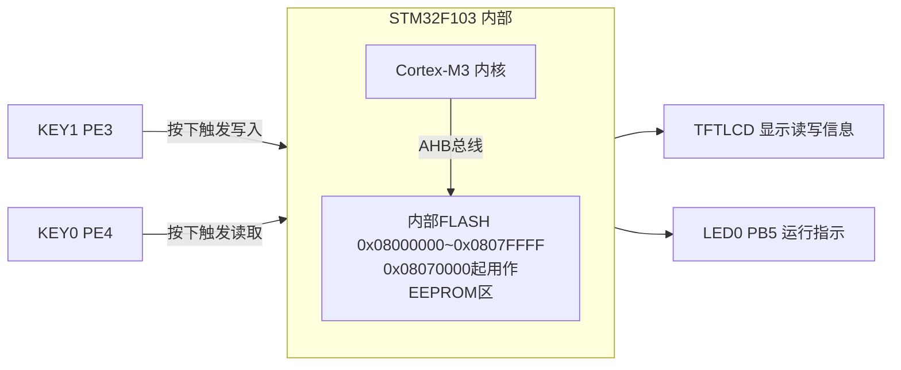
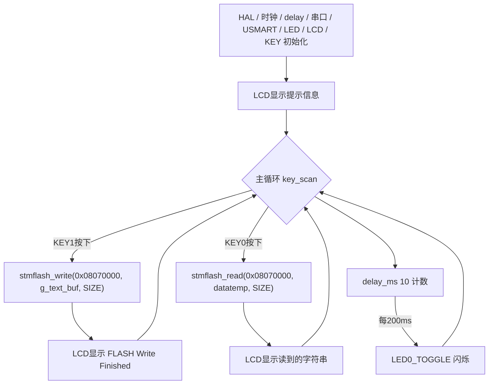
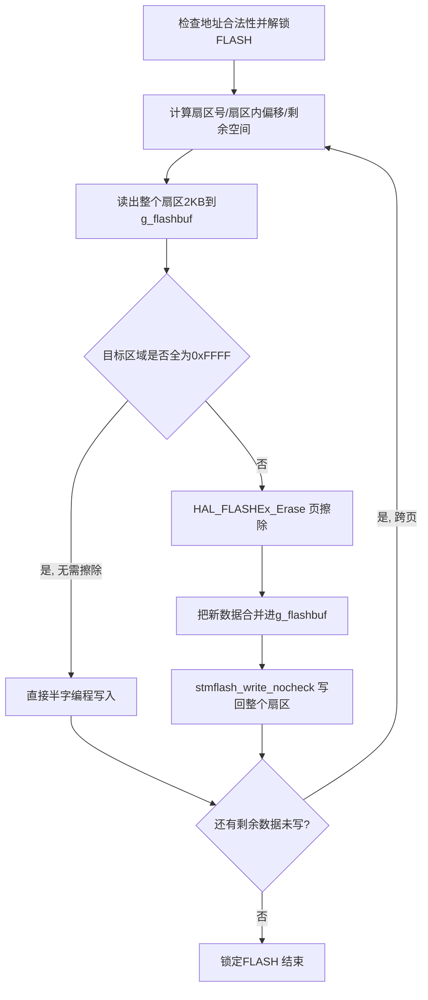

# 实验33 FLASH模拟EEPROM实验

> 平台：正点原子 STM32F103（战舰/精英/mini）开发板 · HAL 库 · Keil MDK

## 一、实验简介

STM32F103 内部没有 EEPROM，但自带大容量 FLASH。本实验通过操作内部 FLASH 的**解锁、页擦除、半字编程**等步骤，把 FLASH 的最后一段区域（`0x08070000`）当作"EEPROM"使用：按 KEY1 把字符串 `"STM32 FLASH TEST"` 写入 FLASH，按 KEY0 再读出来显示在 LCD 上——**掉电后数据不丢失**，这就是 EEPROM 的效果。

🏠 **生活类比**：FLASH 像一本用"褪色笔"写的笔记本——想改某一页，必须把**整页撕掉**（擦除后全变 0xFFFF），再用只能写一次的钢笔重写（编程只能把 1 写成 0）。本实验驱动就是那个细心的秘书：写之前先把整页抄到便签上（RAM 缓存），撕页重抄，只改掉你要改的那几行，其余原样抄回去。

## 二、实验目的

- 了解 STM32 内部 FLASH 的结构（页/扇区、擦写规则）
- 掌握 FLASH 的**解锁（KEYR）、擦除、半字编程**操作流程
- 理解"FLASH 模拟 EEPROM"的软件实现思路（读出整页 → 页擦除 → 合并写回）
- 学会使用 `stmflash_read()` / `stmflash_write()` 接口存取掉电不丢失的数据

## 三、硬件资源与连接图

| 外设 | 引脚 | 说明 |
|------|------|------|
| 内部 FLASH | — | 512KB（战舰 F103ZET6），保存地址 `0x08070000` |
| KEY0 | **PE4** | 读取 FLASH |
| KEY1 | **PE3** | 写入 FLASH |
| LED0 (DS0, 红) | **PB5** | 低电平点亮，指示程序运行 |
| 串口1 | **PA9/PA10** | 板载 CH340，波特率 115200（可用 USMART 调用 `test_write` 调试） |
| TFTLCD | FSMC 并口 | 16 位 8080 并口 MCU 屏，显示读写结果 |



> 说明：本实验数据保存在芯片内部 FLASH，无需外接任何存储器；按键、LCD 均为板载资源。

## 四、核心寄存器（FLASH_ACR / KEYR / SR）

STM32 内部 FLASH 由一组 FLASH 寄存器控制（基地址 `0x40022000`）：

| 寄存器 | 名称 | 作用与关键位域 |
|--------|------|------|
| `FLASH_ACR` | 访问控制寄存器 | bit2:0 LATENCY 等待周期（72MHz 需 2 个等待周期）；bit8 PRFTBE 预取缓冲使能 |
| `FLASH_KEYR` | 键寄存器 | 依次写入 `KEY1=0x45670123`、`KEY2=0xCDEF89AB` 解锁 FLASH（否则不能擦/写） |
| `FLASH_OPTKEYR` | 选项字节键寄存器 | 解锁选项字节（本实验未用） |
| `FLASH_SR` | 状态寄存器 | bit0 BSY 忙；bit2 PGERR 编程错误（目标非 0xFFFF 就写）；bit3 WRPRTERR 写保护错误；bit5 EOP 操作完成 |
| `FLASH_CR` | 控制寄存器 | bit0 PG 编程使能；bit1 PER 页擦除使能；bit2 MER 全擦；bit16 STRT 启动擦除；bit7 LOCK 上锁；bit12 EOPIE 完成中断使能 |
| `FLASH_AR` | 地址寄存器 | 存放要擦除的页地址 |

擦写规则（驱动严格遵循）：

```
写(编程): 以半字(16bit)为单位, 地址必须2字节对齐; 只能把1写成0, 写非0xFFFF单元前必须擦除
擦除:   以页为单位, F103容量≥256K时页=2KB(STM32_SECTOR_SIZE=2048), 擦除后全为0xFFFF
流程:   解锁KEYR → 查SR.BSY → 置CR.PER+写AR+置CR.STRT擦页 → 等EOP → 置CR.PG逐半字写 → 上锁
```

本实验中 HAL 库的 `HAL_FLASH_Unlock/HAL_FLASHEx_Erase/HAL_FLASH_Program` 封装了上述寄存器操作，`stmflash.c` 在其上实现了**自动擦除、跨页写、保留原数据**的完整逻辑。

## 五、软件架构 / 流程



`stmflash_write()` 内部的"页缓存写"流程：



## 六、主要示例代码及讲解

### 1. 读 FLASH —— 直接指针访问（`Drivers/BSP/STMFLASH/stmflash.c`）

```c
uint16_t stmflash_read_halfword(uint32_t faddr)
{
    return *(volatile uint16_t *)faddr;
}

void stmflash_read(uint32_t raddr, uint16_t *pbuf, uint16_t length)
{
    uint16_t i;

    for (i = 0; i < length; i++)
    {
        pbuf[i] = stmflash_read_halfword(raddr);    /* 读取2个字节 */
        raddr += 2; /* 偏移2个字节 */
    }
}
```

**讲解**：
- 内部 FLASH 映射在存储器地址空间（`0x08000000` 起），**读 FLASH 不需要任何寄存器操作**，直接用指针取值即可——和读普通内存一样快。
- 读的单位是**半字（16 位）**，所以地址每次 +2；`length` 是半字个数。
- `volatile` 告诉编译器该地址内容可能变化，禁止优化掉这次读取。

### 2. 写 FLASH 核心流程（`stmflash.c`，节选）

```c
void stmflash_write(uint32_t waddr, uint16_t *pbuf, uint16_t length)
{
    ...
    if (waddr < STM32_FLASH_BASE || (waddr >= (STM32_FLASH_BASE + STM32_FLASH_SIZE)))
    {
        return;     /* 非法地址 */
    }

    HAL_FLASH_Unlock();     /* FLASH解锁 */

    offaddr = waddr - STM32_FLASH_BASE;             /* 实际偏移地址. */
    secpos = offaddr / STM32_SECTOR_SIZE;           /* 扇区地址  0~255 for STM32F103ZET6 */
    secoff = (offaddr % STM32_SECTOR_SIZE) / 2;     /* 在扇区内的偏移(2个字节为基本单位.) */
    secremain = STM32_SECTOR_SIZE / 2 - secoff;     /* 扇区剩余空间大小 */
    ...
    while (1)
    {
        stmflash_read(secpos * STM32_SECTOR_SIZE + STM32_FLASH_BASE, g_flashbuf, STM32_SECTOR_SIZE / 2); /* 读出整个扇区的内容 */
        for (i = 0; i < secremain; i++)             /* 校验数据 */
        {
            if (g_flashbuf[secoff + i] != 0XFFFF)
            {
                break;      /* 需要擦除 */
            }
        }
        if (i < secremain)  /* 需要擦除 */
        { 
            flash_eraseop.TypeErase = FLASH_TYPEERASE_PAGES;     /* 选择页擦除 */
            flash_eraseop.NbPages = 1;
            flash_eraseop.PageAddress = secpos * STM32_SECTOR_SIZE + STM32_FLASH_BASE;  /* 要擦除的扇区 */
            HAL_FLASHEx_Erase( &flash_eraseop, &erase_addr);

            for (i = 0; i < secremain; i++)         /* 复制 */
            {
                g_flashbuf[i + secoff] = pbuf[i];
            }
            stmflash_write_nocheck(secpos * STM32_SECTOR_SIZE + STM32_FLASH_BASE, g_flashbuf, STM32_SECTOR_SIZE / 2); /* 写入整个扇区 */
        }
        else
        {
            stmflash_write_nocheck(waddr, pbuf, secremain); /* 写已经擦除了的,直接写入扇区剩余区间. */
        }
        ...
    }
    HAL_FLASH_Lock(); /* 上锁 */
}
```

**讲解**：
- 入口先做**地址合法性检查**（必须在 `0x08000000 ~ 0x0807FFFF` 内），再 `HAL_FLASH_Unlock()` 向 KEYR 写入两个密钥解锁。
- FLASH 擦除粒度是**一页 2KB**（`STM32_SECTOR_SIZE`），所以先把目标页整体读进 RAM 缓存 `g_flashbuf[1024]`；若目标区域不全是 0xFFFF，就执行**页擦除**，把新数据合并进缓存后整页写回——这样**不会丢失该页其他位置原有的数据**。
- 若目标区域本来就是空白（0xFFFF），跳过擦除直接写，节省一次擦除寿命（FLASH 擦写约 1 万次）。
- `while(1)` 循环支持**跨页写入**：一页写不完就 secpos+1 继续处理下一页。
- 写完 `HAL_FLASH_Lock()` 重新上锁，防止误操作。

### 3. 主函数使用示例（`User/main.c`）

```c
const uint8_t g_text_buf[] = {"STM32 FLASH TEST"};
#define TEXT_LENTH sizeof(g_text_buf) /* 数组长度 */
/*SIZE表示半字长(2字节), 大小必须是2的整数倍, 如果不是的话, 强制对齐到2的整数倍 */
#define SIZE TEXT_LENTH / 2 + ((TEXT_LENTH % 2) ? 1 : 0)
#define FLASH_SAVE_ADDR 0X08070000 /* 设置FLASH 保存地址 */

/* KEY1按下,写入STM32 FLASH */
stmflash_write(FLASH_SAVE_ADDR, (uint16_t *)g_text_buf, SIZE);

/* KEY0按下,读取字符串并显示 */
stmflash_read(FLASH_SAVE_ADDR, (uint16_t *)datatemp, SIZE);
```

**讲解**：
- 读写长度以**半字**为单位，字符串长度不足偶数时向上对齐（`SIZE` 宏）。
- 保存地址 `0x08070000` 位于 512KB FLASH 的末端区域，**必须大于程序代码占用的 FLASH**，否则会覆盖自己的程序导致死机。
- 写入后断电重启，再按 KEY0 依然能读出 "STM32 FLASH TEST"——数据非易失。
- 驱动还提供了 `test_write()` 挂到 USMART，可在串口助手里直接输入命令测试写 FLASH。

## 七、实验效果

烧录后 LCD 显示 "STM32 / FLASH EEPROM TEST / ATOM@ALIENTEK / KEY1:Write KEY0:Read"：

- 按 **KEY1**：LCD 显示 "Start Write FLASH...."，片刻后变为 **"FLASH Write Finished!"**，字符串已写入 `0x08070000`；
- 按 **KEY0**：LCD 显示 "The Data Readed Is:" 并在下方显示读出的 **"STM32 FLASH TEST"**；
- **LED0 每 200ms 翻转一次**，提示程序运行；
- 断电重启后再按 KEY0，数据依然能读出，证明实现了 EEPROM 效果。

## 八、注意事项

- **写入地址绝对不能落在用户代码区**，否则程序被覆盖可能直接死机；`FLASH_SAVE_ADDR` 必须为偶数地址，且大于 `代码占用大小 + 0x08000000`。
- FLASH 编程/擦除期间 CPU 默认会停顿等待（除非代码在 RAM 中运行），写 2KB 页耗时约几十毫秒，期间不要做严格实时操作。
- FLASH 擦写寿命约 **1 万次**，不适合高频记录数据（如每秒存一次的日志），这类场景应做磨损均衡或换 FRAM/EEPROM 芯片。
- 本例程**仅支持 MCU 屏（16 位 8080 并口），不支持 RGB 屏**。
- 串口调试助手波特率须为 **115200**；建议用 XCOM/SSCOM。P4 的 PA9/PA10 必须用跳线帽连接到 RXD/TXD。
- 烧录失败时先运行根目录 `keilkill.bat` 结束占用进程。

## 九、文件结构

```
实验33 FLASH模拟EEPROM实验/
├── User/
│   ├── main.c              主程序（按键触发 FLASH 读写）
│   ├── stm32f1xx_it.c      中断服务函数
│   └── stm32f1xx_hal_conf.h HAL配置
├── Drivers/
│   ├── BSP/
│   │   ├── STMFLASH/       内部FLASH读写驱动 (stmflash.c / stmflash.h) ★本实验核心
│   │   ├── KEY/            按键驱动
│   │   ├── LCD/            LCD 显示驱动
│   │   └── LED/            LED 驱动
│   ├── SYSTEM/             delay / sys / usart 系统支持
│   ├── USMART/             串口调试组件（挂载 test_write）
│   ├── CMSIS/              内核启动与设备定义
│   └── STM32F1xx_HAL_Driver/ ST HAL 库
└── Projects/MDK-ARM/       Keil 工程文件 (.uvprojx)
```
