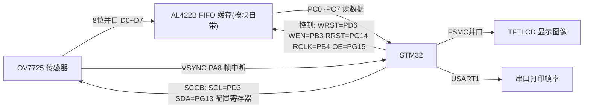
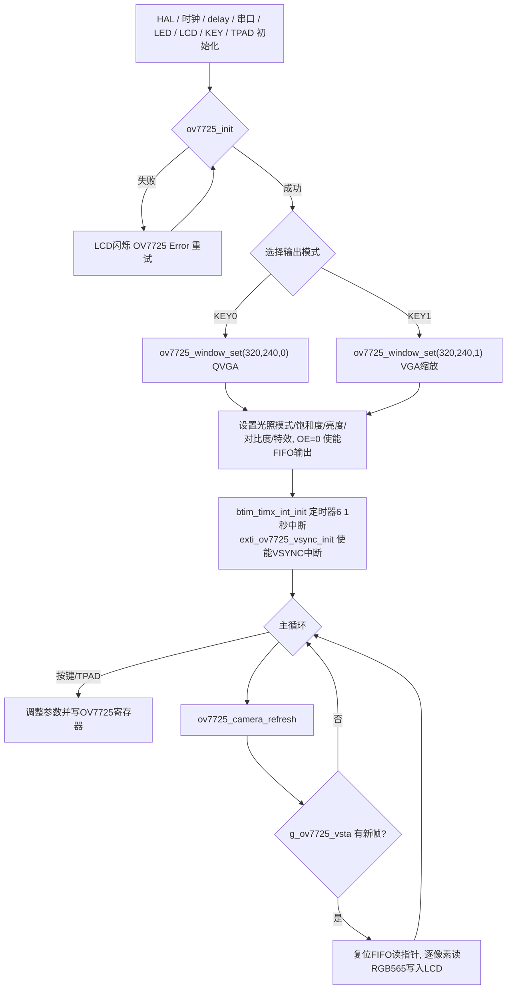

# 实验34 摄像头实验

> 平台：正点原子 STM32F103（战舰/精英/mini）开发板 · HAL 库 · Keil MDK

## 一、实验简介

本实验使用 ALIENTEK **OV7725** 摄像头模块实现实时图像采集与显示。STM32 通过**软件模拟的 SCCB 总线**（类 I2C）配置 OV7725 内部寄存器；图像数据经 8 位并口 D0~D7 先存入模块自带的 **FIFO 缓存**（AL422B），STM32 再用 GPIO 模拟读时钟（RCLK）把整帧 320×240 RGB565 数据逐像素读出并刷到 LCD 上。VSYNC 帧同步信号接外部中断，定时器统计并通过串口打印显示帧率。

🏠 **生活类比**：OV7725 + FIFO 就像一台带内存卡的相机。相机（OV7725）不停地拍，把照片先存进内存卡（FIFO）；你（STM32）不用跟着相机的快门速度走，拍完一张（一帧，VSYNC 通知）再慢慢从卡里取出来看。SCCB 总线则是相机的"设置菜单"，用来调亮度、特效、分辨率。

## 二、实验目的

- 了解 OV7725 摄像头模块的成像原理与 FIFO 缓存架构
- 掌握 **SCCB 总线**（软件模拟 I2C 变体）的读写时序
- 掌握用 **GPIO + 外部中断（VSYNC）** 采集 8 位并口图像数据的方法
- 学会配置 OV7725 的光照模式、饱和度、亮度、对比度、特效与输出窗口

## 三、硬件资源与连接图

| OV7725 信号 | STM32 引脚 | 方向 | 说明 |
|------|------|------|------|
| OV_D0~D7 | **PC0~PC7** | 输入 | 8 位图像数据并口 |
| OV_SCL | **PD3** | 输出 | SCCB 时钟线 |
| OV_SDA | **PG13** | 双向 | SCCB 数据线（开漏+上拉） |
| OV_VSYNC | **PA8** | 输入(EXTI8) | 帧同步信号，上升沿外部中断 |
| FIFO_WRST | **PD6** | 输出 | FIFO 写指针复位 |
| FIFO_WEN | **PB3** | 输出 | FIFO 写使能 |
| FIFO_RRST | **PG14** | 输出 | FIFO 读指针复位 |
| FIFO_RCLK | **PB4** | 输出 | FIFO 读时钟 |
| FIFO_OE | **PG15** | 输出 | FIFO 输出使能 |
| TPAD | **PA1** | — | 电容触摸按键，切换特效 |
| KEY0/KEY1/KEY2 | **PE4/PE3/PE2** | 输入 | 光照模式/饱和度/亮度 |
| KEY_UP(WK_UP) | **PA0** | 输入 | 对比度 |
| LED0 | **PB5** | 输出 | 运行指示 |
| 串口1 | **PA9/PA10** | — | 打印帧率（定时器6每秒中断触发） |



> 注意：PB3/PB4 默认是 JTAG 引脚，驱动中用 `__HAL_AFIO_REMAP_SWJ_NOJTAG()` **禁止 JTAG、保留 SWD**，把它们释放为普通 IO。

## 四、核心寄存器与关键配置

### 1. STM32 侧（GPIO / EXTI / 定时器）

| 寄存器 | 作用 |
|--------|------|
| `GPIOC_IDR` | 读取 D0~D7 图像数据：`#define OV7725_DATA  GPIOC->IDR & 0X00FF` |
| `GPIOB_BSRR / BRR` | 高速翻转 RCLK 读时钟（宏直接操作寄存器，保证读时序速度） |
| `AFIO_MAPR` | SWJ 重映射，释放 PB3/PB4 |
| `EXTI_IMR/RTSR` | PA8 上升沿触发 VSYNC 中断（EXTI9_5_IRQn） |
| `TIM6` 相关（btim） | 10kHz 计数、1 秒中断，用于统计/打印帧率 |

### 2. OV7725 内部寄存器（通过 SCCB 访问，器件地址 `0x42`）

| 寄存器地址 | 名称 | 作用 |
|--------|------|------|
| `0x12` | COM7 | bit7=1 软复位；配置输出格式/分辨率 |
| `0x1C/0x1D` | MIDH/MIDL | 厂家 ID，应为 `0x7FA2`（或 `0x7FFF`） |
| `0x0A/0x0B` | PIDH/PIDL | 产品 ID，应为 `0x7721` |
| `0x15` | COM10 | PCLK/HSYNC 极性、输出使能 |
| `0x42` | 7725 REG42 | 特效（黑白/负片/红绿蓝调等 7 种） |
| `0x6B` | DSPAuto 等 | 光照模式（自动/日光/阴天/办公室/家里/夜晚） |
| `0x2E`/`0x33` 等 | 窗口设置 | `ov7725_window_set()` 设置 QVGA/VGA 输出窗口 |

驱动初始化时把 `ov7725cfg.h` 中 `ov7725_init_reg_tb1[][2]` 寄存器表（QVGA 320×240 配置）逐项写入 OV7725。

### 3. SCCB 总线要点

SCCB 是 Omnivision 版的简化 I2C：**起始/停止信号相同，但读操作第 9 位用 NACK（`sccb_nack()`），且可省略**；SDA 配置为开漏输出+上拉（`OV_SCCB_TYPE_NOD=0` 时无需切换方向），SCL 为推挽输出，位延时 `delay_us(5)`。

## 五、软件架构 / 流程



VSYNC 中断（`OV7725_VSYNC_INT_IRQHandler`）里交替动作：上一帧已处理完 → 复位写指针、允许 FIFO 写入、置 `g_ov7725_vsta=1`；否则禁止 FIFO 写入，保证主循环读的一帧数据完整。

## 六、主要示例代码及讲解

### 1. SCCB 读写 OV7725 寄存器（`Drivers/BSP/OV7725/ov7725.c`）

```c
uint8_t ov7725_read_reg(uint16_t reg)
{
    uint8_t data = 0;
    
    sccb_start();                       /* 起始信号 */
    sccb_send_byte(OV7725_ADDR);        /* 写通讯地址 */
    sccb_send_byte(reg);                /* 寄存器地址 */
    sccb_stop();                        /* 停止信号 */
    
    /* 设置寄存器地址后，才是读 */
    sccb_start();                       /* 起始信号 */
    sccb_send_byte(OV7725_ADDR | 0X01); /* 读通讯地址 */
    data = sccb_read_byte();            /* 读取数据 */
    sccb_nack();                        /* 非应答信号 */
    sccb_stop();                        /* 停止信号 */
    
    return data;
}

uint8_t ov7725_write_reg(uint8_t reg, uint8_t data)
{
    uint8_t res = 0;
    
    sccb_start();   /* 起始信号 */

    if (sccb_send_byte(OV7725_ADDR))res = 1;    /* 写通讯地址 */
    if (sccb_send_byte(reg))res = 1;            /* 寄存器地址 */
    if (sccb_send_byte(data))res = 1;           /* 写数据 */

    sccb_stop();    /* 停止信号 */
    
    return res;
}
```

**讲解**：
- OV7725 器件地址 `0x42`（写），读时最低位或 1 变 `0x43`——这就是 I2C 风格的"地址+读写位"。
- 读寄存器要**先写后读**：先告诉芯片要读哪个寄存器地址，重新发起始信号后再读数据，读完发 **NACK**（SCCB 规定主机读单字节不应答）。
- `ov7725_init()` 里先写 `0x12=0x80` 软复位，再读 MID（0x1C/0x1D）和 PID（0x0A/0x0B）核对芯片身份，最后遍历 `ov7725_init_reg_tb1` 配置表完成 QVGA 初始化。

### 2. VSYNC 外部中断管理 FIFO 写入（`Drivers/BSP/EXTI/exti.c`）

```c
void OV7725_VSYNC_INT_IRQHandler(void)
{
    if (__HAL_GPIO_EXTI_GET_IT(OV7725_VSYNC_GPIO_PIN))   /* 是OV7725_VSYNC_GPIO_PIN线的中断 */
    {
        if (g_ov7725_vsta == 0) /* 上一帧数据已经处理了? */
        {
            OV7725_WRST(0);     /* 复位写指针 */
            OV7725_WRST(1);     /* 结束复位 */
            OV7725_WEN(1);      /* 允许写入FIFO */
            g_ov7725_vsta = 1;  /* 标记帧中断 */
        }
        else
        {
            OV7725_WEN(0);      /* 禁止写入FIFO */
        }
    }

    __HAL_GPIO_EXTI_CLEAR_IT(OV7725_VSYNC_GPIO_PIN);   /* 清除中断标志位 */
}
```

**讲解**：
- VSYNC 每帧产生一次上升沿中断。第一次中断：复位 FIFO **写指针**并打开写使能，让新一帧图像往 FIFO 里存，同时置 `g_ov7725_vsta=1` 通知主循环。
- 第二次中断（即这帧存完、下一帧开始）：关闭写使能，**冻结 FIFO 内容**，避免主循环读的过程中数据被覆盖。
- 这个"乒乓"机制解决了 STM32 读取速度跟不上摄像头输出速度的问题。

### 3. 从 FIFO 读一帧并刷 LCD（`User/main.c`）

```c
OV7725_RRST(0); /* 开始复位读指针 */
OV7725_RCLK(0);
OV7725_RCLK(1);
OV7725_RCLK(0);
OV7725_RRST(1); /* 复位读指针结束 */
OV7725_RCLK(1);

for (i = 0; i < g_ov7725_wheight; i++)
{
    for (j = 0; j < g_ov7725_wwidth; j++)
    {
        OV7725_RCLK(0);
        color = OV7725_DATA; /* 读数据 */
        OV7725_RCLK(1);
        color <<= 8;
        OV7725_RCLK(0);
        color |= OV7725_DATA; /* 读数据 */
        OV7725_RCLK(1);
        LCD->LCD_RAM = color;
    }
}
```

**讲解**：
- 先给 RRST 一个低脉冲并在其间翻转 RCLK，**复位 FIFO 读指针**到帧首。
- FIFO 是 8 位输出，一个 RGB565 像素要**读两次**：第一个 RCLK 上升沿读高字节、第二个读低字节，拼成 16 位 color。
- `OV7725_RCLK` 宏直接写 `BSRR/BRR` 寄存器而不是调 HAL 函数，因为一帧要翻转 15 万多次时钟，必须用最快的方式。
- 读出的像素按 `lcd_set_window()` 设定的居中窗口顺序写入 LCD GRAM（`LCD->LCD_RAM = color`），刷完置 `g_ov7725_vsta=0`、`g_ov7725_frame++` 供帧率统计。

## 七、实验效果

烧录后 LCD 显示初始化信息，OV7725 自检通过显示 "OV7725 Init OK"，按 KEY0 选 QVGA / KEY1 选 VGA 后：

- LCD 中央**实时显示摄像头画面**（320×240），对着物体移动即可看到流畅视频；
- **KEY0** 循环切换 6 种光照模式（Auto/Sunny/Cloudy/Office/Home/Night）；
- **KEY1** 调饱和度（0~8）、**KEY2** 调亮度（0~8）、**WK_UP** 调对比度（0~8）；
- **TPAD 触摸**循环切换 7 种特效（Normal/Negative/B&W/Redish/Greenish/Bluish/Antique）；
- 串口 115200 每秒打印一次 LCD 显示帧率；LED0 闪烁指示运行。

## 八、注意事项

- 摄像头模块必须用 **ALIENTEK OV7725 模块**，按丝印方向插好；接线较多（D0~D7 及 6 根控制线），松动会导致花屏或初始化失败。
- **PB3/PB4 与 JTAG 复用**，驱动已通过 `__HAL_AFIO_REMAP_SWJ_NOJTAG()` 禁用 JTAG 只留 SWD——**调试只能用 SWD 方式**，不要用 JTAG。
- 受 FIFO 容量限制，无法存下 640×480 一整帧，因此 QVGA/VGA 模式都采用 **320×240** 分辨率显示（VGA 模式支持传感器内缩放）。
- 初始化失败时串口会打印 MID/PID 值，可据此判断是 SCCB 通信问题还是模块问题。
- 本例程**仅支持 MCU 屏（16 位 8080 并口），不支持 RGB 屏**；串口助手波特率须为 **115200**，P4 的 PA9/PA10 须跳线帽连接 RXD/TXD。
- 烧录失败时先运行根目录 `keilkill.bat` 结束占用进程。

## 九、文件结构

```
实验34 摄像头实验/
├── User/
│   ├── main.c              主程序（模式选择/参数调节/ov7725_camera_refresh刷屏）
│   ├── stm32f1xx_it.c      中断服务函数
│   └── stm32f1xx_hal_conf.h HAL配置
├── Drivers/
│   ├── BSP/
│   │   ├── OV7725/         OV7725驱动 + SCCB驱动 + 寄存器配置表 ★本实验核心
│   │   │   ├── ov7725.c/.h     摄像头初始化与参数设置
│   │   │   ├── ov7725cfg.h     QVGA初始化寄存器表
│   │   │   └── sccb.c/.h       SCCB总线（软件模拟I2C）
│   │   ├── EXTI/           外部中断（VSYNC帧中断）
│   │   ├── TIMER/          定时器6（帧率统计）
│   │   ├── TPAD/           电容触摸按键（特效切换）
│   │   ├── KEY/            按键驱动
│   │   ├── LCD/            LCD显示驱动
│   │   ├── LED/            LED驱动
│   │   └── BEEP/           蜂鸣器驱动
│   ├── SYSTEM/             delay / sys / usart 系统支持
│   ├── USMART/             串口调试组件
│   ├── CMSIS/              内核启动与设备定义
│   └── STM32F1xx_HAL_Driver/ ST HAL 库
└── Projects/MDK-ARM/       Keil 工程文件 (.uvprojx)
```
