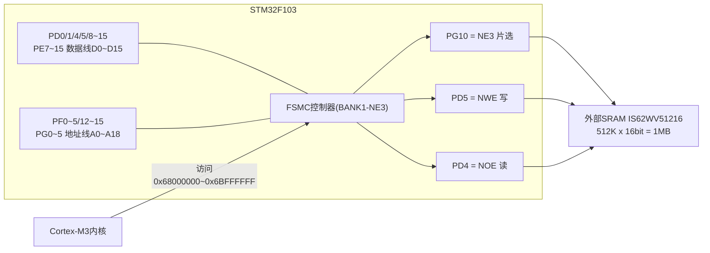
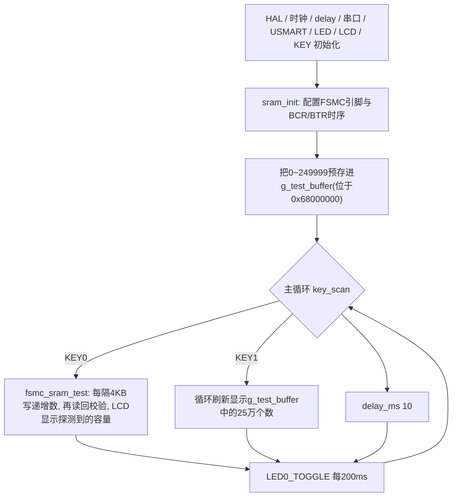

# 实验35 外部SRAM实验

> 平台：正点原子 STM32F103（战舰/精英/mini）开发板 · HAL 库 · Keil MDK

## 一、实验简介

STM32F103ZET6 内部只有 64KB SRAM，做图像处理、大数组缓存时常常不够用。本实验通过 STM32 的 **FSMC（灵活静态存储控制器）** 驱动板载的 **1MB 外部 SRAM**，把它映射到地址 `0x68000000`。初始化完成后，外部 SRAM 用起来就像内部内存一样——**直接指针读写，无需任何总线驱动代码**。按 KEY0 可自动探测 SRAM 实际容量，按 KEY1 浏览预先写入的 100 万个测试数据。

🏠 **生活类比**：FSMC 就像小区门口的快递驿站。CPU 想存取外部 SRAM，只要说一个"门牌号"（内存地址 0x68000000~0x6BFFFFFF），FSMC 驿站就自动帮你完成"取件全流程"——拉片选、发地址、给读写信号、按时序等待——你拿到的就是数据，完全感觉不到背后有一整套硬件协议。

## 二、实验目的

- 了解 FSMC 外设的原理与 BANK1 四个片选（NE1~NE4）的地址映射
- 掌握用 FSMC 驱动外部 SRAM 的 GPIO 复用配置与时序参数（BCR/BTR）设置
- 理解"存储器映射"思想：外部 SRAM 初始化后可直接用 C 指针访问
- 学会用绝对地址定位（`__attribute__((at))`）把大数组放进外部 SRAM

## 三、硬件资源与连接图

板载 SRAM 芯片（IS62WV51216，512K×16 位 = 1MB）通过 FSMC 连接：

| FSMC 信号 | STM32 引脚 | 说明 |
|------|------|------|
| D0~D15 数据线 | **PD14/PD15/PD0/PD1/PE7~PE15** | 16 位双向数据总线 |
| A0~A18 地址线 | **PF0~PF5, PF12~PF15, PG0~PG5** | 19 根，寻址 512K 个半字 |
| NE3 片选 | **PG10** | SRAM_CS（`SRAM_FSMC_NEX=3`） |
| NWE 写使能 | **PD5** | SRAM_WR |
| NOE 读使能 | **PD4** | SRAM_RD |
| KEY0 / KEY1 | **PE4 / PE3** | 测试容量 / 显示预存数据 |
| LED0 | **PB5** | 运行指示 |
| 串口1 | **PA9/PA10** | 115200，USMART 可调 `sram_test_read/write` 调试 |



> 地址映射：FSMC BANK1 共 256MB，均分 4 块。本实验用 **NE3 → `0x68000000 ~ 0x6BFFFFFF`**（`SRAM_BASE_ADDR` 宏由 `SRAM_FSMC_NEX=3` 算出）。16 位总线按半字寻址，A0 对应字节地址的 bit1，所以 19 根地址线可寻址 512K 半字 = 1MB。

## 四、核心寄存器（FSMC_BCR / BTR）

FSMC 每个存储块由一组寄存器控制，NE3 对应 `FSMC_Bank1_NORSRAM3`：

| 寄存器 | 名称 | 关键位域（本实验配置） |
|--------|------|------|
| `FSMC_BCRx` | NOR/PSRAM 片选控制寄存器 | MBKEN 存储块使能；MUXEN=0 地址数据不复用；MTYP=01 SRAM；MWID=01 **16 位数据宽度**；BURSTEN=0 禁突发；WREN=1 **写使能**；EXTMOD=0 读写同时序 |
| `FSMC_BTRx` | 存储块时序寄存器 | ADDSET[3:0] 地址建立时间=0（1 个 HCLK≈13.8ns）；ADDHLD 地址保持（模式 A 未用）；DATAST[7:0] 数据建立时间=1（2 个 HCLK≈27.8ns）；BUSTURN 总线周转=0；ACCMOD=00 **模式 A** |
| `FSMC_BWTRx` | 写时序寄存器 | ExtendedMode=DISABLE 时与 BTR 共用，读写相同时序 |
| `RCC_AHBENR` | AHB 时钟使能 | FSMCEN 位置 1 使能 FSMC 时钟（用前必开） |

FSMC 模式 A 异步 SRAM 一次访问的时序：`地址建立(ADDSET+1 HCLK) → 数据建立(DATAST+1 HCLK) → 总线周转`，NOE/NWE 脉冲宽度由这些参数自动产生，CPU 只需一次存储器读写指令。

以上寄存器均由 HAL 的 `HAL_SRAM_Init()` 根据 `SRAM_HandleTypeDef.Init`（BCR 参数）和 `FSMC_NORSRAM_TimingTypeDef`（BTR 参数）自动写入。

## 五、软件架构 / 流程



## 六、主要示例代码及讲解

### 1. FSMC 初始化（`Drivers/BSP/SRAM/sram.c`）

```c
g_sram_handler.Instance = FSMC_NORSRAM_DEVICE;
g_sram_handler.Extended = FSMC_NORSRAM_EXTENDED_DEVICE;

g_sram_handler.Init.NSBank = ... FSMC_NORSRAM_BANK3 ...;  /* 根据SRAM_FSMC_NEX=3选择FSMC_NE3 */
g_sram_handler.Init.DataAddressMux = FSMC_DATA_ADDRESS_MUX_DISABLE;     /* 地址/数据线不复用 */
g_sram_handler.Init.MemoryType = FSMC_MEMORY_TYPE_SRAM;                 /* SRAM */
g_sram_handler.Init.MemoryDataWidth = FSMC_NORSRAM_MEM_BUS_WIDTH_16;    /* 16位数据宽度 */
g_sram_handler.Init.WriteOperation = FSMC_WRITE_OPERATION_ENABLE;       /* 存储器写使能 */
g_sram_handler.Init.ExtendedMode = FSMC_EXTENDED_MODE_DISABLE;          /* 读写使用相同的时序 */
/* FSMC读时序控制寄存器 */
fsmc_readwritetim.AddressSetupTime = 0x00;  /* 地址建立时间(ADDSET)为1个HCLK 1/72M=13.8ns */
fsmc_readwritetim.DataSetupTime = 0x01;     /* 数据保存时间为2个HCLK=2*13.8=27.8ns */
fsmc_readwritetim.AccessMode = FSMC_ACCESS_MODE_A;                      /* 模式A */
HAL_SRAM_Init(&g_sram_handler, &fsmc_readwritetim, &fsmc_readwritetim);
```

**讲解**：
- `NSBank` 决定用哪个片选（NE1~NE4），必须和硬件接线一致——本板 SRAM_CS 接在 PG10（FSMC_NE3）。
- `MemoryDataWidth=16` 对应 MWID 位，决定 D0~D15 全部使用；`WriteOperation=ENABLE` 才能写 SRAM。
- 时序结构体填的就是 **BTR 寄存器**的参数：地址建立 1 个 HCLK、数据建立 2 个 HCLK，模式 A。SRAM 速度很快（10ns 级），这套配置足够；接更慢的器件时加大 DATAST 即可。
- 初始化前还把所有 FSMC 引脚（PD/PE/PF/PG 共 30 多个）配成 `GPIO_MODE_AF_PP` 复用推挽输出——FSMC 硬件自动接管这些脚的电平。

### 2. 读写 SRAM —— 就是指针操作（`sram.c`）

```c
void sram_write(uint8_t *pbuf, uint32_t addr, uint32_t datalen)
{
    for (; datalen != 0; datalen--)
    {
        *(volatile uint8_t *)(SRAM_BASE_ADDR + addr) = *pbuf;
        addr++;
        pbuf++;
    }
}

void sram_read(uint8_t *pbuf, uint32_t addr, uint32_t datalen)
{
    for (; datalen != 0; datalen--)
    {
        *pbuf++ = *(volatile uint8_t *)(SRAM_BASE_ADDR + addr);
        addr++;
    }
}
```

**讲解**：
- 初始化完成后，`0x68000000 + addr` 就是外部 SRAM 的地址，**一次赋值语句 = 一次完整的 FSMC 总线写周期**，硬件自动生成片选/地址/读写时序。
- `volatile` 禁止编译器优化缓存该地址的值；按 `uint8_t` 指针访问时，FSMC 的 16 位总线由 NBL0/NBL1 字节选通（HAL/硬件自动处理半字拆分）。

### 3. 把大数组直接定位到外部 SRAM（`User/main.c`）

```c
#if (__ARMCC_VERSION >= 6010050)
uint32_t g_test_buffer[250000] __attribute__((section(".bss.ARM.__at_0x68000000")));
#else
uint32_t g_test_buffer[250000] __attribute__((at(SRAM_BASE_ADDR)));
#endif

for (ts = 0; ts < 250000; ts++)
{
    g_test_buffer[ts] = ts;     /* 预存测试数据 */
}
```

**讲解**：
- `g_test_buffer` 是 25 万个 `uint32_t` = **1MB**，内部 64KB RAM 根本放不下。通过编译器的绝对定位属性，它被放到 `0x68000000`，即完全存放在外部 SRAM 中。
- 之后程序像用普通数组一样 `g_test_buffer[ts] = ts`，感知不到任何区别——这就是存储器映射的威力。
- AC5（`__attribute__((at))`）和 AC6（`.bss.ARM.__at_` 段名）写法不同，代码用 `__ARMCC_VERSION` 做了兼容。
- `fsmc_sram_test()` 每隔 4KB 写一个递增数再读回校验，读到不再递增处即为实际容量上限，LCD 实时显示探测结果（最大支持 1MB）。

## 七、实验效果

烧录后 LCD 显示 "STM32 / SRAM TEST / ATOM@ALIENTEK"：

- 按 **KEY0**：开始容量探测，LCD 显示 "Ex Memory Test: xxx KB" 不断增大，最终停在 **1024 KB（1MB）**，证明外部 SRAM 工作正常；
- 按 **KEY1**：LCD 快速滚动显示预先存入外部 SRAM 的 0~249999 递增数据；
- **LED0 每 200ms 翻转**，提示程序运行；
- 也可通过串口 USMART 调用 `sram_test_write(addr, data)` / `sram_test_read(addr)` 对任意地址读写调试。

## 八、注意事项

- **NE 片选号必须与硬件一致**：修改 `SRAM_FSMC_NEX` 的同时，必须改 `SRAM_CS_GPIO_PORT/PIN` 为对应的 FSMC 复用引脚，否则片选无效。
- 外部 SRAM **掉电数据丢失**（易失性），只适合运行期缓存，不能当 EEPROM 用。
- FSMC 引脚是复用的：PD4/PD5/PD8~PD15、PE7~PE15 等被 FSMC 占用后**不能再作普通 IO**；本实验中 LCD 也用 FSMC（NE1），注意两者片选不冲突。
- 4.3 寸和 7 寸屏需要较大电流，USB 供电可能不足，请用外部电源适配器（推荐 12V 1A）。
- 时序参数过激（ADDSET/DATAST 太小）可能导致读写数据出错；换用慢速存储器时应放宽 DATAST。
- 烧录失败时先运行根目录 `keilkill.bat` 结束占用进程。

## 九、文件结构

```
实验35 外部SRAM实验/
├── User/
│   ├── main.c              主程序（绝对定位大数组 + 容量测试/数据显示）
│   ├── stm32f1xx_it.c      中断服务函数
│   └── stm32f1xx_hal_conf.h HAL配置
├── Drivers/
│   ├── BSP/
│   │   ├── SRAM/           外部SRAM驱动 (sram.c / sram.h) ★本实验核心
│   │   ├── KEY/            按键驱动
│   │   ├── LCD/            LCD显示驱动
│   │   └── LED/            LED驱动
│   ├── SYSTEM/             delay / sys / usart 系统支持
│   ├── USMART/             串口调试组件（挂载 sram_test_read/write）
│   ├── CMSIS/              内核启动与设备定义
│   └── STM32F1xx_HAL_Driver/ ST HAL 库
└── Projects/MDK-ARM/       Keil 工程文件 (.uvprojx)
```
