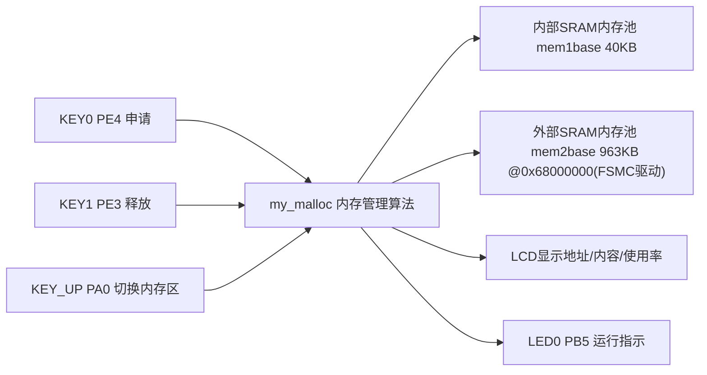
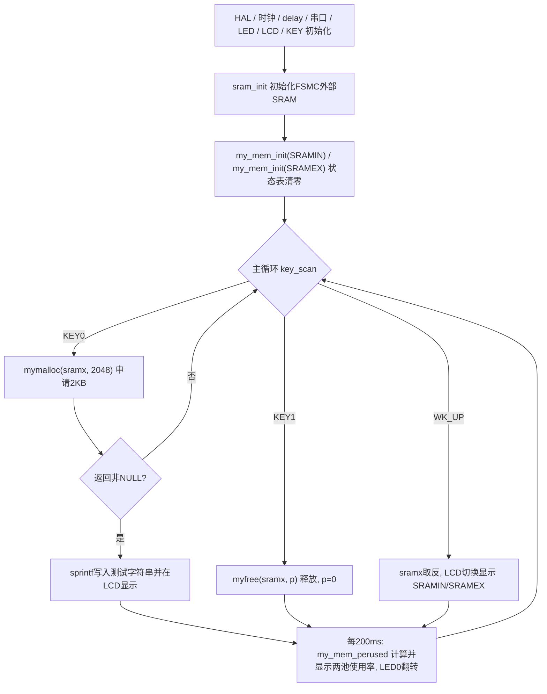

# 实验36 内存管理实验

> 平台：正点原子 STM32F103（战舰/精英/mini）开发板 · HAL 库 · Keil MDK

## 一、实验简介

本实验实现一套**软件内存管理算法**（类似 C 库的 malloc/free），把内存分成**内部 SRAM 池（40KB）**和**外部 SRAM 池（963KB）**两个独立内存池统一管理。按 KEY0 每次申请 2KB 内存并写入字符串，按 KEY1 释放，按 KEY_UP 在两个内存池之间切换，LCD 实时显示两个池的使用率。这是**纯软件实验**，核心是"内存状态表 + 固定块分配"的数据结构，不依赖任何特殊外设。

🏠 **生活类比**：内存池就像一家自助仓储，仓库被隔成一个个 32 字节的小格子（内存块），前台有一张登记表（内存状态表 memmap）：格子空着记 0，被占用就写上"这单占了几个格子"。你要存 2KB 东西，前台从登记表**倒着找**连续 64 个空格子，登记后把钥匙（首地址）给你；你取走东西（free），前台把这几格重新标记为 0，别人又能用了。

## 二、实验目的

- 理解嵌入式系统中**内存池 + 状态表**式内存管理的基本原理
- 掌握固定块大小（32 字节）分配算法：申请（倒序找连续空块）、释放（状态表清零）、重分配
- 学会同时管理**多块内存**（内部 SRAM / FSMC 外扩 SRAM）并按需切换
- 认识标准库 `malloc` 在单片机上的局限（只管内部 RAM、易碎片、不可指定区域），理解自定义内存管理的价值

## 三、硬件资源与连接图

| 外设 | 引脚 | 说明 |
|------|------|------|
| 内部 SRAM 内存池 | — | 64KB 内部 RAM，本驱动管理其中 **40KB**（`mem1base`） |
| 外部 SRAM 内存池 | FSMC（见实验35） | NE3/PG10 片选，基址 `0x68000000`，管理 **963KB**（`mem2base`） |
| KEY0 | **PE4** | 申请 2KB 内存并写入测试字符串 |
| KEY1 | **PE3** | 释放内存 |
| KEY_UP(WK_UP) | **PA0** | 切换操作内存区（SRAMIN ↔ SRAMEX） |
| LED0 (DS0, 红) | **PB5** | 低电平点亮，指示运行 |
| 串口1 | **PA9/PA10** | 板载 CH340，115200 |
| TFTLCD | FSMC 并口 | 16 位 8080 并口 MCU 屏，显示地址/内容/使用率 |



> 说明：本实验的"硬件"只有存储介质本身；外部 SRAM 池依赖实验35 的 FSMC 驱动（`sram_init()`），内存管理算法是纯软件逻辑。

## 四、核心数据结构（纯软件实验，无外设寄存器）

内存管理不操作任何外设寄存器，核心是下面这套**软件数据结构**（`Middlewares/MALLOC/malloc.h`）：

```c
/* 内存管理控制器 */
struct _m_mallco_dev
{
    void (*init)(uint8_t);          /* 初始化 */
    uint16_t (*perused)(uint8_t);   /* 内存使用率 */
    uint8_t *membase[SRAMBANK];     /* 内存池 管理SRAMBANK个区域的内存 */
    MT_TYPE *memmap[SRAMBANK];      /* 内存管理状态表 */
    uint8_t  memrdy[SRAMBANK];      /* 内存管理是否就绪 */
};
```

| 结构/参数 | 作用 |
|--------|------|
| `membase[2]` | 两个内存池首地址：`mem1base`（内部 SRAM，64 字节对齐）、`mem2base`（外部 SRAM，绝对定位到 `0x68000000`） |
| `memmap[2]` | **内存状态表**：每 32 字节块对应一个 `MT_TYPE`（uint16_t）表项；0=空闲，非 0=已占用且值为**本次分配连续占用的块数**（释放时靠它知道要清几格） |
| `memrdy[2]` | 就绪标志，未初始化时自动先调 `init` |
| `MEM1_BLOCK_SIZE=32` / `MEM2_BLOCK_SIZE=32` | 分配粒度：每次最少分配 32 字节，不足 32 字节向上取整 |
| `MEM1_MAX_SIZE=40KB` / `MEM2_MAX_SIZE=963KB` | 池容量。内部池只管理 40KB，**给全局变量/栈等预留空间** |
| `MEM1/2_ALLOC_TABLE_SIZE` | 状态表项数 = MAX_SIZE / BLOCK_SIZE（如内部池 40K/32 = 1280 项） |

分配示意（状态表视角）：申请 2048 字节 = 64 块，倒序扫描状态表找连续 64 个 0，把 64 个表项都写成 64，返回 `offset = 块号 × 32` 换算出的池内绝对地址；释放时读出首块的"64"，把连续 64 项清 0。

## 五、软件架构 / 流程



`mymalloc` 内部流程：`my_mem_malloc` 算出所需块数 `nmemb`（向上取整）→ **从状态表末尾向前**扫描连续空闲块 → 找到则标注块数并返回偏移 → `mymalloc` 把偏移加上 `membase` 得到真实指针；找不到返回 NULL。

## 六、主要示例代码及讲解

### 1. 内存池与状态表的定义（`Middlewares/MALLOC/malloc.c`）

```c
/* 内存池(64字节对齐) */
static __align(64) uint8_t mem1base[MEM1_MAX_SIZE];                                     /* 内部SRAM内存池 */
static __align(64) uint8_t mem2base[MEM2_MAX_SIZE] __attribute__((at(SRAM_BASE_ADDR))); /* 外扩SRAM内存池 */

/* 内存管理表 */
static MT_TYPE mem1mapbase[MEM1_ALLOC_TABLE_SIZE];                                                      /* 内部SRAM内存池MAP */
static MT_TYPE mem2mapbase[MEM2_ALLOC_TABLE_SIZE] __attribute__((at(SRAM_BASE_ADDR + MEM2_MAX_SIZE)));  /* 外扩SRAM内存池MAP */

/* 内存管理控制器 */
struct _m_mallco_dev mallco_dev =
{
    my_mem_init,                    /* 内存初始化 */
    my_mem_perused,                 /* 内存使用率 */
    mem1base, mem2base,             /* 内存池 */
    mem1mapbase, mem2mapbase,       /* 内存管理状态表 */
    0, 0,                           /* 内存管理未就绪 */
};
```

**讲解**：
- 外部内存池 `mem2base` 用 `__attribute__((at(SRAM_BASE_ADDR)))` **绝对定位**到 `0x68000000`（外部 SRAM 起始处），状态表紧随其后放在 `0x680F0C00`——963KB 池之后，互不重叠。
- AC6 编译器不支持 at 表达式，代码改用 `section(".bss.ARM.__at_0X68000000")`，并用 `#if SRAM_BASE_ADDR != 0x68000000 #error` 做防呆检查。
- `mallco_dev` 把函数指针和两个池的基址、状态表、就绪标志打包成"控制器"，`mymalloc(memx, size)` 用 `memx`（0=SRAMIN，1=SRAMEX）索引，实现**一套算法管多块内存**。
- 内存池 64 字节对齐是为了提高访问效率、兼容 DMA 场景。

### 2. 核心分配算法（`malloc.c`）

```c
static uint32_t my_mem_malloc(uint8_t memx, uint32_t size)
{
    signed long offset = 0;
    uint32_t nmemb;                     /* 需要的内存块数 */
    uint32_t cmemb = 0;                 /* 连续空内存块数 */
    uint32_t i;

    if (!mallco_dev.memrdy[memx]) mallco_dev.init(memx);  /* 未初始化,先执行初始化 */
    if (size == 0) return 0XFFFFFFFF;                     /* 不需要分配 */

    nmemb = size / memblksize[memx];    /* 获取需要分配的连续内存块数 */
    if (size % memblksize[memx]) nmemb++;

    for (offset = memtblsize[memx] - 1; offset >= 0; offset--)  /* 搜索整个内存控制区 */
    {
        if (!mallco_dev.memmap[memx][offset])
        {
            cmemb++;                    /* 连续空内存块数增加 */
        }
        else 
        {
            cmemb = 0;                  /* 连续内存块清零 */
        }
        
        if (cmemb == nmemb)             /* 找到了连续nmemb个空内存块 */
        {
            for (i = 0; i < nmemb; i++) /* 标注内存块非空 */
            {
                mallco_dev.memmap[memx][offset + i] = nmemb;
            }

            return (offset * memblksize[memx]); /* 返回偏移地址 */
        }
    }

    return 0XFFFFFFFF;  /* 未找到符合分配条件的内存块 */
}
```

**讲解**：
- 块数计算向上取整：申请 2048 字节 → 2048/32 = 64 块；申请 100 字节 → 4 块（浪费 28 字节，这就是固定块分配的代价——**内部碎片**）。
- **倒序扫描**（从高地址往低地址找）：新分配的内存排在池的高端，低地址区域保持紧凑，减少碎片。
- 找到连续 `nmemb` 个空块后，把每个表项都写成 `nmemb`（占用块数），返回 `块号 × 32` 的**池内偏移**。外层 `mymalloc` 再加上 `membase` 基址，换成真正的指针返回。
- 全程只操作状态表数组，没有任何硬件寄存器——这就是"软件算法管理内存"。

### 3. 释放与使用率（`malloc.c`）

```c
static uint8_t my_mem_free(uint8_t memx, uint32_t offset)
{
    int i;
    ...
    if (offset < memsize[memx])     /* 偏移在内存池内 */
    {
        int index = offset / memblksize[memx];      /* 偏移所在内存块号码 */
        int nmemb = mallco_dev.memmap[memx][index]; /* 内存块数量 */

        for (i = 0; i < nmemb; i++)                 /* 内存块清零 */
        {
            mallco_dev.memmap[memx][index + i] = 0;
        }

        return 0;
    }
    else
    {
        return 2;   /* 偏移超区了. */
    }
}

uint16_t my_mem_perused(uint8_t memx)
{
    uint32_t used = 0;
    uint32_t i;

    for (i = 0; i < memtblsize[memx]; i++)
    {
        if (mallco_dev.memmap[memx][i]) used++;
    }

    return (used * 1000) / (memtblsize[memx]);
}
```

**讲解**：
- 释放时 `myfree` 先算出指针相对池基址的偏移，再由偏移算出块号，**从状态表首项读出当初写入的块数**，把连续这么多个表项清 0 即可——O(块数) 完成释放，无需遍历。
- `my_mem_perused()` 统计非 0 表项比例，返回放大 1000 倍的整数（如 125 表示 12.5%），main 里用 `%d.%01d%%` 格式化显示，避免浮点运算。
- `myrealloc()` = 申请新块 + `my_mem_copy` 拷旧内容 + `myfree` 释放旧块，与标准 realloc 思路一致。

## 七、实验效果

烧录后 LCD 显示 "STM32 / MALLOC TEST / ATOM@ALIENTEK" 及两池使用率（初始 0.0%）：

- 按 **KEY0**：从当前选择的内存池申请 2KB，LCD 显示 `P Addr:0x2000xxxx`（内部池）或 `P Addr:0x680xxxxx`（外部池）及写入的内容 "Memory Malloc Test000"（序号递增）；连续按多次可在不同地址申请多块，对应池**使用率上升**（内部池每次 +5.0%，2048/40960）；
- 按 **KEY1**：释放最近申请的内存，使用率回落；
- 按 **KEY_UP**：LCD 顶部在 " SRAMIN " / " SRAMEX " 间切换，之后的 KEY0/KEY1 操作另一个内存池；
- **LED0 每 200ms 翻转**，使用率每 200ms 刷新一行。

## 八、注意事项

- 本算法**不可重入**（无临界区保护），在中断里调用 `mymalloc/myfree` 可能与主循环冲突，实时系统下需加互斥保护。
- 分配粒度 32 字节，申请小内存（如 1 字节）也会占一整块，存在内部碎片；块大小可在 `malloc.h` 中调整。
- 内部池只管理 **40KB**（`MEM1_MAX_SIZE`），剩余内部 RAM 留给全局变量、栈和编译器使用，**不要把它改大到接近 64KB**，否则程序会因 RAM 溢出链接失败或运行异常。
- 外部池定位依赖 `SRAM_BASE_ADDR`（`0x68000000`）：若修改 FSMC 片选（`SRAM_FSMC_NEX`），AC6 下的 `#error` 防呆检查会强制你同步修改 `malloc.c` 中的绝对地址。
- `myfree` 释放后要把指针置 0（main 中 `p = 0`），防止野指针；本驱动没有检测重复释放，重复 free 会破坏状态表。
- 本例程**仅支持 MCU 屏（16 位 8080 并口），不支持 RGB 屏**；串口助手波特率须为 **115200**，P4 的 PA9/PA10 须跳线帽连接 RXD/TXD。烧录失败先运行根目录 `keilkill.bat`。

## 九、文件结构

```
实验36 内存管理实验/
├── User/
│   ├── main.c              主程序（按键申请/释放/切换内存池）
│   ├── stm32f1xx_it.c      中断服务函数
│   └── stm32f1xx_hal_conf.h HAL配置
├── Middlewares/
│   └── MALLOC/             内存管理算法 ★本实验核心
│       ├── malloc.c        内存池/状态表定义 + 分配/释放/重分配算法
│       └── malloc.h        内存管理控制器结构与池参数
├── Drivers/
│   ├── BSP/
│   │   ├── SRAM/           外部SRAM的FSMC驱动（外部内存池依赖）
│   │   ├── KEY/            按键驱动
│   │   ├── LCD/            LCD显示驱动
│   │   └── LED/            LED驱动
│   ├── SYSTEM/             delay / sys / usart 系统支持
│   ├── USMART/             串口调试组件
│   ├── CMSIS/              内核启动与设备定义
│   └── STM32F1xx_HAL_Driver/ ST HAL 库
└── Projects/MDK-ARM/       Keil 工程文件 (.uvprojx)
```
