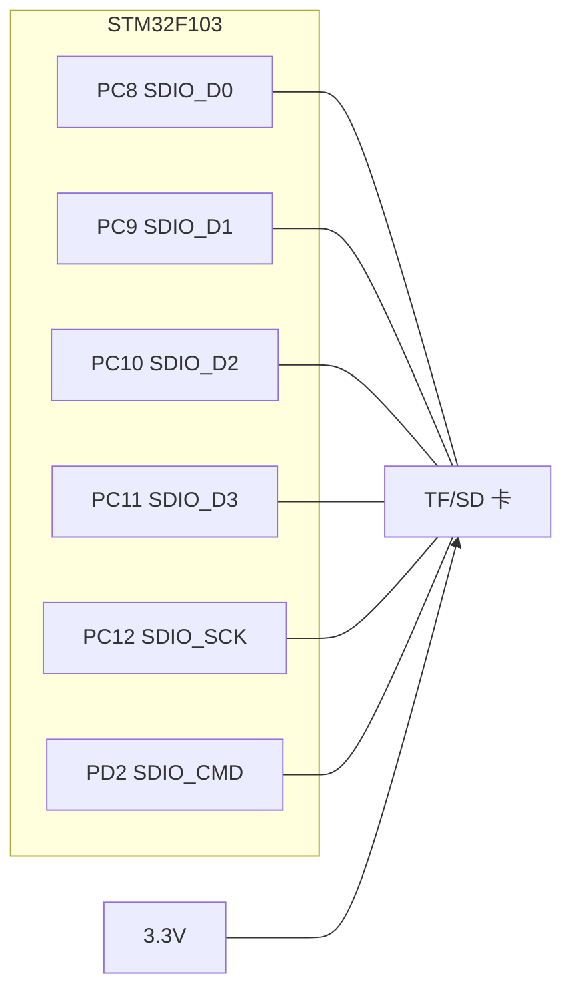
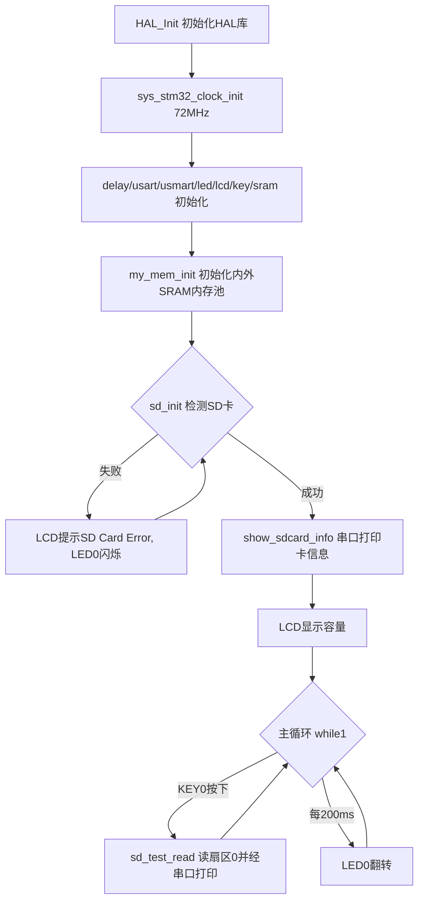

# 实验37 SD卡实验

> 平台：正点原子 STM32F103（战舰）开发板 · HAL 库 · Keil MDK

## 一、实验简介

本实验使用 STM32F103 内置的 **SDIO 外设**驱动一张 TF/SD 卡：上电先初始化 SD 卡，成功后在 LCD 上显示容量、通过串口打印卡的类型/制造商/容量等信息；按下 KEY0 则读取 SD 卡第 0 扇区（512 字节）的内容，经串口发送到电脑。它演示了 MCU 如何用标准总线读写外部大容量存储。

🏠 **生活类比**：SDIO 就像电脑上的"读卡器插槽"。SD 卡是一张 U 盘，MCU 通过一组固定的信号线（时钟、命令、数据）跟卡"对话"——先发命令（比如"报上你的容量"），卡再回应数据。整个过程有严格的时序协议，就像两个人用对讲机按约定口令一问一答。

## 二、实验目的

- 了解 SDIO 总线（1 位/4 位模式）与 SD 卡通信协议
- 掌握用 HAL 库 `HAL_SD_Init` 初始化 SD 卡、`HAL_SD_ReadBlocks`/`WriteBlocks` 读写扇区
- 学会通过 `HAL_SD_GetCardInfo`/`HAL_SD_GetCardCID` 获取卡的类型、容量、制造商等信息
- 理解 SDIO 引脚复用（AF）配置与时钟使能流程

## 三、硬件资源与连接图

SDIO 采用固定引脚（复用功能），不可随意更换：

| 信号 | 引脚 | 说明 |
|------|------|------|
| SDIO_D0 | **PC8** | 数据线 0（1 位模式只用这根） |
| SDIO_D1 | **PC9** | 数据线 1 |
| SDIO_D2 | **PC10** | 数据线 2 |
| SDIO_D3 | **PC11** | 数据线 3 |
| SDIO_SCK | **PC12** | SDIO 时钟 |
| SDIO_CMD | **PD2** | 命令线 |
| LED0 (DS0, 红) | **PB5** | 低电平点亮，指示运行/报错 |
| KEY0 | **PE4** | 按下读取扇区 0 |



> 接线说明：SD 卡通过板载 TF 卡座接到上述 SDIO 引脚。这些引脚都是 SDIO 的**固定复用功能**，必须配置为 `GPIO_MODE_AF_PP`（复用推挽）。

## 四、核心寄存器（SDIO）

SDIO 外设由一组寄存器控制命令/数据的收发，本实验相关的关键寄存器：

| 寄存器 | 名称 | 作用 |
|--------|------|------|
| `SDIO_POWER` | 电源控制寄存器 | POWERCTRL[1:0] 控制卡上电/断电，初始化时置为开启 |
| `SDIO_CLKCR` | 时钟控制寄存器 | CLKDIV 分频、CLKEN 时钟使能、WIDBUS 位宽（1/4 位）、PWRSAV 省电 |
| `SDIO_ARG` | 参数寄存器 | 存放即将发送命令的 32 位参数 |
| `SDIO_CMD` | 命令寄存器 | CMDINDEX 命令号、WAITRESP 应答类型、CPSMEN 启动命令发送 |
| `SDIO_DCTRL` | 数据控制寄存器 | DTEN 数据使能、DTDIR 方向、DTBLKSIZE 块大小、DMAEN |
| `SDIO_STA` | 状态寄存器 | 各类标志位：命令响应、数据结束、超时、FIFO 空/满等 |
| `SDIO_FIFO` | 数据 FIFO | 读写数据的 32 位缓冲窗口 |

命令发送流程（由 HAL 库封装）：

```
写 SDIO_ARG(参数) -> 写 SDIO_CMD(命令号+应答类型+CPSMEN) -> 轮询 SDIO_STA 等响应
数据传输: 配置 SDIO_DCTRL(块大小/方向) -> 通过 SDIO_FIFO 收发 -> 查 STA 的完成/超时标志
```

初始化时时钟不能超过 **400KHz**（识别阶段），识别完成后切到最高 25MHz（传输阶段）。本实验用 `SDIO_BUS_WIDE_1B`（1 位数据线）、上升沿采样、开启硬件流控。

## 五、软件架构 / 流程



## 六、主要示例代码及讲解

### 1. SD 卡初始化（`Drivers/BSP/SDIO/sdio_sdcard.c`）

```c
uint8_t sd_init(void)
{
    uint8_t SD_Error;

    /* 初始化时的时钟不能大于400KHZ */
    g_sdcard_handler.Instance = SDIO;
    g_sdcard_handler.Init.ClockEdge = SDIO_CLOCK_EDGE_RISING;                       /* 上升沿 */
    g_sdcard_handler.Init.ClockBypass = SDIO_CLOCK_BYPASS_DISABLE;                  /* 不分频bypass */
    g_sdcard_handler.Init.ClockPowerSave = SDIO_CLOCK_POWER_SAVE_DISABLE;           /* 空闲不关时钟 */
    g_sdcard_handler.Init.BusWide = SDIO_BUS_WIDE_1B;                               /* 1位数据线 */
    g_sdcard_handler.Init.HardwareFlowControl = SDIO_HARDWARE_FLOW_CONTROL_ENABLE;  /* 开启硬件流控 */
    g_sdcard_handler.Init.ClockDiv = SDIO_TRANSFER_CLK_DIV;                         /* 传输时钟分频 */

    SD_Error = HAL_SD_Init(&g_sdcard_handler);
    if (SD_Error != HAL_OK)
    {
        return 1;
    }
    return 0;
}
```

**讲解**：
- `SD_HandleTypeDef` 是"配置单"，填好时钟边沿、位宽、分频、流控后交给 `HAL_SD_Init()` 一次性写入 SDIO 寄存器并完成卡的识别流程。
- `BusWide = SDIO_BUS_WIDE_1B` 表示只用 D0 一根数据线（4 位模式速度更快，但例程默认注释掉了 `HAL_SD_ConfigWideBusOperation`）。
- 返回 0 表示识别成功，非 0 表示没有卡或初始化失败。

### 2. SDIO 底层引脚初始化（`HAL_SD_MspInit`，被 `HAL_SD_Init` 自动调用）

```c
void HAL_SD_MspInit(SD_HandleTypeDef *hsd)
{
    GPIO_InitTypeDef gpio_init_struct;

    __HAL_RCC_SDIO_CLK_ENABLE();    /* 使能SDIO时钟 */
    SD_D0_GPIO_CLK_ENABLE();        /* 各引脚IO时钟使能 */
    /* ... D1~D3 / CLK / CMD 时钟使能 ... */

    gpio_init_struct.Pin = SD_D0_GPIO_PIN;
    gpio_init_struct.Mode = GPIO_MODE_AF_PP;            /* 推挽复用 */
    gpio_init_struct.Pull = GPIO_PULLUP;                /* 上拉 */
    gpio_init_struct.Speed = GPIO_SPEED_FREQ_HIGH;      /* 高速 */
    HAL_GPIO_Init(SD_D0_GPIO_PORT, &gpio_init_struct);
    /* ... 其余引脚同理 ... */
}
```

**讲解**：SDIO 引脚必须设为 **复用推挽（AF_PP）**，才能把引脚交给 SDIO 外设控制而不是当普通 GPIO。MspInit 是 HAL 的"回调"机制——你调用 `HAL_SD_Init` 时它会自动帮你把时钟和引脚配好。

### 3. 读扇区（`sd_read_disk`）与主循环调用（`User/main.c`）

```c
uint8_t sd_read_disk(uint8_t *pbuf, uint32_t saddr, uint32_t cnt)
{
    uint8_t sta = HAL_OK;
    uint32_t timeout = SD_TIMEOUT;
    long long lsector = saddr;
    __disable_irq();                                                                       /* 关总中断 */
    sta = HAL_SD_ReadBlocks(&g_sdcard_handler, (uint8_t *)pbuf, lsector, cnt, SD_TIMEOUT); /* 读cnt个扇区 */
    while (get_sd_card_state() != SD_TRANSFER_OK)                                          /* 等读完 */
    {
        if (timeout-- == 0) { sta = SD_TRANSFER_BUSY; }
    }
    __enable_irq();
    return sta;
}
```

```c
if (key == KEY0_PRES)   /* KEY0按下了 */
{
    sd_test_read(0, 1); /* 从0扇区读取1*512字节的内容 */
}
```

**讲解**：本例程用 **POLLING（轮询）模式**读写，读写期间必须 `__disable_irq()` 关总中断，防止被打断破坏时序。`sd_test_read` 先 `mymalloc` 申请 `512*cnt` 字节缓冲，读完把每字节以十六进制 `printf` 到串口，最后 `myfree` 释放。

## 七、实验效果

烧录后：
- 若插好 SD 卡，LCD 显示 `SD Card OK` 与容量（MB），串口（115200）打印卡类型、制造商 ID、RCA、容量、块大小等信息；
- 按下 **KEY0**，串口打印第 0 扇区 512 字节的十六进制内容，LCD 提示 `USART1 Send Data Over!`；
- **LED0（红）** 约每 200ms 翻转一次，指示程序运行；若检测不到 SD 卡，LCD 交替显示 `SD Card Error! / Please Check!`，红灯闪烁。

## 八、注意事项

- 电脑端串口助手波特率必须为 **115200**；建议用 XCOM/SSCOM，其它助手可能控制 DTR/RTS 导致 MCU 复位。
- P4 的 PA9/PA10 必须用跳线帽连接到 RXD/TXD（板载 CH340）。
- 开发板 SD 卡座是 **TF 卡**类型，请准备一张 TF 卡。
- 4.3 寸、7 寸屏电流较大，USB 供电可能不足，建议外接 12V 1A 电源。
- 读写为轮询模式，**切勿在读写过程中开中断**；`sd_test_write` 慎用，最好写全 `0xFF` 的扇区，否则可能损坏卡内数据。

## 九、文件结构

```
实验37 SD卡实验/
├── User/
│   └── main.c                 主程序（SD卡信息打印、读扇区测试）
├── Drivers/
│   ├── BSP/
│   │   ├── SDIO/              SD卡驱动 (sdio_sdcard.c / .h)  ★核心
│   │   ├── LCD/               LCD 显示驱动
│   │   ├── KEY/               按键驱动
│   │   ├── LED/               LED 驱动
│   │   └── SRAM/              外部SRAM驱动
│   ├── MALLOC/                内存管理 (mymalloc/myfree)
│   ├── SYSTEM/                delay / sys / usart 系统支持
│   ├── USMART/                USMART 调试组件
│   └── STM32F1xx_HAL_Driver/  ST HAL 库（含 SD 驱动）
└── Projects/MDK-ARM/          Keil 工程文件 (.uvprojx)
```
