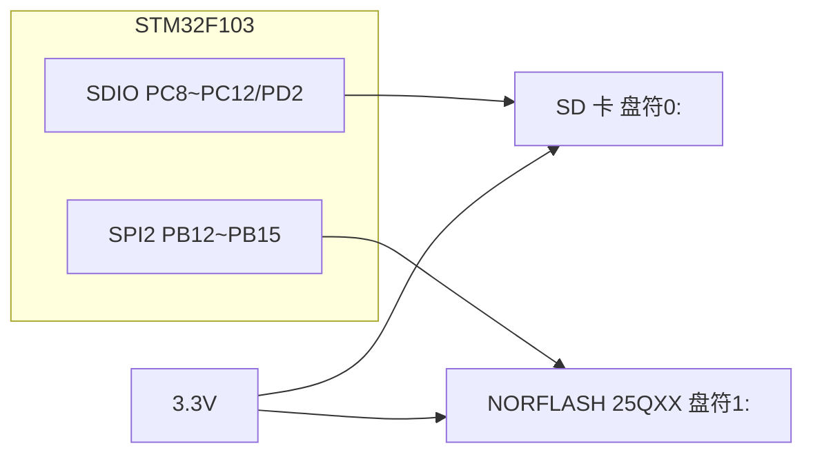
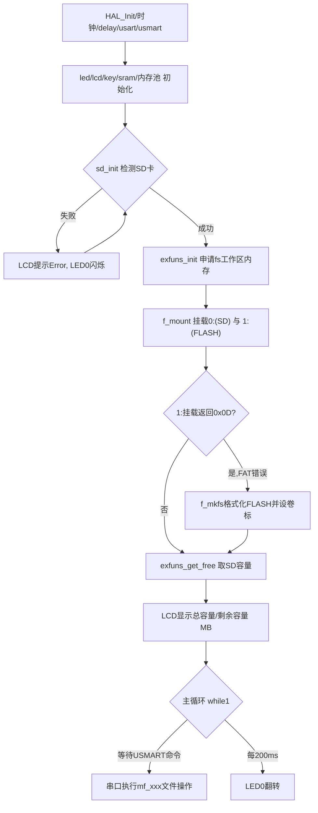

# 实验38 FATFS实验

> 平台：正点原子 STM32F103（战舰）开发板 · HAL 库 · Keil MDK

## 一、实验简介

本实验移植 **FatFs 文件系统**，把它同时挂到两个存储设备上：SD 卡（盘符 `0:`）和外部 SPI NORFLASH 25QXX（盘符 `1:`）。开机初始化 SD 卡后注册两个工作区，获取并在 LCD 上显示 SD 卡的总容量与剩余空间，之后通过 USMART 在串口输入命令即可完成**创建、打开、读、写、删除文件、建目录、格式化**等操作。它让你像操作电脑上的文件一样操作单片机的外部存储。

🏠 **生活类比**：FatFs 就是"文件管家"。SD 卡和 FLASH 好比两个仓库（毛坯房），里面只是一格格原始扇区（货架）。FatFs 给仓库装上"目录、文件名、文件夹"这套管理系统，你只要说"打开 0:/test.txt 写点东西"，管家就自动帮你找到对应的货架并存放，不用关心数据具体落在哪个扇区。

## 二、实验目的

- 理解 FatFs 的分层结构（应用层 → FatFs 核心 ff.c → 磁盘 IO 层 diskio.c → 物理驱动）
- 掌握 `f_mount` 挂载、`f_open/f_read/f_write/f_close` 文件读写、`f_mkdir/f_unlink` 目录与删除
- 学会用 `f_getfree` 获取磁盘容量、`f_mkfs` 格式化磁盘
- 掌握把不同物理设备（SDIO、SPI FLASH）通过 diskio 映射到不同盘符的方法

## 三、硬件资源与连接图

| 外设 | 引脚 | 说明 |
|------|------|------|
| SDIO_D0~D3 | **PC8~PC11** | SD 卡数据线（盘符 `0:`） |
| SDIO_SCK | **PC12** | SD 卡时钟 |
| SDIO_CMD | **PD2** | SD 卡命令线 |
| SPI2_SCK | **PB13** | NORFLASH 时钟（盘符 `1:`） |
| SPI2_MISO | **PB14** | NORFLASH 数据输入 |
| SPI2_MOSI | **PB15** | NORFLASH 数据输出 |
| NORFLASH_CS | **PB12** | NORFLASH 片选 |
| LED0 (DS0, 红) | **PB5** | 低电平点亮，指示运行 |



> 接线说明：FatFs 是纯软件层，本身不接引脚；它通过 diskio.c 把 `0:` 盘映射到 SDIO 驱动的 `sd_read_disk/sd_write_disk`，把 `1:` 盘映射到 SPI FLASH 的 `norflash_read/norflash_write`。

## 四、核心软件模块与数据结构

FatFs 是**软件文件系统**，无专用硬件寄存器。它的关键在于数据结构与分层，底层再调用 SDIO/FLASH 驱动：

| 结构体 / 类型 | 作用 |
|--------------|------|
| `FATFS` | 一个逻辑磁盘（卷）的工作区，保存文件系统参数，`f_mount` 时绑定盘符 |
| `FIL` | 已打开的文件对象，保存文件指针、大小、状态，读写都基于它 |
| `DIR` | 目录对象，用于 `f_opendir/f_readdir` 遍历目录 |
| `FILINFO` | 文件信息（名字、大小、时间等），遍历目录时填充 |

| 软件层 | 文件 | 职责 |
|--------|------|------|
| 应用/扩展层 | `exfuns.c` / `fattester.c` | 封装测试函数（`mf_open/mf_read/mf_write` 等）、申请工作区内存 |
| FatFs 核心 | `ff.c` | 实现 FAT12/16/32/exFAT 协议、`f_open/f_read/f_write` 等 API |
| 磁盘 IO 层 | `diskio.c` | 把 FatFs 的通用读写请求按盘符转发给具体物理驱动 |
| 物理驱动 | `sdio_sdcard.c` / `norflash.c` | 真正操作 SDIO 寄存器、SPI FLASH 芯片 |

diskio 中的盘符映射（`Middlewares/FATFS/source/diskio.c`）：

```
#define SD_CARD     0   /* SD卡,卷标为0 */
#define EX_FLASH    1   /* 外部spi flash,卷标为1 */
```

底层 SDIO 寄存器（识别/传输命令）见《实验37 SD卡实验》第四节；FLASH 侧则通过 SPI 命令（读 0x03、写 0x02、扇区擦除 0x20 等）访问。

## 五、软件架构 / 流程



## 六、主要示例代码及讲解

### 1. 挂载文件系统（`User/main.c`）

```c
exfuns_init();                 /* 为fatfs相关变量申请内存 */
f_mount(fs[0], "0:", 1);       /* 挂载SD卡 */
res = f_mount(fs[1], "1:", 1); /* 挂载FLASH */

if (res == 0X0D)               /* FLASH磁盘,FAT文件系统错误,重新格式化FLASH */
{
    res = f_mkfs("1:", 0, 0, FF_MAX_SS);   /* 格式化FLASH */
    if (res == 0)
    {
        f_setlabel((const TCHAR *)"1:ALIENTEK");  /* 设置卷标为ALIENTEK */
    }
}
```

**讲解**：
- 调用任何 FatFs 函数前必须先用 `exfuns_init()` 给每个卷的 `FATFS` 工作区申请内存。
- `f_mount(fs, "盘符:", 1)` 把工作区绑定到盘符，第三个参数 1 表示立即挂载（尝试读取文件系统信息）。
- FLASH 首次使用时没有有效 FAT 结构，`f_mount` 返回 `0x0D`（FR_NO_FILESYSTEM），于是用 `f_mkfs` 格式化并 `f_setlabel` 起个卷标名。

### 2. 磁盘 IO 转发（`Middlewares/FATFS/source/diskio.c`）

```c
DRESULT disk_read (BYTE pdrv, BYTE *buff, LBA_t sector, UINT count)
{
    DRESULT res = RES_OK;
    switch (pdrv)
    {
        case SD_CARD:       /* SD卡 */
            res = sd_read_disk(buff, sector, count);
            if (res != 2) sd_init();            /* 出错则重新初始化再读 */
            break;

        case EX_FLASH:      /* 外部flash */
            while (count--)
            {
                norflash_read(buff, SPI_FLASH_FATFS_BASE + sector * SPI_FLASH_SECTOR_SIZE,
                              SPI_FLASH_SECTOR_SIZE);
                buff += SPI_FLASH_SECTOR_SIZE;
                sector++;
            }
            break;
    }
    return res;
}
```

**讲解**：这是 FatFs 与硬件之间的"翻译层"。FatFs 只说"读第 N 号扇区"，diskio 根据盘符 `pdrv` 决定是调用 SDIO 驱动还是 FLASH 驱动，并把扇区号换算成物理地址。要接入新存储设备，只需在这里加一个 `case`。

### 3. 文件读写封装（`Middlewares/FATFS/exfuns/fattester.c`）

```c
uint8_t mf_open(uint8_t *path, uint8_t mode)
{
    return f_open(fattester.file, (const TCHAR *)path, mode);   /* 打开文件 */
}

uint8_t mf_write(uint8_t *pdata, uint16_t len)
{
    uint32_t bw = 0;
    res = f_write(fattester.file, pdata, len, &bw);             /* 写入 */
    printf("Writed data len:%d\r\n", bw);
    return res;
}

uint8_t mf_read(uint16_t len)
{
    uint32_t br = 0;
    res = f_read(fattester.file, fattester.fatbuf, 512, &br);   /* 每次读512字节 */
    for (t = 0; t < br; t++) printf("%c", fattester.fatbuf[t]); /* 打印到串口 */
    return res;
}
```

**讲解**：`fattester` 把常用的文件操作封装成一组 `mf_xxx` 函数并注册到 USMART，你在串口助手里就能像敲命令一样测试。`f_open` 的 mode 支持 `FA_READ`/`FA_WRITE`/`FA_CREATE_ALWAYS` 等；`f_write/f_read` 通过 `bw/br` 返回实际写入/读出的字节数。

## 七、实验效果

烧录后（需插 SD 卡）：
- LCD 显示 `FATFS OK!`、SD 卡总容量与剩余容量（MB）；
- 若 FLASH 无文件系统会自动格式化并设卷标 `ALIENTEK`；
- 通过串口 + USMART 可执行 `mf_open/mf_write/mf_read/mf_mkdir/mf_unlink/mf_fmkfs` 等命令，实现文件与目录的增删改查；
- **LED0（红）** 约每 200ms 翻转，指示程序运行；检测不到 SD 卡时 LCD 提示 `SD Card Error!` 且红灯闪烁。

## 八、注意事项

- 电脑端串口助手波特率 **115200**，建议用 XCOM/SSCOM，其它助手可能因 DTR/RTS 导致 MCU 复位。
- P4 的 PA9/PA10 必须用跳线帽连接到 RXD/TXD。
- 需要准备一张 SD 卡；FLASH 侧例程规定前 **12MB** 给 FatFs 使用。
- 写 FLASH 前必须先擦除（NOR FLASH 只能 1→0 写，0→1 需整扇区擦除），diskio/norflash 驱动内部已处理，勿随意改动扇区大小定义。
- 4.3 寸、7 寸屏电流较大，建议外接 12V 1A 电源。

## 九、文件结构

```
实验38 FATFS实验/
├── User/
│   └── main.c                     主程序（挂载、格式化、显示容量）
├── Middlewares/
│   ├── FATFS/
│   │   ├── source/                FatFs 核心 (ff.c / diskio.c / ffconf.h) ★
│   │   └── exfuns/                扩展封装 (exfuns.c / fattester.c) ★
│   ├── MALLOC/                    内存管理
│   └── USMART/                    USMART 调试组件（串口命令）
├── Drivers/
│   ├── BSP/
│   │   ├── SDIO/                  SD 卡驱动（盘符0:）★
│   │   ├── NORFLASH/              SPI FLASH 25QXX 驱动（盘符1:）★
│   │   ├── SPI/                   SPI2 驱动
│   │   ├── LCD/ KEY/ LED/ SRAM/   显示/按键/灯/外扩SRAM
│   └── STM32F1xx_HAL_Driver/      ST HAL 库
└── Projects/MDK-ARM/              Keil 工程文件 (.uvprojx)
```
