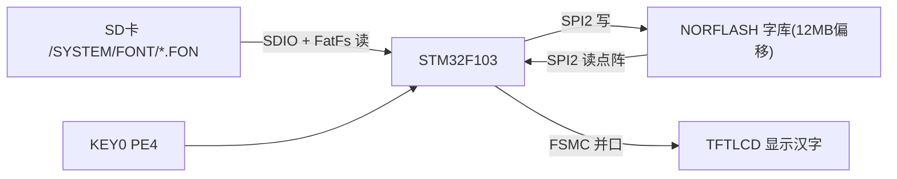
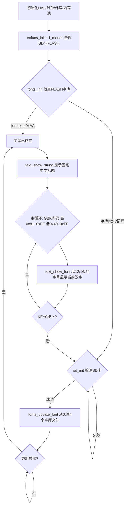

# 实验39 汉字显示实验

> 平台：正点原子 STM32F103（战舰）开发板 · HAL 库 · Keil MDK

## 一、实验简介

本实验在 LCD 上显示**汉字**。汉字不像英文字符那样可以用几十字节的 ASCII 点阵搞定，它数量庞大，必须借助外部"字库"。程序开机先检查外部 NORFLASH 中是否已存有字库：有则直接显示；没有就从 SD 卡的 `/SYSTEM/FONT/` 目录读取 `UNIGBK.BIN`、`GBK12/16/24.FON` 四个文件，写入 FLASH 完成字库更新。之后按 GBK 内码从 0x8140 开始循环，逐个取出汉字点阵，以 12/16/24 三种字号显示在 LCD 上，按 KEY0 可强制重新更新字库。

🏠 **生活类比**：字库就像一本"新华字典"。FLASH 是存放字典的书架，SD 卡是买来新书（字库文件）的书店。要显示某个汉字时，程序按这个字的"内码"（相当于字典的页码/部首索引）快速翻到对应那一页，取出它的"点阵图案"（哪个点该亮），再一点点画到屏幕上。

## 二、实验目的

- 理解汉字 GBK 编码（双字节内码）与点阵字库的存储原理
- 掌握把字库文件从 SD 卡经 FatFs 更新写入 NORFLASH 的方法
- 学会根据 GBK 内码计算点阵在字库中的偏移地址
- 掌握 `text_show_font` / `text_show_string` 在 LCD 上逐点绘制汉字

## 三、硬件资源与连接图

| 外设 | 引脚 | 说明 |
|------|------|------|
| SDIO_D0~D3 | **PC8~PC11** | SD 卡数据线（存放字库源文件） |
| SDIO_SCK | **PC12** | SD 卡时钟 |
| SDIO_CMD | **PD2** | SD 卡命令线 |
| SPI2_SCK/MISO/MOSI | **PB13/PB14/PB15** | NORFLASH（存放字库）SPI 总线 |
| NORFLASH_CS | **PB12** | NORFLASH 片选 |
| TFTLCD | FSMC 并口 | 16 位 8080 并口，显示汉字 |
| KEY0 | **PE4** | 强制更新字库 |
| LED0 (DS0, 红) | **PB5** | 指示运行 |



> 接线说明：字库数据流是"SD 卡 → FLASH → LCD"。FLASH 中从 **12MB** 偏移（`FONTINFOADDR`）开始存放字库信息与四个字库文件，这段区域不能被其它数据占用。

## 四、核心数据结构与字库布局

本实验核心是**软件字库管理 + LCD 接口**，无专用寄存器。关键是字库信息结构体与地址布局：

`_font_info`（保存于 FLASH 的 `FONTINFOADDR` 处，`Middlewares/TEXT/fonts.h`）：

| 成员 | 作用 |
|------|------|
| `fontok` | 字库存在标志，等于 `0xAA` 表示字库正常，否则需更新 |
| `ugbkaddr` / `ugbksize` | UNIGBK 转换码表的地址与大小 |
| `f12addr` / `gbk12size` | 12×12 点阵字库地址与大小 |
| `f16addr` / `gbk16size` | 16×16 点阵字库地址与大小 |
| `f24addr` / `gbk24size` | 24×24 点阵字库地址与大小 |

FLASH 字库布局（从 12MB 起，`fonts.c`）：

```
FONTINFOADDR(12MB) : ftinfo 信息头
  -> UNIGBK.BIN    : Unicode→GBK 转换码表
  -> GBK12.FON     : 12x12 点阵
  -> GBK16.FON     : 16x16 点阵
  -> GBK24.FON     : 24x24 点阵
```

LCD 侧则通过 FSMC 并口把点阵数据写成像素：`lcd_draw_point(x,y,color)` 逐点着色。GBK 内码为双字节，高字节范围 0x81~0xFE，低字节范围 0x40~0x7E、0x80~0xFE。

## 五、软件架构 / 流程



## 六、主要示例代码及讲解

### 1. 由 GBK 内码计算点阵偏移并读取（`Middlewares/TEXT/text.c`）

```c
static void text_get_hz_mat(unsigned char *code, unsigned char *mat, uint8_t size)
{
    unsigned char qh, ql;
    unsigned long foffset;
    uint8_t csize = (size / 8 + ((size % 8) ? 1 : 0)) * (size); /* 一个字点阵占用字节数 */
    qh = *code;          /* 内码高字节 */
    ql = *(++code);      /* 内码低字节 */

    if (qh < 0x81 || ql < 0x40 || ql == 0xff || qh == 0xff)     /* 非常用汉字 */
    {
        for (i = 0; i < csize; i++) *mat++ = 0x00;              /* 填空 */
        return;
    }

    if (ql < 0x7f) ql -= 0x40;   /* 低字节索引换算(注意跳过0x7F) */
    else           ql -= 0x41;
    qh -= 0x81;

    foffset = ((unsigned long)190 * qh + ql) * csize;  /* 字库中的字节偏移量 */

    switch (size)
    {
        case 12: norflash_read(mat, foffset + ftinfo.f12addr, csize); break;
        case 16: norflash_read(mat, foffset + ftinfo.f16addr, csize); break;
        case 24: norflash_read(mat, foffset + ftinfo.f24addr, csize); break;
    }
}
```

**讲解**：
- 每个 GBK 汉字用两个字节（高字节 qh、低字节 ql）表示。字库按内码顺序线性排列，每行 190 个字，所以偏移 = `(190*qh + ql) * 每个字的点阵字节数`。
- `csize` 计算一个字点阵占多少字节：16×16 字为 `(16/8)*16 = 32` 字节。
- 最后用 `norflash_read` 从 FLASH 对应字库区把点阵读到 `mat`。

### 2. 逐点绘制一个汉字（`text_show_font`）

```c
void text_show_font(uint16_t x, uint16_t y, uint8_t *font, uint8_t size, uint8_t mode, uint16_t color)
{
    uint8_t *dzk = mymalloc(SRAMIN, size);      /* 申请点阵缓存 */
    text_get_hz_mat(font, dzk, size);           /* 取点阵数据 */

    for (t = 0; t < csize; t++)
    {
        temp = dzk[t];
        for (t1 = 0; t1 < 8; t1++)
        {
            if (temp & 0x80)  lcd_draw_point(x, y, color);          /* 该点要显示 */
            else if (mode == 0) lcd_draw_point(x, y, g_back_color); /* 否则填背景色 */
            temp <<= 1;
            y++;
            if ((y - y0) == size) { y = y0; x++; break; }           /* 换列 */
        }
    }
    myfree(SRAMIN, dzk);
}
```

**讲解**：点阵每字节 8 位对应 8 个像素点，最高位 `0x80` 为 1 表示该点要显示。程序逐位判断、逐点调用 `lcd_draw_point` 画出，画完一列（size 个像素）后 x++ 换下一列。`mode=0` 会把不显示的点填背景色（可覆盖旧内容），`mode=1` 为叠加显示。

### 3. 主循环遍历 GBK 内码（`User/main.c`）

```c
for (i = 0x81; i < 0xff; i++)       /* GBK内码高字节范围 0X81~0XFE */
{
    fontx[0] = i;
    for (j = 0x40; j < 0xfe; j++)   /* 低字节范围 0X40~0X7E, 0X80~0XFE */
    {
        if (j == 0x7f) continue;    /* 跳过0x7F */
        fontx[1] = j;
        text_show_font(30 + 132, 180, fontx, 24, 0, BLUE);  /* 24字号 */
        text_show_font(30 + 144, 204, fontx, 16, 0, BLUE);  /* 16字号 */
        text_show_font(30 + 108, 220, fontx, 12, 0, BLUE);  /* 12字号 */
        /* 延时期间扫描按键, KEY0则goto UPD强制更新字库 */
    }
}
```

**讲解**：双重循环遍历所有合法 GBK 内码组合，`fontx[2]` 保存双字节内码，分别以三种字号显示同一个汉字。延时循环里持续扫描按键，一旦按下 KEY0 就跳回 `UPD` 标签重新走"检测 SD → 更新字库"流程。

## 七、实验效果

烧录后（首次需插含字库文件的 SD 卡）：
- 若 FLASH 无字库，LCD 依次提示 `SD Card OK` → `Font Updating...` → `Font Update Success!`，把字库写入 FLASH；
- 顶部显示"正点原子STM32开发板""GBK字库测试程序"等中文标题；
- 主循环从内码 0x8140 起逐个显示汉字，同时以 **24/16/12** 三种字号呈现，并显示当前内码高/低字节与汉字计数器；
- 按 **KEY0** 可强制重新更新字库；**LED0** 在遍历过程中不断翻转。

## 八、注意事项

- 首次运行必须在 SD 卡根目录建 `SYSTEM/FONT/` 文件夹，并放入 `UNIGBK.BIN`、`GBK12.FON`、`GBK16.FON`、`GBK24.FON`（获取方法见开发指南）。
- FLASH 中 **12MB 之后**约 3MB 区域固定给字库使用，勿作它用，否则会破坏字库。
- 字库更新会擦写 FLASH，耗时较长，属正常现象；更新过程中勿断电。
- 串口助手波特率 **115200**，建议用 XCOM/SSCOM；P4 的 PA9/PA10 需用跳线帽连到 RXD/TXD。
- 4.3/7 寸屏电流大，建议外接 12V 1A 电源。

## 九、文件结构

```
实验39 汉字显示实验/
├── User/
│   └── main.c                 主程序（字库检查/更新、遍历GBK内码显示汉字）
├── Middlewares/
│   ├── TEXT/                  汉字显示核心 ★
│   │   ├── text.c / text.h    取点阵、显示汉字/字符串
│   │   └── fonts.c / fonts.h  字库信息结构体、字库更新与初始化
│   ├── FATFS/                 FatFs（从SD卡读字库文件）
│   ├── MALLOC/                内存管理
│   └── USMART/                USMART 调试组件
├── Drivers/
│   ├── BSP/
│   │   ├── LCD/               TFTLCD 显示驱动 (lcd.c / lcdfont.h)
│   │   ├── NORFLASH/          SPI FLASH 25QXX（存字库）★
│   │   ├── SDIO/              SD 卡驱动
│   │   ├── SPI/ KEY/ LED/ SRAM/
│   └── STM32F1xx_HAL_Driver/  ST HAL 库
└── Projects/MDK-ARM/          Keil 工程文件 (.uvprojx)
```
