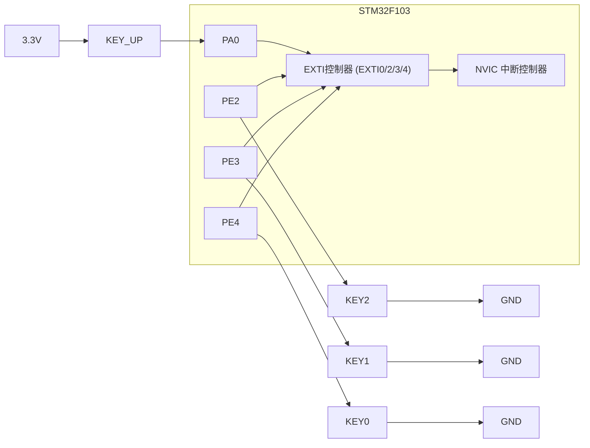
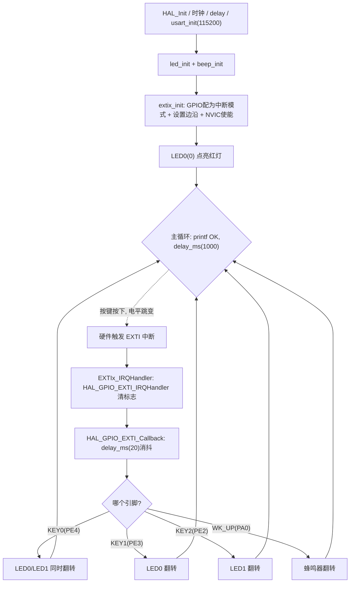

# 实验4 外部中断实验

> 平台：正点原子 STM32F103（战舰/精英/mini）开发板 · HAL 库 · Keil MDK

## 一、实验简介

本实验把实验3 的"轮询按键"升级为"**中断按键**"：4 个按键接到 STM32 的 4 条外部中断线（EXTI0/2/3/4）上，平时 CPU 在主循环里打印 "OK"，一旦有按键按下，硬件立刻产生中断，CPU 暂停当前工作跳去执行中断服务函数，翻转 LED / 蜂鸣器后再返回。

🏠 **生活类比**：轮询像你每隔一分钟跑去门口看有没有快递；中断则像装了**门铃**——你安心做自己的事，快递员一按铃（电平跳变），你马上去开门（执行中断服务函数）。门铃比跑断腿高效得多，这就是中断"事件驱动"的优势。

## 二、实验目的

- 理解中断的基本概念：触发条件、中断线、NVIC 优先级、中断服务函数
- 掌握 STM32 外部中断 EXTI 的配置方法（GPIO → EXTI 线映射、触发边沿）
- 学会用 HAL 的 `HAL_GPIO_EXTI_IRQHandler()` + `HAL_GPIO_EXTI_Callback()` 框架
- 掌握 `HAL_NVIC_SetPriority()` / `HAL_NVIC_EnableIRQ()` 设置并使能中断
- 理解中断方式下按键消抖的处理位置

## 三、硬件资源与连接图

| 按键 | 引脚 | EXTI 中断线 | 触发方式 | 中断服务函数 |
|------|------|-------------|----------|--------------|
| KEY_UP (WK_UP) | **PA0** | EXTI0（EXTI0_IRQn） | 上升沿 | `EXTI0_IRQHandler` |
| KEY2 | **PE2** | EXTI2（EXTI2_IRQn） | 下降沿 | `EXTI2_IRQHandler` |
| KEY1 | **PE3** | EXTI3（EXTI3_IRQn） | 下降沿 | `EXTI3_IRQHandler` |
| KEY0 | **PE4** | EXTI4（EXTI4_IRQn） | 下降沿 | `EXTI4_IRQHandler` |

其他资源：LED0 - PB5、LED1 - PE5、蜂鸣器 - PB8、串口1 - PA9/PA10（115200 打印提示）。



> 接线说明：引脚信号经 AFIO 映射到对应编号的 EXTI 线（PA0→EXTI0、PE2→EXTI2……），EXTI 检测到设定边沿后置位中断标志，NVIC 通知 CPU 跳转到对应中断向量。注意：**同编号引脚（如 PA0/PE0）只能有一条接入 EXTI0**。

## 四、核心寄存器（EXTI / AFIO / NVIC）

| 寄存器 | 名称 | 作用 |
|--------|------|------|
| `RCC_APB2ENR` | APB2 时钟使能寄存器 | 使能 GPIOA/GPIOE 时钟及 **AFIOEN**（复用功能时钟，EXTI 映射必须开） |
| `AFIO_EXTICR1~4` | 外部中断配置寄存器 | 选择每条 EXTI 线由哪个 GPIO 端口提供信号（如 EXTI4 选 PE） |
| `EXTI_IMR` | 中断屏蔽寄存器 | 对应位写 1 = 放开该中断线的中断请求 |
| `EXTI_RTSR` | 上升沿触发选择寄存器 | 写 1 = 该线上升沿触发（WK_UP 用） |
| `EXTI_FTSR` | 下降沿触发选择寄存器 | 写 1 = 该线下降沿触发（KEY0/1/2 用） |
| `EXTI_PR` | 挂起（标志）寄存器 | 中断发生后对应位置 1，**写 1 清零**；不清会反复进中断 |
| `NVIC_ISERx` | 中断使能寄存器 | 使能 EXTI0/2/3/4 对应的中断通道 |
| `NVIC_IPRx` | 中断优先级寄存器 | 设置抢占优先级/子优先级（本实验 4 条线抢占优先级 0~3 递减） |

F1 系列通过 **AFIO_EXTICR** 完成"GPIO 端口 → EXTI 线"的选择；EXTI0~4 每条线有独立中断向量，EXTI5~9、EXTI10~15 则共享向量。HAL 的 `HAL_GPIO_Init()`（Mode=`GPIO_MODE_IT_xxx`）会自动完成上述寄存器配置。

## 五、软件架构 / 流程



## 六、主要示例代码及讲解

### 1. 外部中断初始化（`Drivers/BSP/EXTI/exti.c`，节选）

```c
void extix_init(void)
{
    GPIO_InitTypeDef gpio_init_struct;

    KEY0_GPIO_CLK_ENABLE();                                  /* KEY0时钟使能 */
    KEY1_GPIO_CLK_ENABLE();                                  /* KEY1时钟使能 */
    KEY2_GPIO_CLK_ENABLE();                                  /* KEY2时钟使能 */
    WKUP_GPIO_CLK_ENABLE();                                  /* WKUP时钟使能 */

    gpio_init_struct.Pin = KEY0_INT_GPIO_PIN;
    gpio_init_struct.Mode = GPIO_MODE_IT_FALLING;            /* 下降沿触发 */
    gpio_init_struct.Pull = GPIO_PULLUP;
    HAL_GPIO_Init(KEY0_INT_GPIO_PORT, &gpio_init_struct);    /* KEY0配置为下降沿触发中断 */

    /* KEY1、KEY2 配置同上(略) */

    gpio_init_struct.Pin = WKUP_INT_GPIO_PIN;
    gpio_init_struct.Mode = GPIO_MODE_IT_RISING;             /* 上升沿触发 */
    gpio_init_struct.Pull = GPIO_PULLDOWN;
    HAL_GPIO_Init(WKUP_GPIO_PORT, &gpio_init_struct);

    HAL_NVIC_SetPriority(KEY0_INT_IRQn, 0, 2);               /* 抢占0，子优先级2 */
    HAL_NVIC_EnableIRQ(KEY0_INT_IRQn);                       /* 使能中断线1 */

    HAL_NVIC_SetPriority(KEY1_INT_IRQn, 1, 2);               /* 抢占1，子优先级2 */
    HAL_NVIC_EnableIRQ(KEY1_INT_IRQn);

    HAL_NVIC_SetPriority(KEY2_INT_IRQn, 2, 2);               /* 抢占2，子优先级2 */
    HAL_NVIC_EnableIRQ(KEY2_INT_IRQn);

    HAL_NVIC_SetPriority(WKUP_INT_IRQn, 3, 2);               /* 抢占3，子优先级2 */
    HAL_NVIC_EnableIRQ(WKUP_INT_IRQn);                       /* 使能中断线0 */
}
```

**讲解**：
- `GPIO_MODE_IT_FALLING` / `GPIO_MODE_IT_RISING` 让 `HAL_GPIO_Init()` 一次完成：GPIO 输入配置 + AFIO 映射 + EXTI 触发边沿 + 屏蔽寄存器设置。
- KEY0/1/2 接地，按下产生**下降沿**，配上拉；WK_UP 接 3.3V，按下产生**上升沿**，配下拉——边沿选择必须与按键接法一致。
- `HAL_NVIC_SetPriority(IRQn, 抢占, 子)` 设定优先级：抢占优先级数字越小越高，高抢占优先级中断可打断低抢占优先级中断（本实验 KEY0 的 0 最高，WK_UP 的 3 最低）。
- 只设置优先级不 `HAL_NVIC_EnableIRQ()` 使能，中断永远不会被响应，两步缺一不可。

### 2. 中断服务函数（`Drivers/BSP/EXTI/exti.c`，节选）

```c
void KEY0_INT_IRQHandler(void)        /* 即 EXTI4_IRQHandler */
{
    HAL_GPIO_EXTI_IRQHandler(KEY0_INT_GPIO_PIN);   /* 调用中断处理公用函数 清除KEY0所在中断线的中断标志位 */
    __HAL_GPIO_EXTI_CLEAR_IT(KEY0_INT_GPIO_PIN);   /* 退出时再清一次中断，避免按键抖动误触发 */
}
```

**讲解**：
- `KEY0_INT_IRQHandler` 在 `exti.h` 中被宏定义为 `EXTI4_IRQHandler`，即启动文件向量表里的中断入口名，编译后自动"对接"。
- `HAL_GPIO_EXTI_IRQHandler()` 做两件事：清 `EXTI_PR` 标志 + 调用回调函数 `HAL_GPIO_EXTI_Callback()`。
- 退出前再清一次标志，可以抹掉按键抖动产生的第二个边沿，防止一次按键触发多次中断。

### 3. 中断回调——真正的按键处理（`Drivers/BSP/EXTI/exti.c`）

```c
void HAL_GPIO_EXTI_Callback(uint16_t GPIO_Pin)
{
    delay_ms(20);      /* 消抖 */
    switch(GPIO_Pin)
    {
        case KEY0_INT_GPIO_PIN:
            if (KEY0 == 0)
            {
                LED0_TOGGLE();  /* LED0 状态取反 */
                LED1_TOGGLE();  /* LED1 状态取反 */
            }
            break;
        case KEY1_INT_GPIO_PIN:
            if (KEY1 == 0)
            {
                LED0_TOGGLE();  /* LED0 状态取反 */
            }
            break;
        case KEY2_INT_GPIO_PIN:
            if (KEY2 == 0)
            {
                LED1_TOGGLE();  /* LED1 状态取反 */
            }
            break;
        case WKUP_INT_GPIO_PIN:
            if (WK_UP == 1)
            {
                BEEP_TOGGLE();  /* 蜂鸣器状态取反 */
            }
            break;
    }
}
```

**讲解**：
- HAL 把所有 EXTI 的"下半部处理"统一交给这个回调，按 `GPIO_Pin` 区分是哪个按键。
- 进入后先 `delay_ms(20)` 消抖，再**重读一次电平确认**按键确实处于按下状态，双保险防误触发。
- 一般原则：中断服务函数要**短小快**，耗时工作尽量放主循环；这里的消抖延时是教学演示用法，工程中常用定时器消抖。

## 七、实验效果

烧录程序后，LED0 点亮，串口每秒打印一次 "OK"。按下按键：

- **KEY_UP**：蜂鸣器翻转（响/停切换）
- **KEY1**：LED0 翻转
- **KEY2**：LED1 翻转
- **KEY0**：LED0 / LED1 同时翻转

## 八、注意事项

- 同编号的引脚共用一条 EXTI 线（如 PA0 与 PE0 都对应 EXTI0），**不能同时**把两个同编号引脚配为外部中断。
- 中断标志必须清除（`HAL_GPIO_EXTI_IRQHandler` 已完成），否则退出中断后会立刻再次进入，表现为"按一次翻转无数次"。
- 触发边沿要与按键接法匹配：接地按键用下降沿 + 上拉，接电源按键用上升沿 + 下拉。
- NVIC 优先级分组由 `HAL_Init()` 默认设为组4（4 位全为抢占优先级），设置优先级时注意取值范围。
- 中断内使用 `delay_ms` / `printf` 等耗时函数仅用于教学演示，实际项目应尽量精简中断服务函数。
- 修改代码后需重新编译并烧录；若烧录失败先运行根目录 `keilkill.bat` 结束占用进程。

## 九、文件结构

```
实验4 外部中断实验/
├── User/
│   ├── main.c                  主程序(初始化+主循环打印OK)
│   ├── stm32f1xx_it.c          系统中断服务函数
│   └── stm32f1xx_hal_conf.h    HAL配置
├── Drivers/
│   ├── BSP/
│   │   ├── EXTI/               外部中断驱动 (exti.c / exti.h)
│   │   ├── KEY/                按键引脚定义与读取宏 (key.c / key.h)
│   │   ├── LED/                LED驱动 (led.c / led.h)
│   │   └── BEEP/               蜂鸣器驱动 (beep.c / beep.h)
│   ├── SYSTEM/                 delay / sys / usart 系统支持
│   ├── CMSIS/                  内核启动与设备定义
│   └── STM32F1xx_HAL_Driver/   ST HAL库
├── Middlewares/                中间件
├── Projects/MDK-ARM/           Keil工程文件 (.uvprojx)
├── keilkill.bat                结束Keil占用进程
└── readme.txt                  实验说明(GBK编码)
```
