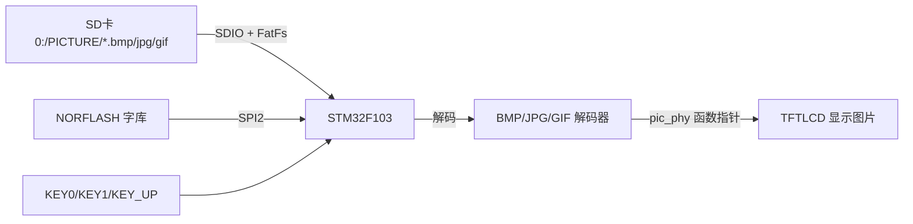
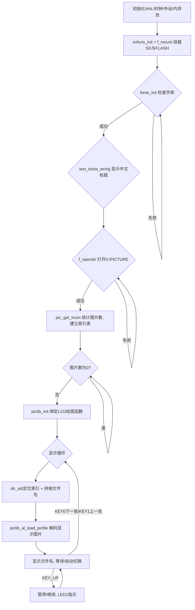

# 实验40 图片显示实验

> 平台：正点原子 STM32F103（战舰）开发板 · HAL 库 · Keil MDK

## 一、实验简介

本实验在 LCD 上显示 SD 卡里的图片，做成一个简易"数码相框"。程序开机检查字库和 SD 卡，扫描根目录 `PICTURE` 文件夹下所有图片（支持 **bmp / jpg / jpeg / gif**），记录索引后循环解码显示。按 KEY0/KEY1 切换下一张/上一张，KEY_UP 暂停或继续播放，LED1 指示暂停状态。图片解码后通过一组绑定了 LCD 驱动的绘图函数（画点、画线、填充）绘制到屏幕。

🏠 **生活类比**：SD 卡是一个装满照片的相册，图片解码器（bmp/jpg/gif）像"翻译官"，把压缩打包的图片文件还原成一个个像素点；LCD 驱动则是"画笔"。相框程序就像自动翻页的相册，每隔几秒翻一张，你还能手动前翻/后翻或按下暂停键。

## 二、实验目的

- 理解常见图片格式（BMP/JPG/GIF）的解码原理与在 MCU 上的显示方法
- 掌握用 FatFs 扫描目录、按扩展名筛选图片文件并建立索引
- 学会用函数指针把"绘图动作"与具体 LCD 驱动解耦（`pic_phy` 结构体）
- 掌握图片按 LCD 尺寸自动缩放显示的机制

## 三、硬件资源与连接图

| 外设 | 引脚 | 说明 |
|------|------|------|
| SDIO_D0~D3 | **PC8~PC11** | SD 卡数据线（存放图片） |
| SDIO_SCK | **PC12** | SD 卡时钟 |
| SDIO_CMD | **PD2** | SD 卡命令线 |
| SPI2 (NORFLASH) | **PB12~PB15** | 调用汉字库显示文件名 |
| TFTLCD | FSMC 并口 | 16 位 8080 并口，显示图片 |
| KEY0 | **PE4** | 下一张 |
| KEY1 | **PE3** | 上一张 |
| KEY_UP (WK_UP) | **PA0** | 暂停 / 继续 |
| LED0 (DS0, 红) | **PB5** | 指示运行 |
| LED1 (DS1, 绿) | **PE5** | 暂停时点亮 |



> 接线说明：图片数据流是"SD 卡 → 解码器 → LCD"。解码器不直接操作 LCD，而是通过 `pic_phy` 里的函数指针调用 `lcd_draw_point/lcd_fill/lcd_draw_hline` 等，实现与具体屏幕解耦。

## 四、核心数据结构与显示接口

本实验核心是**软件图片解码 + LCD 绘图接口**，无专用寄存器。关键结构体如下：

绘图函数指针集合 `_m_pic_phy`（绑定到 LCD 驱动，`Middlewares/PICTURE/piclib.h`）：

| 成员 | 绑定的 LCD 函数 | 用途 |
|------|----------------|------|
| `read_point` | `lcd_read_point` | 读点（仅 BMP 需要） |
| `draw_point` | `lcd_draw_point` | 画单个像素点 |
| `fill` | `lcd_fill` | 单色填充（仅 GIF 需要） |
| `draw_hline` | `lcd_draw_hline` | 画水平线（仅 GIF 需要） |
| `fillcolor` | `piclib_fill_color` | 批量颜色填充（仅 JPG/TJPGD 需要） |

图片信息 `_m_pic_info`（缩放与坐标状态）：

| 成员 | 作用 |
|------|------|
| `lcdwidth / lcdheight` | LCD 分辨率 |
| `ImgWidth / ImgHeight` | 图片实际宽高 |
| `Div_Fac` | 缩放系数（放大 8192 倍存储） |
| `S_Width / S_Height` | 设定的显示区域宽高 |
| `S_XOFF / S_YOFF` | 显示起始偏移坐标 |
| `staticx / staticy` | 当前绘制到的坐标 |

解码器按格式分工：`bmp.c`（标准 BMP）、`tjpgd.c`（JPG/JPEG，Tiny JPEG Decoder）、`gif.c`（GIF 动图）。文件类型由 `exfuns_file_type()` 按扩展名判定（返回 `T_BMP/T_JPG/T_JPEG/T_GIF`）。

## 五、软件架构 / 流程



## 六、主要示例代码及讲解

### 1. 绑定 LCD 绘图函数（`Middlewares/PICTURE/piclib.c`）

```c
void piclib_init(void)
{
    pic_phy.read_point = lcd_read_point;    /* 读点函数实现,仅BMP需要 */
    pic_phy.draw_point = lcd_draw_point;    /* 画点函数实现 */
    pic_phy.fill       = lcd_fill;          /* 填充函数实现,仅GIF需要 */
    pic_phy.draw_hline = lcd_draw_hline;    /* 画线函数实现,仅GIF需要 */
    pic_phy.fillcolor  = piclib_fill_color; /* 颜色填充函数实现,仅TJPGD需要 */

    picinfo.lcdwidth  = lcddev.width;       /* 得到LCD的宽度像素 */
    picinfo.lcdheight = lcddev.height;      /* 得到LCD的高度像素 */
    /* ... 其余缩放/坐标状态清零 ... */
}
```

**讲解**：这是整个图片库的"接口层"。解码器只调用 `pic_phy.draw_point(...)` 之类的函数指针，具体画到哪里由这里绑定的 LCD 驱动决定。这样同一套解码代码换个屏幕只要改这几个指针赋值即可。`picinfo` 记录 LCD 分辨率，用于后续自动缩放。

### 2. 按格式分发解码（`piclib_ai_load_picfile`）

```c
uint8_t piclib_ai_load_picfile(char *filename, uint16_t x, uint16_t y,
                               uint16_t width, uint16_t height, uint8_t fast)
{
    if ((x + width) > picinfo.lcdwidth)  return PIC_WINDOW_ERR;  /* x超范围 */
    if ((y + height) > picinfo.lcdheight) return PIC_WINDOW_ERR; /* y超范围 */
    if (width == 0 || height == 0) return PIC_WINDOW_ERR;        /* 窗口错误 */

    picinfo.S_Height = height;
    picinfo.S_Width  = width;
    picinfo.S_YOFF = y;   picinfo.S_XOFF = x;   /* 显示起始坐标 */

    temp = exfuns_file_type(filename);          /* 得到文件类型 */
    switch (temp)
    {
        case T_BMP:  res = stdbmp_decode(filename);                   break; /* 解码bmp */
        case T_JPG:
        case T_JPEG: res = jpg_decode(filename, fast);                break; /* 解码JPG */
        case T_GIF:  res = gif_decode(filename, x, y, width, height); break; /* 解码gif */
        default:     res = PIC_FORMAT_ERR;                            break; /* 非图片格式 */
    }
    return res;
}
```

**讲解**：先校验显示窗口不超出 LCD 范围，再用 `exfuns_file_type` 按扩展名判断格式，分发到对应解码器。`fast` 参数控制 JPG 是否走快速（批量填色）路径。各解码器内部会边解码边通过 `pic_phy` 把像素画到屏幕。

### 3. 目录扫描与循环显示（`User/main.c`）

```c
totpicnum = pic_get_tnum("0:/PICTURE");            /* 得到总有效图片数 */
/* ... 建立 picoffsettbl 索引表 ... */

strcpy((char *)pname, "0:/PICTURE/");              /* 复制路径 */
strcat((char *)pname, (const char *)picfileinfo->fname); /* 拼接文件名 */
lcd_clear(BLACK);
piclib_ai_load_picfile(pname, 0, 0, lcddev.width, lcddev.height, 1); /* 全屏显示 */
text_show_string(2, 2, lcddev.width, 16, (char *)pname, 16, 1, RED); /* 显示文件名 */

/* 内层循环: t>250自动翻页; KEY1上一张, KEY0下一张, KEY_UP暂停(LED1指示) */
if (key == KEY0_PRES) { curindex++; if (curindex >= totpicnum) curindex = 0; break; }
else if (key == WKUP_PRES) { pause = !pause; LED1(!pause); }
```

**讲解**：程序先遍历目录统计图片数并记录每张图的目录偏移 `picoffsettbl`，显示时用 `dir_sdi` 直接跳到该偏移读取文件名，避免每次都从头扫描。拼好完整路径后调用 `piclib_ai_load_picfile` 全屏解码显示，并用汉字库显示文件名。计时到 250（约 2.5 秒）自动翻下一张，按键可手动切换或暂停。

## 七、实验效果

烧录后（需插含 `PICTURE` 文件夹的 SD 卡）：
- LCD 先显示中文标题与操作提示，随后全屏循环播放 `PICTURE` 目录下的图片（bmp/jpg/jpeg/gif）；
- 每张图约显示 2.5 秒后自动切换，左上角显示当前图片文件名；
- **KEY0** 下一张、**KEY1** 上一张、**KEY_UP** 暂停/继续（暂停时 **LED1 绿** 点亮）；
- **LED0（红）** 持续闪烁指示运行；找不到文件夹或图片时 LCD 提示相应错误。

## 八、注意事项

- SD 卡根目录需建 `PICTURE` 文件夹，并放入 bmp/jpg/jpeg/gif 图片；文件名尽量简短。
- 若要用汉字显示文件名，需先按《实验39 汉字显示》更新 FLASH 字库，否则中文文件名可能显示异常。
- GIF/JPG 解码较耗内存与算力，超大图片可能显示缓慢或失败，建议使用与屏幕分辨率相近的图片。
- 串口助手波特率 **115200**，建议 XCOM/SSCOM；P4 的 PA9/PA10 需用跳线帽连到 RXD/TXD。
- 4.3/7 寸屏电流大，建议外接 12V 1A 电源。

## 九、文件结构

```
实验40 图片显示实验/
├── User/
│   └── main.c                 主程序（扫描PICTURE目录、循环解码显示、按键控制）
├── Middlewares/
│   ├── PICTURE/               图片显示核心 ★
│   │   ├── piclib.c / .h      绘图接口(pic_phy)、图片信息(picinfo)、格式分发
│   │   ├── bmp.c / .h         BMP 解码
│   │   ├── tjpgd.c / .h       JPG/JPEG 解码 (Tiny JPEG Decoder)
│   │   └── gif.c / .h         GIF 解码
│   ├── TEXT/                  汉字显示（显示文件名）
│   ├── FATFS/                 FatFs（读SD卡图片文件）
│   ├── MALLOC/                内存管理
│   └── USMART/                USMART 调试组件
├── Drivers/
│   ├── BSP/
│   │   ├── LCD/               TFTLCD 显示驱动 ★
│   │   ├── SDIO/ NORFLASH/ SPI/ KEY/ LED/ SRAM/
│   └── STM32F1xx_HAL_Driver/  ST HAL 库
└── Projects/MDK-ARM/          Keil 工程文件 (.uvprojx)
```
