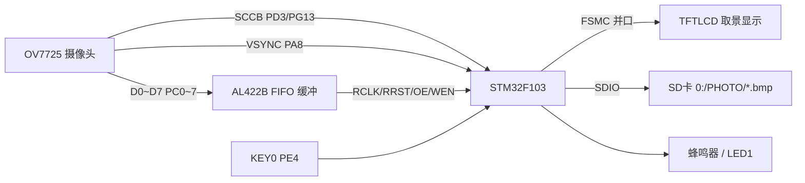
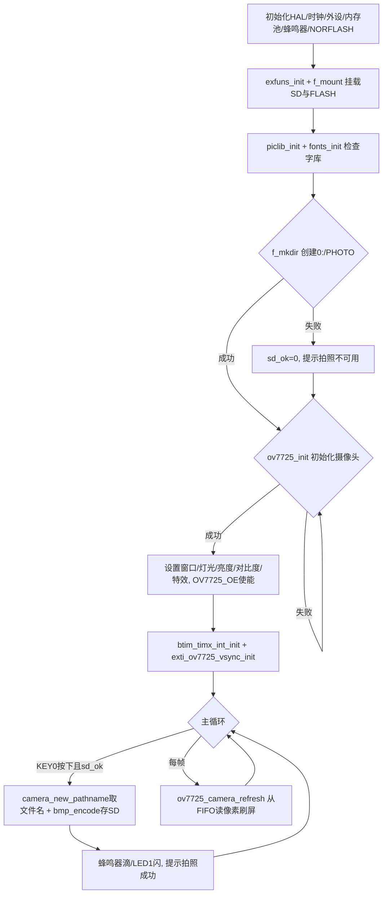

# 实验41 照相机实验

> 平台：正点原子 STM32F103（战舰）开发板 · HAL 库 · Keil MDK

## 一、实验简介

本实验用 **ALIENTEK OV7725 摄像头模块**实现一个简易照相机：开机检测字库与 SD 卡（自动创建 `PHOTO` 文件夹），初始化 OV7725 后把摄像头画面实时显示在 LCD 上；按下 KEY0 即"拍照"——把当前画面编码成 BMP 图片保存到 SD 卡，蜂鸣器"滴"一声、LED1 闪一下提示成功。OV7725 通过 SCCB 总线配置寄存器，图像数据先存入模块自带的 FIFO 缓冲，再由 STM32 逐像素读出刷屏。

🏠 **生活类比**：OV7725 是"眼睛+胶片仓"。SCCB 总线像相机的"设置菜单"（调亮度、分辨率、特效），FIFO 像相机的"缓存底片仓"——眼睛看到的一帧画面先存进底片仓，STM32 再一张张取出来显示到 LCD（取景框）。按下快门（KEY0）时，把当前底片冲洗成 BMP 照片存进 SD 卡这个"相册"。

> 说明：STM32F103 **没有 DCMI 数字摄像头接口**，因此本方案采用 OV7725 + 外部 FIFO（AL422B）缓冲、GPIO 模拟时序读取的经典架构，而非 STM32F4 的 DCMI 方式。

## 二、实验目的

- 了解 OV7725 摄像头模块的工作原理与 FIFO 缓冲机制
- 掌握用 **SCCB 总线**（类 I2C）读写 OV7725 内部寄存器进行配置
- 学会用外部中断（VSYNC）捕获帧信号、用定时器统计帧率
- 掌握把摄像头画面编码为 BMP 并经 FatFs 保存到 SD 卡的完整流程

## 三、硬件资源与连接图

| OV7725 信号 | STM32 引脚 | 说明 |
|-------------|-----------|------|
| OV_D0~D7 | **PC0~PC7** | 8 位并行数据（读 `GPIOC->IDR & 0xFF`） |
| OV_SCL | **PD3** | SCCB 时钟 |
| OV_SDA | **PG13** | SCCB 数据 |
| OV_VSYNC | **PA8** | 帧同步信号（外部中断 EXTI8） |
| FIFO_RRST | **PG14** | FIFO 读指针复位 |
| FIFO_OE | **PG15** | FIFO 数据输出使能 |
| FIFO_WRST | **PD6** | FIFO 写指针复位 |
| FIFO_WEN | **PB3** | FIFO 写使能 |
| FIFO_RCLK | **PB4** | FIFO 读时钟 |

其它：SDIO(PC8~PC12/PD2) 存照片、SPI2 NORFLASH(PB12~PB15) 存字库、KEY0(PE4) 拍照、LED0(PB5) 运行、LED1(PE5) 拍照指示、蜂鸣器提示、TIM6 统计帧率。



> 接线说明：PB3/PB4 默认是 JTAG 引脚，程序中用 `__HAL_AFIO_REMAP_SWJ_NOJTAG()` 关闭 JTAG（保留 SWD）后才能作普通 IO 使用。

## 四、核心寄存器与配置

本实验核心是 **OV7725 内部寄存器（经 SCCB 访问）+ FIFO 控制 GPIO**：

| 寄存器 / 资源 | 名称 | 作用 |
|--------------|------|------|
| OV7725 REG `0x12` | 复位寄存器 | 写 `0x80` 软复位摄像头 |
| OV7725 REG `0x1C/0x1D` | 厂商 ID (MID) | 读回须等于 `OV7725_MID`，校验通信 |
| OV7725 REG `0x0A/0x0B` | 产品 ID (PID) | 读回须等于 `OV7725_PID`，确认型号 |
| `ov7725_init_reg_tb1[]` | 初始化寄存器表 | 一次性写入 QVGA(320×240) 各配置寄存器 |
| EXTI8 (PA8) | 外部中断 | 检测 VSYNC 帧同步下降沿，标记新帧到达 |
| TIM6 | 基本定时器 | 1 秒中断一次，统计并打印摄像头帧率 |
| `GPIOC->IDR` | 数据输入 | 读 FIFO 输出的 8 位像素数据（D0~D7） |

OV7725 采用 **SCCB（Serial Camera Control Bus）** 协议配置寄存器，它兼容 I2C：由 `sccb.c` 用 GPIO 模拟 SCL/SDA 时序，`ov7725_write_reg/read_reg` 完成寄存器读写。像素为 RGB565，一像素 2 字节，需读两次 FIFO 拼成 16 位颜色。

## 五、软件架构 / 流程



## 六、主要示例代码及讲解

### 1. 摄像头初始化与 ID 校验（`Drivers/BSP/OV7725/ov7725.c`）

```c
uint8_t ov7725_init(void)
{
    /* ... 配置 VSYNC(输入)、WRST/RRST/OE/RCLK/WEN(推挽输出)、PC0~7(输入) ... */
    __HAL_AFIO_REMAP_SWJ_NOJTAG();   /* 关JTAG留SWD, 释放PB3/PB4做普通IO */

    sccb_init();                     /* 初始化SCCB的IO口 */

    if (ov7725_write_reg(0x12, 0x80)) return 1;   /* 软复位 */
    delay_ms(50);

    reg  = ov7725_read_reg(0X1c); reg <<= 8;
    reg |= ov7725_read_reg(0X1d);                 /* 读厂商ID */
    if ((reg != OV7725_MID) && (reg != OV7725_MID1)) return 1;

    reg  = ov7725_read_reg(0X0a); reg <<= 8;
    reg |= ov7725_read_reg(0X0b);                 /* 读产品ID */
    if (reg != OV7725_PID) return 2;

    for (i = 0; i < sizeof(ov7725_init_reg_tb1)/sizeof(ov7725_init_reg_tb1[0]); i++)
        ov7725_write_reg(ov7725_init_reg_tb1[i][0], ov7725_init_reg_tb1[i][1]); /* 写配置表 */
    return 0;
}
```

**讲解**：先配好各控制 GPIO，再初始化 SCCB。复位后读厂商 ID（MID）和产品 ID（PID）确认摄像头在线且型号正确，任何一步不对都返回错误码。最后把一整张寄存器配置表 `ov7725_init_reg_tb1` 逐个写入，设定 QVGA 分辨率、输出格式等参数。

### 2. 从 FIFO 读一帧刷到 LCD（`User/main.c`）

```c
void ov7725_camera_refresh(void)
{
    if (g_ov7725_vsta)                 /* 有帧中断更新(EXTI里置位) */
    {
        lcd_scan_dir(U2D_L2R);
        lcd_set_window((lcddev.width - g_ov7725_wwidth) / 2,
                       (lcddev.height - g_ov7725_wheight) / 2,
                       g_ov7725_wwidth, g_ov7725_wheight);  /* 画面居中 */
        lcd_write_ram_prepare();        /* 准备写GRAM */

        OV7725_RRST(0); OV7725_RCLK(0); OV7725_RCLK(1);
        OV7725_RCLK(0); OV7725_RRST(1); OV7725_RCLK(1);  /* 复位FIFO读指针 */

        for (i = 0; i < g_ov7725_wheight; i++)
            for (j = 0; j < g_ov7725_wwidth; j++)
            {
                OV7725_RCLK(0); color  = OV7725_DATA; OV7725_RCLK(1); /* 读高字节 */
                color <<= 8;
                OV7725_RCLK(0); color |= OV7725_DATA; OV7725_RCLK(1); /* 读低字节 */
                LCD->LCD_RAM = color;   /* 写入LCD */
            }

        g_ov7725_vsta = 0;              /* 清帧中断标记 */
        g_ov7725_frame++;               /* 帧计数(供TIM6算帧率) */
        lcd_scan_dir(DFT_SCAN_DIR);     /* 恢复默认扫描方向 */
    }
}
```

**讲解**：EXTI 检测到 VSYNC 帧信号后置位 `g_ov7725_vsta`。刷新时先复位 FIFO 读指针，然后每产生一个 RCLK 时钟脉冲就从 `GPIOC->IDR` 读一个字节；RGB565 一个像素 2 字节，读两次拼成 16 位颜色直接写入 `LCD->LCD_RAM`。逐像素扫完整帧即完成取景显示，帧计数供定时器计算帧率。

### 3. 拍照保存为 BMP（`User/main.c`）

```c
if (key == KEY0_PRES)
{
    if (sd_ok)
    {
        LED1(0);                            /* 点亮LED1, 提示正在拍照 */
        camera_new_pathname(pname);         /* 生成不重复的文件名, 如 0:PHOTO/PIC00001.bmp */
        if (bmp_encode((uint8_t *)pname, ..., g_ov7725_wheight, g_ov7725_wwidth, 0))
            text_show_string(40, 110, 240, 12, "写入文件错误!", 12, 0, RED);
        else
        {
            text_show_string(40, 110, 240, 12, "拍照成功!", 12, 0, BLUE);
            BEEP(1); delay_ms(100);         /* 蜂鸣器短叫提示 */
        }
        BEEP(0); LED1(1);                   /* 关蜂鸣器/LED1 */
    }
}
```

**讲解**：`camera_new_pathname` 用 `PIC%05d.bmp` 递增试探，`f_open` 返回 `FR_NO_FILE` 说明该名字未用过，从而避免覆盖旧照片。`bmp_encode` 把当前 FIFO 画面按 BMP 文件格式（文件头+像素数据）经 FatFs 写入 SD 卡的 `PHOTO` 文件夹。成功后蜂鸣器短叫、LCD 提示。

## 七、实验效果

烧录后（需插 SD 卡、接 OV7725 模块）：
- LCD 先显示中文标题与"KEY0:拍照(bmp格式)"提示，随后**实时显示摄像头取景画面**（320×240 居中）；
- 按下 **KEY0** 拍照：**LED1（绿）** 亮表示处理中，保存成功后蜂鸣器"滴"一声、LED1 灭，LCD 显示"拍照成功! 保存为: 0:PHOTO/PICxxxxx.bmp"；
- 照片以 BMP 格式存入 SD 卡 `PHOTO` 文件夹，文件名自动递增不覆盖；
- **LED0（红）** 闪烁指示运行；TIM6 每秒经串口打印帧率；SD 卡或 OV7725 异常时 LCD 提示相应错误。

## 八、注意事项

- OV7725 受模块 FIFO 容量限制，无法存下整帧 640×480，故 QVGA/VGA 模式都用 **320×240** 分辨率。
- PB3/PB4 被 FIFO_WEN/RCLK 占用，必须关闭 JTAG（保留 SWD），否则引脚不可用、也无法用 JTAG 调试。
- 拍照前请确保 SD 卡已插入且能创建 `PHOTO` 文件夹，否则拍照功能不可用。
- 摄像头排线方向、插接要牢固；SCCB 通信失败会读不到正确 MID/PID 而初始化报错。
- 串口助手波特率 **115200**，建议 XCOM/SSCOM；P4 的 PA9/PA10 需用跳线帽连到 RXD/TXD；大屏建议外接 12V 1A 电源。

## 九、文件结构

```
实验41 照相机实验/
├── User/
│   └── main.c                 主程序（取景刷新、拍照保存BMP、按键/蜂鸣器/LED）
├── Middlewares/
│   ├── PICTURE/               图片库 (bmp.c 提供 bmp_encode 编码) ★
│   ├── TEXT/                  汉字显示（提示文字）
│   ├── FATFS/                 FatFs（照片存SD卡）
│   ├── MALLOC/ USMART/        内存管理 / 调试组件
├── Drivers/
│   ├── BSP/
│   │   ├── OV7725/            摄像头驱动 (ov7725.c / sccb.c / ov7725cfg.h) ★核心
│   │   ├── EXTI/              外部中断（VSYNC帧捕获）★
│   │   ├── TIMER/             基本定时器（帧率统计）★
│   │   ├── BEEP/              蜂鸣器驱动
│   │   ├── LCD/ SDIO/ NORFLASH/ SPI/ KEY/ LED/ SRAM/
│   └── STM32F1xx_HAL_Driver/  ST HAL 库
└── Projects/MDK-ARM/          Keil 工程文件 (.uvprojx)
```
