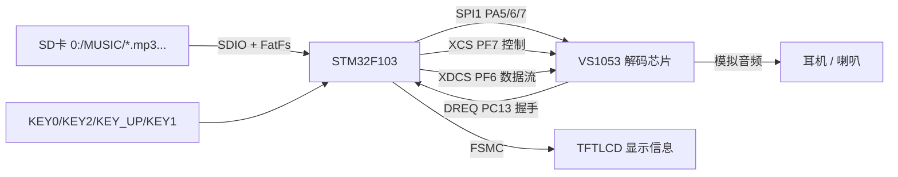
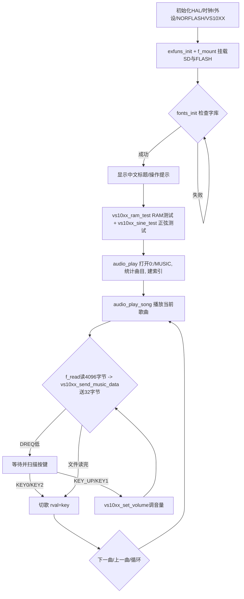

# 实验42 音乐播放器实验

> 平台：正点原子 STM32F103（战舰）开发板 · HAL 库 · Keil MDK

## 一、实验简介

本实验用 **VS1053 音频解码芯片**实现一个简易 MP3 播放器。开机先对 VS1053 做 RAM 测试和正弦波测试，随后循环播放 SD 卡 `MUSIC` 文件夹里的歌曲（支持 mp3/wav/wma/flac/midi/ogg）。STM32 通过 FatFs 从 SD 卡读出音频数据，再经 SPI 分块喂给 VS1053 解码，VS1053 输出模拟音频到耳机/喇叭。LCD 显示歌名、播放时间、总时长、曲目数、编号等信息；KEY0/KEY2 切歌，KEY_UP/KEY1 调节音量。

🏠 **生活类比**：VS1053 是"专业音响师"，STM32 是"点歌+递带子的助手"。音频文件是压缩好的"乐谱磁带"，助手从 SD 卡这个"曲库"里取出磁带，一段段递给音响师；音响师负责解码还原成音乐播放出来。DREQ 信号像音响师举手示意"我准备好了，快递下一段"，助手看到才继续喂数据。

> 说明：本方案的音频解码由 **VS1053 专用解码芯片**完成，STM32 只做数据搬运与控制；这不同于用 TIM PWM + DAC 直接产生声音的低端方案，音质与格式支持都更好。

## 二、实验目的

- 了解 VS1053 音频解码芯片的工作原理与 SCI/SDI 双接口
- 掌握用 SPI 读写 VS1053 控制寄存器（模式、时钟、音量等）与发送音频数据流
- 理解 DREQ 握手信号控制数据发送节奏的机制
- 掌握用 FatFs 读取 SD 卡音频文件并循环播放、切歌、调音量的完整逻辑

## 三、硬件资源与连接图

| VS1053 信号 | STM32 引脚 | 说明 |
|-------------|-----------|------|
| VS_SCK | **PA5** | SPI1 时钟 |
| VS_MISO | **PA6** | SPI1 主入从出 |
| VS_MOSI | **PA7** | SPI1 主出从入 |
| VS_RST | **PE6** | 硬复位（低有效） |
| VS_XDCS | **PF6** | 数据片选（SDI，送音频流） |
| VS_XCS | **PF7** | 控制片选（SCI，读写寄存器） |
| VS_DREQ | **PC13** | 数据请求（高=可接收数据） |

其它：SDIO(PC8~PC11/PC12/PD2) 读歌曲、SPI2 NORFLASH(PB12~PB15) 存字库、KEY0(PE4) 下一曲、KEY2(PE2) 上一曲、KEY_UP(PA0) 音量+、KEY1(PE3) 音量-、LED0(PB5) 运行、LED1(PE5) 测试指示。



> 接线说明：VS1053 有两套片选——`XCS`（SCI 控制口，读写寄存器）与 `XDCS`（SDI 数据口，送音频流），二者不能同时有效。`DREQ` 为高表示 VS1053 的接收 FIFO 有空间，此时才能发数据。

## 四、核心寄存器（VS1053）

VS1053 内部寄存器通过 SCI（XCS 片选）读写，本实验用到的关键寄存器：

| 寄存器 | 地址 | 名称 | 作用 |
|--------|------|------|------|
| `SPI_MODE` | 0x00 | 模式寄存器 | 控制工作模式：SM_RESET 复位、SM_TESTS 测试、SM_CANCEL 取消解码；复位后应为 `0x0800` |
| `SPI_STATUS` | 0x01 | 状态寄存器 | 反映 VS1053 当前状态 |
| `SPI_BASS` | 0x02 | 低音/高音寄存器 | 设置高低音增强 |
| `SPI_CLOCKF` | 0x03 | 时钟寄存器 | 设置倍频，本例写 `0x9800`（3 倍频，1.5xADD） |
| `SPI_DECODE_TIME` | 0x04 | 解码时间寄存器 | 已解码时间（秒），用于显示播放进度 |
| `SPI_VOL` | 0x0B | 音量寄存器 | 高/低字节分别是右/左声道音量，值越小越响 |
| `SPI_WRAM` / `SPI_WRAMADDR` | 0x06 / 0x07 | RAM 读写 | RAM 测试、加载 FLAC patch 用 |

读写时序（`vs10xx.c`）：写命令字节 `VS_WRITE_COMMAND(0x02)` / 读命令 `VS_READ_COMMAND(0x03)` + 寄存器地址 + 16 位数据，控制口拉低 `XCS`；发音频数据时拉低 `XDCS`，每次发 32 字节。

音量换算：`volt = 254 - volx`（左右声道相同），例程限制音量范围 100~250，显示时按 `(vol-100)/5` 换算成 0~30 级。

## 五、软件架构 / 流程



## 六、主要示例代码及讲解

### 1. 写 VS1053 控制寄存器（`Drivers/BSP/VS10XX/vs10xx.c`）

```c
void vs10xx_write_cmd(uint8_t address, uint16_t data)
{
    while (VS10XX_DQ == 0);          /* 等待DREQ为高, VS10XX空闲 */
    vs10xx_spi_speed_low();          /* 控制口用低速 */
    VS10XX_XDCS(1);                  /* 关数据口 */
    VS10XX_XCS(0);                   /* 开控制口(SCI) */
    vs10xx_spi_read_write_byte(VS_WRITE_COMMAND); /* 写命令0x02 */
    vs10xx_spi_read_write_byte(address);          /* 寄存器地址 */
    vs10xx_spi_read_write_byte(data >> 8);        /* 数据高8位 */
    vs10xx_spi_read_write_byte(data);             /* 数据低8位 */
    VS10XX_XCS(1);
    vs10xx_spi_speed_high();
}
```

**讲解**：写寄存器前先等 `DREQ`（代码里叫 `VS10XX_DQ`）变高表示芯片空闲。控制口操作必须**拉低 XCS、拉高 XDCS**，按"写命令 0x02 + 地址 + 16 位数据"顺序发。控制口用低速 SPI 保证可靠，数据口才切高速。

### 2. 发送音频数据流（`vs10xx_send_music_data`）

```c
uint8_t vs10xx_send_music_data(uint8_t *buf)
{
    if (VS10XX_DQ != 0)          /* DREQ为高, VS10XX可以接收数据 */
    {
        VS10XX_XDCS(0);          /* 开数据口(SDI) */
        for (n = 0; n < 32; n++) /* 每次发送32字节 */
        {
            vs10xx_spi_read_write_byte(buf[n]);
        }
        VS10XX_XDCS(1);
    }
    else
    {
        return 1;                /* DREQ为低, 芯片忙, 暂不发送 */
    }
    return 0;                    /* 成功发送 */
}
```

**讲解**：这是与寄存器操作不同的**数据口**（XDCS）。VS1053 每次接收 32 字节，且必须先看 `DREQ` 是否为高——为低说明内部 FIFO 满了，返回 1 让上层等待。这个握手保证不会丢数据或淹没芯片。

### 3. 播放主循环与按键（`User/APP/audioplayer.c`）

```c
res = f_open(fmp3, (const TCHAR *)pname, FA_READ);   /* 打开歌曲文件 */
if (res == 0)
{
    vs10xx_spi_speed_high();
    while (rval == 0)
    {
        res = f_read(fmp3, databuf, 4096, (UINT *)&br);   /* 读4096字节 */
        i = 0;
        do
        {
            if (vs10xx_send_music_data(databuf + i) == 0) /* 送32字节成功 */
                i += 32;
            else
            {
                key = key_scan(0);                        /* 芯片忙时扫按键 */
                switch (key)
                {
                    case KEY0_PRES:                        /* 下一曲 */
                    case KEY2_PRES: rval = key; break;     /* 上一曲 */
                    case WKUP_PRES:                        /* 音量+ */
                        if (vsset.mvol < 250) { vsset.mvol += 5; vs10xx_set_volume(vsset.mvol); }
                        break;
                    case KEY1_PRES:                        /* 音量- */
                        if (vsset.mvol > 100) { vsset.mvol -= 5; vs10xx_set_volume(vsset.mvol); }
                        break;
                }
                audio_msg_show(fmp3->obj.objsize);         /* 刷新时间/信息 */
            }
        } while (i < 4096);
        if (br != 4096 || res != 0) { rval = KEY0_PRES; break; } /* 播放完毕 */
    }
    f_close(fmp3);
}
```

**讲解**：外层每次从 SD 卡读 4096 字节到缓冲，内层按 32 字节为单位喂给 VS1053。当 `vs10xx_send_music_data` 因 DREQ 低返回非 0（芯片忙）时，正好利用这段空档扫描按键、处理切歌/音量，并刷新 LCD 上的播放时间。文件读完（`br != 4096`）或按下切歌键时退出，回到上层选择下一首。FLAC 格式还需先 `vs10xx_load_patch` 加载专用 patch。

## 七、实验效果

烧录后（需插含 `MUSIC` 文件夹的 SD 卡、接耳机）：
- LCD 先显示中文标题与"KEY0:NEXT KEY2:PREV / KEY_UP:VOL+ KEY1:VOL-"提示；
- 依次进行"存储器测试"（串口打印 RAM 测试结果）与"正弦波测试"（**需插耳机**才能听到，板载喇叭不响），随后进入 `<<音乐播放器>>`；
- 循环播放 `MUSIC` 目录下的歌曲，LCD 显示歌名、播放时间、总时长、曲目数、当前编号、音量、比特率等；
- **KEY0** 下一曲、**KEY2** 上一曲、**KEY_UP** 音量+、**KEY1** 音量-；**LED0** 闪烁指示运行。

## 八、注意事项

- 必须在 SD 卡根目录新建 `MUSIC` 文件夹并放入音乐文件（mp3/wav/wma/flac/midi/ogg），否则报错。
- **正弦波测试需插耳机**才能听到，开发板自带喇叭不播放测试音。
- VS1053 数据发送必须遵循 DREQ 握手（每次 32 字节），控制口与数据口片选（XCS/XDCS）不可混淆，否则无声或异常。
- FLAC 播放依赖加载 `vs1053b_patch`，请勿删除相关 patch 头文件。
- 串口助手波特率 **115200**，建议 XCOM/SSCOM；P4 的 PA9/PA10 需用跳线帽连到 RXD/TXD；大屏建议外接 12V 1A 电源。

## 九、文件结构

```
实验42 音乐播放器实验/
├── User/
│   ├── main.c                 主程序（初始化、RAM/正弦测试、调用audio_play）
│   └── APP/
│       ├── audioplayer.c/.h   播放器业务逻辑（扫描曲目、播放循环、切歌调音量）★
├── Middlewares/
│   ├── TEXT/                  汉字显示（歌名、提示）
│   ├── FATFS/                 FatFs（读SD卡音乐文件）
│   ├── MALLOC/ USMART/        内存管理 / 调试组件
├── Drivers/
│   ├── BSP/
│   │   ├── VS10XX/            VS1053 解码芯片驱动 (vs10xx.c/.h, patch_*.h) ★核心
│   │   ├── LCD/ SDIO/ NORFLASH/ SPI/ KEY/ LED/ SRAM/
│   └── STM32F1xx_HAL_Driver/  ST HAL 库
└── Projects/MDK-ARM/          Keil 工程文件 (.uvprojx)
```
