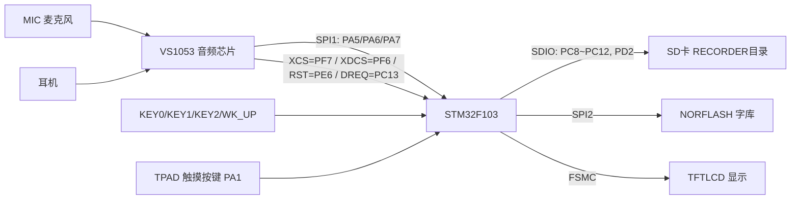
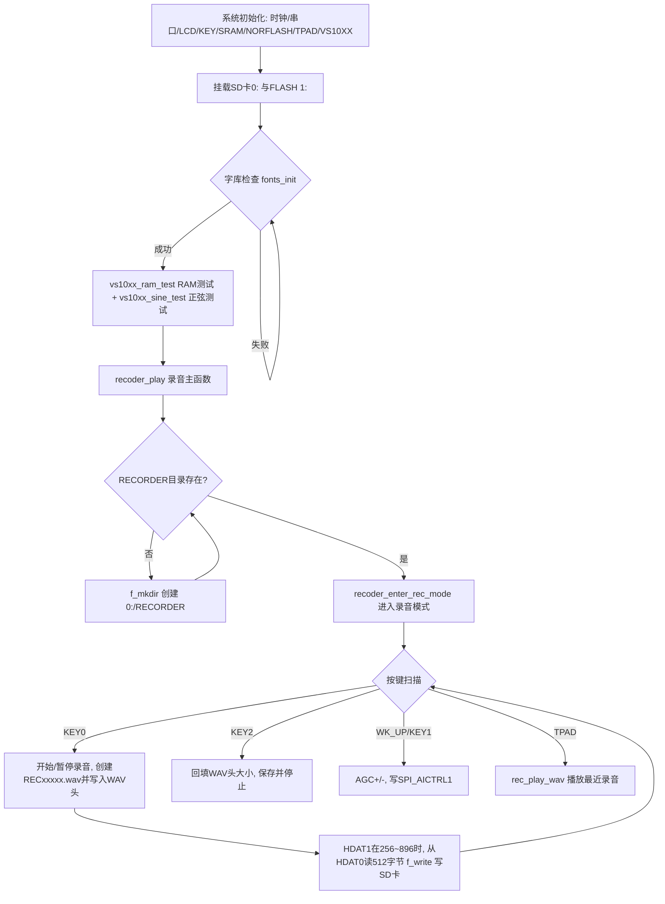

# 实验43 录音机实验

> 平台：正点原子 STM32F103 战舰开发板 · HAL 库 · Keil MDK

## 一、实验简介

本实验使用板载 **VS1053 音频解码芯片的录音模式**，配合 SD 卡与 FATFS 文件系统，实现一台简单的 **WAV 录音机**：按下按键开始录音，麦克风采集的声音被 VS1053 数字化为 8KHz、16 位、单声道的线性 PCM 数据，STM32 通过 SPI 读出数据并加上 WAV 文件头，保存到 SD 卡的 `RECORDER` 文件夹中；录完后还能通过触摸按键 TPAD 直接试听。

🏠 **生活类比**：就像用老式磁带录音机——按下"录音键"（KEY0）磁带开始转，按下"停止键"（KEY2）保存这盘磁带；VS1053 是录音机芯（负责把声音变成数据），STM32 是操作员（负责把数据写进 SD 卡这个"磁带盒"），WAV 文件头就是磁带盒上的标签（告诉播放器里面是什么格式的声音）。

## 二、实验目的

- 掌握 VS1053 **录音模式**的激活方法（`SPI_MODE`、`SPI_AICTRL0~3`、`SPI_CLOCKF` 配置）
- 理解 **WAV 文件格式**（RIFF/fmt/data 块结构）及其生成方法
- 掌握通过 VS1053 的 `SPI_HDAT0/SPI_HDAT1` 寄存器读取录音数据
- 学习用 **FATFS** 在 SD 卡上创建目录、创建文件与流式写入
- 了解 AGC（自动增益控制）调节与录音文件的回放流程

## 三、硬件资源与连接图

| 外设 | 引脚 | 说明 |
|------|------|------|
| VS1053 数据 SPI | **PA5(SCK) / PA6(MISO) / PA7(MOSI)** | 复用 SPI1，读写 VS1053 寄存器与音频数据 |
| VS1053 VS_RST | **PE6** | 硬复位，低电平有效 |
| VS1053 VS_XDCS | **PF6** | 数据片选（发音频数据） |
| VS1053 VS_XCS | **PF7** | 命令片选（读写 SCI 寄存器） |
| VS1053 VS_DREQ | **PC13** | 数据请求，高电平表示可接收数据 |
| SD 卡 (SDIO) | **PC8~PC11(D0~D3) / PC12(SCK) / PD2(CMD)** | 4 位 SDIO 模式，存录音文件 |
| NORFLASH | **SPI2（PB13/PB14/PB15 + PB12 CS）** | 存放字库 |
| 按键 | **KEY0=PE4、KEY1=PE3、KEY2=PE2、WK_UP=PA0** | 录音/暂停、AGC-、停止保存、AGC+ |
| TPAD 触摸按键 | **PA1（TIM5_CH2 输入捕获）** | 播放最近一次录音 |
| LED | **LED0=PB5、LED1=PE5** | 低电平点亮，LED0 指示运行 |
| 串口1 | **PA9(TX) / PA10(RX)** | 115200，打印 RAM 测试结果等 |
| TFTLCD | FSMC 16位8080并口 | 显示菜单、录音时间、AGC |



## 四、核心寄存器（VS1053 SCI 寄存器 + WAV 文件结构）

VS1053 的控制通过一组 **SCI 寄存器**（16 位）完成，STM32 经 SPI 以 `VS_WRITE_COMMAND(0x02)/VS_READ_COMMAND(0x03)` 读写（定义于 `Drivers/BSP/VS10XX/vs10xx.h`）：

| 寄存器 | 地址 | 作用 |
|--------|------|------|
| `SPI_MODE` | 0x00 | 模式控制。录音时写 **0x1804**（SM_ADPCM\|SM_SDINEW\|SM_RESET 位组合，MIC 录音激活） |
| `SPI_STATUS` | 0x01 | 状态寄存器 |
| `SPI_BASS` | 0x02 | 低音/高音控制，录音前置 0 |
| `SPI_CLOCKF` | 0x03 | 时钟配置。写 0x2000：2 倍频，输入 12.288MHz |
| `SPI_HDAT0` | 0x08 | **录音数据高字**（16 位 PCM 数据出口） |
| `SPI_HDAT1` | 0x09 | 录音数据低字/缓冲区状态（高字节非 0 表示缓冲区忙） |
| `SPI_AICTRL0` | 0x0C | 录音采样率（线性 PCM 直接填采样值，本实验 8000） |
| `SPI_AICTRL1` | 0x0D | 录音增益 AGC（0=自动；1024=1 倍；512=0.5 倍，最大 65535≈64 倍） |
| `SPI_AICTRL2` | 0x0E | AGC 最大值（0 代表最大 64 倍） |
| `SPI_AICTRL3` | 0x0F | 录音通道/格式配置（写 6：左通道 MIC 单声道、线性 PCM） |

WAV 文件头是一个 44 字节结构体（`User/APP/recorder.h`），由 RIFF、fmt、data 三个块拼接：

| 字段 | 值 | 含义 |
|------|----|------|
| `riff.ChunkID` | 0x46464952 | ASCII "RIFF" |
| `riff.ChunkSize` | 文件总大小-8 | 停止录音时回填 |
| `riff.Format` | 0x45564157 | ASCII "WAVE" |
| `fmt.AudioFormat` | 1 | 线性 PCM |
| `fmt.SampleRate` | 8000 | 8KHz 采样率 |
| `fmt.BitsPerSample` | 16 | 16 位量化 |
| `data.ChunkSize` | 数据大小 | 停止录音时回填（sectorsize×512） |

> 另外：SD 卡使用 SDIO 外设（`SDIO->POWER/CLKCR/ARG/CMD/DPSM` 等寄存器，由 HAL SD 驱动封装），文件系统由 Middlewares 中的 **FATFS** 提供（`f_mount/f_open/f_write/f_mkdir` 等）。

## 五、软件架构 / 流程



## 六、主要示例代码及讲解

### 1. 激活 VS1053 录音模式（`User/APP/recorder.c`）

```c
void recoder_enter_rec_mode(uint16_t agc)
{
    vs10xx_write_cmd(SPI_BASS, 0x0000);
    vs10xx_write_cmd(SPI_AICTRL0, 8000);    /* 设置采样率, 设置为8Khz */
    vs10xx_write_cmd(SPI_AICTRL1, agc);     /* 设置增益 */
    vs10xx_write_cmd(SPI_AICTRL2, 0);       /* 设置增益最大值,0,代表最大值65536=64X */
    vs10xx_write_cmd(SPI_AICTRL3, 6);       /* 左通道(MIC单声道输入), 线性PCM */
    vs10xx_write_cmd(SPI_CLOCKF, 0X2000);   /* 设置VS10XX的时钟,MULT:2倍频;ADD:不允许;CLK:12.288Mhz */
    vs10xx_write_cmd(SPI_MODE, 0x1804);     /* MIC, 录音激活 */
    delay_ms(5);                            /* 等待至少1.35ms */
    vs10xx_load_patch((uint16_t *)wav_plugin, 40);  /* VS1053的WAV录音需要patch */
}
```

**讲解**：
- 录音参数全部通过 `SPI_AICTRL0~3` 四个"AI 控制寄存器"设定：采样率、增益、通道。
- 最后写 `SPI_MODE = 0x1804` 才真正**激活录音**，顺序不能反。
- VS1053 的 WAV 录音固件有 bug，必须加载 `wav_plugin` 补丁（40 个字的压缩插件）修正。

### 2. 录音数据的读取与写文件（`User/APP/recorder.c` 录音主循环）

```c
if (rec_sta == 0X80)    /* 已经在录音了 */
{
    w = vs10xx_read_reg(SPI_HDAT1);

    if ((w >= 256) && (w < 896))
    {
        idx = 0;

        while (idx < 512)   /* 一次读取512字节 */
        {
            w = vs10xx_read_reg(SPI_HDAT0);
            recbuf[idx++] = w & 0XFF;
            recbuf[idx++] = w >> 8;
        }

        res = f_write(f_rec, recbuf, 512, &bw); /* 写入文件 */
        sectorsize++;   /* 扇区数增加1,约为32ms */
    }
}
```

**讲解**：
- 先读 `SPI_HDAT1` 判断 VS1053 内部录音缓冲区的填充量，**在 256~896 之间**时才去取数，避免读空或溢出。
- `SPI_HDAT0` 每读一次得到 16 位 PCM 样本，拆成两个字节按小端存入 `recbuf`，凑满 512 字节（一个扇区）后用 FATFS 的 `f_write` 写入 SD 卡。
- 每个 512 字节约对应 32ms 声音，录音时长由 `sectorsize * 4 / 125` 换算成秒显示。

### 3. KEY2 保存文件：回填 WAV 头（`User/APP/recorder.c`）

```c
case KEY2_PRES:     /* STOP&SAVE */
    if (rec_sta & 0X80) /* 有录音 */
    {
        wavhead->riff.ChunkSize = sectorsize * 512 + 36;    /* 整个文件的大小-8 */
        wavhead->data.ChunkSize = sectorsize * 512;         /* 数据大小 */
        f_lseek(f_rec, 0);  /* 偏移到文件头 */
        f_write(f_rec, (const void *)wavhead, sizeof(__WaveHeader), &bw);   /* 写入头数据 */
        f_close(f_rec);
        sectorsize = 0;
    }
    rec_sta = 0;
```

**讲解**：
- 创建文件时先写入一个"占位"的 44 字节 WAV 头（此时数据大小未知，`ChunkSize=0`）。
- 停止录音时用 `f_lseek` 把文件指针移回开头，**回填真实的数据长度**，再关闭文件——这是所有录音类程序处理变长文件的标准手法。
- 文件名由 `recoder_new_pathname()` 穷举生成 `REC00000.wav~REC65535.wav`，避免覆盖旧录音。

## 七、实验效果

1. 开机先检测字库，然后进行 VS1053 RAM 测试与正弦波测试（**正弦测试需插耳机**才能听到）。
2. LCD 显示"WAV录音机"菜单与操作提示；SD 卡根目录自动创建/检查 `RECORDER` 文件夹。
3. 按 **KEY0** 开始/暂停录音，屏幕显示文件名 `RECxxxxx.wav` 与录音时间（分:秒），LED1 指示录音状态；耳机中可实时监听采集到的声音。
4. **WK_UP/KEY1** 调节 AGC 增益（0~15，0 为自动）。
5. 按 **KEY2** 保存并停止录音；之后按 **TPAD** 可试听刚录的文件。
6. LED0 闪烁提示程序运行。

## 八、注意事项

- 电脑端串口助手波特率 **115200**，请用 XCOM/SSCOM，并把 P4 的 PA9/PA10 用跳线帽连到 RXD/TXD。
- 需自备 SD 卡（建议先在根目录建好 `MUSIC` 文件夹，与音乐播放器实验共用）；`RECORDER` 文件夹程序会自动创建。
- **录音监听只有耳机能听到**，板载喇叭不监听（否则会自激啸叫）；正弦测试同理。
- VS1053 录音必须先加载 `wav_plugin` 补丁，且 `SPI_MODE` 写 0x1804 后要延时至少 1.35ms。
- 4.3 寸/7 寸屏电流较大，USB 供电可能不足，建议外接 12V 1A 电源。
- 修改代码后重新编译烧录；若烧录失败先运行根目录 `keilkill.bat` 结束占用进程。

## 九、文件结构

```
实验43 录音机实验/
├── User/
│   ├── main.c                  主程序（初始化 + 测试 + 进入录音机）
│   ├── APP/
│   │   ├── recorder.c          录音机应用（录音模式/WAV头/播放）
│   │   └── recorder.h          WAV文件头结构体定义
│   └── stm32f1xx_it.c          中断服务函数
├── Drivers/
│   ├── BSP/
│   │   ├── VS10XX/             VS1053 驱动 (vs10xx.c/.h, patch_flac.h)
│   │   ├── SDIO/               SD卡驱动
│   │   ├── NORFLASH/           字库FLASH驱动
│   │   ├── LCD/ KEY/ LED/ SRAM/ SPI/ TPAD/
│   ├── SYSTEM/                 delay / sys / usart
│   └── STM32F1xx_HAL_Driver/   ST HAL 库
├── Middlewares/
│   ├── FATFS/                  文件系统（SD卡文件读写）
│   ├── TEXT/                   汉字显示（字库）
│   ├── MALLOC/                 内存管理
│   └── USMART/                 串口调试组件
└── Projects/MDK-ARM/           Keil 工程文件 (.uvprojx)
```
