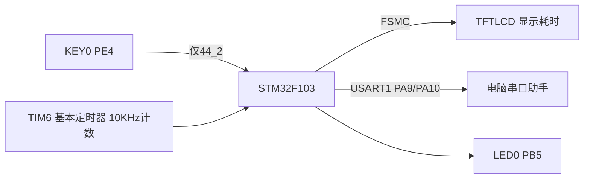
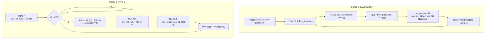

# 实验44 DSP测试实验

> 平台：正点原子 STM32F103 战舰开发板 · HAL 库 · Keil MDK · CMSIS-DSP 库

本实验目录包含两个子实验：

| 子实验 | 目录 | 内容 |
|--------|------|------|
| 实验44_1 | `实验44_1 DSP BasicMath测试实验/` | 对比 DSP 库 `arm_sin_f32/arm_cos_f32` 与标准库 `sinf/cosf` 的运算速度 |
| 实验44_2 | `实验44_2 DSP FFT测试实验/` | 用 DSP 库执行 1024 点 FFT（基4法）并把结果输出到串口 |

## 一、实验简介

DSP（Digital Signal Processing，数字信号处理）就是"对数字信号做数学运算"。ARM 官方为 Cortex-M 系列内核提供了 **CMSIS-DSP 软件库**，里面的三角函数、FFT 等函数都做了汇编级优化。本实验通过两个子实验直观感受这个库的价值：44_1 让同一台"计算器"分别用普通方法和 DSP 优化方法算一万次 sin/cos，比谁快；44_2 生成一个由三种正弦波叠加的 1024 点信号，用 FFT 一次性算出它的频谱。

🏠 **生活类比**：普通 C 库函数像用手算乘法，CMSIS-DSP 库像用计算器——结果一样，速度快好几倍。FFT 则像"声音分离器"：把一杯混合果汁（时域信号）放进分析机，立刻告诉你里面加了苹果、橙子和葡萄各多少（各频率分量的幅值）。

## 二、实验目的

- 了解 **CMSIS-DSP 库**的组成与在 Keil 工程中的集成方式（头文件 + 静态库）
- 掌握 `arm_sin_f32()/arm_cos_f32()` 等基础数学函数的使用，并实测其与标准库的速度差异
- 掌握 FFT 的使用流程：`arm_cfft_radix4_init_f32()` 初始化 → `arm_cfft_radix4_f32()` 运算 → `arm_cmplx_mag_f32()` 求幅值
- 学会用**基本定时器 TIM6** 做高精度计时（10KHz 计数，0.1ms 分辨率）

## 三、硬件资源与连接图

| 外设 | 引脚 | 说明 |
|------|------|------|
| LED0 (DS0) | **PB5** | 低电平点亮，闪烁提示程序运行 |
| LED1 (DS1) | **PE5** | 备用指示 |
| KEY0 | **PE4** | 44_2 中触发一次 FFT 运算 |
| 串口1 | **PA9(TX) / PA10(RX)** | 115200，44_2 输出 FFT 结果 |
| TFTLCD | FSMC 16位8080并口 | 显示运算耗时 |
| TIM6 基本定时器 | 内部外设 | 计数频率 10KHz（72MHz/7200），最大计 6.5536 秒，溢出次数由 `g_timeout` 累计 |



## 四、核心模块（CMSIS-DSP 软件库，纯软件实验）

本实验不涉及新的硬件寄存器，核心是 **CMSIS-DSP 库**（位于 `Drivers/CMSIS/DSP/Include` 与 `Drivers/CMSIS/Lib/ARM`）。这是一套纯软件的算法库：

| 模块/函数 | 作用 |
|-----------|------|
| `arm_math.h` | DSP 库总头文件，包含全部函数声明与数据结构 |
| `arm_sin_f32(x)` / `arm_cos_f32(x)` | 优化的浮点正弦/余弦（查表法，输入单位是**弧度**） |
| `arm_cfft_radix4_instance_f32` | FFT 实例结构体：保存点数、旋转因子表指针、位反转表指针等 |
| `arm_cfft_radix4_init_f32(&S, fftLen, ifftFlag, bitReverseFlag)` | 初始化 FFT 实例；`fftLen` 可选 16/64/256/1024，`ifftFlag=0` 表示正变换，`bitReverseFlag=1` 表示输出做位反转排序 |
| `arm_cfft_radix4_f32(&S, buf)` | 执行**基4 FFT**，输入输出都在 `buf` 中（原址计算） |
| `arm_cmplx_mag_f32(in, out, len)` | 复数求模：把 FFT 输出的实部/虚部转换为幅值 |

FFT 输入数据的**存储格式**（关键数据结构约定）：

```c
float fft_inputbuf[FFT_LENGTH * 2];  /* 复数按 [实部,虚部,实部,虚部...] 交织存放 */
float fft_outputbuf[FFT_LENGTH];     /* 求模后的幅值谱 */
/* fft_inputbuf[2*i]   = 第i个点的实部 */
/* fft_inputbuf[2*i+1] = 第i个点的虚部 */
```

## 五、软件架构 / 流程



## 六、主要示例代码及讲解

### 1. sin/cos 速度对比（`实验44_1/User/main.c`）

```c
uint8_t sin_cos_test(float angle, uint32_t times, uint8_t mode)
{
    float sinx, cosx;
    float result;
    uint32_t i = 0;

    if (mode == 0)
    {
        for (i = 0; i < times; i++)
        {
            cosx = cosf(angle);                 /* 不使用DSP优化的sin，cos函数 */
            sinx = sinf(angle);
            result = sinx * sinx + cosx * cosx; /* 计算结果应该等于1 */
            result = fabsf(result - 1.0f);      /* 对比与1的差值 */
            if (result > DELTA)return 0XFF;     /* 判断失败 */
            angle += 0.001f;    /* 角度自增 */
        }
    }
    else
    {
        for (i = 0; i < times; i++)
        {
            cosx = arm_cos_f32(angle);          /* 使用DSP优化的sin，cos函数 */
            sinx = arm_sin_f32(angle);
            ...
        }
    }
    return 0;   /* 任务完成 */
}
```

**讲解**：
- 两种模式做完全相同的事：算 `sin²x + cos²x`，用恒等于 1 这个数学性质**校验结果正确性**（误差超过 `DELTA=0.0001` 判失败）。
- 唯一区别是调用标准库 `sinf/cosf` 还是 DSP 库 `arm_sin_f32/arm_cos_f32`，公平对比速度。

### 2. 用 TIM6 计时（`实验44_1/User/main.c`）

```c
btim_timx_int_init(65535, 7200 - 1);   /* 10Khz计数频率,最大计时6.5秒超出 */
...
__HAL_TIM_SET_COUNTER(&timx_handler, 0);   /* 重设TIM6定时器的计数器值 */
g_timeout = 0;
res = sin_cos_test(PI / 6, 10000, 0);
time = __HAL_TIM_GET_COUNTER(&timx_handler) + (uint32_t)g_timeout * 65536;
sprintf(buf, "%0.1fms\r\n", time / 10);
```

**讲解**：
- TIM6 以 72MHz/7200 = **10KHz** 计数，每个计数 = 0.1ms，所以最后 `time / 10` 得到毫秒数。
- 计满 65536 会溢出，`btim.c` 的更新中断回调里 `g_timeout++`，把溢出次数补进总时间，实现超过 6.5 秒的计时。

### 3. 1024 点 FFT（`实验44_2/User/main.c`）

```c
arm_cfft_radix4_init_f32(&scfft, FFT_LENGTH, 0, 1); /* 初始化scfft结构体，设定FFT相关参数 */
...
for (i = 0; i < FFT_LENGTH; i++)   /* 生成信号序列 */
{
    fft_inputbuf[2 * i] = 100 +
                          10 * arm_sin_f32(2 * PI * i / FFT_LENGTH) +
                          30 * arm_sin_f32(2 * PI * i * 4 / FFT_LENGTH) +
                          50 * arm_cos_f32(2 * PI * i * 8 / FFT_LENGTH);  /* 生成输入信号实部 */
    fft_inputbuf[2 * i + 1] = 0; /* 虚部全部为0 */
}

arm_cfft_radix4_f32(&scfft, fft_inputbuf);                  /* FFT计算（基4） */
arm_cmplx_mag_f32(fft_inputbuf, fft_outputbuf, FFT_LENGTH); /* 把运算结果复数求模得幅值 */
```

**讲解**：
- 测试信号 = 直流分量 100 + 1 倍频正弦（幅值 10）+ 4 倍频正弦（幅值 30）+ 8 倍频余弦（幅值 50）。FFT 之后，理论上应在第 **0、1、4、8** 号谱线上看到对应的尖峰——这是验证 FFT 正确性的经典方法。
- 复数输入按"实部、虚部"交织存放，所以数组长度是点数的 2 倍；虚部全填 0（实信号）。
- `arm_cfft_radix4_f32` 是**原址运算**：结果直接覆盖 `fft_inputbuf`，再用 `arm_cmplx_mag_f32` 求模得到幅值谱，通过 `printf` 逐点发到串口。

## 七、实验效果

- **44_1**：LCD 上分两行显示 "No DSP runtime" 与 "Use DSP runtime" 各算 10000 次 sin/cos 的耗时（单位 ms），可直观看到 DSP 库明显更快；LED0 闪烁。
- **44_2**：开机显示 "KEY0:Run FFT"；每按一次 KEY0，LCD 显示本次 1024 点 FFT 的耗时（ms），串口以 115200 波特率打印全部 1024 个幅值结果，在谱线 0/1/4/8 处出现峰值；LED0 闪烁。

## 八、注意事项

- 两个子实验都要保证工程中包含了 CMSIS-DSP 的**头文件路径**（`Drivers/CMSIS/DSP/Include`）和**静态库**（`Drivers/CMSIS/Lib/ARM`），否则链接会报 `arm_xxx` 未定义。
- 串口助手波特率必须 **115200**，请用 XCOM/SSCOM，P4 的 PA9/PA10 需用跳线帽连到 RXD/TXD。
- TIM6 计时精度 0.1ms；44_1 中若单次运算超过 6.5 秒依赖 `g_timeout` 扩展，不要删掉 TIM6 更新中断。
- `arm_sin_f32/arm_cos_f32` 输入是**弧度**而不是角度，`PI/6` 即 30°。
- FFT 点数只能是 16/64/256/1024（基4法要求 4 的幂），修改 `FFT_LENGTH` 时注意数组大小同步变化。
- 修改代码后重新编译烧录；若烧录失败先运行各子目录下的 `keilkill.bat`。

## 九、文件结构

```
实验44 DSP测试实验/
├── 实验44_1 DSP BasicMath测试实验/
│   ├── User/main.c                 sin/cos 速度对比主程序
│   ├── Drivers/
│   │   ├── BSP/LCD|LED|TIMER/      TIMER为TIM6基本定时器计时驱动(btim.c/.h)
│   │   ├── CMSIS/
│   │   │   ├── DSP/Include/        arm_math.h 等DSP库头文件
│   │   │   └── Lib/ARM/            DSP静态库(.lib)
│   │   └── SYSTEM/                 delay / sys / usart
│   ├── Middlewares/USMART/         串口调试组件
│   └── Projects/MDK-ARM/           Keil 工程
└── 实验44_2 DSP FFT测试实验/
    ├── User/main.c                 1024点FFT主程序
    ├── Drivers/BSP/LCD|LED|KEY|TIMER/
    ├── Drivers/CMSIS/DSP + Lib/    CMSIS-DSP 库
    ├── Output/                     编译输出(hex/bin)
    └── Projects/MDK-ARM/           Keil 工程
```
