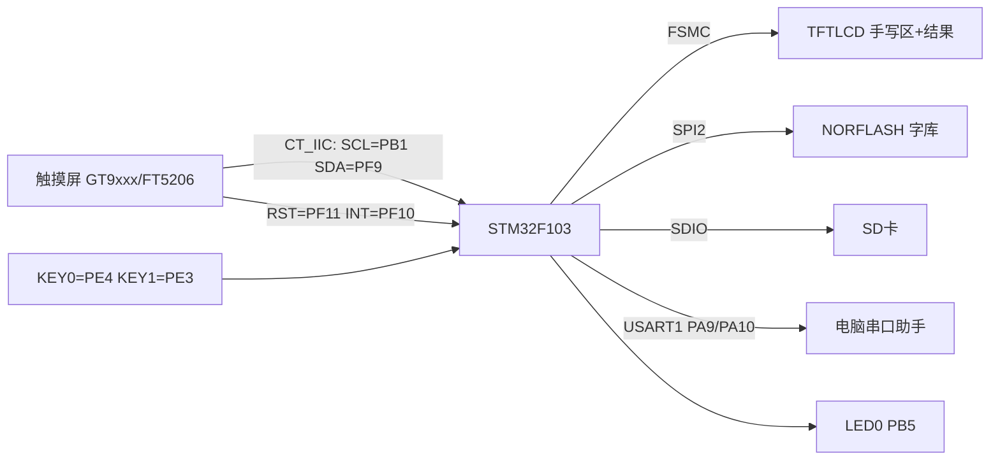
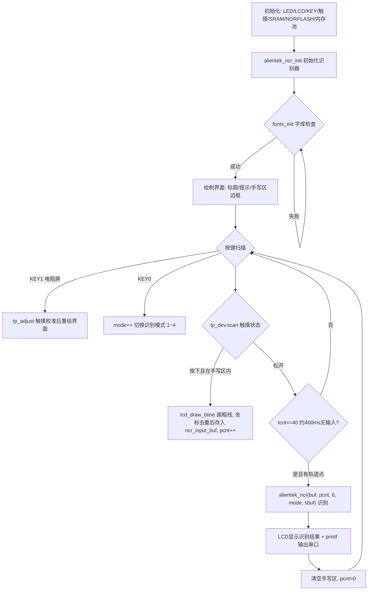

# 实验45 手写识别实验

> 平台：正点原子 STM32F103 战舰开发板 · HAL 库 · Keil MDK

## 一、实验简介

本实验在 TFTLCD 上画出一个"手写区"，用手指（或触摸笔）在里面写一个**数字或英文字母**，松手后程序自动调用正点原子手写识别库（ATKNCR），把你写的字符识别出来，显示在 LCD 上并打印到串口。识别基于你书写的**轨迹点序列**，而不是图像——触摸屏每扫到一个点就记录一次坐标，最多 200 个点，交给识别库与内置的特征模板进行匹配。

🏠 **生活类比**：就像快递员看你的潦草签名猜名字——他不需要"照片级"比对，而是抓住笔画的走向、拐角等特征来判断。手写识别库也一样：把你写的轨迹（一串坐标点）归一化后提取形状特征，再和它"背熟"的 0~9、A~Z、a~z 模板逐一比对，挑出最像的几个候选。

## 二、实验目的

- 掌握触摸屏驱动（电容屏 GT9xxx/FT5206 或电阻屏）的坐标获取方法
- 了解正点原子 **ATKNCR 手写识别库**的调用流程（初始化 → 喂入轨迹点 → 取识别结果）
- 学会把手写轨迹实时画到 LCD 上（Bresenham 画粗线算法）
- 理解"轨迹点采样 + 去重"这一识别前处理思路
- 掌握识别模式（仅数字/仅大写/仅小写/混合）的切换方法

## 三、硬件资源与连接图

| 外设 | 引脚 | 说明 |
|------|------|------|
| 电容触摸 IIC | **SCL=PB1、SDA=PF9**（软件模拟IIC，ctiic） | 读取 GT9xxx/FT5206 触摸坐标 |
| 电容触摸控制 | **GT9XXX_RST=PF11、GT9XXX_INT=PF10** | 复位与中断/状态引脚 |
| TFTLCD | FSMC 16位8080并口 | 显示界面、手写轨迹与识别结果 |
| KEY0 | **PE4** | 切换识别模式（数字→大写→小写→混合） |
| KEY1 | **PE3** | 触摸屏校准（电阻屏时有效） |
| LED0 | **PB5** | 低电平点亮，闪烁提示运行 |
| 串口1 | **PA9 / PA10** | 115200，打印轨迹点数与识别结果 |
| NORFLASH | SPI2（PB13/PB14/PB15，CS=PB12） | 存放字库（显示汉字用） |
| SD 卡 | SDIO：PC8~PC12、PD2 | 挂载文件系统（本实验需插卡） |



## 四、核心模块（手写识别算法库，纯软件部分）

识别核心由正点原子以静态库形式提供（`Middlewares/ATKNCR/`），用户只需按约定调用接口：

| 模块/接口 | 作用 |
|-----------|------|
| `ATKNCR_M_V2.0.lib` | 识别库（M 版，**使用动态内存**，需实现 `alientek_ncr_malloc/free`，本实验链接此版本） |
| `ATKNCR_N_V2.0.lib` | 识别库（N 版，不用动态内存，使用静态 tracebuf，死机时可加大 `ATK_NCR_TRACEBUF1/2_SIZE`） |
| `atk_ncr_point` | 轨迹点结构体：`{short x; short y;}`，即触摸屏坐标 |
| `alientek_ncr_init()` | 第一步：初始化识别器，返回 0 成功 |
| `alientek_ncr(track, potnum, charnum, mode, result)` | 第三步：识别。`track`=点集，`potnum`=点数（须≥2个不同点），`charnum`=期望输出的候选个数，`mode`=1数字/2大写/3小写/4混合，`result`=结果缓存（至少 charnum+1 字节） |
| `alientek_ncr_stop()` | 第四步：不再识别时终止识别器 |

程序侧的数据结构（`User/main.c`）：

```c
atk_ncr_point ncr_input_buf[200];  /* 最大记录200个轨迹点(输入数据) */
uint8_t mode = 4;                  /* 识别模式, 默认4=混合(全部识别) */
uint16_t lastpos[2];               /* 上一个触摸点坐标, 用于连线绘制 */
```

## 五、软件架构 / 流程



## 六、主要示例代码及讲解

### 1. 轨迹采集与画线（`User/main.c`）

```c
if (lastpos[0] == 0XFFFF)
{
    lastpos[0] = tp_dev.x[0];
    lastpos[1] = tp_dev.y[0];
}

lcd_draw_bline(lastpos[0], lastpos[1], tp_dev.x[0], tp_dev.y[0], 2, BLUE);  /* 画线 */
lastpos[0] = tp_dev.x[0];
lastpos[1] = tp_dev.y[0];

if (pcnt < 200) /* 总点数少于200 */
{
    if (pcnt)
    {
        if ((ncr_input_buf[pcnt - 1].y != tp_dev.y[0]) && (ncr_input_buf[pcnt - 1].x != tp_dev.x[0])) /* x,y不相等 */
        {
            ncr_input_buf[pcnt].x = tp_dev.x[0];
            ncr_input_buf[pcnt].y = tp_dev.y[0];
            pcnt++;
        }
    }
    ...
}
```

**讲解**：
- 触摸点必须落在手写区矩形内才有效（外框由 `lcd_draw_rectangle(19, 114, lcddev.width - 20, lcddev.height - 5, RED)` 画出）。
- `lcd_draw_bline` 用 **Bresenham 直线算法**把相邻两个触摸点连成粗线（内部逐点调用 `lcd_fill_circle`），让笔迹看起来连续。
- 与上一点坐标完全相同的重复点会被**过滤掉**，保证识别库拿到的是"有效轨迹"（至少要有 2 个不同的点）。

### 2. 延时触发识别（`User/main.c`）

```c
else    /* 按键松开了 */
{
    lastpos[0] = 0XFFFF;
    tcnt++;
    delay_ms(10);

    if (tcnt == 40)
    {
        if (pcnt)   /* 有有效的输入 */
        {
            printf("总点数:%d\r\n", pcnt);
            alientek_ncr(ncr_input_buf, pcnt, 6, mode, sbuf);
            printf("识别结果:%s\r\n", sbuf);
            pcnt = 0;
            lcd_show_string(60 + 72, 90, 200, 16, 16, sbuf, BLUE);
        }
        lcd_fill(20, 115, lcddev.width - 20 - 1, lcddev.height - 5 - 1, WHITE);
    }
}
```

**讲解**：
- 松手后每轮循环 `tcnt++`（每轮约 10ms），数到 **40（约 400ms）没有新笔迹**才认为"写完了"，自动触发识别——不需要额外的确认按键。
- `alientek_ncr(轨迹, 点数, 6, mode, sbuf)`：第 3 个参数 6 表示最多输出 6 个候选字符，结果以字符串形式写入 `sbuf`，**第一个字符就是最可能的答案**。
- 识别后清空手写区，准备下一次书写。

### 3. 识别库的内存对接（`Middlewares/ATKNCR/atk_ncr.c`）

```c
void *alientek_ncr_malloc(unsigned int size)
{
    return mymalloc(SRAMIN, size);
}

void alientek_ncr_free(void *ptr)
{
    myfree(SRAMIN, ptr);
}
```

**讲解**：本实验链接的是 **M 版库**（`ATKNCR_M_V2.0.lib`），它运行时需要的内存由用户"喂"——这里把申请/释放转接到正点原子的内存管理模块，从**内部 SRAM 内存池**（`SRAMIN`）分配。这就是为什么 main 里必须先 `my_mem_init(SRAMIN)` 再 `alientek_ncr_init()`。

## 七、实验效果

1. 开机初始化识别器并检查字库，LCD 显示标题、按键提示、"识别结果:"栏和红色手写区边框，手写区中央提示当前模式（默认"全部识别"）。
2. 在手写区内书写数字/字母，笔迹以蓝色粗线实时显示；**松手约 0.4 秒后自动识别**，结果显示在"识别结果:"后面（最多 6 个候选），同时串口打印总点数和识别结果。
3. 按 **KEY0** 依次切换：仅识别数字 → 仅识别大写字母 → 仅识别小写字母 → 全部识别。
4. 按 **KEY1** 进入触摸屏校准（电阻屏）。
5. LED0 闪烁提示程序运行。

## 八、注意事项

- 识别是**轨迹匹配**而非图像识别：书写要连贯、大小适中，至少要有 2 个不同的轨迹点，超过 200 点后的部分会被忽略。
- 本实验需要插 SD 卡（挂载文件系统），字库在 NORFLASH 中；字库缺失时屏幕反复提示 "Font Error!"。
- 使用 M 版识别库时，`alientek_ncr_malloc/free` 必须实现且内存池要先初始化；若换用 N 版库出现死机，把 `ATK_NCR_TRACEBUF1_SIZE/ATK_NCR_TRACEBUF2_SIZE` 适当调大。
- 电容屏无需校准；只有电阻屏（`tp_dev.touchtype` 最高位为 0）才响应 KEY1 校准。
- 串口助手波特率 **115200**，请用 XCOM/SSCOM；4.3/7 寸屏建议外接 12V 1A 电源。
- 修改代码后重新编译烧录；若烧录失败先运行根目录 `keilkill.bat`。

## 九、文件结构

```
实验45 手写识别实验/
├── User/
│   ├── main.c                  主程序（界面/轨迹采集/调用识别/结果显示）
│   └── stm32f1xx_it.c          中断服务函数
├── Drivers/
│   ├── BSP/
│   │   ├── TOUCH/              触摸驱动 (touch.c/.h, gt9xxx, ft5206, ctiic)
│   │   ├── LCD/ KEY/ LED/ SRAM/ SDIO/ NORFLASH/ SPI/ IIC/ 24CXX/
│   ├── SYSTEM/                 delay / sys / usart
│   └── STM32F1xx_HAL_Driver/   ST HAL 库
├── Middlewares/
│   ├── ATKNCR/                 手写识别库 (atk_ncr.c/.h + ATKNCR_M/N_V2.0.lib)
│   ├── FATFS/                  文件系统
│   ├── TEXT/                   汉字显示（字库）
│   ├── MALLOC/                 内存管理（识别库内存来源）
│   ├── PICTURE/ USMART/
└── Projects/MDK-ARM/           Keil 工程文件 (.uvprojx)
```
