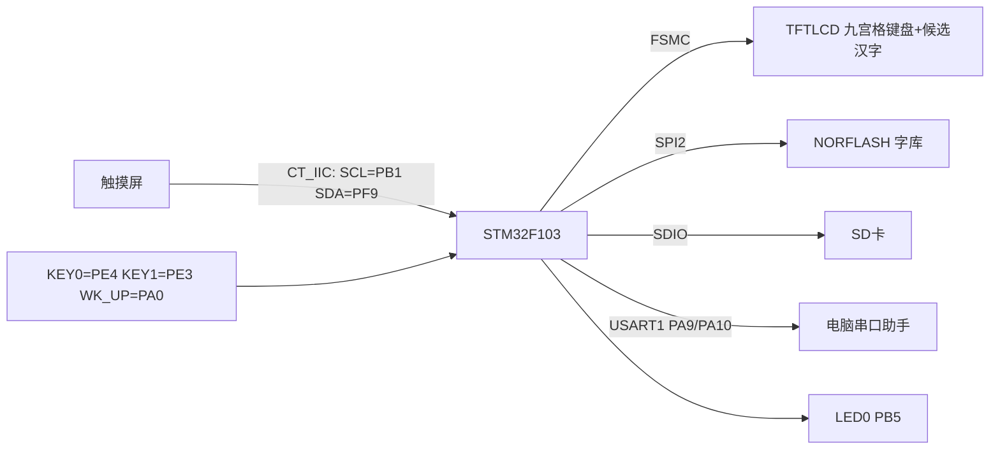
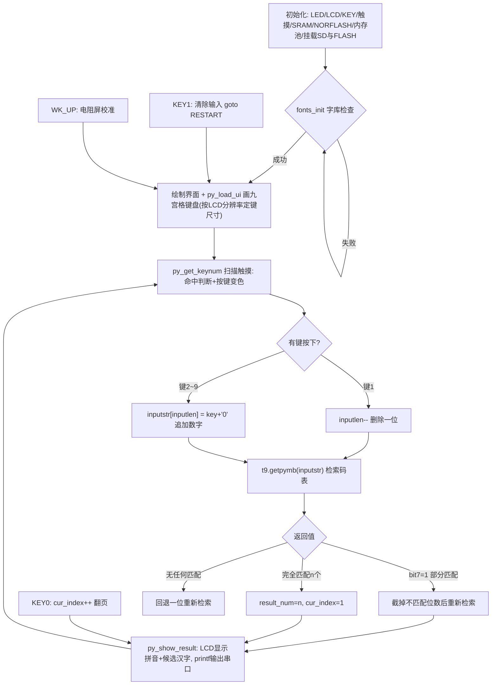

# 实验46 T9拼音输入法实验

> 平台：正点原子 STM32F103 战舰开发板 · HAL 库 · Keil MDK

## 一、实验简介

本实验在 TFTLCD 上绘制一个 **九宫格虚拟键盘**（就是老式手机上的 T9 键盘），用触摸屏输入拼音对应的**数字串**（如按 2-4 对应 "ai"…），程序实时在内置的拼音码表中查找匹配项，把对应的**拼音和候选汉字**显示在屏幕上并打印到串口。它完整演示了一个输入法的三大件：**键位映射（字母→数字）、码表检索（数字串→拼音→汉字）、候选翻页**。

🏠 **生活类比**：就像九十年代的功能手机发短信——键盘上只有 2~9 八个数字键，"2"键上印着 abc、"7"键上印着 pqrs。你想打"爱(ai)"，就按 2、4 两下，手机自动列出所有 a?i? 组合里以 24 开头的拼音和对应汉字让你挑。本实验做的就是这件事，只不过键盘画在了液晶屏上。

## 二、实验目的

- 理解 **T9 输入法原理**：字母到数字键的映射关系（abc→2、def→3 …… wxyz→9）
- 掌握"数字串 → 拼音 → 汉字候选"的**码表检索算法**（完全匹配/部分匹配）
- 学会在 LCD 上用触摸坐标实现**九宫格虚拟键盘**（绘制、命中判断、按下变色）
- 掌握 `py_index` / `pyinput` 等数据结构与函数指针的用法
- 了解汉字候选的翻页与清除逻辑

## 三、硬件资源与连接图

| 外设 | 引脚 | 说明 |
|------|------|------|
| 电容触摸 IIC | **SCL=PB1、SDA=PF9**（ctiic 软件模拟IIC） | 读取触摸坐标，点按虚拟键盘 |
| 电容触摸控制 | **GT9XXX_RST=PF11、GT9XXX_INT=PF10** | 复位与中断引脚 |
| TFTLCD | FSMC 16位8080并口 | 显示界面、九宫格键盘、拼音与汉字候选 |
| KEY0 | **PE4** | 候选结果下翻页 |
| KEY1 | **PE3** | 清除本次输入，重新开始 |
| WK_UP (KEY_UP) | **PA0** | 电阻屏触摸校准 |
| LED0 | **PB5** | 低电平点亮，闪烁提示运行 |
| 串口1 | **PA9 / PA10** | 115200，打印拼音与匹配结果 |
| NORFLASH | SPI2（PB13/PB14/PB15，CS=PB12） | 存放字库（显示汉字必需） |
| SD 卡 | SDIO：PC8~PC12、PD2 | 挂载文件系统 |



## 四、核心模块（拼音码表与 T9 检索算法，纯软件部分）

本实验的核心是 `Middlewares/T9INPUT/` 下的码表与检索代码：

| 模块/数据结构 | 作用 |
|---------------|------|
| `py_index` 结构体 | 一条"拼音索引"：`{py_input 数字串, py 拼音, pymb 汉字表指针}` |
| `py_index3[]` 码表 | **约 400 条**拼音索引（`pymb.h`），如 `{"2","a",PY_mb_a}`、`{"24","ai",PY_mb_ai}`，按数字串检索 |
| `PY_mb_xxx[]` 汉字表 | 每个拼音对应一串常用汉字，如 `PY_mb_ai={"爱埃挨哎唉哀皑癌蔼矮艾碍隘捱嗳嗌嫒瑷暧砹锿霭"}` |
| `pyinput t9` 结构体 | 输入法对象：`{getpymb 函数指针, pymb[10] 匹配结果指针数组}`，最多存 `MAX_MATCH_PYMB=10` 个候选 |
| `str_match(s1,s2)` | 字符串比较：返回 0xFF=完全匹配，其他=从开头起匹配的位数（用于找"最佳部分匹配"） |
| `get_matched_pymb()` | 遍历码表：收集所有**完全匹配**的拼音；若一个都没有，则返回**最佳部分匹配**（bit7=1 标志部分匹配，bit6:0=有效位数） |
| `t9.getpymb(str)` | 对外统一入口 = `get_matched_pymb(str, t9.pymb)` |

T9 键位映射（虚拟键盘上直接印着）：

```
1:←(删除)   2:abc   3:def
4:ghi       5:jkl   6:mno
7:pqrs      8:tuv   9:wxyz
```

## 五、软件架构 / 流程



## 六、主要示例代码及讲解

### 1. 拼音码表（`Middlewares/T9INPUT/pymb.h`）

```c
/* 汉字排列表 */
const char PY_mb_a     []={"啊阿腌吖锕厑嗄錒呵腌"};
const char PY_mb_ai    []={"爱埃挨哎唉哀皑癌蔼矮艾碍隘捱嗳嗌嫒瑷暧砹锿霭"};
...
/* 拼音数字串索引表 */
const py_index py_index3[]=
{
    {"" ,"",(char*)PY_mb_space},
    {"2","a",(char*)PY_mb_a},
    {"3","e",(char*)PY_mb_e},
    {"6","o",(char*)PY_mb_o},
    {"24","ai",(char*)PY_mb_ai},
    {"26","an",(char*)PY_mb_an},
    {"26","ao",(char*)PY_mb_ao},
    ...
};
```

**讲解**：
- 这是整个输入法的"字典"：每个拼音按 T9 规则转成数字串（a→2、i→4，所以 ai→"24"）。
- 注意 `{"26","an",...}` 与 `{"26","ao",...}` 数字串相同——这正是 T9 的**一对多**特性：输入 26 时 an/ao 都是候选，需要翻页选择。
- 汉字表按常用程度排序，候选显示时直接取 `pymb` 字符串逐个显示。

### 2. 码表检索核心（`Middlewares/T9INPUT/pyinput.c`）

```c
uint8_t get_matched_pymb(uint8_t *strin, py_index **matchlist)
{
    py_index *bestmatch = 0;    /* 最佳匹配 */
    ...
    bestmatch = (py_index *)&py_index3[0];  /* 默认为a的匹配 */
    pyindex_len = sizeof(py_index3) / sizeof(py_index3[0]); /* 得到py索引表的大小 */

    for (i = 0; i < pyindex_len; i++)
    {
        temp = str_match(strin, (uint8_t *)py_index3[i].py_input);

        if (temp)
        {
            if (temp == 0XFF)
            {
                matchlist[mcnt++] = (py_index *)&py_index3[i];  /* 完全匹配, 收进候选表 */
            }
            else if (temp > bmcnt)  /* 找最佳匹配 */
            {
                bmcnt = temp;
                bestmatch = (py_index *)&py_index3[i];  /* 最好的匹配 */
            }
        }
    }

    if (mcnt == 0 && bmcnt)     /* 没有完全匹配的结果,但是有部分匹配的结果 */
    {
        matchlist[0] = bestmatch;
        mcnt = bmcnt | 0X80;    /* 返回部分匹配的有效位数 */
    }

    return mcnt;    /* 返回匹配的个数 */
}
```

**讲解**：
- **一次线性遍历**约 400 条码表：`str_match` 返回 0xFF 表示输入串与某条数字串完全一致，收进候选数组；否则记录"从头开始能匹配几位"的最大者作为最佳部分匹配。
- 返回值是**打包的状态**：bit7=0 时，低 7 位是完全匹配的拼音个数；bit7=1 时，低 7 位是部分匹配的有效位数——main 函数据此把多按的数字截掉重新检索，实现"智能纠错回退"。
- `t9.getpymb` 是**函数指针**（指向 `get_pymb`），把算法与界面代码解耦，这是小型 C 工程里常见的"面向对象"写法。

### 3. 虚拟键盘命中判断（`User/main.c`）

```c
uint8_t py_get_keynum(uint16_t x, uint16_t y)
{
    ...
    tp_dev.scan(0);

    if (tp_dev.sta & TP_PRES_DOWN)  /* 触摸屏被按下 */
    {
        for (i = 0; i < 3; i++)
        {
            for (j = 0; j < 3; j++)
            {
                if (tp_dev.x[0] < (x + j * kbdxsize + kbdxsize) &&
                    tp_dev.x[0] > (x + j * kbdxsize) &&
                    tp_dev.y[0] < (y + i * kbdysize + kbdysize) &&
                    tp_dev.y[0] > (y + i * kbdysize))
                {
                    key = i * 3 + j + 1;    /* 换算成1~9号键 */
                    break;
                }
            }
            ...
            py_key_staset(x, y, key_x - 1, 1);  /* 被按下的键填充绿色 */
        }
    }
    else if (key_x)
    {
        py_key_staset(x, y, key_x - 1, 0);      /* 松开恢复白色 */
        key_x = 0;
    }
    return key;
}
```

**讲解**：
- 九宫格键盘画在 `(30,195)` 处，每个键宽 `kbdxsize`、高 `kbdysize`（按 LCD 的 `lcddev.id` 分辨率自动选择尺寸）。触摸坐标落在哪个格子，就换算出键值 1~9。
- `static key_x` 记录当前按下的键，**同一次按压只触发一次**（按住不动不会连续输入）；按下变绿、松开复原，给用户视觉反馈。
- 键值 1 是"←"删除键，2~9 直接 `+'0'` 变成字符 '2'~'9' 拼进 `inputstr`。

## 七、实验效果

1. 开机检查字库后显示界面：标题、按键提示（"KEY_UP:校准 / KEY0:翻页 KEY1:清除"）、"输入/匹配/拼音/当前/结果"各栏目，以及下方 3×3 九宫格拼音键盘。
2. 点按键盘输入数字串，屏幕实时刷新：有效数字串、匹配结果数、第一个候选的**拼音与对应汉字**（最多 10 个候选），同时串口打印拼音与结果。
3. 输入的数字若无法完全匹配（如按了 2 再按 9），程序自动截掉无效位并按**最佳部分匹配**给出提示。
4. 按 **KEY0** 在多个完全匹配的拼音之间翻页；按 **KEY1** 清空本次输入；电阻屏按 **WK_UP** 校准。
5. LED0 闪烁提示程序运行。

## 八、注意事项

- 显示汉字依赖 **NORFLASH 中的字库**，字库缺失会反复提示 "Font Error!"，请先用字库生成工具烧录。
- 码表是**静态数据**（约 400 条拼音、每条最多 10 个候选），只做单字输入演示，不支持词组联想与用户自造词。
- 输入串最长 6 位（`inputstr[7]`，含结束符），超出无效。
- 电容屏不需要校准，`WK_UP` 校准只对电阻屏生效（`tp_dev.touchtype == 0`）。
- 串口助手波特率 **115200**，请用 XCOM/SSCOM，P4 的 PA9/PA10 用跳线帽连到 RXD/TXD。
- 可通过 USMART 调用 `test_py("数字串")` 在串口上直接调试检索算法。
- 修改代码后重新编译烧录；若烧录失败先运行根目录 `keilkill.bat`。

## 九、文件结构

```
实验46 T9拼音输入法实验/
├── User/
│   ├── main.c                  主程序（虚拟键盘UI/输入处理/结果显示）
│   └── stm32f1xx_it.c          中断服务函数
├── Drivers/
│   ├── BSP/
│   │   ├── TOUCH/              触摸驱动 (touch, gt9xxx, ft5206, ctiic)
│   │   ├── LCD/ KEY/ LED/ SRAM/ SDIO/ NORFLASH/ SPI/ IIC/ 24CXX/
│   ├── SYSTEM/                 delay / sys / usart
│   └── STM32F1xx_HAL_Driver/   ST HAL 库
├── Middlewares/
│   ├── T9INPUT/                T9拼音输入法核心
│   │   ├── pyinput.c/.h        码表检索算法 (str_match/get_matched_pymb/t9对象)
│   │   ├── pymb.h              拼音码表 py_index3[] 与汉字表 PY_mb_xxx[]
│   │   └── t9input.c/.h        F407 GUI版输入法遗留代码(本实验未使用)
│   ├── FATFS/                  文件系统
│   ├── TEXT/                   汉字显示（字库）
│   ├── MALLOC/ PICTURE/ USMART/
└── Projects/MDK-ARM/           Keil 工程文件 (.uvprojx)
```
