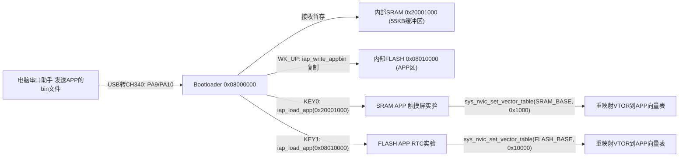
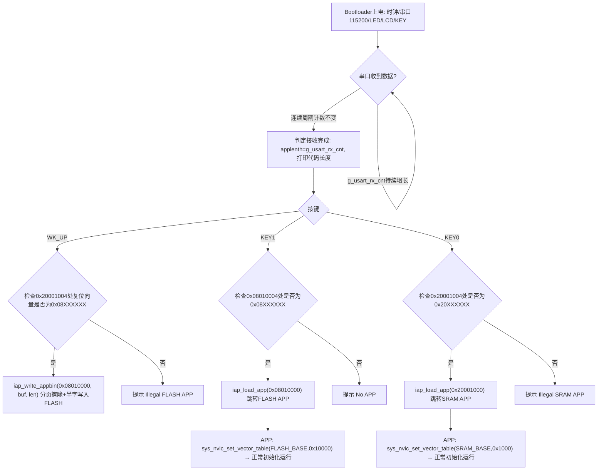

# 实验47 串口IAP实验

> 平台：正点原子 STM32F103 战舰开发板 · HAL 库 · Keil MDK

本实验目录包含三个工程：**IAP Bootloader V1.0**（引导程序）+ 两个示例 APP（**实验15 RTC实验_FLASH_APP**、**实验27 触摸屏实验_SRAM_APP**）。

## 一、实验简介

IAP（In-Application Programming，在应用编程）就是**不借助烧录器，让程序自己升级自己**。本实验先烧录一个 Bootloader（引导程序）到 STM32 内部 FLASH 的起始区域，之后把 APP 程序的 `.bin` 文件通过**串口**发给开发板：Bootloader 把收到的数据暂存在内部 SRAM（0x20001000），按按键决定是直接在 SRAM 里运行它，还是搬进 FLASH 的 0x08010000 处再运行。运行 FLASH APP 的关键是**中断向量表重映射**（设置 `SCB->VTOR`），否则 APP 里的中断会跳回 Bootloader 的向量表而出错。

🏠 **生活类比**：Bootloader 像手机的" recovery 刷机模式"——它常驻在机身里，负责接收新系统（APP）；SRAM APP 像"试用装"，断电就没了；FLASH APP 像"正式安装"，重启依然在。而中断向量表就像大楼的**楼层索引牌**：APP 搬到了 0x08010000 这个"新楼层"，必须把索引牌（VTOR）也改到新楼层，否则找"电梯"（中断）时还会跑回老楼层。

## 二、实验目的

- 理解 IAP 的基本框架：**Bootloader + APP** 双程序分区存放
- 掌握串口接收任意二进制数据（大缓冲区、无校验、一次性接收）的方法
- 掌握 STM32 内部 FLASH 的解锁、页擦除与半字编程（`stmflash` 驱动）
- 掌握"跳转执行 APP"的三个关键步骤：检查栈顶地址 → 设置 MSP → 跳到复位向量
- 掌握 APP 端 **中断向量表偏移设置**（`SCB->VTOR`，FLASH APP 偏移 0x10000，SRAM APP 偏移 0x1000）

## 三、硬件资源与连接图

| 外设 | 引脚 | 说明 |
|------|------|------|
| 串口1 | **PA9(TX) / PA10(RX)** | 115200，接收 APP 的 bin 数据（板载 CH340 USB 转串口） |
| 内部 FLASH | 0x08000000~0x0807FFFF（512KB） | Bootloader 占前段；**APP 存放地址 0x08010000**，页大小 2KB |
| 内部 SRAM | 0x20000000~0x2000FFFF（64KB） | 串口接收缓冲区 `g_usart_rx_buf` **固定在 0x20001000**，55KB；SRAM APP 也从此处执行 |
| WK_UP (KEY_UP) | **PA0** | 把 SRAM 中收到的 APP 复制到 FLASH 0x08010000 |
| KEY1 | **PE3** | 运行 FLASH APP（0x08010000） |
| KEY0 | **PE4** | 运行 SRAM APP（0x20001000） |
| LED0 | **PB5** | 低电平点亮，闪烁提示 Bootloader 运行 |
| TFTLCD | FSMC 16位8080并口 | 显示操作提示与状态 |



## 四、核心寄存器（FLASH 编程 + 中断向量表重映射）

| 寄存器 | 名称 | 作用 |
|--------|------|------|
| `FLASH->KEYR` | FLASH 键寄存器 | 依次写入解锁键 **0x45670123、0xCDEF89AB** 解锁 FLASH 编程/擦除（HAL 的 `HAL_FLASH_Unlock` 内部完成） |
| `FLASH->CR` | FLASH 控制寄存器 | PG 位=编程使能；PER 位=页擦除；STRT 位=启动擦除；LOCK 位=上锁 |
| `FLASH->SR` | FLASH 状态寄存器 | BSY 位=忙；EOP 位=操作完成；WRPRTERR 等错误标志 |
| `FLASH->ACR` | FLASH 访问控制寄存器 | 延时/预取配置（时钟初始化时设置） |
| `SCB->VTOR` | **中断向量表偏移寄存器** | 高 23 位有效（低 9 位保留），指向 APP 的向量表基地址，APP 启动时必设 |
| `MSP` | 主堆栈指针 | 跳转 APP 前，用 APP 向量表第 1 个字（栈顶地址）重设 MSP |

FLASH 编程要点（`Drivers/BSP/STMFLASH/stmflash.h/.c`）：

```c
#define STM32_FLASH_SIZE        0x80000         /* STM32 FLASH 总大小 512KB */
#define STM32_FLASH_BASE        0x08000000      /* STM32 FLASH 起始地址 */
#define STM32_SECTOR_SIZE       2048            /* 容量≥256K的F103, 页(扇区)大小为2K字节 */
```

- F103 大容量 FLASH 按**页（2KB）**擦除、按**半字（16位）**编程（`HAL_FLASH_Program(FLASH_TYPEPROGRAM_HALFWORD, ...)`）。
- USART 侧（`Drivers/SYSTEM/usart/usart.h`）：`USART_REC_LEN = 55*1024`，接收缓冲用链接属性**绝对定位**到 0x20001000，中断里逐字节存入 `g_usart_rx_buf[g_usart_rx_cnt++]`。

## 五、软件架构 / 流程



## 六、主要示例代码及讲解

### 1. 跳转到 APP 执行（`IAP Bootloader V1.0/User/IAP/iap.c`）

```c
typedef void (*iapfun)(void);   /* 定义一个函数类型的参数 */
iapfun jump2app;

void iap_load_app(uint32_t appxaddr)
{
    if (((*(volatile  uint32_t *)appxaddr) & 0x2FFE0000) == 0x20000000)   /* 检查栈顶地址是否合法 */
    {
        /* 用户代码区第二个字为程序开始地址(复位地址) */
        jump2app = (iapfun) * (volatile uint32_t *)(appxaddr + 4);

        /* 初始化APP堆栈指针(用户代码区的第一个字用于存放栈顶地址) */
        sys_msr_msp(*(volatile uint32_t *)appxaddr);

        /* 跳转到APP */
        jump2app();
    }
}
```

**讲解**：
- Cortex-M 的 bin 镜像**前两个字**是固定的：第 1 个字 = 栈顶地址（必须在 SRAM 范围 0x20000000~0x2001FFFF 内，故用 `0x2FFE0000` 掩码检查），第 2 个字 = 复位向量（Reset_Handler 地址，即 APP 的真正入口）。
- `sys_msr_msp()` 执行 `MSR MSP, R0` 指令重设主堆栈指针，然后把复位向量强转成**函数指针**直接调用——从此 CPU 就在 APP 里跑了。
- 跳转前应关闭相关中断（本程序在按键流程中直接跳转，APP 会重新初始化 NVIC）。

### 2. 把 bin 写入 FLASH（`IAP Bootloader V1.0/User/IAP/iap.c`）

```c
void iap_write_appbin(uint32_t appxaddr, uint8_t *appbuf, uint32_t appsize)
{
    uint16_t t, i = 0, temp;
    uint32_t fwaddr = appxaddr; /* 当前写入的地址 */
    uint8_t *dfu = appbuf;

    for (t = 0; t < appsize; t += 2)
    {
        temp = (uint16_t)dfu[1] << 8;
        temp |= (uint16_t)dfu[0];
        dfu += 2;               /* 偏移2个字节 */
        g_iapbuf[i++] = temp;

        if (i == 1024)
        {
            i = 0;
            stmflash_write(fwaddr, g_iapbuf, 1024);
            fwaddr += 2048;     /* 每凑满1024个半字(2KB=一页), 写一次 */
        }
    }

    if (i) stmflash_write(fwaddr, g_iapbuf, i);  /* 将最后的一些内容字节写进去 */
}
```

**讲解**：
- STM32F1 的 FLASH 只能按**半字（16位）**编程，所以把相邻两个字节拼成一个 `uint16_t`（小端序）。
- 用 2KB 的 `g_iapbuf` 做中转，凑满一页写一页；`stmflash_write` 内部完成**解锁 → 判断是否要页擦除 → 编程 → 上锁**（`FLASH_TYPEERASE_PAGES` + `HAL_FLASH_Program`）。
- 目标地址 `FLASH_APP1_ADDR = 0x08010000`（`iap.h` 中定义），Bootloader 占用它之前的空间，两者互不覆盖。

### 3. APP 端设置向量表偏移（`实验15 RTC实验_FLASH_APP/User/main.c`、`Drivers/SYSTEM/sys/sys.c`）

```c
/* FLASH APP: main.c 开头 */
sys_nvic_set_vector_table(FLASH_BASE, 0x10000);   /* 设置中断向量表偏移量为0X10000 */

/* SRAM APP(实验27): main.c 开头 */
sys_nvic_set_vector_table(SRAM_BASE, 0x1000);     /* 向量表在SRAM里面, 偏移量0X1000 */

/* sys.c 中的实现 */
void sys_nvic_set_vector_table(uint32_t baseaddr, uint32_t offset)
{
    /* 设置NVIC的向量表偏移寄存器,VTOR低9位保留,即[8:0]保留 */
    SCB->VTOR = baseaddr | (offset & (uint32_t)0xFFFFFE00);
}
```

**讲解**：
- FLASH APP 链接在 0x08010000（= FLASH_BASE + **0x10000**），SRAM APP 链接在 0x20001000（= SRAM_BASE + **0x1000**），所以两个 APP 的偏移量不同。
- APP 的 `main` 一进来就改 `SCB->VTOR`，此后所有中断/异常都会去 **APP 自己的向量表**取服务函数地址——这是编写 APP 工程时**绝对不能忘**的一步。
- 偏移量必须 **512 字节对齐**（VTOR 低 9 位保留），且 APP 起始地址不能落在 Bootloader 代码区内。

## 七、实验效果

1. 烧录 Bootloader（`IAP Bootloader V1.0/Output/atk_f103.hex`）后开机，LCD 显示 "IAP TEST" 与三条按键提示，LED0 闪烁，串口等待接收。
2. 用串口助手（XCOM/SSCOM 的**发送文件**功能）把 APP 工程的 `Output/atk_f103.bin` 发出，Bootloader 打印"用户程序接收完成! 代码长度:xxxxBytes"。
3. 按 **KEY0**：校验 0x20001004 处为 0x20XXXXXX 后直接运行 **SRAM APP**（触摸屏实验），断电即失效。
4. 按 **WK_UP**：校验 0x20001004 处为 0x08XXXXXX 后，把 APP 从 SRAM 搬到 FLASH 0x08010000，LCD 显示 "Copy APP Successed!!"；再按 **KEY1** 即可运行 **FLASH APP**（RTC 实验）。FLASH APP 掉电不丢失，重启后仍会先进入 Bootloader，按 KEY1 即可再次运行它。
5. 非法程序（地址校验不通过）会提示 "Illegal FLASH/SRAM APP!"；无固件时提示 "No APP!"。

## 八、注意事项

- **创建 APP 代码时切记设置中断向量偏移量**（FLASH APP：0x10000；SRAM APP：0x1000），否则 APP 内所有中断都会异常。
- APP 起始地址必须与 Bootloader 分区错开，且至少 **512 字节对齐**（推荐按 2KB 页对齐，本工程用 0x08010000）。
- 串口接收是**无校验、一次性**的：发送 bin 文件期间不要夹杂其他数据；本 Bootloader 判断"接收完成"的依据是接收计数在相邻检测周期内不再变化。
- 接收缓冲固定占 0x20001000 起 55KB，因此 **SRAM APP 也运行在 0x20001000**；FLASH APP 对 SRAM 无此限制。
- 串口助手波特率 **115200**，请用 XCOM/SSCOM（其他助手可能拉 DTR/RTS 导致复位）；P4 的 PA9/PA10 需跳线帽连 RXD/TXD。
- 擦写 FLASH 期间不要断电；修改代码后重新编译烧录，失败先运行各目录下 `keilkill.bat`。

## 九、文件结构

```
实验47 串口IAP实验/
├── IAP Bootloader V1.0/            引导程序工程
│   ├── User/
│   │   ├── main.c                  主程序（串口收APP + 按键分发 + 校验跳转）
│   │   ├── IAP/iap.c/.h            IAP核心（iap_load_app跳转 / iap_write_appbin写FLASH）
│   │   └── stm32f1xx_it.c          中断服务函数
│   ├── Drivers/
│   │   ├── BSP/STMFLASH/           内部FLASH读写驱动（解锁/页擦除/半字编程）
│   │   ├── BSP/LCD|LED|KEY/
│   │   └── SYSTEM/usart/           串口接收（55KB缓冲@0x20001000）
│   └── Output/atk_f103.hex         编译好的Bootloader（可直接烧录）
├── 实验15 RTC实验_FLASH_APP/       FLASH APP 示例（RTC实验）
│   ├── User/main.c                 开头调用 sys_nvic_set_vector_table(FLASH_BASE, 0x10000)
│   └── Output/atk_f103.bin/.hex    发送给Bootloader的APP固件（bin用于串口IAP）
└── 实验27 触摸屏实验_SRAM_APP/     SRAM APP 示例（触摸屏实验）
    ├── User/main.c                 开头调用 sys_nvic_set_vector_table(SRAM_BASE, 0x1000)
    └── Output/atk_f103.bin/.hex    发送给Bootloader的APP固件
```
