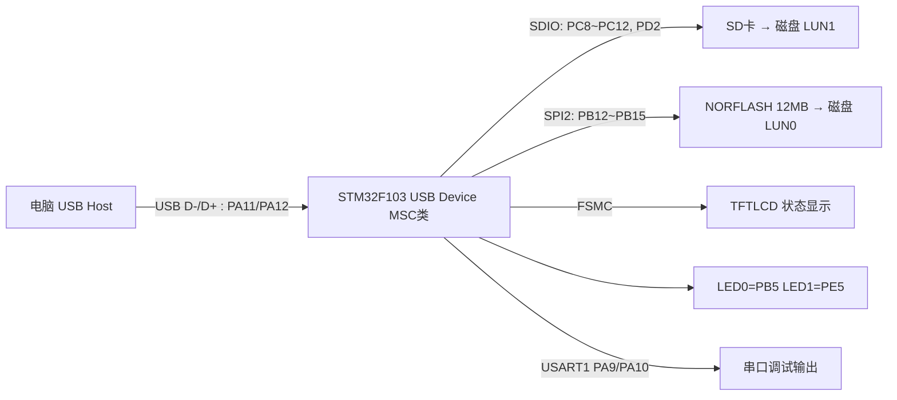
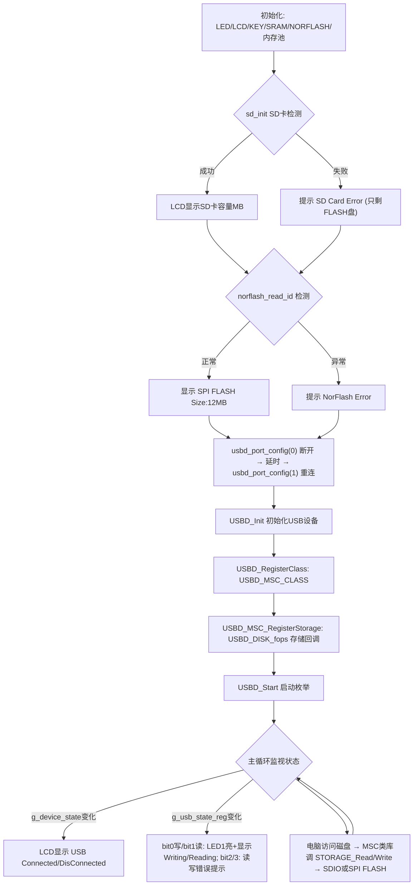

# 实验48 USB读卡器实验

> 平台：正点原子 STM32F103 战舰开发板 · HAL 库 · Keil MDK · ST USB Device 库

## 一、实验简介

本实验让 STM32F103 充当一个 **USB 设备（Device/Slave）**：通过板上的 USB_SLAVE 接口（D-/D+ 接 PA11/PA12）连到电脑，枚举成 **USB 大容量存储设备（MSC 类）**。它把 **SD 卡**和板载 **12MB NORFLASH** 分别包装成两个"可移动磁盘"呈现给电脑——插上 USB 线，电脑"此电脑"里就会多出两个 U 盘，可以直接拷贝文件。STM32 在中间做的事，就是把 USB 收到的 SCSI 读/写命令翻译成对 SDIO 或 SPI FLASH 的扇区读写。

🏠 **生活类比**：STM32 变成了一个"翻译官 + 双面管家"：电脑说的是 USB/SCSI 语言（"读第 100 号扇区"），存储介质说的是各自的方言（SD 卡走 SDIO、NORFLASH 走 SPI）。读卡器把两种语言互译，电脑就以为自己在和一个普通 U 盘对话。

## 二、实验目的

- 掌握 STM32 **USB 全速设备（USB_FS）**的基本配置（PA11/PA12、USB 时钟、USB_LP 中断）
- 理解 USB 设备库的分层结构：Core（枚举/端点）→ Class（MSC 类）→ 用户存储回调
- 掌握 **MSC 类存储回调接口**（Init/GetCapacity/Read/Write/GetMaxLun）的实现方法
- 学会用**多 LUN（逻辑单元）**把两个物理介质映射成两个磁盘
- 了解 USB 连接状态的软件控制（断开/重连，即 D+ 上拉控制）

## 三、硬件资源与连接图

| 外设 | 引脚 | 说明 |
|------|------|------|
| USB_SLAVE 接口 | **PA11(D-) / PA12(D+)** | USB 全速 12Mbps，连电脑 |
| SD 卡 (SDIO) | **PC8~PC11(D0~D3) / PC12(SCK) / PD2(CMD)** | LUN1：可移动磁盘 1 |
| NORFLASH | **SPI2：PB13(SCK) / PB14(MISO) / PB15(MOSI) / PB12(CS)** | LUN0：12MB 可移动磁盘 2 |
| LED0 | **PB5** | 低电平点亮，闪烁提示运行 |
| LED1 | **PE5** | USB 连接成功常亮；读写时点亮 |
| TFTLCD | FSMC 16位8080并口 | 显示介质容量与 USB 读写状态 |
| 串口1 | **PA9 / PA10** | 115200，打印读写错误信息 |



## 四、核心寄存器（USB_FS 设备外设 + SDIO）

STM32F103 内置 **USB 全速设备外设**（寄存器基址 0x40005C00，本实验由 HAL PCD 驱动封装，`hpcd.Instance = USB`，`hpcd.Init.speed = PCD_SPEED_FULL`）：

| 寄存器 | 名称 | 作用 |
|--------|------|------|
| `USB_CNTR` | 控制寄存器 | FRES=强制复位、PDWN=掉电模式；控制 USB 外设启停 |
| `USB_ISTR` | 中断状态寄存器 | CTR=正确传输、RESET=总线复位（枚举开始）、SUSP=挂起、WKUP=唤醒 |
| `USB_DADDR` | 设备地址寄存器 | 枚举时主机分配的 7 位地址，EF 位=使能 |
| `USB_BTABLE` | 缓冲表地址寄存器 | 指向 PMA（USB 专用包内存区）中的端点缓冲描述表 |
| `USB_EPnR` (n=0~7) | 端点寄存器 | 每个端点的类型（批量/控制/中断）、地址、收发状态；MSC 用 2 个**批量端点**（IN/OUT） |
| PMA (512B) | 专用包内存区 | USB 收发数据的实际缓存，通过 BTABLE 描述表映射到端点 |
| `RCC_APB1ENR` | 时钟使能 | USBEN 位使能 USB 时钟（`__HAL_RCC_USB_CLK_ENABLE()`），中断用 `USB_LP_CAN1_RX0_IRQn` |

SD 卡侧使用 **SDIO 外设**（`SDIO->POWER / CLKCR / ARG / CMD / STA / ICR / DPSM / FIFO`，由 HAL SD 驱动与 `sdio_sdcard.c` 封装）；NORFLASH 侧使用 **SPI2**（`SPI2->CR1/CR2/SR/DR`，HAL SPI 封装）。MSC 协议层（BOT 批量传输、SCSI 命令解析）由 ST 的 `usbd_msc` 类库完成，用户只需实现存储回调。

## 五、软件架构 / 流程



## 六、主要示例代码及讲解

### 1. USB 设备初始化（`User/main.c`）

```c
usbd_port_config(0);    /* USB先断开 */
delay_ms(500);
usbd_port_config(1);    /* USB再次连接 */
delay_ms(500);

lcd_show_string(30, 170, 200, 16, 16, "USB Connecting...", RED);    /* 提示正在建立连接 */
USBD_Init(&USBD_Device, &MSC_Desc, 0);                      /* 初始化USB */
USBD_RegisterClass(&USBD_Device, USBD_MSC_CLASS);           /* 添加类 */
USBD_MSC_RegisterStorage(&USBD_Device, &USBD_DISK_fops);    /* 为MSC类添加回调函数 */
USBD_Start(&USBD_Device);                                   /* 开启USB */
```

**讲解**：
- `usbd_port_config()` 通过把 PA11/PA12 拉低再释放，模拟一次**拔插动作**，确保电脑重新枚举（F103 的 USB 上拉由板上电路/引脚状态控制）。
- 四步初始化是 ST USB 设备库的标准套路：`USBD_Init`（底层 PCD/描述符）→ 注册 **MSC 类** → 挂上**存储回调** `USBD_DISK_fops` → `USBD_Start` 开中断等枚举。
- 枚举成功后 `g_device_state` 置 1，主循环里点亮 LED1 并显示 "USB Connected"。

### 2. 存储回调接口（`Middlewares/USB/USB_APP/usbd_storage.c`）

```c
USBD_StorageTypeDef USBD_DISK_fops =
{
    STORAGE_Init,
    STORAGE_GetCapacity,
    STORAGE_IsReady,
    STORAGE_IsWriteProtected,
    STORAGE_Read,
    STORAGE_Write,
    STORAGE_GetMaxLun,
    (int8_t *)STORAGE_Inquirydata,
};

int8_t STORAGE_GetCapacity (uint8_t lun, uint32_t *block_num, uint16_t *block_size)
{
    switch (lun)
    {
        case 0: /* SPI FLASH */
            *block_size = 512;
            *block_num = (1024 * 1024 * 12) / 512;   /* SPI FLASH的 12MB 字节, 文件系统用 */
            break;

        case 1: /* SD卡 */
            *block_size = 512;
            *block_num = ((long long)g_sdcard_handler.SdCard.BlockNbr * g_sdcard_handler.SdCard.BlockSize) / 512;
            break;
    }
    return 0;
}
```

**讲解**：
- MSC 类库通过这张**函数指针表**访问物理介质——这就是"USB 协议"与"存储介质"之间的抽象层，换介质只需改这几个函数。
- 本实验有 2 个 LUN（逻辑单元）：**LUN0=NORFLASH（12MB）**、**LUN1=SD 卡**。对电脑来说，USB 存储一律按 **512 字节扇区**访问，所以 FLASH 也把块大小报成 512。
- `STORAGE_Inquirydata` 是两个磁盘的"铭牌"（厂商 ALIENTEK、产品名 SPI Flash Disk / SD Flash Disk），电脑设备管理器里能看到。

### 3. 扇区读写（`Middlewares/USB/USB_APP/usbd_storage.c`）

```c
int8_t STORAGE_Read (uint8_t lun, uint8_t *buf, uint32_t blk_addr, uint16_t blk_len)
{
    int8_t res = 0;
    g_usb_state_reg |= 0X02;    /* 标记正在读数据 */

    switch (lun)
    {
        case 0: /* SPI FLASH */
            norflash_read(buf, USB_STORAGE_FLASH_BASE + blk_addr * 512, blk_len * 512);
            break;

        case 1: /* SD卡 */
            res = sd_read_disk(buf, blk_addr, blk_len);
            break;
    }

    if (res)
    {
        printf("rerr:%d,%d\r\n", lun, res);
        g_usb_state_reg |= 0X08;    /* 读错误! */
    }
    return res;
}
```

**讲解**：
- 电脑读"扇区 blk_addr 开始的 blk_len 个扇区"，FLASH 盘换算成字节地址（`USB_STORAGE_FLASH_BASE=0`，即整片 12MB NORFLASH 都可被电脑访问），SD 盘直接透传给 SDIO 驱动。
- `g_usb_state_reg` 是状态位图：bit0 正在写、bit1 正在读、bit2 写错误、bit3 读错误、bit4 主机轮询——main 循环检测到变化就在 LCD 上显示 "USB Writing.../Reading..."，并点亮 LED1。
- `STORAGE_GetMaxLun()` 返回 `STORAGE_LUN_NBR - 1`（=1，表示 2 个盘）；**SD 卡异常时返回 0 只上报 FLASH 一个盘**，这就是没插卡也能用一半功能的原因。

## 七、实验效果

1. 开机检测 SD 卡与 NORFLASH：正常则在 LCD 上显示 SD 卡容量（MB）和 "SPI FLASH Size:12MB"，异常则显示相应 Error。
2. 程序自动执行一次 USB 断开/重连，随后电脑发现新硬件并枚举出**两个可移动磁盘**（无 SD 卡时只有一个 12MB 的 FLASH 盘），可直接在电脑上格式化、拷贝文件。
3. 电脑读写磁盘时，LCD 显示 "USB Writing.../Reading..."，LED1 点亮；读写出错显示 "USB Write Err / Read Err" 并串口打印错误码。
4. USB 连接建立后 LCD 显示 "USB Connected"，LED1 常亮；拔出显示 "USB DisConnected"。
5. LED0 持续闪烁提示程序运行。

## 八、注意事项

- USB 线必须插开发板的 **USB_SLAVE 接口**（不是 USB_UART，那个是 CH340 串口）。
- 本例程**仅支持 MCU 屏**，不支持 RGB 屏；4.3/7 寸屏建议外接 12V 1A 电源。
- 没有 SD 卡也能实验，但电脑只会看到 12MB 的 SPI FLASH 盘；**首次使用 FLASH 盘需在电脑上格式化**（FAT/FAT32）。
- NORFLASH 整片暴露给电脑（基地址 0），**不要与字库/文件系统实验的 FLASH 数据混用**，格式化会覆盖原有数据。
- MSC 传输包大小 `MSC_MEDIA_PACKET = 2KB`（`usbd_conf.h`），越大速度越快，但占用内存也越多。
- 电脑对磁盘的所有操作都是标准 SCSI 命令，由 `usbd_msc` 类库解析，**严禁**在 USB 枚举期间拔卡或复位，可能导致电脑磁盘错误。
- 修改代码后重新编译烧录；若烧录失败先运行根目录 `keilkill.bat`。

## 九、文件结构

```
实验48 USB读卡器实验/
├── User/
│   ├── main.c                  主程序（介质检测 + USB枚举 + 状态显示）
│   └── stm32f1xx_it.c          中断服务函数
├── Drivers/
│   ├── BSP/
│   │   ├── SDIO/               SD卡驱动 (sdio_sdcard.c/.h)
│   │   ├── NORFLASH/           SPI FLASH驱动 (12MB介质)
│   │   ├── SPI/ LCD/ KEY/ LED/ SRAM/
│   ├── SYSTEM/                 delay / sys / usart
│   └── STM32F1xx_HAL_Driver/   ST HAL 库（含HAL PCD USB驱动）
├── Middlewares/
│   ├── USB/
│   │   ├── STM32_USB_Device_Library/
│   │   │   ├── Core/           USB设备核心（枚举/端点/请求）
│   │   │   └── Class/MSC/      MSC大容量存储类（BOT+SCSI）
│   │   └── USB_APP/
│   │       ├── usbd_conf.c/.h  USB底层配置（PA11/PA12、时钟、中断、LUN数）
│   │       ├── usbd_desc.c/.h  设备描述符
│   │       └── usbd_storage.c/.h  存储回调（SD卡/NORFLASH → 两个磁盘）
│   ├── MALLOC/ USMART/
└── Projects/MDK-ARM/           Keil 工程文件 (.uvprojx)
```
