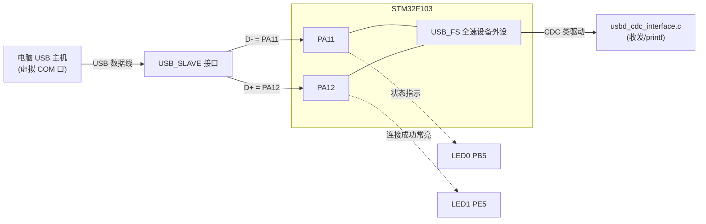
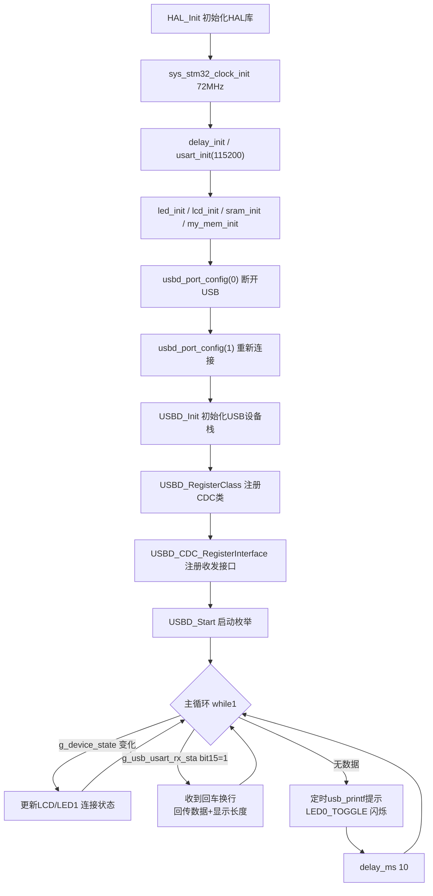

# 实验49 USB虚拟串口实验

> 平台：正点原子 战舰 STM32F103 开发板 · HAL 库 · Keil MDK · STM32 USB Device Library（CDC 类）

## 一、实验简介

本实验利用 STM32F103 自带的 **USB 全速设备外设（USB_FS）**，把它枚举成一个 **USB 虚拟串口（CDC-ACM，Virtual COM Port）**。开发板通过 USB 线接到电脑后，电脑端会出现一个"串口"，用它就能像普通串口一样和 MCU 收发数据——本例程功能与《串口通信实验》完全相同，只是把物理串口换成了 USB 虚拟串口：电脑发来一串数据（以回车换行结束），开发板原样回传并显示消息长度。

🏠 **生活类比**：普通串口好比家里的固定电话线，需要专门的接口；USB 虚拟串口则像一根"万能数据线"——插上 USB，电脑自动把它认成一个 COM 口，实际上数据走的是 USB 通道。它相当于给电脑和 MCU 之间搭了一座"翻译桥"，让 USB 数据被伪装成大家熟悉的串口数据。

## 二、实验目的

- 了解 STM32 USB 全速设备外设的基本原理与引脚（PA11=D-，PA12=D+）
- 理解 **USB CDC（通信设备类）** 如何把 USB 虚拟成一个串口
- 掌握 STM32 USB Device Library 的初始化流程（`USBD_Init → USBD_RegisterClass → USBD_CDC_RegisterInterface → USBD_Start`）
- 学会用 `usb_printf()` / `cdc_vcp_data_tx()` 通过 USB 发送数据，用接收状态字 `g_usb_usart_rx_sta` 处理收到的数据
- 理解 USB 连接状态检测（`g_device_state`）与 LED 指示

## 三、硬件资源与连接图

| 外设 | 引脚 | 说明 |
|------|------|------|
| USB_SLAVE 接口 | **PA11 (D-)** | USB 全速设备数据负线 |
| USB_SLAVE 接口 | **PA12 (D+)** | USB 全速设备数据正线（内部上拉，枚举触发点） |
| LED0 (DS0, 红) | **PB5** | 低电平点亮，闪烁提示程序运行 |
| LED1 (DS1, 绿) | **PE5** | 低电平点亮，USB 连接成功后常亮 |
| 串口1 (调试) | **PA9 / PA10** | 板载 CH340，用于打印日志（波特率 115200） |
| TFTLCD | 16 位 8080 并口 | 仅支持 MCU 屏，显示提示信息 |



> 接线说明：USB 线的 D+/D- 直接接到 PA12/PA11。开发板通过 `usbd_port_config()` 先把 PA11/PA12 拉低模拟"断开"，再重新连接，触发电脑重新枚举。开发板配套 USB 线应插 **USB_SLAVE** 接口。

## 四、核心寄存器（USB_FS + CDC 类）

STM32F103 的 USB 全速设备外设由一组寄存器控制，配合专用分组包存储区（PMA）完成收发。关键寄存器：

| 寄存器 | 名称 | 作用 |
|--------|------|------|
| `USB_CNTR` | 控制寄存器 | USB 全局控制。`FRES`(bit0) 强制复位、`PDWN`(bit1) 掉电、`RESETM`(bit10) 复位中断使能 |
| `USB_ISTR` | 中断状态寄存器 | 记录各类 USB 事件。`RESET`(bit10) 总线复位请求、`CTR` 正确传输中断 |
| `USB_FNR` | 帧号寄存器 | 保存 SOF 帧号，反映总线活动 |
| `USB_DADDR` | 设备地址寄存器 | 枚举时主机分配的设备地址；`USBD`(bit7) 使能 USB 设备功能 |
| `USB_BTABLE` | 缓冲表地址寄存器 | 指定 PMA 中"端点缓冲描述表"的起始地址 |
| `USB_EPnR` | 端点寄存器 (n=0..7) | 每个端点的地址 `EA`、类型 `EP_TYPE`、收发状态 `STAT_TX/STAT_RX`、数据翻转 `DTOG`、传输完成标志 `CTR_TX/CTR_RX` |

`USB_EPnR` 端点类型 `EP_TYPE[1:0]`：

```
00 = 批量(BULK)   01 = 控制(CONTROL)   10 = 等时(ISO)   11 = 中断(INTERRUPT)
```

CDC 类在 USB 之上定义了三种端点：**控制端点（EP0）** 处理枚举与类命令（如 `SET_LINE_CODING` 设置波特率），**批量 IN 端点** 用于设备向主机发数据，**批量 OUT 端点** 用于主机向设备发数据。这些寄存器配置由 STM32 USB Device Library（`usbd_conf.c` + HAL PCD 驱动）在 `USBD_Init()`/`USBD_Start()` 内部完成，应用层只需调用类接口函数。

## 五、软件架构 / 流程



USB 数据接收由中断驱动：主机发来数据 → `CDC_Itf_Receive()` → `cdc_vcp_data_rx()` 逐字节存入 `g_usb_usart_rx_buffer`，收到 `0x0D 0x0A`（回车换行）后置位 `g_usb_usart_rx_sta` 的 bit15 表示"一帧接收完成"，主循环再统一处理。

## 六、主要示例代码及讲解

### 1. USB 设备栈初始化（`User/main.c`）

```c
usbd_port_config(0);    /* USB先断开 */
delay_ms(500);
usbd_port_config(1);    /* USB再次连接 */
delay_ms(500);

USBD_Init(&USBD_Device, &VCP_Desc, 0);           /* 初始化USB设备,注册描述符 */
USBD_RegisterClass(&USBD_Device, USBD_CDC_CLASS);/* 注册为CDC(虚拟串口)类 */
USBD_CDC_RegisterInterface(&USBD_Device, &USBD_CDC_fops); /* 绑定收发接口 */
USBD_Start(&USBD_Device);                        /* 启动USB,开始枚举 */
```

**讲解**：
- `usbd_port_config(0/1)` 通过控制 PA11/PA12 制造一次"物理断开—重连"，确保电脑每次都重新枚举，避免上次异常残留。
- 四步初始化是 STM32 USB Device Library 的标准套路：**先初始化设备栈 → 声明自己是 CDC 类 → 把具体的收发实现（`USBD_CDC_fops`）挂进去 → 启动**。
- `VCP_Desc` 是设备描述符（厂商/产品 ID、字符串等），决定电脑把它识别成什么样的串口。

### 2. CDC 收发接口实现（`Middlewares/USB/USB_APP/usbd_cdc_interface.c`）

```c
/* 虚拟串口配置函数(供USB内核调用) */
USBD_CDC_ItfTypeDef USBD_CDC_fops =
{
    CDC_Itf_Init,
    CDC_Itf_DeInit,
    CDC_Itf_Control,      /* 处理波特率等类命令 */
    CDC_Itf_Receive       /* 收到数据时的回调 */
};

static int8_t CDC_Itf_Receive(uint8_t *buf, uint32_t *len)
{
    USBD_CDC_ReceivePacket(&USBD_Device);  /* 重新开启接收 */
    cdc_vcp_data_rx(buf, *len);            /* 处理收到的数据 */
    return USBD_OK;
}

void cdc_vcp_data_tx(uint8_t *data, uint32_t Len)  /* 发送 */
{
    USBD_CDC_SetTxBuffer(&USBD_Device, data, Len);
    USBD_CDC_TransmitPacket(&USBD_Device);
    delay_ms(CDC_POLLING_INTERVAL);
}
```

**讲解**：
- `USBD_CDC_fops` 是一张"函数表"，把初始化、控制、接收的实现注册给 USB 内核；内核收到相应事件时自动回调。
- `CDC_Itf_Control` 中处理 `CDC_SET_LINE_CODING`（电脑串口助手设置的波特率/数据位/停止位/校验位），本例默认 `115200, 8, N, 1`。
- 每次收完一包必须调用 `USBD_CDC_ReceivePacket()` 重新武装接收，否则下一次数据收不到。
- 发送时先 `SetTxBuffer` 指定缓冲和长度，再 `TransmitPacket` 触发一次批量 IN 传输。

### 3. 接收状态字解析 + 主循环回显（`usbd_cdc_interface.c` / `main.c`）

```c
/* 接收状态: bit15=接收完成, bit14=收到0x0d, bit13~0=有效字节数 */
uint16_t g_usb_usart_rx_sta = 0;

// main.c 主循环:
if (g_usb_usart_rx_sta & 0x8000)
{
    len = g_usb_usart_rx_sta & 0x3FFF;                    /* 取数据长度 */
    usb_printf("\r\n您发送的消息长度为:%d\r\n\r\n", len);
    cdc_vcp_data_tx(g_usb_usart_rx_buffer, len);          /* 原样回传 */
    g_usb_usart_rx_sta = 0;                               /* 清零,准备下次 */
}
```

**讲解**：这套"状态字 + 缓冲区"的做法和普通串口 1 接收完全一致——用 bit14 记住收到过回车 `0x0D`，再等到换行 `0x0A` 时置 bit15 表示一帧结束，低 14 位是数据长度。`usb_printf()` 则是把 `printf` 重定向到 USB（内部用 `vsprintf` 格式化后经 `cdc_vcp_data_tx` 发出），用起来和普通串口打印一样方便。

## 七、实验效果

- 用 USB 线连接开发板 **USB_SLAVE** 接口与电脑，安装 ST 虚拟串口驱动（`VCP_V1.4.0_Setup.exe`）后，电脑出现一个新 COM 口。
- **LED0（红）持续闪烁**，提示程序正在运行；USB 连接成功后 **LED1（绿）常亮**，LCD 显示 `USB Connected`。
- 打开串口调试助手（波特率 **115200**），发送一串以回车换行结束的数据，开发板会回显该数据并提示"您发送的消息长度为:N"；空闲时周期打印"请输入数据,以回车键结束"。

## 八、注意事项

- 必须先安装 ST 的 **USB 虚拟串口驱动**（`光盘\6，软件资料\1，软件\STM32 USB虚拟串口驱动\VCP_V1.4.0_Setup.exe`），若显示惊叹号请手动指定驱动路径安装。
- 电脑端串口助手波特率必须是 **115200**；建议用 XCOM/SSCOM，其他助手可能控制 DTR/RTS 导致 MCU 复位或程序不运行。
- 输入的字符串必须以**回车换行**结束，否则 `g_usb_usart_rx_sta` 的 bit15 不会置位、主循环不处理。
- USB 线务必插在 **USB_SLAVE** 接口（不是 USB_UART）。
- 本例程仅支持 **MCU 屏**，不支持 RGB 屏。
- 修改代码后需重新编译烧录；若烧录失败先运行根目录 `keilkill.bat` 结束占用进程。

## 九、文件结构

```
实验49 USB虚拟串口实验/
├── User/
│   ├── main.c                       主程序(USB栈初始化 + 收发主循环)
│   ├── APP/                         audioplayer/recorder(音频相关,本实验未用)
│   ├── stm32f1xx_it.c               中断服务函数
│   └── stm32f1xx_hal_conf.h         HAL 配置
├── Middlewares/
│   └── USB/
│       ├── STM32_USB_Device_Library/
│       │   ├── Core/                USB 设备核心(usbd_core/ctlreq/ioreq)
│       │   └── Class/CDC/           CDC 类驱动(usbd_cdc.c/.h)
│       └── USB_APP/
│           ├── usbd_cdc_interface.c/.h  CDC 收发接口 + usb_printf(核心)
│           ├── usbd_conf.c/.h       USB 底层配置(PA11/PA12、时钟、中断)
│           └── usbd_desc.c/.h       设备描述符(VCP_Desc)
├── Drivers/
│   ├── BSP/LED/  BSP/LCD/  BSP/SRAM/   LED、LCD、外部SRAM 驱动
│   ├── SYSTEM/  (delay/sys/usart)      系统支持
│   ├── CMSIS/                          内核启动与设备定义(含USB寄存器)
│   └── STM32F1xx_HAL_Driver/           ST HAL 库(含 USB PCD 驱动)
└── Projects/MDK-ARM/                   Keil 工程文件(.uvprojx)
```
