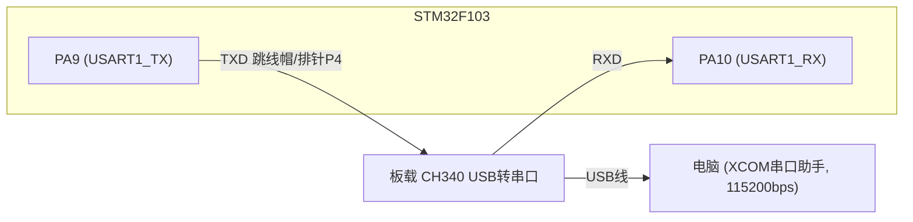
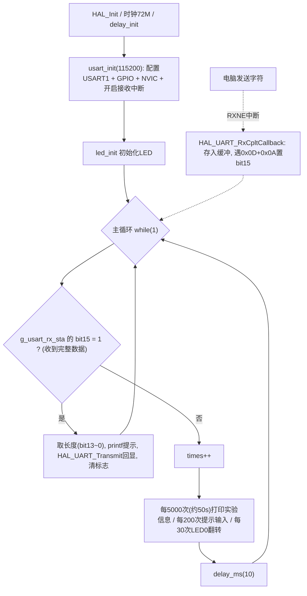

# 实验5 串口实验

> 平台：正点原子 STM32F103（战舰/精英/mini）开发板 · HAL 库 · Keil MDK

## 一、实验简介

本实验学习 **USART 串口通信**：STM32 通过串口1（PA9/PA10，板载 CH340 USB 转串口）与电脑对话。电脑发送一串字符（以回车换行结束），STM32 用中断逐字节接收，收完后原样回显；空闲时 STM32 还会定时通过 `printf` 发送提示信息，LED0 闪烁表示程序在运行。

🏠 **生活类比**：串口通信就像两个人用**对讲机**通话——先约定好语速（波特率 115200）和"一句话"的格式（8 位数据、1 位停止位、无校验），然后你说一句我回一句。对方说完"Over"（回车换行 0x0D 0x0A）你才知道一句话结束，可以把内容复述回去。

## 二、实验目的

- 掌握 USART 的初始化：波特率、数据位、停止位、校验位、收发模式
- 理解串口**中断接收**机制与 `HAL_UART_RxCpltCallback()` 回调
- 学会重定向 `fputc` 使 Keil 中 `printf` 直接输出到串口
- 理解串口引脚的复用功能配置（TX 复用推挽输出 / RX 复用输入）

## 三、硬件资源与连接图

| 外设 | 引脚 | 说明 |
|------|------|------|
| USART1_TX | **PA9** | 发送，复用推挽输出，接 CH340 的 RXD |
| USART1_RX | **PA10** | 接收，复用输入，接 CH340 的 TXD |
| LED0 (DS0, 红) | PB5 | 闪烁提示程序运行 |
| USB 转串口 | 板载 CH340 | 接电脑 USB_UART 口，用 XCOM 等串口助手收发 |



> 接线说明：PA9/PA10 通过排针 P4 的跳线帽连接到 CH340（必须接在 RXD/TXD 上），电脑用 USB 线接开发板 **USB_UART** 口即可通信，无需外接 USB 转 TTL 模块。

## 四、核心寄存器（USART）

| 寄存器 | 名称 | 作用 |
|--------|------|------|
| `RCC_APB2ENR` | 时钟使能寄存器 | 使能 USART1EN 及 GPIOA 时钟 |
| `USART_SR` | 状态寄存器 | bit7 TXE=发送缓冲空；**bit6 TC=发送完成**（`fputc` 等待的就是它，0x40）；bit5 RXNE=接收缓冲非空（触发接收中断） |
| `USART_DR` | 数据寄存器 | 写 DR 发送一个字符，读 DR 取出接收到的字符（发送/接收共用） |
| `USART_BRR` | 波特率寄存器 | 由 USART 时钟与目标波特率算出的分频值，决定 115200bps 等速率 |
| `USART_CR1` | 控制寄存器1 | UE=使能串口；TE/RE=使能发送/接收；RXNEIE=接收中断使能 |
| `USART_CR2` | 控制寄存器2 | STOP[13:12] 停止位选择（本实验 1 位） |
| `USART_CR3` | 控制寄存器3 | 硬件流控 RTS/CTS（本实验不用） |
| `GPIOA_CRH` | 端口配置高寄存器 | PA9 配复用推挽输出、PA10 配复用输入（Pin8~15 在 CRH） |

## 五、软件架构 / 流程



## 六、主要示例代码及讲解

### 1. 串口初始化（`Drivers/SYSTEM/usart/usart.c`）

```c
void usart_init(uint32_t baudrate)
{
    /*UART 初始化设置*/
    g_uart1_handle.Instance = USART_UX;                                       /* USART_UX */
    g_uart1_handle.Init.BaudRate = baudrate;                                  /* 波特率 */
    g_uart1_handle.Init.WordLength = UART_WORDLENGTH_8B;                      /* 字长为8位数据格式 */
    g_uart1_handle.Init.StopBits = UART_STOPBITS_1;                           /* 一个停止位 */
    g_uart1_handle.Init.Parity = UART_PARITY_NONE;                            /* 无奇偶校验位 */
    g_uart1_handle.Init.HwFlowCtl = UART_HWCONTROL_NONE;                      /* 无硬件流控 */
    g_uart1_handle.Init.Mode = UART_MODE_TX_RX;                               /* 收发模式 */
    HAL_UART_Init(&g_uart1_handle);                                           /* HAL_UART_Init()会使能UART1 */

    /* 该函数会开启接收中断：标志位UART_IT_RXNE，并且设置接收缓冲以及接收缓冲接收最大数据量 */
    HAL_UART_Receive_IT(&g_uart1_handle, (uint8_t *)g_rx_buffer, RXBUFFERSIZE);
}
```

**讲解**：
- "配置单"六要素：**115200、8、N、1、无流控、收发**——必须与电脑端串口助手设置完全一致，否则收到乱码。
- `HAL_UART_Init()` 内部会回调 `HAL_UART_MspInit()`，那里完成时钟使能、PA9/PA10 复用配置和 NVIC 中断使能，这是 HAL "上层配置 + 底层 MSP"的分层套路。
- `HAL_UART_Receive_IT()` 开启**中断接收**：每收到 1 字节触发一次中断，CPU 不必死等串口。

### 2. printf 重定向（`Drivers/SYSTEM/usart/usart.c`）

```c
/* MDK下需要重定义fputc函数, printf函数最终会通过调用fputc输出字符串到串口 */
int fputc(int ch, FILE *f)
{
    while ((USART_UX->SR & 0X40) == 0);     /* 等待上一个字符发送完成 */

    USART_UX->DR = (uint8_t)ch;             /* 将要发送的字符 ch 写入到DR寄存器 */
    return ch;
}
```

**讲解**：
- 标准库的 `printf` 每输出一个字符都会调用 `fputc`，把它改写成"往串口 DR 寄存器塞一个字节"，`printf` 就从串口出来了。
- `SR & 0x40` 检查 **TC（发送完成）标志**：上一个字符没发完就写 DR 会丢数据，所以先等待。
- 该文件同时定义了 `_sys_exit` 等函数关闭**半主机模式**，否则脱离调试器运行时程序会卡死。

### 3. 中断接收与"回车换行判帧"（`Drivers/SYSTEM/usart/usart.c`，节选）

```c
void HAL_UART_RxCpltCallback(UART_HandleTypeDef *huart)
{
    if (huart->Instance == USART_UX)                    /* 如果是串口1 */
    {
        if ((g_usart_rx_sta & 0x8000) == 0)             /* 接收未完成 */
        {
            if (g_usart_rx_sta & 0x4000)                /* 接收到了0x0d（即回车键） */
            {
                if (g_rx_buffer[0] != 0x0a)             /* 接收到的不是0x0a（即不是换行键） */
                {
                    g_usart_rx_sta = 0;                 /* 接收错误,重新开始 */
                }
                else                                    /* 接收到的是0x0a（即换行键） */
                {
                    g_usart_rx_sta |= 0x8000;           /* 接收完成了 */
                }
            }
            else                                        /* 还没收到0X0d（即回车键） */
            {
                if (g_rx_buffer[0] == 0x0d)
                    g_usart_rx_sta |= 0x4000;
                else
                {
                    g_usart_rx_buf[g_usart_rx_sta & 0X3FFF] = g_rx_buffer[0];
                    g_usart_rx_sta++;
                    /* 超长则清零重收(略) */
                }
            }
        }

        HAL_UART_Receive_IT(&g_uart1_handle, (uint8_t *)g_rx_buffer, RXBUFFERSIZE);
    }
}
```

**讲解**：
- `g_usart_rx_sta` 是一个"状态字"：**bit15=接收完成标志，bit14=已收到 0x0D，bit13~0=有效字节数**。
- 协议约定：一帧数据以 **0x0D（回车）+ 0x0A（换行）** 结尾。收到 0x0D 后再收到 0x0A 才置完成标志，否则判为错误重新开始。
- HAL 的中断接收是"一次性"的，回调末尾必须**重新调用** `HAL_UART_Receive_IT()` 才能继续收下一个字节。
- 主循环通过 `if (g_usart_rx_sta & 0x8000)` 判断"收到完整一句"，再取出长度回显——中断收数据、主循环处理数据，分工明确。

## 七、实验效果

烧录程序后，打开 XCOM 串口助手（115200bps，连接板载 CH340 对应 COM 口）：

1. **LED0 闪烁**，提示程序在运行；
2. STM32 定时输出 "正点原子 STM32开发板 串口实验" 等信息及 "请输入数据,以回车键结束" 提示；
3. 在串口助手发送一串字符（以回车换行结束），STM32 回复 "您发送的消息为:" 并**原样回显**收到的内容。

## 八、注意事项

- 电脑端串口调试助手波特率必须调成与程序相同的 **115200bps**，不一致会收到乱码。
- 请使用 **XCOM/SSCOM** 串口调试助手，其他串口助手可能控制 DTR/RTS 导致 MCU 复位、程序不运行。
- 串口输入字符串必须**以回车换行结束**（勾选"发送新行"），否则程序认为一帧未结束、不会回显。
- USB 线要接开发板的 **USB_UART** 口（板载 CH340），不是 USB_SLAVE 口；排针 P4 的 PA9/PA10 必须用跳线帽连到 RXD/TXD。
- 最大接收长度 `USART_REC_LEN = 200` 字节，超长会被丢弃重新接收。
- 修改代码后需重新编译并烧录；若烧录失败先运行根目录 `keilkill.bat` 结束占用进程。

## 九、文件结构

```
实验5 串口实验/
├── User/
│   ├── main.c                  主程序(回显+定时打印+LED闪烁)
│   ├── stm32f1xx_it.c          系统中断服务函数
│   └── stm32f1xx_hal_conf.h    HAL配置
├── Drivers/
│   ├── BSP/
│   │   └── LED/                LED驱动 (led.c / led.h)
│   ├── SYSTEM/
│   │   ├── usart/              串口驱动与printf重定向 (usart.c / usart.h) ★本实验核心
│   │   ├── delay/              延时函数
│   │   └── sys/                系统时钟等支持
│   ├── CMSIS/                  内核启动与设备定义
│   └── STM32F1xx_HAL_Driver/   ST HAL库
├── Middlewares/                中间件
├── Output/                     编译输出
├── Projects/MDK-ARM/           Keil工程文件 (.uvprojx)
├── keilkill.bat                结束Keil占用进程
└── readme.txt                  实验说明(GBK编码)
```
