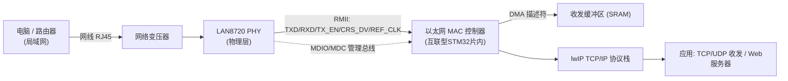
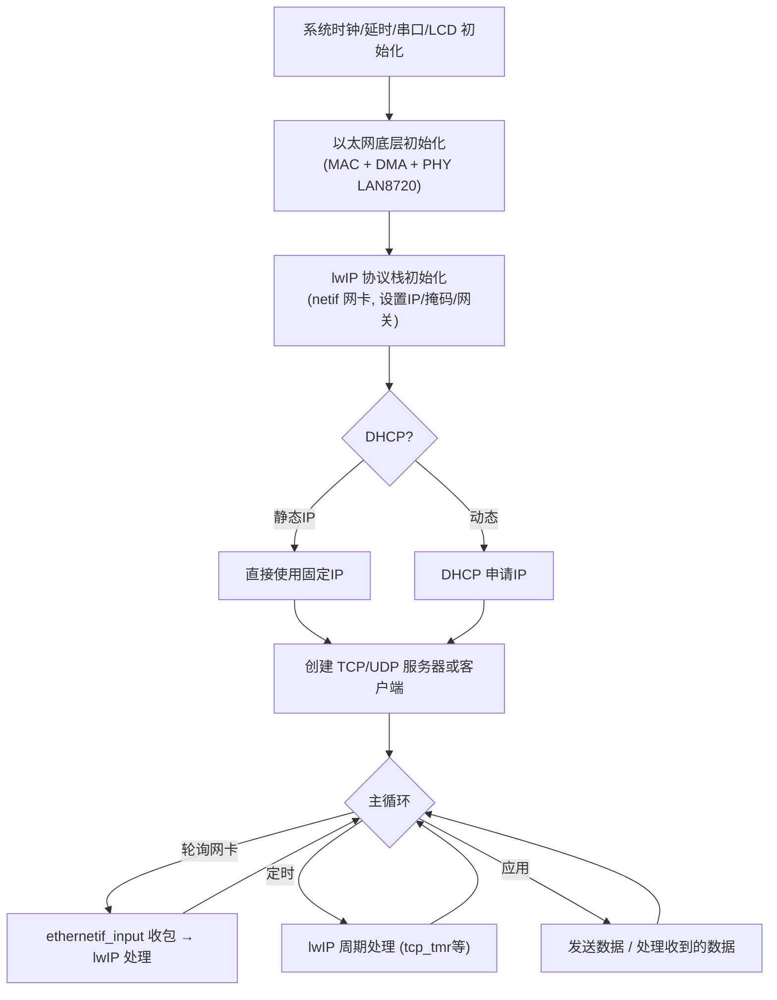

# 实验50 网络通信实验

> 平台：正点原子 STM32F103 开发板 · HAL 库 · Keil MDK
>
> ⚠️ **重要说明（请先阅读）**：本实验目录**不包含随附的工程源码**，其中 `readme.txt` 仅有一句提示——「该例程已放在**扩展例程下的网络例程文件夹**当中」。也就是说，完整的网络通信例程由正点原子单独放在光盘/资料下载包的"扩展例程 → 网络例程"目录中，需要另行获取，本目录下无法直接编译运行。
>
> 因此本 `readme.md` 的第三、四、六节内容属于**通用参考知识**（基于 STM32 以太网方案与 LAN8720 PHY 的公开资料整理），**并非从本目录源码提取**，已在各处明确标注。请配合扩展例程的真实源码对照阅读。

## 一、实验简介

网络通信实验让 STM32 通过以太网接入局域网，实现与电脑之间的 TCP/UDP 数据收发（常见形态是网页服务器、TCP 回显、UDP 通信等）。它通常由两部分组成：底层是**以太网 MAC + PHY 芯片**（如 LAN8720）负责物理层收发，上层是 **lwIP 轻量级 TCP/IP 协议栈**负责把数据封装成网络报文。

关于本开发板（战舰 STM32F103，主芯片为 **STM32F103ZET6，属高密度型**）的特别说明：**STM32F103 系列本身没有集成以太网 MAC 控制器**，只有 STM32 互联型（如 **STM32F105/F107**）以及 F2/F4/F7 系列才内置以太网 MAC。因此在 F103 平台上做网络通信，一般采用以下两种方案之一：

- **方案 A（外挂 SPI 以太网芯片）**：F103 + ENC28J60 / W5500 等 SPI 接口以太网控制器，由芯片自带 MAC/PHY 或 TCP/IP 硬件协议栈。
- **方案 B（换用互联型 MCU）**：STM32F107 + LAN8720 PHY，走 RMII 接口，使用片内以太网 MAC + lwIP。正点原子的"网络例程"多以此类方案为基础。

🏠 **生活类比**：STM32 好比一户人家，以太网 PHY（LAN8720）是门口的"翻译官+收发室"，负责把家里的话（并行数据）翻译成能在网线（局域网）上传输的信号；MAC 控制器是"调度中心"，管理收发队列；lwIP 协议栈则是"邮政系统规则"，负责打包、写地址（IP）、投递与签收（TCP/UDP）。

## 二、实验目的

- 了解嵌入式网络通信的基本组成：**MAC 控制器 + PHY 芯片 + TCP/IP 协议栈（lwIP）**
- 理解 **RMII/MII 接口**与 **LAN8720 PHY** 的作用及与 MCU 的连接方式
- 了解以太网 **DMA 收发描述符**机制（收发数据不占用 CPU 逐字节搬运）
- 掌握 lwIP 移植思路与 TCP/UDP 通信的基本流程（`socket → bind → listen/send`）
- 理解在 STM32F103（无内置 MAC）与互联型/F4（有内置 MAC）上实现网络的差异

## 三、硬件资源与连接图（通用参考，非本目录源码）

> 下表以**方案 B：互联型 STM32 + LAN8720（RMII 接口）**为典型示例列出常见引脚。具体引脚请以你获取到的扩展例程源码为准；若采用 F103 + SPI 以太网芯片，则引脚完全不同（仅用 SPI + 中断/片选）。

| 信号 | 方向 | 说明（RMII 典型） |
|------|------|------|
| REF_CLK (50MHz) | PHY → MCU | RMII 参考时钟 |
| MDIO / MDC | 双向 / MCU→PHY | PHY 管理总线（读写 PHY 寄存器） |
| CRS_DV | PHY → MCU | 载波侦测/数据有效 |
| RXD0 / RXD1 | PHY → MCU | 接收数据（RMII 为 2 位） |
| TX_EN | MCU → PHY | 发送使能 |
| TXD0 / TXD1 | MCU → PHY | 发送数据（RMII 为 2 位） |
| PHY_RST / LED | MCU ↔ PHY | 复位与链路状态指示 |
| RJ45 网络变压器 | — | 连接网线，隔离与阻抗匹配 |



> 说明：**PHY** 处理物理层电信号与自协商（10/100M、全/半双工）；**MAC** 处理帧的封装/解析、CRC 校验，并通过 **DMA** 把收发数据在网卡缓冲区与内存之间自动搬运；MCU 通过 **MDIO/MDC** 读写 PHY 寄存器来配置/查询 PHY 状态。

## 四、核心寄存器（通用参考，非本目录源码）

> 本节寄存器基于**含以太网 MAC 的 STM32（互联型 F105/F107、F4 等）**。再次提醒：**本仓库使用的 STM32F103（高密度）片内没有这些以太网寄存器**，若你的扩展例程是"F103 + SPI 以太网芯片"方案，则应查阅该芯片（如 ENC28J60/W5500）的寄存器手册，而非下表。

以太网外设分为 **MAC 寄存器组**和 **DMA 寄存器组**，本类实验常用：

| 寄存器 | 名称 | 作用 |
|--------|------|------|
| `ETH_MACCR` | MAC 控制寄存器 | 配置速度(10/100M)、全/半双工、使能收发、RMII/MII 选择等 |
| `ETH_MACFFR` | MAC 帧过滤寄存器 | 设置接收过滤规则（完美过滤/混杂模式等） |
| `ETH_MACMIIAR` | MII 地址寄存器 | MDIO 访问 PHY：选择 PHY 地址、寄存器地址、读写、时钟分频 |
| `ETH_MACMIIDR` | MII 数据寄存器 | 存放读写 PHY 寄存器的数据 |
| `ETH_MACA0HR/LR` | MAC 地址0 高/低寄存器 | 设置本机 MAC 物理地址 |
| `ETH_DMABMR` | DMA 总线模式寄存器 | 配置 DMA 突发长度、描述符格式、软件复位(SR)等 |
| `ETH_DMAMR` (DMA MR) | DMA 模式寄存器 | 配置收发 DMA 使能、中断使能、描述符跳过长等 |
| `ETH_DMATDLAR` | 发送描述符列表地址寄存器 | 指向发送 DMA 描述符链首地址 |
| `ETH_DMARDLAR` | 接收描述符列表地址寄存器 | 指向接收 DMA 描述符链首地址 |
| `ETH_DMATPDR` | 发送轮询请求寄存器 | 写它触发 DMA 立即处理待发送描述符 |
| `ETH_DMARPDR` | 接收轮询请求寄存器 | 写它触发 DMA 立即处理接收 |
| `ETH_DMASR` | DMA 状态寄存器 | 收发完成/中断标志、总线状态 |

**LAN8720 PHY 关键寄存器（通过 MDIO 读写）**：

```
BCR (Reg0) : 基本控制   - 软件复位、自协商启动、速度/双工选择
BSR (Reg1) : 基本状态   - 链路是否 UP、自协商是否完成
PHYID1/2   : 芯片 ID    - 用于探测 LAN8720 是否在线
```

**DMA 描述符机制**：以太网收发不是 CPU 逐字节搬运，而是把"数据缓冲区地址 + 长度 + 状态"组织成**描述符链**放在内存里，DMA 按描述符自动收发。`DMATDLAR/DMARDLAR` 就是告诉 DMA 描述符链的起点。

## 五、软件架构 / 流程（通用参考）



> 典型 lwIP 应用采用"无操作系统轮询模式"或"基于 RTOS 的多任务模式"。裸机轮询下，主循环需不停调用网卡收包函数和 lwIP 周期处理函数，网络才能正常响应。

## 六、主要示例代码及讲解

> ⚠️ 本实验目录**未随附源码**，故本节无法给出真实代码片段。下面仅给出**通用伪代码/流程示意**，帮助理解结构；请以扩展例程的真实源文件为准，切勿直接照抄编译。

### 1. 底层初始化流程（示意）

```c
/* 以下为通用流程示意，非本目录真实源码 */
ETH_BSP_Init();          /* 配置 RMII 引脚、MAC 时钟、复位 PHY */
LAN8720_Init();          /* 通过 MDIO 复位并自协商 LAN8720，读取链路状态 */
lwip_init();             /* 初始化 lwIP 协议栈 */
netif_add(&gnetif, &ipaddr, &netmask, &gw, NULL, &ethernetif_init, &tcpip_input);
netif_set_default(&gnetif);
netif_set_up(&gnetif);   /* 使能网卡 */
```

**讲解（通用）**：网络程序通常"自底向上"初始化——先把物理层（引脚、PHY）跑通并能读到"链路 UP"，再初始化协议栈并给网卡配上 IP，最后创建应用连接。任何一层没通，上层都无法工作，调试时应逐层排查（PHY 链路 → ping 通 IP → 端口连接）。

### 2. 主循环轮询（示意）

```c
while (1)
{
    ethernetif_input(&gnetif);   /* 收取网卡数据交给lwIP */
    lwip_periodic_handle();      /* 处理lwIP周期性任务 */
    tcp_server_poll();           /* 应用层: 收发业务数据 */
}
```

**讲解（通用）**：裸机 lwIP 靠主循环不断"喂"数据与"跑"定时任务。若长时间不调用 `ethernetif_input`，网络会"卡住"无响应；这也解释了为何网络程序对主循环阻塞（如长延时）比较敏感。

## 七、实验效果

以正点原子典型网络例程为例，正确获取扩展例程源码、按对应硬件（互联型 MCU + LAN8720，或 F103 + SPI 以太网模块）连接网线并烧录后，一般可实现：

- 开发板通过网线接入局域网，LCD 或串口打印出分配到的 **IP 地址**。
- 电脑用网络调试助手或浏览器访问该 IP，可与开发板进行 **TCP/UDP 数据收发**（如回显、点亮 LED、简易 Web 页面等，具体取决于例程）。
- 链路正常时 PHY 的 **LINK 指示灯**常亮。

> 若你手头是 STM32F103（本仓库平台），请注意：**片内无以太网 MAC**，需确认扩展例程使用的是哪种硬件方案，再准备相应模块，否则无法直接运行。

## 八、注意事项

- **本目录不含源码**：完整例程在正点原子资料的「扩展例程 → 网络例程」文件夹中，需单独下载；本 `readme.md` 第三/四/六节为通用参考，非源码提取内容。
- **平台匹配**：STM32F103（高密度）**没有内置以太网 MAC**。请先确认例程针对的是"互联型 STM32 + LAN8720（RMII）"还是"F103 + SPI 以太网芯片（ENC28J60/W5500）"，两者硬件与驱动完全不同。
- **PHY 时钟**：RMII 需要 50MHz 参考时钟（由 LAN8720 提供或有源晶振），时钟不对会导致无法通信。
- **网线与 IP**：确保网线接好、PHY 链路 UP；静态 IP 要与电脑处于同一网段，或正确使用 DHCP。
- **调试顺序**：先确认能 ping 通 IP，再测试端口/应用；用网络调试助手而非仅靠串口打印定位问题。
- 本文件中的寄存器名（`ETH_DMAMR/ETH_DMABMR` 等）仅适用于**含以太网 MAC 的 STM32**，请勿在 F103 高密度器件上查找这些寄存器。

## 九、文件结构

```
实验50 网络通信实验/
└── readme.txt        仅一句提示:「该例程已放在扩展例程下的网络例程文件夹当中」

（说明：本目录无 User/、Drivers/、Middlewares/、Projects/ 等工程文件，
  完整的网络通信例程需从正点原子资料的“扩展例程 → 网络例程”目录获取。
  典型扩展例程的目录结构一般为：）

网络例程(扩展)/
├── User/
│   ├── main.c                    主程序
│   └── app/                      应用层(TCP/UDP 服务器、Web 等)
├── Middlewares/
│   └── lwip/                     lwIP TCP/IP 协议栈
├── Drivers/
│   ├── BSP/(LAN8720 或 SPI以太网)  PHY/以太网芯片驱动
│   ├── SYSTEM/(delay/sys/usart)  系统支持
│   └── STM32Fxxx_HAL_Driver/     ST HAL 库(含 ETH 驱动, 仅互联型/F4)
└── Projects/MDK-ARM/             Keil 工程文件(.uvprojx)
```
