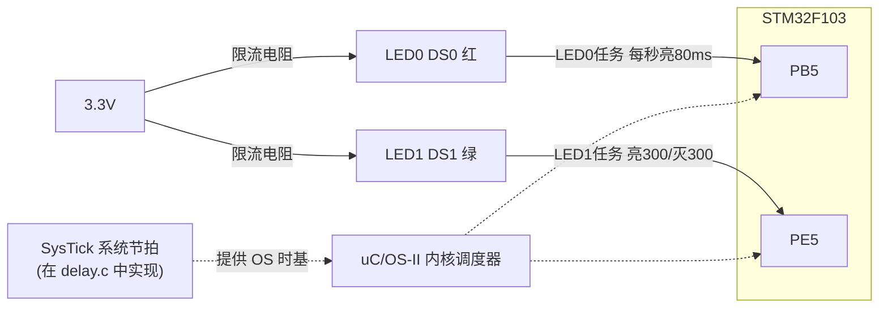
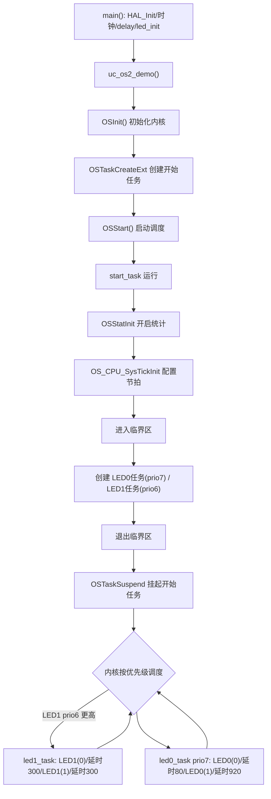

# 实验51 UCOSII实验1-任务调度

> 平台：正点原子 战舰 STM32F103 开发板 · HAL 库 · Keil MDK · uC/OS-II V2.93.01

## 一、实验简介

本实验是 uC/OS-II 实时操作系统（RTOS）的入门例程，演示**多任务调度**：在系统里创建 3 个任务（开始任务、LED0 任务、LED1 任务），它们"看似同时"独立运行——LED0 每秒亮 80ms，LED1 亮 300ms 灭 300ms 循环。开始任务负责创建其余任务，创建完后把自己挂起。通过它你能直观理解 RTOS 如何按优先级在多个任务间快速切换。

🏠 **生活类比**：裸机程序像一个人一次只能做一件事（做完 A 才能做 B）；RTOS 则像一位"总调度管家"，把 CPU 时间切成小片分给多个任务。因为切换极快（毫秒级），看起来两盏灯在各自按不同节奏闪烁、互不干扰，就像多个人在同时干活。

## 二、实验目的

- 初步认识 uC/OS-II 实时操作系统及其"任务"概念
- 掌握 `OSInit()` / `OSStart()` 启动内核的基本流程
- 学会用 `OSTaskCreateExt()` 创建任务，理解任务优先级、堆栈、任务选项
- 理解 `OSTimeDly()` 让出 CPU 实现任务切换、`OSTaskSuspend()` 挂起任务
- 掌握临界区 `OS_ENTER_CRITICAL()` / `OS_EXIT_CRITICAL()` 与统计任务 `OSStatInit()`

## 三、硬件资源与连接图

| 外设 | 引脚 | 说明 |
|------|------|------|
| LED0 (DS0, 红) | **PB5** | 低电平点亮，由 LED0 任务控制 |
| LED1 (DS1, 绿) | **PE5** | 低电平点亮，由 LED1 任务控制 |
| 独立按键 KEY0 | **PE4** | （本例程未使用，硬件在位） |
| 独立按键 KEY1 | **PE3** | （本例程未使用，硬件在位） |
| 独立按键 KEY2 | **PE2** | （本例程未使用，硬件在位） |
| 独立按键 KEY_UP (WK_UP) | **PA0** | （本例程未使用，硬件在位） |



> 说明：本实验的核心不是硬件，而是软件调度。uC/OS-II 依赖 **SysTick 中断**提供系统节拍（`OS_TICKS_PER_SEC`），该中断已在 `Drivers/SYSTEM/delay/delay.c` 中实现，**不要在别处重复实现**，否则会冲突。

## 四、内核对象与 API（本节为 RTOS 内核概念，不涉及硬件寄存器）

uC/OS-II 是运行在 STM32 上的软件操作系统，本实验主要涉及**任务**这一内核对象及其相关 API：

| API / 概念 | 作用 |
|-----------|------|
| `OSInit()` | 初始化 uC/OS-II 内核，建立空闲任务、统计任务等，必须在创建任务前调用 |
| `OSStart()` | 启动内核多任务调度，从此不再返回，运行优先级最高的就绪任务 |
| `OSTaskCreateExt()` | 创建任务（扩展版），指定任务函数、参数、堆栈、优先级、任务 ID、选项 |
| `OSTimeDly(ticks)` | 让当前任务延时若干节拍并**主动让出 CPU**，是任务切换的关键 |
| `OSTaskSuspend(prio)` | 挂起指定任务（本例挂起开始任务自身，避免它空占 CPU） |
| `OSStatInit()` | 开启统计任务，用于计算 CPU 使用率（`OSCPUUsage`） |
| `OS_CPU_SysTickInit(cnts)` | 按节拍频率配置 SysTick，提供系统时基 |
| `OS_ENTER_CRITICAL()` / `OS_EXIT_CRITICAL()` | 进入/退出临界区（关/开中断），保护创建任务等关键操作 |
| 任务优先级 (PRIO) | 数值越小优先级越高，每个任务优先级必须唯一 |
| 任务堆栈 (`OS_STK[]`) | 每个任务独立的栈空间，用于保存现场和局部变量 |

`OSTaskCreateExt()` 的任务选项（本例统一使用）：

```
OS_TASK_OPT_STK_CHK  : 使能任务堆栈检查
OS_TASK_OPT_STK_CLR  : 创建时清空堆栈
OS_TASK_OPT_SAVE_FP  : 保存浮点寄存器(为保险,所有任务都保存)
```

## 五、软件架构 / 流程



任务优先级：LED1(6) > LED0(7) > START(10)。开始任务创建完 LED0/LED1 后挂起，之后 LED0、LED1 两任务各自靠 `OSTimeDly()` 主动让出 CPU，内核在延时期满时唤醒它们，从而实现两灯按不同节奏"并行"闪烁。

## 六、主要示例代码及讲解

### 1. uC/OS-II 入口与开始任务创建（`User/uc-os2_demo.c`）

```c
void uc_os2_demo(void)
{
    OSInit();                                    /* UCOS初始化 */
    OSTaskCreateExt((void(*)(void *))start_task, /* 任务函数 */
                    (void *)0,                   /* 传给任务的参数 */
                    (OS_STK *)&START_TASK_STK[START_STK_SIZE - 1], /* 堆栈栈顶 */
                    (INT8U )START_TASK_PRIO,     /* 任务优先级 */
                    (INT16U)START_TASK_PRIO,     /* 任务ID */
                    (OS_STK *)&START_TASK_STK[0],/* 堆栈栈底 */
                    (INT32U)START_STK_SIZE,      /* 堆栈大小 */
                    (void *)0,                   /* 用户补充存储区 */
                    (INT16U)OS_TASK_OPT_STK_CHK | OS_TASK_OPT_STK_CLR | OS_TASK_OPT_SAVE_FP);
    OSStart();                                   /* 开始多任务调度,不返回 */

    for (;;) { /* 不会进入这里 */ }
}
```

**讲解**：
- `OSInit()` 必须先调用，它把内核数据结构准备好。
- `OSTaskCreateExt()` 参数较多，注意**堆栈是"从高地址向低地址生长"**：栈顶传数组末尾 `&STK[SIZE-1]`，栈底传数组开头 `&STK[0]`。
- `OSStart()` 启动调度后不再返回，CPU 交给优先级最高的就绪任务（此时即开始任务）。后面的 `for(;;)` 永远进不去。

### 2. 开始任务：配置节拍并创建业务任务（`uc-os2_demo.c`）

```c
void start_task(void *pdata)
{
    OS_CPU_SR cpu_sr = 0;
    CPU_INT32U cnts;

    OSStatInit();                                          /* 开启统计任务 */
    cnts = (CPU_INT32U)(HAL_RCC_GetSysClockFreq() / OS_TICKS_PER_SEC);
    OS_CPU_SysTickInit(cnts);                              /* 配置SysTick节拍 */

    OS_ENTER_CRITICAL();                                   /* 进临界区(关中断) */
    OSTaskCreateExt((void(*)(void *))led0_task, ... , LED0_TASK_PRIO, ...); /* 建LED0任务 */
    OSTaskCreateExt((void(*)(void *))led1_task, ... , LED1_TASK_PRIO, ...); /* 建LED1任务 */
    OS_EXIT_CRITICAL();                                    /* 出临界区(开中断) */

    OSTaskSuspend(START_TASK_PRIO);                        /* 挂起开始任务自己 */
}
```

**讲解**：
- `OSStatInit()` 与 `OS_CPU_SysTickInit()` 必须放在**开始任务里、其他任务创建之前**，因为它们需要系统时钟已就绪。`cnts` 由主频除以每秒节拍数算出 SysTick 重装值。
- 创建任务的过程用 `OS_ENTER_CRITICAL()/OS_EXIT_CRITICAL()` 包起来，防止创建过程中被中断打断导致内核数据结构损坏。
- 最后 `OSTaskSuspend(START_TASK_PRIO)` 挂起自己——开始任务的使命已完成，没必要继续占用 CPU。

### 3. 两个 LED 任务体（`uc-os2_demo.c`）

```c
void led0_task(void *pdata)
{
    while (1)
    {
        LED0(0);        /* 亮 */
        OSTimeDly(80);  /* 延时80个节拍,期间让出CPU */
        LED0(1);        /* 灭 */
        OSTimeDly(920); /* 延时920个节拍 → 合计约1秒 */
    }
}

void led1_task(void *pdata)
{
    while (1)
    {
        LED1(0);        /* 亮 */
        OSTimeDly(300);
        LED1(1);        /* 灭 */
        OSTimeDly(300); /* 亮300灭300循环 */
    }
}
```

**讲解**：每个任务都是一个"永不返回"的 `while(1)`。关键在于 `OSTimeDly()`——它不是死等（不像裸机 `delay_ms` 空转 CPU），而是把任务置为延时态并**主动让出 CPU**，让别的任务运行；延时期满后内核再把它唤醒。正因如此，两个 LED 任务才能各按自己的节奏独立闪烁。

## 七、实验效果

烧录运行后，uC/OS-II 内核启动并调度两个 LED 任务：
- **LED0（红，PB5）**：每约 1 秒亮一次，每次亮 80ms（快速一闪）。
- **LED1（绿，PE5）**：亮 300ms、灭 300ms 交替循环。
- 两灯节奏不同、互不干扰，直观体现 RTOS 的多任务并行调度。

## 八、注意事项

- 本实验使用的 uC/OS-II 版本为 **V2.93.01**。
- uC/OS-II 使用的 **SysTick 中断在 `delay.c` 中已实现，切勿重复实现**，否则节拍冲突导致调度异常。
- 每个任务的**优先级必须唯一**，且**堆栈大小要足够**（本例 128 个 `OS_STK`），太小会溢出。
- 任务函数**绝不能返回**（必须是 `while(1)` 或最后 `OSTaskDel(NULL)` 删除自己），否则内核行为未定义。
- `OSStart()` 之后代码不再顺序执行，初始化外设应在 `OSStart()` 之前或开始任务内完成。
- 修改代码后需重新编译烧录；若烧录失败先运行根目录 `keilkill.bat`。

## 九、文件结构

```
实验51 UCOSII实验1-任务调度/
├── User/
│   ├── main.c                       主程序(HAL/时钟/LED初始化 → uc_os2_demo)
│   ├── uc-os2_demo.c                uC/OS-II 例程(任务创建与任务体)【核心】
│   ├── uc-os2_demo.h                例程头文件
│   ├── stm32f1xx_it.c               中断服务函数
│   └── stm32f1xx_hal_conf.h         HAL 配置
├── Middlewares/
│   ├── MALLOC/                      内存管理
│   └── uC-OS2/                      uC/OS-II 内核源码(os_core/os_task/... + 移植层)
├── Drivers/
│   ├── BSP/LED/ KEY/ LCD/ SRAM/     板级驱动(本实验主要用 LED)
│   ├── SYSTEM/(delay/sys/usart)     系统支持(SysTick 节拍在 delay.c)
│   ├── CMSIS/                       内核启动与设备定义
│   └── STM32F1xx_HAL_Driver/        ST HAL 库
└── Projects/MDK-ARM/                Keil 工程文件(.uvprojx)
```
