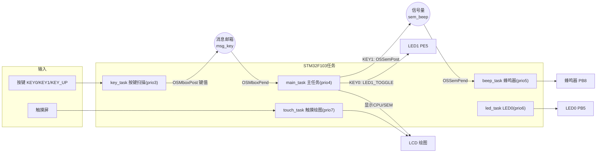
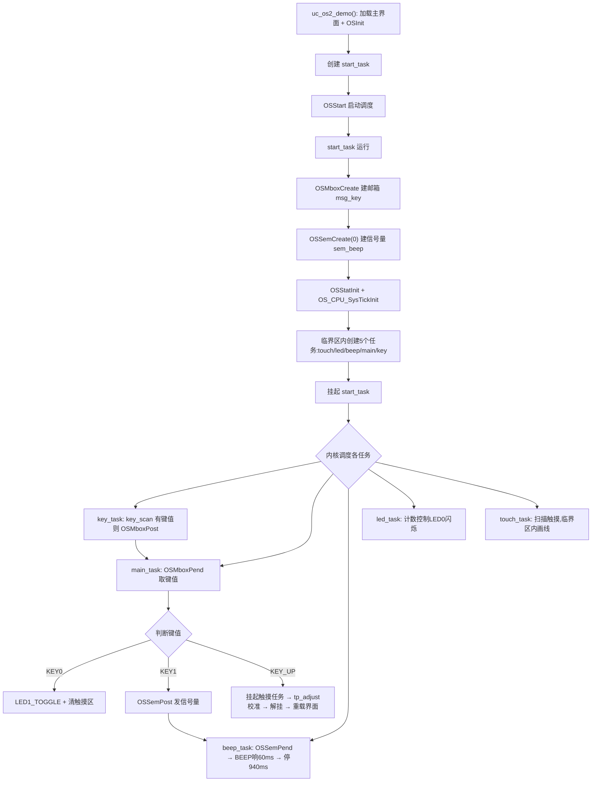

# 实验52 UCOSII实验2-信号量和邮箱

> 平台：正点原子 战舰 STM32F103 开发板 · HAL 库 · Keil MDK · uC/OS-II V2.93.01

## 一、实验简介

本实验在实验 51（任务调度）的基础上，进一步学习 uC/OS-II 的两种**任务间通信/同步对象**——**信号量（Semaphore）**和**消息邮箱（Mailbox）**。系统里创建 6 个任务：开始任务、LED 任务、触摸屏任务、蜂鸣器任务、按键扫描任务和主任务。按键扫描任务把键值通过**邮箱**发给主任务；主任务按 KEY1 时通过**信号量**通知蜂鸣器任务发声。由此理解 RTOS 中任务如何"传递数据"和"互相通知"。

🏠 **生活类比**：
- **消息邮箱**像家门口的信箱——一个人（按键任务）把信（键值）投进去，另一个人（主任务）来取，实现"数据传递"。
- **信号量**像餐厅的取餐号/令牌——每发放一个令牌，蜂鸣器任务就被允许叫一次号（响一声）；令牌发几个就响几次，实现"事件计数与同步"。

## 二、实验目的

- 掌握**消息邮箱**的创建与使用：`OSMboxCreate()` / `OSMboxPost()` / `OSMboxPend()`
- 掌握**信号量**的创建与使用：`OSSemCreate()` / `OSSemPost()` / `OSSemPend()`
- 理解"生产者—消费者"模型：按键任务生产键值，主任务消费并分发
- 学会在多任务中协调 LED、蜂鸣器、触摸屏、按键、LCD 等资源
- 理解临界区保护共享资源（如 LCD 绘图）与 CPU 使用率统计

## 三、硬件资源与连接图

| 外设 | 引脚 | 说明 |
|------|------|------|
| LED0 (DS0, 红) | **PB5** | 低电平点亮，LED 任务控制，提示程序运行 |
| LED1 (DS1, 绿) | **PE5** | 低电平点亮，按 KEY0 时翻转 |
| 蜂鸣器 BEEP | **PB8** | `BEEP(1)` 响、`BEEP(0)` 停，由蜂鸣器任务控制 |
| 按键 KEY0 | **PE4** | 控制 DS1 亮灭 + 清除触摸区 |
| 按键 KEY1 | **PE3** | 发送信号量 → 触发蜂鸣器 |
| 按键 KEY2 | **PE2** | （硬件在位） |
| 按键 KEY_UP (WK_UP) | **PA0** | 触摸屏校准（电阻屏） |
| TFTLCD + 触摸屏 | 16 位 8080 并口 | 绘图、显示 CPU 使用率/信号量值 |



> 说明：数据流是"按键扫描任务 →（邮箱）→ 主任务 →（信号量）→ 蜂鸣器任务"。主任务是"指挥中心"，根据键值分派动作；信号量做"计数令牌"，KEY1 按几次就累积几个令牌，蜂鸣器就每隔约 1 秒响一次、响满对应次数。

## 四、内核对象与 API（本节为 RTOS 内核概念，不涉及硬件寄存器）

本实验在任务对象之外，新增**信号量**和**消息邮箱**两种内核通信对象：

| API / 概念 | 作用 |
|-----------|------|
| `OSSemCreate(cnt)` | 创建信号量，`cnt` 为初始计数（本例为 0） |
| `OSSemPost(sem)` | 释放（V 操作）信号量，计数 +1，唤醒一个等待任务 |
| `OSSemPend(sem, timeout, &err)` | 请求（P 操作）信号量，计数 >0 则 -1 并继续，否则阻塞等待 |
| `OSMboxCreate(msg)` | 创建消息邮箱，初值一般为 `0`（空） |
| `OSMboxPost(mbox, msg)` | 向邮箱发送一条消息（一个指针） |
| `OSMboxPend(mbox, timeout, &err)` | 从邮箱取消息，邮箱空则阻塞等待 |
| `OS_EVENT *` | 信号量/邮箱/队列在 uC/OS-II 中统一用事件块指针表示 |
| `OSEventCnt` | 事件块内的计数值（本例读 `sem_beep->OSEventCnt` 显示信号量当前值） |
| `OS_ENTER_CRITICAL/OS_EXIT_CRITICAL` | 临界区，保护 LCD 绘图等共享操作不被打断 |

**信号量 vs 邮箱的区别**：

```
信号量(Semaphore): 传递的是"计数/事件",不含数据 → 用于同步、资源计数
消息邮箱(Mailbox)  : 传递的是"一个指针(消息)" → 用于任务间传数据
```

## 五、软件架构 / 流程



任务优先级：key(3) > main(4) > beep(5) > led(6) > touch(7) > start(10)。按键扫描优先级最高，保证按键及时被采集并发进邮箱。

## 六、主要示例代码及讲解

### 1. 创建通信对象（`User/uc-os2_demo.c`，start_task 内）

```c
OS_EVENT *msg_key;    /* 按键邮箱事件块指针 */
OS_EVENT *sem_beep;   /* 蜂鸣器信号量指针 */

void start_task(void *pdata)
{
    ...
    msg_key  = OSMboxCreate((void *)0);  /* 创建消息邮箱(初始为空) */
    sem_beep = OSSemCreate(0);           /* 创建信号量(初始计数0) */

    OSStatInit();                        /* 开启统计任务 */
    cnts = (CPU_INT32U)(HAL_RCC_GetSysClockFreq() / OS_TICKS_PER_SEC);
    OS_CPU_SysTickInit(cnts);            /* 配置SysTick节拍 */

    OS_ENTER_CRITICAL();
    /* ...创建 touch/led/beep/main/key 五个任务... */
    OS_EXIT_CRITICAL();
    OSTaskSuspend(START_TASK_PRIO);      /* 挂起开始任务 */
}
```

**讲解**：信号量和邮箱都必须在内核运行前（开始任务里、创建其他任务之前）创建好，因为要用它们的任务一被创建就可能立即去请求。邮箱初值传 `0` 表示"空"；信号量初值传 `0` 表示"暂无令牌"，请求它的任务会阻塞。

### 2. 邮箱：按键任务发送、主任务接收（`uc-os2_demo.c`）

```c
/* 按键扫描任务(生产者) */
void key_task(void *pdata)
{
    uint32_t key;
    while (1)
    {
        key = key_scan(0);
        if (key)
        {
            OSMboxPost(msg_key, (void *)key);   /* 把键值作为消息发进邮箱 */
        }
        OSTimeDly(10);
    }
}

/* 主任务(消费者) */
void main_task(void *pdata)
{
    uint32_t key = 0;
    uint8_t err;
    while (1)
    {
        key = (uint32_t)OSMboxPend(msg_key, 10, &err);  /* 取消息,最多等10节拍 */
        switch (key)
        {
            case KEY0_PRES:  LED1_TOGGLE();                       /* 翻转DS1 */
                             lcd_fill(0, 121, lcddev.width-1, lcddev.height-1, WHITE); /* 清触摸区 */
                             break;
            case KEY1_PRES:  OSSemPost(sem_beep);                 /* 发一个信号量 */
                             break;
            case WKUP_PRES:  OSTaskSuspend(TOUCH_TASK_PRIO);      /* 挂起触摸任务 */
                             if ((tp_dev.touchtype & 0X80) == 0) tp_adjust(); /* 电阻屏校准 */
                             OSTaskResume(TOUCH_TASK_PRIO);       /* 解挂 */
                             ucos_load_main_ui();                 /* 重载界面 */
                             break;
        }
        ...
        OSTimeDly(10);
    }
}
```

**讲解**：
- `OSMboxPost` 把键值（转成 `void*`）投进邮箱；`OSMboxPend` 取出它。这就是典型的"生产者—消费者"：一个任务采集数据，另一个任务处理数据，二者解耦。
- `OSMboxPend(msg_key, 10, &err)` 的第二个参数 `10` 是超时节拍数——最多等 10 个节拍，没消息也返回（避免主任务被永久阻塞，好让它继续刷新 CPU/信号量显示）。
- 主任务收到 KEY1 时并不直接驱动蜂鸣器，而是 `OSSemPost` 发一个信号量，把"该响了"这件事交给蜂鸣器任务。

### 3. 信号量：蜂鸣器任务请求（`uc-os2_demo.c`）

```c
void beep_task(void *pdata)
{
    uint8_t err;
    while (1)
    {
        OSSemPend(sem_beep, 0, &err);  /* 请求信号量,无令牌则一直阻塞等待 */
        BEEP(1);                       /* 得到令牌 → 打开蜂鸣器 */
        OSTimeDly(60);
        BEEP(0);                       /* 关闭蜂鸣器 */
        OSTimeDly(940);                /* 约1秒一次 */
    }
}
```

**讲解**：`OSSemPend(sem_beep, 0, &err)` 的超时参数为 `0` 表示"无限等待"。信号量计数为 0 时任务阻塞在这里、不占 CPU；每被 `OSSemPost` 一次，计数 +1，任务就被唤醒执行一轮"响 60ms、停 940ms"。因此连按多次 KEY1 后，会看到蜂鸣器每隔约 1 秒响一次，把累积的令牌一个个消耗掉——这正是信号量做"事件计数"的效果。

## 七、实验效果

- **LED0（红）**由 led_task 控制闪烁，提示程序运行；LCD 主界面显示操作说明、CPU 使用率（`CPU: xx%`）和信号量值（`SEM:xxx`）。
- 按 **KEY0**：LED1（绿）翻转亮灭，同时清除触摸屏绘图区。
- 按 **KEY1**：发送信号量，蜂鸣器响一声；连续按多次，蜂鸣器会每隔约 1 秒响一次（消耗累积的信号量），LCD 上 SEM 值相应变化。
- 按 **KEY_UP**：进入触摸屏校准（仅电阻屏有效；电容屏相当于清屏一次）。
- 在触摸屏区域（界面下半部）可用手指/笔尖画线，用于观察 CPU 使用率上升。

## 八、注意事项

- 本实验使用的 uC/OS-II 版本为 **V2.93.01**；SysTick 中断在 `delay.c` 中，**不要重复实现**。
- 信号量/邮箱等内核对象必须在**使用前创建**（本例统一在开始任务中创建），否则指针为空会导致错误。
- `OSMboxPost` 传递的是一个**指针**（这里把键值强转为指针），接收方需按同样类型还原；邮箱一次只能存一条消息，若前一条未被取走再 Post 会失败。
- 多个任务共享 LCD 时要用 `OS_ENTER_CRITICAL/OS_EXIT_CRITICAL` 保护（见 touch_task 画线），防止液晶操作被打断导致显示乱序。
- `OSSemPend`/`OSMboxPend` 的超时参数：`0` = 永久等待，`>0` = 最多等待该节拍数，需根据任务是否还要做其他事来选择。
- 修改代码后需重新编译烧录；若烧录失败先运行根目录 `keilkill.bat`。

## 九、文件结构

```
实验52 UCOSII实验2-信号量和邮箱/
├── User/
│   ├── main.c                       主程序(HAL/时钟/LED/LCD/KEY/BEEP/触摸/SRAM初始化)
│   ├── uc-os2_demo.c                uC/OS-II 例程(6任务 + 信号量/邮箱)【核心】
│   ├── uc-os2_demo.h                例程头文件
│   ├── stm32f1xx_it.c               中断服务函数
│   └── stm32f1xx_hal_conf.h         HAL 配置
├── Middlewares/
│   ├── MALLOC/                      内存管理
│   └── uC-OS2/                      uC/OS-II 内核源码 + 移植层
├── Drivers/
│   ├── BSP/
│   │   ├── LED/  KEY/  BEEP/        LED、按键、蜂鸣器驱动
│   │   ├── LCD/  TOUCH/  IIC/       液晶、触摸屏、IIC
│   │   └── 24CXX/  SRAM/            EEPROM、外部SRAM
│   ├── SYSTEM/(delay/sys/usart)     系统支持(SysTick 节拍在 delay.c)
│   ├── CMSIS/                       内核启动与设备定义
│   └── STM32F1xx_HAL_Driver/        ST HAL 库
└── Projects/MDK-ARM/                Keil 工程文件(.uvprojx)
```
